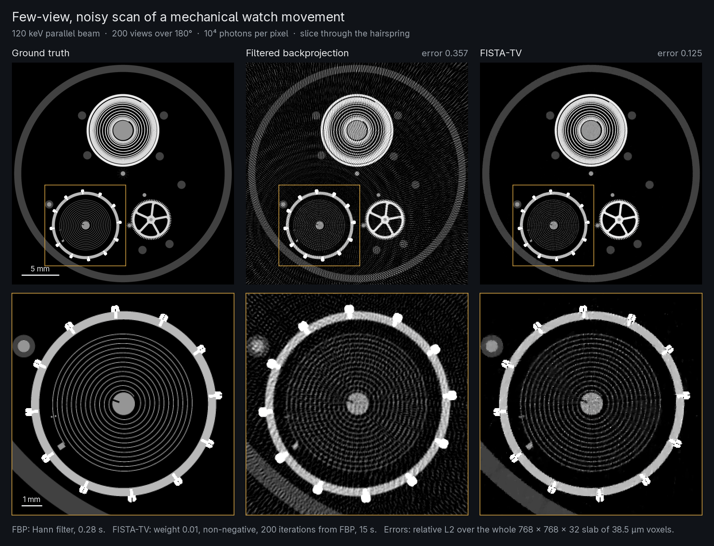
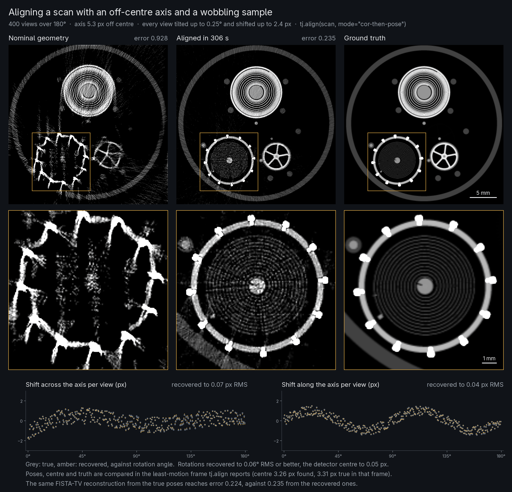

# TomoJAX

Reconstruct parallel-beam tomography, laminography and lab cone-beam CT with JAX. TomoJAX
provides differentiable projectors, fast FBP and iterative reconstruction,
joint volume-and-pose alignment, and a CLI for taking NXtomo, APS Data
Exchange, Nikon `.xtekct` or TIFF data through correction, reconstruction, and
slice export.

TomoJAX is an early research library. Its strongest fit is scientists who need
control over geometry and differentiation in a Python workflow. Synchrotron
geometries use parallel rays; lab scans use a point source and flat detector
(`ConeGeometry`), reconstructed with FDK or the iterative solvers. Alignment
needs scan-specific validation. See the
[support matrix](docs/support-matrix.md) and [known limitations](docs/known-limitations.md)
before choosing it for an experiment.



64³ voxels, 90 parallel views, 40 CGLS iterations. This example uses the same
Joseph model for simulation and reconstruction; it demonstrates the API, not
independent reconstruction accuracy. [Reproduce the figure](examples/README.md#reproduce-the-readme-figure).



`tomojax align` and `tomojax.alignment` solve the volume and each view's pose
together. Here a 96³ laminography scan with ±1° and ±2 px of random per-view
motion goes from 0.68 to 0.047 relative error, with rotations recovered to
0.0022°, in 18 s on a laptop GPU including compilation. The measurements are
analytic integrals of continuous objects. [Reproduce it](examples/README.md#align-a-scan-with-per-view-motion).

## First reconstruction

You need Git and [uv](https://docs.astral.sh/uv/getting-started/installation/).
The package currently requires **Python 3.12**; uv can install it. These commands
install this checkout with CPU dependencies, generate a small scan, and write
three central slices. No scan data or GPU is required.

```bash
git clone https://github.com/tristanmanchester/tomojax.git
cd tomojax
uv sync --locked --extra cpu --no-dev

uv run --no-sync tomojax simulate -o synthetic.nxs --size 32 --views 60
uv run --no-sync tomojax recon synthetic.nxs -o recon.nxs
uv run --no-sync tomojax inspect recon.nxs --preview previews
```

`inspect` describes the file, checks it and ends with `Valid: yes`. Open
`previews/slice_x.png`, `slice_y.png`, and `slice_z.png`, the volume's central
slices (`projection.png` is the central projection). `recon.nxs` contains the
projections, volume, and geometry metadata. The PNGs are display-scaled
previews; use the stored volume for quantitative analysis. This CLI example
uses FBP; the figure above uses the Python CGLS example.

Every command reads an input and writes `-o OUTPUT`, refusing to replace an
existing file without `--force`; `tomojax <command> --help` describes it, and
the [CLI overview](src/tomojax/cli/README.md) lists the commands.

For CUDA installation, wheel installation, and device checks, see
[installation](docs/installation.md). For your own scan, start with
[the quickstart](docs/quickstart.md).

## Choose a workflow

| Task | Start here |
| --- | --- |
| Load and correct an NXtomo, APS Data Exchange, Nikon `.xtekct` or TIFF scan, then reconstruct it | [Quickstart](docs/quickstart.md) |
| Supply measured geometry for parallel or laminography data, including TIFF stacks | [Real scan guide](docs/real-laminography.md) |
| Import, calibrate and reconstruct a lab cone-beam CT scan, including multi-orbit scans | [Lab cone-beam CT](docs/lab-ct.md) |
| Simulate data or use the Python API | [Synthetic workflow](docs/synthetic-tomography.md), [runnable examples](examples/README.md) |
| Correct per-view motion or the centre of rotation | [Alignment guide](docs/alignment-guide.md) (experimental; check the recovered geometry) |
| Reconstruct scans larger than the GPU, or use several GPUs | [Large scans and several GPUs](docs/large-scans.md) |
| Check supported models and limitations | [Support matrix](docs/support-matrix.md), [known limitations](docs/known-limitations.md) |

## Python

In Python, a `Scan` holds projections and their geometry, and every
operation returns a result that carries its geometry:

```python
import tomojax as tj

scan = tj.load("scan.nxs")                        # or a Nikon .xtekct
recon = tj.reconstruct(scan)                      # FBP; FDK for cone beams
recon = tj.reconstruct(scan, "cgls", iterations=50)
result = tj.align(scan, mode="cor-then-pose")     # result.scan carries the corrections
tj.save("recon.nxs", tj.reconstruct(result.scan))
```

The command-line options use the same names: the CGLS line is
`tomojax recon scan.nxs -o recon.nxs --method cgls --iterations 50`, and the
alignment `tomojax align scan.nxs -o aligned.nxs --mode cor-then-pose`.
Expert settings are a configuration of the method's own class from
`tomojax.recon`,
`tj.reconstruct(scan, "fista", config=FistaConfig(regulariser="huber_tv"))`,
or the same fields in a TOML file given to `--config`. A long alignment can
save its progress and resume after an interruption:
`tj.align(scan, checkpoint="align.ckpt")`, or `--checkpoint align.ckpt`.

`tj.Scan(projections, geometry)` builds a scan from arrays, and
`tj.project(geometry, volume)` simulates one for any geometry. Volumes use
`(x, y, z)` and projections `(view, v, u)`; detector and voxel spacings must
use the same physical length unit. The building blocks behind these are in
`tomojax.recon`, `tomojax.alignment`, `tomojax.corrections`,
`tomojax.geometry`, `tomojax.io`, `tomojax.forward` and `tomojax.datasets`.
Start with the [complete example](examples/simulate_and_reconstruct.py) or
browse the [documentation index](docs/README.md).

## Evidence

Measured speed, accuracy and memory against ASTRA and TIGRE, failed cases
included, are in the [measurements](docs/measurements.md).

## Development and license

See [CONTRIBUTING.md](CONTRIBUTING.md) for environment setup, engineering
conventions, tests, and package checks. Changes on this branch are recorded in
the [changelog](CHANGELOG.md).

TomoJAX is licensed under [GPL-3.0-only](LICENSE).
