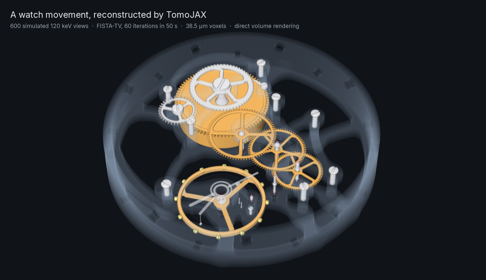
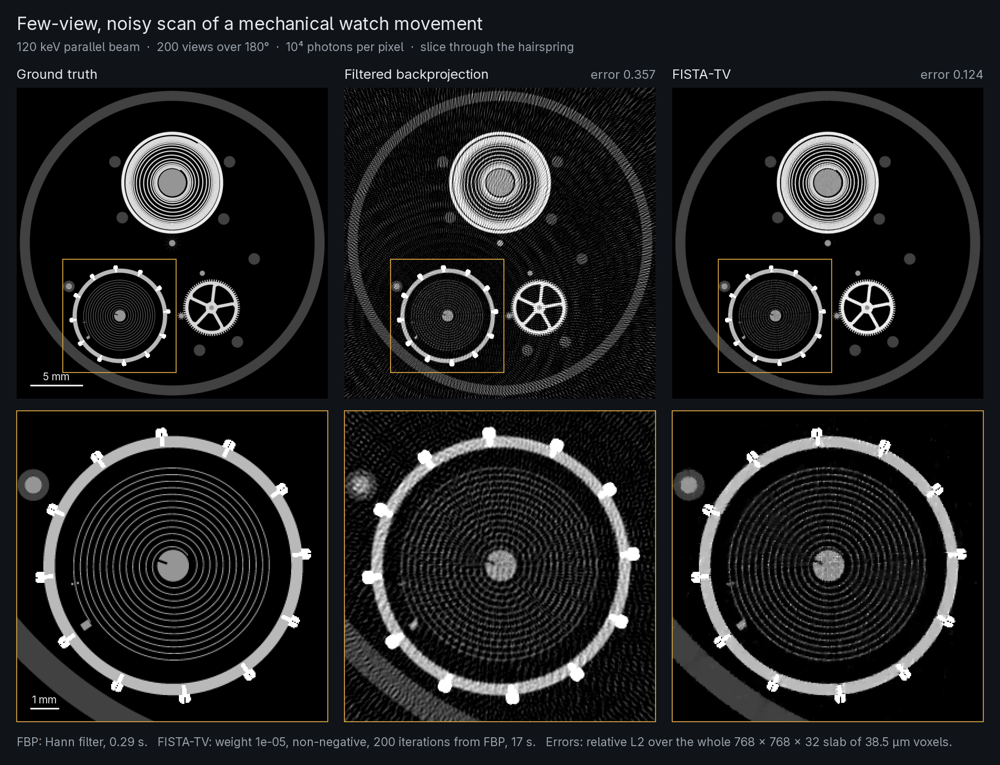
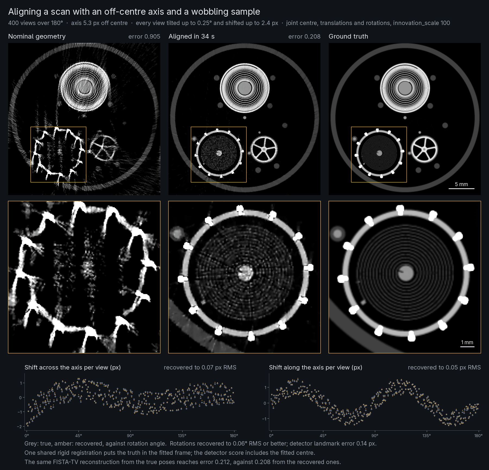

<picture>
  <source media="(prefers-color-scheme: dark)" srcset="https://github.com/tristanmanchester/tomojax/raw/main/assets/brand/tomojax-logo-dark.svg">
  <source media="(prefers-color-scheme: light)" srcset="https://github.com/tristanmanchester/tomojax/raw/main/assets/brand/tomojax-logo.svg">
  
</picture>

TomoJAX reconstructs and aligns parallel-beam tomography, laminography, and lab cone-beam CT in JAX with CUDA kernels. It provides differentiable forward projectors with exact transposes, fast analytical and iterative reconstruction (Fourier, FBP/FDK, CGLS, SIRT/OS-SART, MLEM/OSEM, FISTA-TV, SPDHG-TV), joint volume-and-pose alignment, a CLI, an MCP server for AI agents, and a native desktop workspace for NXtomo and NeXus scan files, APS Data Exchange, Nikon `.xtekct`, Zeiss `.txrm`, ESRF, SkyScan, and TIFF data.

Full documentation is at [tomojax.dev](https://tomojax.dev).



A 29 mm mechanical watch movement simulated with 600 views of a 120 keV parallel beam in gVXR (independent of TomoJAX's projector), reconstructed with FISTA-TV on 38.5 µm voxels in 50 s on a laptop GPU, and rendered directly in JAX. [Reproduce it](https://github.com/tristanmanchester/tomojax/blob/main/examples/README.md#volume-render-a-reconstruction).



From 200 views at 10⁴ photons per pixel, filtered backprojection through the hairspring has relative error 0.357 against the exact voxel average of the meshes; FISTA-TV reaches 0.124 in 17 s. [Reproduce the figure](https://github.com/tristanmanchester/tomojax/blob/main/examples/README.md#reconstruct-a-few-view-noisy-scan).



`tomojax align` and `tj.align` fit geometry errors and per-view motion. On well-sampled axial parallel scans, `fit="center"` measures the rotation axis directly from the projections across the full detector width without reconstructing a volume. By default `tj.align` fits per-view translations jointly with the volume; add `"tilt"` and `"roll"` for shared setup angles, or `"rotations"` for per-view wobble. See [align a scan](https://tomojax.dev/align-a-scan/).

## First reconstruction

On Linux, install [uv](https://docs.astral.sh/uv/getting-started/installation/) and install the CPU wheel into a fresh environment:

```bash
uv venv --python 3.12
uv pip install --python .venv/bin/python "tomojax[cpu]"

.venv/bin/tomojax simulate -o synthetic.nxs --size 32 --n-views 60
.venv/bin/tomojax reconstruct synthetic.nxs -o recon.nxs
.venv/bin/tomojax inspect recon.nxs --preview-dir previews
```

To try unreleased changes from source, [build and install a wheel](https://tomojax.dev/installation/#build-and-install-an-unreleased-wheel) first, then run the same three commands.

For this axial parallel scan, `reconstruct` selects the Fourier-slice inverse automatically and writes the volume, geometry, and processing record to `recon.nxs` (pass `--include-scan` to keep the projections in the same file). `inspect` checks the file (`Valid: yes`) and writes display-scaled central slice PNGs to `previews/`.

Numerical commands that write data take `-o OUTPUT` and refuse to overwrite existing files without `--force` (`inspect` prints a report and optionally writes PNGs to `--preview-dir DIR`; `simulate` takes no input). Run `tomojax <command> --help` for flags, or see the [CLI overview](https://github.com/tristanmanchester/tomojax/blob/main/src/tomojax/cli/README.md). For CUDA 12 installation see [installation](https://tomojax.dev/installation/); for real data start with the [quickstart](https://tomojax.dev/quickstart/).

## Studio

[TomoJAX Studio](https://github.com/tristanmanchester/tomojax/blob/main/studio/README.md) is a native [Rune](https://github.com/anomalyco/rune) desktop workspace for persistent tomography projects. Keep acquisitions, reconstructions, saved recipes, and job records together; queue operations through TomoJAX's numerical engine; and inspect linked orthogonal slices, sinograms, side-by-side comparisons, and 3D GPU volume renderings while jobs run.


Install the prebuilt Linux `x86_64` or `aarch64` wheel alongside TomoJAX (while `1.0.0` is in release candidate, include `--prerelease=allow`, or `--pre` with `pip`):

```bash
uv pip install --prerelease=allow "tomojax[cuda12]" tomojax-studio
tomojax studio
```

Use `cpu` on CPU-only machines, or build from a source checkout with Rust **1.99.1** (`uv run --no-sync tomojax studio --build`; see [install and run](https://github.com/tristanmanchester/tomojax/blob/main/studio/README.md#install-and-run)). Choose **Create a project** and add scans, or **Try a demo project** to simulate a scan and reconstruct it. Reopen a project later with `tomojax studio /path/to/project`.

See the [Studio guide](https://github.com/tristanmanchester/tomojax/blob/main/studio/README.md) for calibration, live previews, measurements, comparison modes, exports, and verification, and [studio/ARCHITECTURE.md](https://github.com/tristanmanchester/tomojax/blob/main/studio/ARCHITECTURE.md) for its persistence and rendering architecture.

## Choose a workflow

| Task | Guide |
| --- | --- |
| Manage persistent projects, queue work and explore 3D results in the native GUI | [TomoJAX Studio](https://github.com/tristanmanchester/tomojax/blob/main/studio/README.md) |
| Load, correct, and reconstruct NXtomo, Data Exchange, Nikon, or TIFF scans | [Quickstart](https://tomojax.dev/quickstart/) |
| Supply measured geometry for parallel or laminography scans, including TIFF stacks | [Real scan guide](https://tomojax.dev/real-laminography/) |
| Import, calibrate, and reconstruct lab cone-beam CT, including multi-orbit scans | [Lab cone-beam CT](https://tomojax.dev/lab-ct/) |
| Simulate data or script the Python API | [Synthetic tomography](https://tomojax.dev/synthetic-tomography/), [examples](https://github.com/tristanmanchester/tomojax/blob/main/examples/README.md) |
| Correct per-view motion, setup angles, or the center of rotation | [Align a scan](https://tomojax.dev/align-a-scan/) |
| Reconstruct volumes larger than GPU memory, use several GPUs, or resume killed cluster jobs | [Large scans and several GPUs](https://tomojax.dev/large-scans/) |
| Let an AI agent such as Claude Code drive TomoJAX through MCP | [Use TomoJAX from an AI agent](https://tomojax.dev/mcp/) |
| Check supported formats, models, and limitations | [Support matrix](https://tomojax.dev/support-matrix/), [known limitations](https://tomojax.dev/known-limitations/) |

## Python API

A `Scan` bundles projections with their geometry, and every operation returns a result carrying its geometry and processing record:

```python
import tomojax as tj

scan = tj.load("scan.nxs")
recon = tj.reconstruct(scan)                                # chooses method from geometry
recon = tj.reconstruct(scan, "cgls", iterations=50)
result = tj.align(scan, fit="translations")  # result.scan holds the updated poses
tj.save("recon.nxs", tj.reconstruct(result.scan))
```

CLI options use the same names: `tomojax reconstruct scan.nxs -o recon.nxs --method cgls --iterations 50` and `tomojax align scan.nxs -o aligned.nxs --fit translations`. Pass method-specific settings via config classes from `tomojax.recon` (such as `FISTAConfig(regularizer="huber_tv")` or `FBPConfig(exterior="zero")`) or a TOML file passed to `--config`. For region-of-interest scans where the object extends past the detector, `fourier`, `fbp`, and cone-beam FDK continue each detector row with a cylinder model by default (`exterior="cylinder"`) and record truncation metrics in `recon.info["truncation"]`; see [truncated scans](https://tomojax.dev/quickstart/#truncated-and-region-of-interest-scans). See [align a scan](https://tomojax.dev/align-a-scan/#settings) for alignment settings.

Build a scan from arrays with `tj.Scan(projections, geometry)` and simulate projections with `tj.project(geometry, volume)`. Volumes use `(z, y, x)` and projections use `(view, v, u)`, with detector and voxel spacings in one consistent length unit. Lower-level interfaces live in `tomojax.recon`, `tomojax.alignment`, `tomojax.corrections`, `tomojax.geometry`, `tomojax.io`, `tomojax.forward`, and `tomojax.datasets`. Start with [examples/simulate_and_reconstruct.py](https://github.com/tristanmanchester/tomojax/blob/main/examples/simulate_and_reconstruct.py) or browse [tomojax.dev](https://tomojax.dev/).

## Benchmarks

| Library | 1 V100S (s) | 4 V100S (s) | 1 Blackwell (s) | 8 Blackwell (s) |
| --- | ---: | ---: | ---: | ---: |
| TomoJAX | 74.51 Fourier | 41.28 Fourier | 27.87 Fourier | 28.99 FBP |
| tomocupy | 109.8 `fourierrec` | 66.35 `fourierrec` | 69.71 `fourierrec` | 45.77 `linerec` |
| ASTRA FBP | 768.6 | 199.6 | 182.0 | 46.21 |
| TIGRE FBP | 558.3 | 172.3 | 180.5 | 48.91 |
| LEAP FBP | 753.3 | 198.2 | 227.7 | 51.28 |
| TomoPy `gridrec` (CPU) | 430.4 | — | 143.9 | — |

Median seconds of three fresh worker launches reconstructing a full Diamond K11 (DIAD) scan (8,000 views of 2,160 × 2,560 pixels into a 56.62 GB volume) from process startup through final output `fsync` on Tesla V100S 32 GB and RTX PRO 6000 Blackwell 96 GB nodes (40 CPU cores; excludes the 96.0 s one-time input rechunking required by the five comparison libraries above). See [measurements](https://tomojax.dev/measurements/#full-volume-speed-on-a-synchrotron-scan) and the [full-volume speed chart](https://github.com/tristanmanchester/tomojax/blob/main/docs/images/speed-comparison.png) for all nine libraries, repeat ranges, and the cases where TomoJAX does not win (a 256-row band on eight Blackwell cards and Fourier scaling beyond one Blackwell card).

Volumes larger than GPU memory stream automatically in slabs: SIRT of a whole Diamond I12 scan (1801 views of 2160 × 2560 pixels into a 56.6 GB volume) ran on an 8 GB laptop GPU using 1.4 GB of VRAM at 1.13× the per-voxel time of an in-core scan ([large scans](https://tomojax.dev/large-scans/)).

## Development and license

See [CONTRIBUTING.md](https://github.com/tristanmanchester/tomojax/blob/main/CONTRIBUTING.md) for development setup, conventions, and test commands, and [CHANGELOG.md](https://github.com/tristanmanchester/tomojax/blob/main/CHANGELOG.md) for release notes.

TomoJAX is licensed under [GPL-3.0-only](https://github.com/tristanmanchester/tomojax/blob/main/LICENSE).
