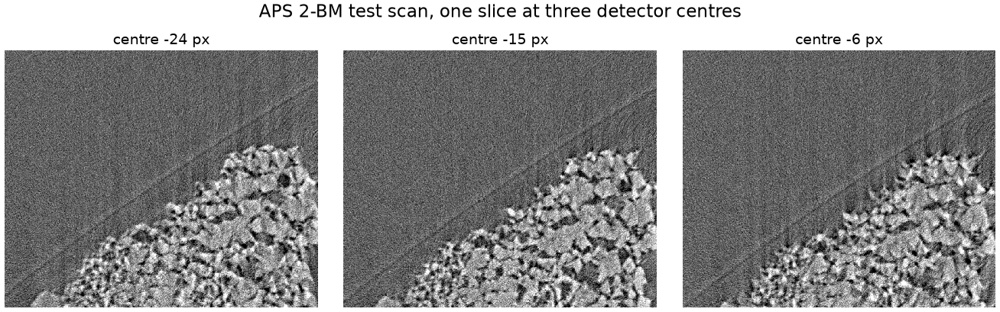
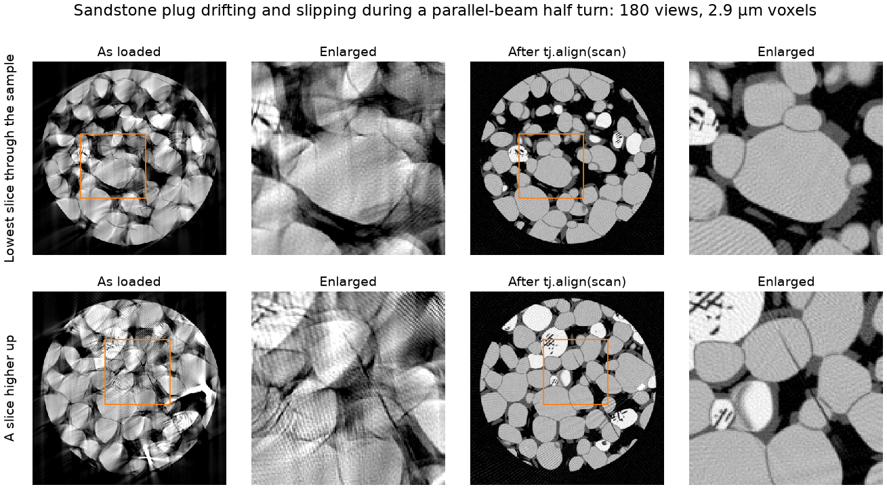

# Align a scan

`tj.align` estimates geometry errors and sample motion. Choose which parameters to fit with `fit=`. Start with the simplest model that matches the artifact you see, check the result, and add parameters only while artifacts remain: unnecessary degrees of freedom cost accuracy, while missing ones leave errors the fit cannot represent.

Before aligning, correct projections to line integrals and check declared geometry against the instrument ([real scan guide](real-laminography.md)). If the scan may contain broken frames or diffraction flashes, pass `RejectViews()` during correction so the aligner does not move views to chase bad frames; check `scan.corrections` afterwards, because `RejectViews` can also drop valid views on modulated or hopping beams. Reconstruct once without alignment to keep a baseline for comparison.

## Choose what to fit

| What you see | Likely error | Fit |
| --- | --- | --- |
| Point-like features drawn as identical rings or arcs in every slice | Rotation center offset | `fit="center"` |
| Doubled or smeared edges that vary across features | Drift or sudden slips between views | `fit="translations"` (default) |
| Sharp central slice, with haloes and doubled edges growing towards top and bottom | Rotation axis or detector rolled about the beam | `fit=("translations", "roll")` |
| In laminography, doubling remaining after translations, worst far from the rotation axis | Laminography tilt error | `fit=("translations", "tilt")` |
| Blur remaining after translations and setup angles | Rotation axis wobbling between views | `fit=("translations", "rotations")` |

```python
import tomojax as tj

scan = tj.load("corrected.nxs")
result = tj.align(scan)                                # translations
result = tj.align(scan, fit="center")                  # rotation center only
result = tj.align(scan, fit=("translations", "roll"))  # translations + axis roll
tj.save("aligned.nxs", result)
recon = tj.reconstruct(result.scan, "cgls")            # result.scan carries the corrections
```

On the command line:

```bash
tomojax align corrected.nxs -o aligned.nxs --fit translations roll
```

Pass one name or a tuple of distinct names in any order; omitted parameters stay fixed at their input values. Multiple parameters are fitted jointly with the volume for parallel, laminography and cone-beam scans. After a vertical shift of `n` pixels, the outermost `n` top and bottom slices on the default grid are only partly covered by data.

| Name | Fitted parameters | Units and frame |
| --- | --- | --- |
| `center` | Detector-u center (plus detector-v for cone data) | Physical length, matching `Detector.center` |
| `tilt` | Shared axis or laminography tilt correction | Degrees; positive leans the rotation axis towards the beam |
| `roll` | Shared detector roll correction | Degrees, right-handed about the detector normal (positive turns u towards v) |
| `translations` | Per-view translations (2 for parallel/lamino; 3 for cone) | Physical lab-frame lengths: across beam and vertical, plus along beam for cone |
| `rotations` | Per-view wobble of the rotation axis (2 components; nominal view angle is kept as recorded) | Degrees, sample-frame rotations about object x and y |

The figures below illustrate each error before and after fitting on simulated scans (a watch movement in laminography and a spark plug in parallel beam, using the default `motion="independent"`). The lower row shows the difference against a true-geometry reconstruction; panel titles list pose error in detector pixels and runtime. See [How the figures were made](#how-the-figures-were-made).

## The rotation center

A wrong rotation center turns every small bright feature into a ring of the same radius across the entire slice.


`fit="center"` estimates the horizontal detector center (`Detector.center[0]`) for parallel and laminography scans, and both detector-u and detector-v for cone data (cone data constrain detector-v weakly because a vertical detector shift is nearly equivalent to shifting the volume vertically). Run it first on a new instrument or after detector or stage changes. On the laminography watch scan above, the joint center fit runs in 23 s.

On an unposed, unrolled axial parallel scan with a well-sampled half-turn, `tj.align(scan, fit="center")` needs no extra options. It measures the rotation axis directly from the projections across the full detector width, including large offsets and narrow detectors, without reconstructing a working volume. Over up to 401 views across the half-turn, it combines Fourier-slice edge sharpness, half-turn Fourier parity (periodic real part and antiperiodic imaginary part after detector reflection), and the sinusoidal motion of the projected center of mass. Detector-edge signal, shared air-reference bias, and changing projection mass downweight that third term when background error or truncation is present. Up to 16 opposing view pairs then refine the center to fractions of a native pixel on their common illuminated detector support, closing an endpoint-exclusive half-turn at the measured view spacing. Both stages account for stationary detector column structure and linear flat-field drift.

The returned `Alignment` holds the updated geometry in `result.scan`, the fitted center in `result.info["calibration"]["center"]` (`value` in geometry length units, `change` in native pixels), `result.info["method"] == "sinogram-focus"`, and `result.info["diagnostics"]` (`focus_px`, `binning`, `views`, and `pairs`). Both `result.image` and `result.grid` are `None`. Pass `method="joint"` when you also want a fitted working volume; supplying `grid=`, `region=`, `config=`, any joint solver keyword, a multi-parameter `fit`, or a geometry outside an unposed, unrolled, well-sampled axial parallel half-turn also runs the joint fit. Axial parallel joint fits initialize from the measured center. For a quick check from opposing view pairs alone (within 2°, with per-pair diagnostics), run `tj.align(scan, method="opposite-views")`, which also leaves `result.image` and `result.grid` as `None`.

On well-sampled parallel scans with rings, streaks, and flat-field drift, the direct fit recovers the center with median error under 1 px across detector widths from 24 to 2,560 columns ([axial center measurements](measurements.md#axial-rotation-center)). Measurement requires transmitted sample signal across the turn: a dark or empty row band has no axis to locate and can return a large arbitrary offset. Strong artifacts, severely spoiled flats, or smooth, nearly stationary structure can still shift the estimate by several pixels. If reconstructed features still look doubled after `fit="center"`:

1. Confirm the cropped row band holds illuminated sample structure across the turn, and apply `RejectViews()` or `Rings()` if broken frames or heavy rings are present.
2. Sweep nearby centers by eye (below) and set the sharpest value with `--detector-center` or `Detector(..., center=...)`.
3. If doubling grows from the middle towards the top and bottom, fit detector roll with `fit=("translations", "roll")`. If doubling varies across features within one slice, fit per-view drift with `fit="translations"` (which also absorbs a constant center offset on parallel scans). Pass `method="joint"` to run the joint image-and-geometry solver for the center alone.

### Check the center by eye

A center sweep reconstructs one slice at each of several detector centers, so you can pick the sharpest:

```bash
tomojax inspect scan.nxs --preview-dir sweep --centers -20:20:2 --slice z=300
```



`--centers` takes `START:STOP:STEP` or a comma list, in detector pixels from the detector middle. `sweep/center_sweep.png` shows every candidate on the same gray scale, with the center the file records outlined. `inspect` lists each candidate with its center in the pixel size's unit, and the command that applies one:

```bash
tomojax correct scan.nxs -o centered.nxs --detector-center U V
```

`--detector-center` sets the first detector's center and moves every other detector of a segmented scan by the same amount. In Python, `tj.interactive.center_sweep(scan, "z", 300, centers)` returns the planes as one array.

## Drift and slips

Sample motion between views doubles or smears features by varying amounts depending on when each view was acquired. `fit="translations"` tracks both gradual drift and sudden slips.

### Independent or smooth motion

`motion=` controls whether neighboring views are coupled:

- `motion="independent"` (default): each view moves freely, tracking smooth drift, sudden slips, and view-to-view stage jitter.
- `motion="smooth"`: translations follow a smooth spline and step between views only when the data justify a slip, and per-view rotations couple to neighbors. The coupling scale is estimated from view-to-view scatter in the scan itself so model error is not absorbed as jitter.

```python
result = tj.align(scan)                   # motion="independent"
result = tj.align(scan, motion="smooth")  # steady stage
```

On the README watch scan (up to 0.8 px jitter per view), `motion="independent"` recovers shifts to 0.07 / 0.05 px RMS across and along the axis, while `motion="smooth"` leaves 0.47 / 0.29 px. On Diamond K11 scan 54013 (a steady stage), slices look the same either way, and `motion="smooth"` reduces the unexplained ruby-sphere track residual from 0.30 / 0.19 px to 0.20 / 0.18 px. Use `motion="smooth"` when you know the stage is steady.


Here `fit="translations"` recovers the drift and five slips to 0.012 px in 36 s. In parallel and laminography scans it also absorbs any constant center offset, so you do not need to fit `"center"` first. When `"center"` and `"translations"` are requested together, translations are constrained to zero mean so the shared gauge is unique.



A 384-voxel simulated sandstone plug drifting by 4.5 voxels over a parallel half turn with a 6-voxel slip a third of the way through, corrected by `tj.align(scan)`:

```bash
uv run python examples/gallery/rock_alignment.py alignment-rock.png
```


On Diamond K11 laminography scan 54013 (1441 views), `tj.align(scan)` on a 6.48 µm working grid turns the doubled sphere and bubble boundaries into sharp single edges when reconstructed by FBP at 2.16 µm:

```bash
uv run python examples/gallery/k11_sphere_alignment.py k11-54013.nxs alignment-k11-sphere.png
```

## The setup angles

### Roll

When the rotation axis or detector is rolled about the beam, each detector row sees a different rotation center. The middle row stays sharp while haloes and doubling grow linearly towards the top and bottom of the volume. Per-view translations move every row together and cannot fix roll.


Slices at four heights show how roll blurs small features away from the midplane:


`fit=("translations", "roll")` recovers the 0.75° roll as 0.756° in 77 s (versus 50 s for translations alone), matching the true-geometry image to 0.3% relative L2 at every height. On parallel-beam instruments, roll is the first setup angle to check: even a fraction of a degree blurs the top and bottom of a tall sample.

### Tilt

When the rotation axis tilts towards or away from the beam, every point rises and falls once per turn in proportion to its depth along the beam. For a compact sample, per-view translations absorb almost all of this motion, leaving only a smaller residual that grows with distance from the sample's center.


Mounted 9 mm off-axis with a large 3° tilt, the vertical section error drops from 49% to 10% under `fit="translations"` alone (even though pose error stays around 5 px because translations cannot express a tilt). In parallel-beam tomography, tilt is only weakly separated from translations, so rely on `fit="translations"` rather than adding `"tilt"`.

In laminography, tilt strongly affects projections and separates cleanly from translations: `fit=("translations", "tilt")` recovers a 2° laminography tilt error on the watch scan to 0.017 px in 84 s (versus 28 s for translations alone). Small laminography tilt errors below ~0.5° leave little visible artifact; doubling becomes clear around 2°.

Both `"tilt"` and `"roll"` are solved jointly with the image and per-view poses in one optimization rather than an outer grid search.

## Sample rotation

When the rotation axis wobbles between views, translations remove most blur but leave a fine residual. Adding `"rotations"` fits the two wobble angles per view while keeping each view's recorded rotation angle about the axis (stage encoders are typically accurate, though if recorded angles do contain errors, `tj.align` does not fit them: 0.07° RMS angle error moves features on the watch phantom by 0.13 px RMS).


Add `"rotations"` only when a residual remains after translations and setup angles. When no wobble is present, extra rotational degrees of freedom degrade accuracy (on the 96 × 96 drift test, 0.080 px versus 0.022 px with translations alone), and on periodic structures such as a TEM grid they can lock onto a false orientation. Their size prior is in radians, independent of voxel size or binning.

## Try alignment on a synthetic scan

```bash
tomojax simulate -o moving.nxs --size 32 --n-views 64 --translation-sigma 0.5
tomojax align moving.nxs -o aligned.nxs
```

`--translation-sigma 0.5` shifts the object independently along the horizontal
and vertical detector axes in each view, with a Gaussian standard deviation
of half a voxel pitch along each axis. The saved scan declares the nominal
geometry. In Python, read the true shifts with
`tj.load_simulation("moving.nxs").true_poses`.

## Check the result

The CLI prints shared corrections (such as `center` in native pixels or angles in degrees), the RMS and maximum absolute per-view corrections, and the reason each joint-fit stage stopped.

1. **Compare reconstructions** against the unaligned baseline and simpler `fit=` choices; keep an extra parameter only when it removes a visible artifact.
2. **Inspect fitted globals and poses.** `result.scan` carries both the updated geometry and per-view poses for reconstruction and saving. `result.info["calibration"]` holds `{"value": ..., "change": ...}` for each fitted global (`change` is in detector pixels for `center` and degrees for angles; segmented cone scans list values in segment order). Each `"value"` passes directly to constructors in another script:

   | Parameter | Parallel or laminography | Cone beam |
   | --- | --- | --- |
   | `center` | `Detector(..., center=(center, v))` | `Detector(..., center=center)` |
   | `roll` | `ParallelGeometry(..., detector_roll=roll)` / `LaminographyGeometry(..., detector_roll=roll)` | `ConeBeam(..., detector_roll=roll)` |
   | `tilt` | `LaminographyGeometry(..., tilt=tilt)` | `ConeGeometry(..., axis_unit=(0, sin(tilt), cos(tilt)))` |

   Per-view poses in `result.poses` have columns `(alpha, beta, phi, x, z, y)` in degrees and physical lengths.
3. **Check physical plausibility.** Multi-degree tilt shifts or per-view rotations larger than a fraction of a degree usually indicate model mismatch rather than real stage motion. Remember that a global rigid motion of the object cannot be observed from projections; remove one common rigid transform before comparing pose tables.
4. **Read `result.info["report"]` (joint fits) or `result.info["diagnostics"]` (direct center fits).** For joint fits, `report` summarizes each level's termination (`pose_steps_below_tolerance` or `step_budget_reached`), smooth and view-to-view correction magnitudes, offset ranges, `advisories` (for example, weakly determined rotations on an axial parallel scan), and flagged views that also trigger warnings:
   - `isolated_views`: single-view jumps away from both neighbors (not permanent slips).
   - `unusual_views`: views with residuals at least 3× their neighbors', such as broken frames or diffraction flashes. Inspect those frames and drop them or rerun with `RejectViews()`.

   For direct axial center fits (`info["method"] == "sinogram-focus"`), `info["diagnostics"]` records `focus_px`, `binning`, `views`, and `pairs`; for `method="opposite-views"`, it holds the per-pair offsets, scatter, row slope, and consistency p-value.
5. **Check held-out views** to test smooth motion recovery. Hold out every sixth view, align the remaining views, interpolate their poses to the held-out views, and compare projection error against nominal poses after removing each view's offset and vertical ramp:

   ```python
   import numpy as np

   index = np.arange(len(scan.angles))
   train, test = index % 6 != 5, index % 6 == 5
   fitted = tj.align(scan.selected(train)).poses
   poses = np.stack([np.interp(index, index[train], fitted[:, j]) for j in range(6)], 1)

   def held_out_error(table):
       candidate = scan.with_poses(table)
       volume = tj.reconstruct(candidate.selected(train), "fbp").volume
       error = np.asarray(tj.project(candidate.selected(test).geometry, volume))
       error = error - np.asarray(scan.projections)[test]
       rows = np.linspace(-1, 1, error.shape[1]).repeat(error.shape[2])
       basis = np.stack([np.ones_like(rows), rows], 1)
       flat = error.reshape(len(error), -1).T
       flat = flat - basis @ np.linalg.lstsq(basis, flat, rcond=None)[0]
       return float(np.sqrt(np.mean(flat**2)))

   print(held_out_error(np.zeros((len(index), 6))), held_out_error(poses))
   ```

### Working grid and per-view background

For joint fits, `tj.align` fits on a bounded working grid of at most 16 million voxels and a detector of at most 320 pixels per side, binned no coarser than one voxel at the object (passing `grid=` fixes the grid and adjusts binning to match). The working volume extends slightly above and below the grid so shifted material stays inside the model, then crops back on return. `result.image` is this working-grid volume (filtered with `[1, 2, 1] / 4` along detector rows and columns to suppress Nyquist mismatch, so it carries fine-scale texture); reconstruct `result.scan` to get a full-resolution volume. Direct parallel `fit="center"` and `method="opposite-views"` fit no working volume and leave `result.image` and `result.grid` as `None`.

Inside every joint step, the solver profiles out each view's offset and vertical row ramp relative to the scan-wide mean level so flux fluctuations or phase offsets do not mimic vertical motion (the data themselves are untouched; `info["offsets"]` records the fitted pairs). The shared mean level stays in the residual because removing it lets the solver invent a constant-projection disc.

## Settings

These settings configure the joint solver; passing any of them (or `config=`, `grid=`, or `region=`) alongside `fit="center"` selects the joint fit instead of direct axial measurement. Pass the six common settings as keywords to `tj.align` (`motion`, `iterations`, `image_iterations`, `tolerance`, `interpolation`, `resolution`) and any remaining settings via `config=AlignConfig(...)` from `tomojax.alignment`. Keywords override matching fields in `config`, and `result.info["config"]` records all resolved values. Save a fit with `tj.save("aligned.nxs", result)` and read it back with `tj.load_alignment("aligned.nxs")`. On the CLI, pass `--motion`, `--iterations`, `--image-iterations`, `--tolerance`, `--interpolation`, and `--resolution`, or a `--config` TOML file (`tomojax align --config-keys` lists every key, and `--dry-run` prints resolved settings).

```python
from tomojax.alignment import AlignConfig

config = AlignConfig(levels=(1,), refine_iterations=0)
result = tj.align(scan, fit="translations", iterations=12, config=config)
```

| Setting | Default | What it controls | When to change it |
| --- | --- | --- | --- |
| `motion` | `"independent"` | Free per-view motion (`"independent"`) or smooth drift with slips (`"smooth"`) | Set `"smooth"` for a steady stage |
| `iterations` | 8 | Gauss-Newton iterations at the working resolution | Raise if `info["levels"][-1]["status"] == "step_budget_reached"` |
| `coarse_iterations` | 12 | Gauss-Newton iterations at coarser pyramid levels | Same trade-off at coarse levels |
| `levels` | `(2, 1)` | Detector binning factors from coarsest to finest | `(1,)` for small motion; `(4, 2, 1)` for large shifts |
| `image_iterations` | 16 | CG image-solve iterations per Gauss-Newton step | Lower for faster translation fits; keep 16+ for angle fits |
| `image_tolerance` | 0.03 | Early-stop tolerance for each image solve | Lower for tighter solves |
| `tolerance` | 0.01 working pixels | Stop a level when two successive pose updates move less than this | `0` runs the full budget; higher stops sooner |
| `min_iterations` | 4 | Minimum iterations before `tolerance` can stop a level | Raise alongside `tolerance` to prevent early stopping |
| `resolution` | 320 pixels | Longest side of the working detector | Raise for small motion on large detectors; lower for speed |
| `max_voxels` | 16 000 000 | Working grid voxel cap | Trade VRAM against resolution |
| `interpolation` | cubic for parallel angle fits, else linear | Projector interpolation kernel during alignment | `"cubic"` for sharp objects and highest accuracy (~3× slower: 876 s vs 287 s on K11) |
| `refine_iterations` | 5 | Final per-view refinement with the image held fixed | `0` for speed or to inspect the joint solve alone |
| `initial_image_iterations` | 5 | FISTA iterations for the initial volume | Raise on difficult scans |
| `slip_scale` | 0.02 native pixels | Under `motion="smooth"`, step scale of maximum neighbor pull; larger jumps pass as slips | Rarely |
| `knot_spacing` | 10 views | Under `motion="smooth"`, spline stiffness for drift | Match faster or slower drift |
| `rotation_sigma` | 0.5 degrees | Prior scale on per-view rotations | Match known stage wobble |
| `loss_width` | 2.5 noise deviations | Robust loss transition from quadratic to linear | Lower for heavy outliers (zingers, diffraction) |
| `loss_contrast_floor` | 0.5 of contrast | Minimum loss width on low-noise scans | Tune alongside `loss_width` |
| `image_tv_weight`, `image_tv_huber` | 0, 1.0 | Total variation on the working image | Enable on very noisy scans |
| `margin` | 1/16 of height | Vertical padding above and below the grid during fitting | Raise if large vertical shifts bring outside material into view |
| `refine_smoothing`, `refine_neighbors` | 8 native pixels, 5 views | Edge filter width and neighborhood for refinement | Rarely |

`region=` restricts the fitting region just as in `tj.reconstruct` (`"auto"`, `"bbox"`, `"cube"`, `"cyl"`, or a `RegionEstimate`). Each level's resolved budgets, step count, and status are recorded in `info["levels"][i]`.

## How the figures were made

Both phantoms are closed meshes simulated with gVXR at 120 keV and 10⁴ photons per pixel, reconstructed with FBP on a 384³ grid from 720 views of 384 × 384 pixels (0.135 mm pitch). The watch uses 35° laminography; the spark plug (steel, nickel, copper, alumina, conductive glass, talc, carbon, iridium, platinum) uses parallel beam. Center errors are injected into declared geometry; drift, slips, rotations, roll, and tilt are rendered into the projections. Differences and landmark RMS errors (in 0.135 mm pixels) are evaluated against a true-geometry reconstruction after removing one global rigid motion. Timings are on an RTX 4070 Laptop GPU.

```bash
uv run --no-project --with numpy --with scipy --with scikit-image \
    python bench/phantoms/spark_plug.py PLUG_MESHES
uv run python examples/gallery/alignment_ladder.py PLUG_MESHES docs/images
```

The center sweep uses tomocupy's test scan from APS 2-BM (720 views over a half turn on 22 rows of 1536 pixels), which records no rotation center:

```bash
uv run --with matplotlib python examples/gallery/center_sweep.py test_data.h5 \
    docs/images/center-sweep-aps.png
```

See [bench/README.md](../bench/README.md#alignment-fit-settings) for analytic verification of each `fit=` setting.
