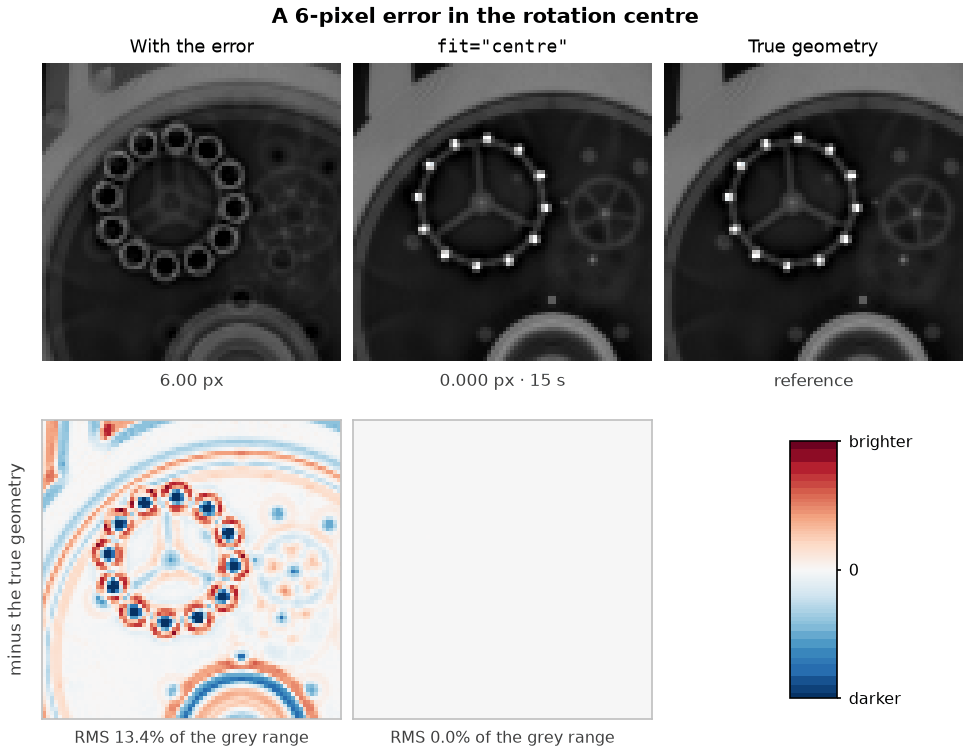
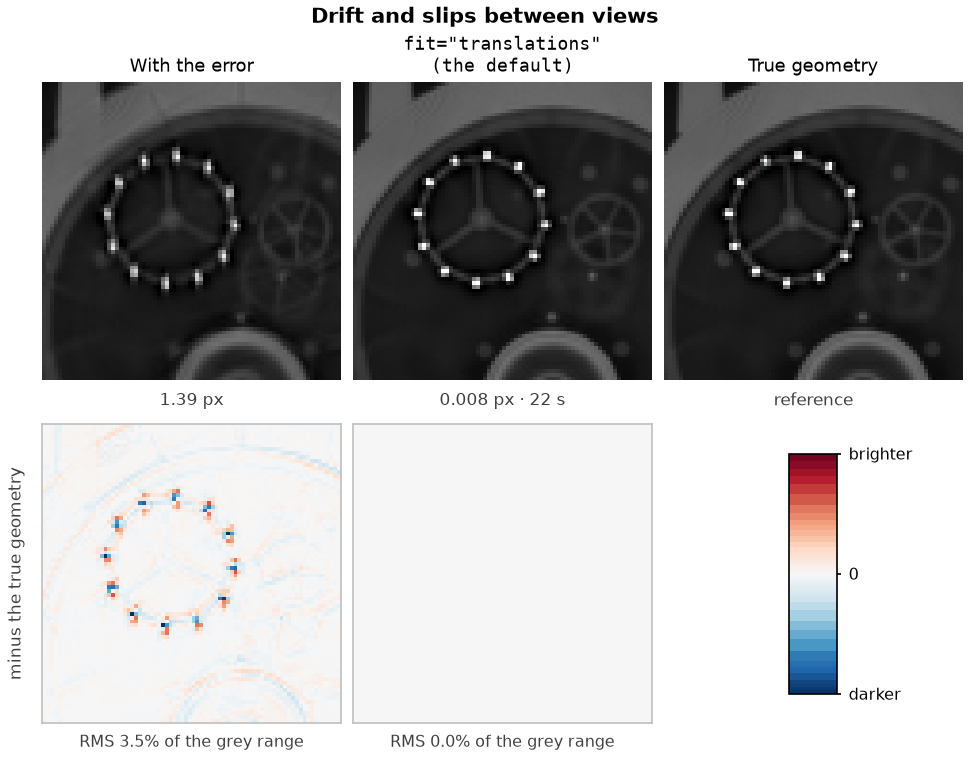
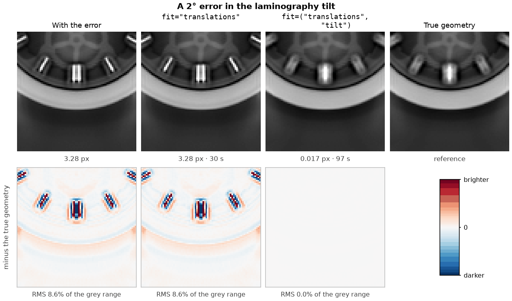
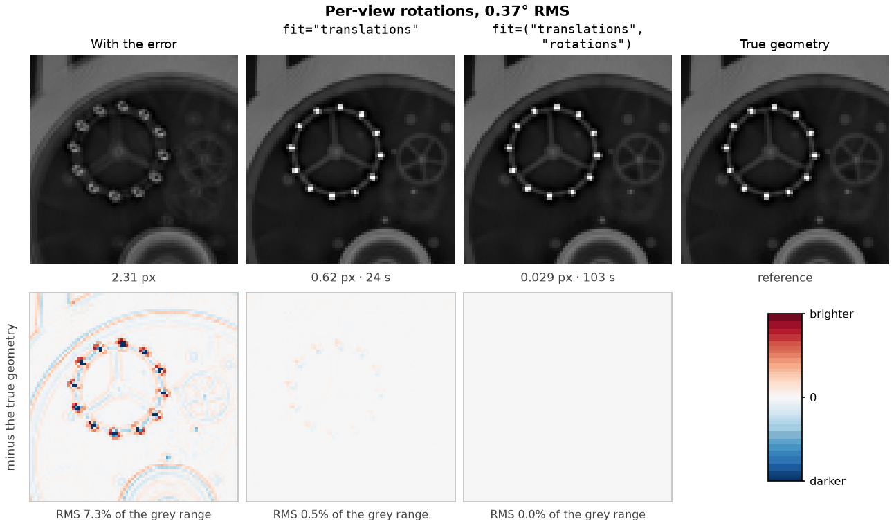

# Align a scan

`tj.align` estimates geometry errors and sample movement while it reconstructs. You choose
which errors it estimates with `fit=`. Start with the cheapest model that matches the error you
suspect, look at the result, and add parameters only while artefacts remain: a parameter the data
do not need costs accuracy, and a missing one leaves an error the fit cannot represent.

Before you align, correct the projections to line integrals and check the declared geometry
against the instrument, as the [real scan guide](real-laminography.md) describes. Reconstruct once
without alignment so that you have an image to compare with.

## Choose what to fit

| What you see | Likely error | Fit |
| --- | --- | --- |
| Point-like features drawn as rings or arcs, the same in every slice | The rotation centre | `fit="centre"` |
| Doubled or smeared edges that vary from feature to feature | Drift or sudden slips of the sample between views | `fit="translations"` (the default) |
| Sharp slices at the detector's centre row, with haloes and doubled edges that grow towards the top and bottom of the volume | The rotation axis or the detector rolled about the beam | `fit=("translations", "roll")` |
| Doubling that remains after translations and roll, worst far from the rotation axis | The laminography or axis tilt | `fit=("translations", "tilt")` |
| Blur that remains after translations and the setup angles | The sample rotating or wobbling between views | `fit=("translations", "rotations")` |

```python
import tomojax as tj

scan = tj.load("corrected.nxs")
result = tj.align(scan)                                  # translations
result = tj.align(scan, fit="centre")                    # the rotation centre only
result = tj.align(scan, fit=("translations", "roll"))    # add the axis roll
tj.save("aligned.nxs", result)
recon = tj.reconstruct(result.scan, "cgls")              # result.scan carries the corrections
```

The command line uses the same names:

```bash
tomojax align corrected.nxs -o aligned.nxs --fit translations roll
```

`fit` is one name or a tuple of distinct names; the order does not matter. Parameters you leave
out stay at their input values. Every combination uses the same joint solve of the image and the
selected parameters, for parallel, laminography and cone data.

| Name | Fitted parameters | Units and frame |
| --- | --- | --- |
| `centre` | One detector-u centre, plus detector-v for cone data | Physical detector-centre lengths, in the same units as `Detector.center` |
| `tilt` | One axis or laminography tilt correction shared by every view | Degrees; positive tilt leans the rotation axis towards the beam |
| `roll` | One detector roll correction shared by every view | Degrees about the beam |
| `translations` | Two translations per view; three for cone data | Physical lab-frame lengths: across the beam and vertically, plus along the beam for cone |
| `rotations` | Three rotations per view | Sample-frame rotations in radians |

The figures below show each error on simulated scans, before and after the matching fit: a watch
movement in laminography, and a spark plug in parallel-beam tomography. The lower row of each
figure is the image minus the image made with the true geometry, so any remaining error stands
out. The numbers under each panel are the pose error in detector pixels and the time to fit.

## The rotation centre

A wrong rotation centre turns every small, bright feature into a ring. The rings are the same size
everywhere in the slice, because every view is displaced by the same amount.



`fit="centre"` estimates one number for parallel and laminography data and is the fastest fit:
15 s here. Fit the centre first on a new instrument or after any change to the detector or stage.

For cone data, `"centre"` also estimates the detector-v centre. The data determine it only weakly:
a vertical detector offset looks almost the same as moving the image vertically, so the fit may
leave the v centre near its starting value and move the image instead. The reconstruction is
still consistent with the data; do not read the fitted v centre as an instrument calibration.

`tj.estimate_center(scan)` is also available as a projection-only preview for axial parallel scans
with opposing views. It does not reconstruct, and it estimates neither tilt, roll nor drift.

## Drift and slips

When the sample moves between views, features are doubled or smeared by different amounts,
depending on when each view was taken. The translation fit follows smooth drift and sudden slips
of the sample together.



The default, `fit="translations"`, removes the drift and slips in this example to 0.008 px in
22 s. It also absorbs a centre error in parallel and laminography scans, so you do not need to fit
the centre separately first. If you request `"centre"` and `"translations"` together, the
translations are given zero mean: a common translation and a centre offset describe the same
parallel-ray geometry, and the data cannot tell them apart.

## The setup angles

### Roll

If the rotation axis is rolled about the beam, or the detector is rolled, each detector row sees a
different rotation centre. The row at the detector's centre is right, and the error grows linearly
above and below it. Slices near the middle of the volume are sharp; slices towards the top and
bottom grow haloes and doubled edges. Per-view translations move every row together, so they
cannot correct it.

A vertical section through the rotation axis shows the pattern at once: the error is zero at the
detector's centre row and grows towards the top and bottom of the sample.


Slices at four heights show what the error does to the features themselves:


Adding `"roll"` estimates one angle for the whole scan. In this example it recovers the 0.75° roll
as 0.71°, and every slice then matches the true-geometry image to within 1.3% of its grey range.
It takes 204 s, against 46 s for translations alone. The roll matters most where it is easiest to
miss: away from the centre row it blurs away small defects, such as the bubble in the glass seal.
On a parallel-beam instrument, roll is the setup error to look for first: a fraction of a degree is
enough to blur the top and bottom of a tall sample.

### Tilt

A tilt of the axis towards or away from the beam, including a wrong laminography angle, moves
features mostly along the beam, where the rays cannot see the movement. Its effect on the image is
small: in the watch example a 0.5° laminography tilt error leaves no visible artefact, and the error
has to reach about 2° before features double.



Fit `"tilt"` only if doubling remains after translations and roll. In this example it recovers the
2° error to 0.017 px in 97 s, against 30 s for translations alone.

`"tilt"` and `"roll"` are shared parameters in the same solve as the image and the per-view
corrections, not an outer search over repeated alignments. They still need structure and angular
coverage that make them observable; an angle the data constrain only weakly is not an instrument
calibration.

## Sample rotation

If the sample itself tips or turns slightly between views, translations remove most of the blur
but leave a residual at the finest features. Fitting rotations estimates three more parameters for
every view.



Fit rotations only when the residual is visible. On data without rotation they cost accuracy: on the
drift example at 96 × 96 detector pixels they leave 0.080 px instead of 0.021 px. Their size prior is in angular units, so
changing the voxel size or binning does not make a rotation cheaper; the data must justify each
one. On repetitive structures, such as a TEM grid, per-view rotations can lock onto a wrong
orientation that matches the pattern. Check the fitted angles, and compare the image with the
translation fit.

## Check the result

1. Compare the aligned reconstruction with your unaligned one and with the previous setting's
   result. An extra parameter should remove a visible artefact; if it does not, use the simpler fit.
2. Inspect the estimated values. `result.info["calibration"]` holds the fitted global values under
   the names used in `fit=`, and `result.poses` holds the per-view correction table. The returned
   `result.scan` carries both, so use it for reconstruction and saving.
3. Check that the global values are physically plausible: a tilt correction of several degrees, or
   per-view rotations of more than a fraction of a degree, usually means the model is wrong rather
   than the instrument. A sharper image or a lower residual alone does not establish accurate
   poses.
4. Compare poses only after removing one common rigid motion of the object. Moving the whole
   object and moving every pose back predicts the same data.

`calibration` reports final global values: `centre` is a scalar for parallel data and a `(u, v)`
pair for cone data; `tilt` is the signed lab inclination `atan2(axis_y, axis_z)` in degrees; `roll`
is the detector angle from u towards v in degrees. Only requested globals appear. For a segmented
cone scan whose starting calibrations differ, their final values are listed in segment order.
`info["corrections"]` records the fitted increments, with centre increments in detector pixels and
angular increments in degrees. Per-view tables use `(alpha, beta, phi, x, z, y)`; rotations are in
radians and translations in physical lengths.

The fit works on a bounded grid of at most 16 million voxels and a detector of at most 320 pixels a
side, binned so that each working pixel is no wider than a voxel at the object. Supplying `grid=`
keeps that grid and limits the binning instead. The fitted image extends a little above and below
the grid, so material that moving views bring into the outer rows has somewhere to be; the
returned volume is cropped back to the grid. Reconstruct `result.scan` at the resolution you need:
the alignment volume is not a final-resolution reconstruction.

## How the figures were made

Both phantoms are meshes simulated with gVXR at 120 keV with 10⁴ photons per pixel and
reconstructed with FBP. The watch is scanned in 35° laminography with 360 of 720 views on
192 × 192 detector pixels of 0.27 mm and a 192³ grid. The spark plug (steel, nickel, copper,
alumina, glass, a carbon resistor and an iridium tip) is scanned in parallel beam with 720 views on
384 × 384 pixels of 0.135 mm and a 384³ grid. The errors were applied to the declared geometry
(centre, tilt) or rendered into the data (drift, slips, rotations, roll). Pose errors are detector
landmark RMS in 0.135 mm pixels after one rigid gauge. Times are for one RTX 4070 Laptop GPU.
Numerical checks of each `fit=`
setting are described in [the benchmark guide](../bench/README.md#alignment-fit-settings).
