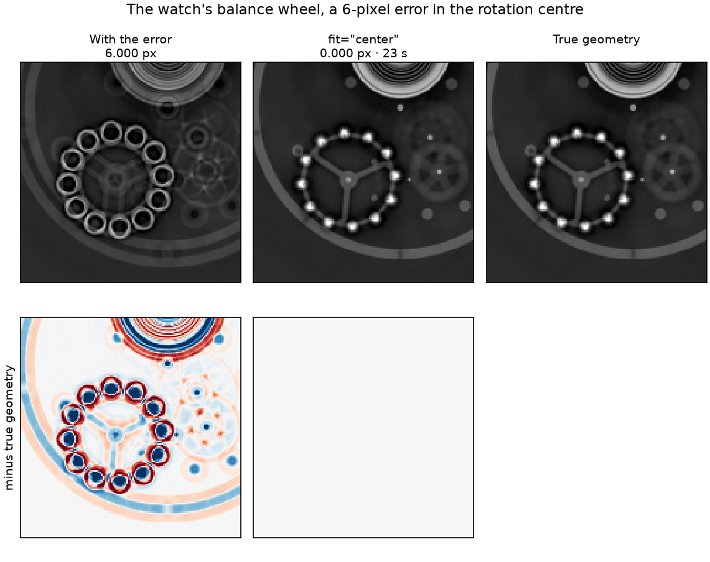
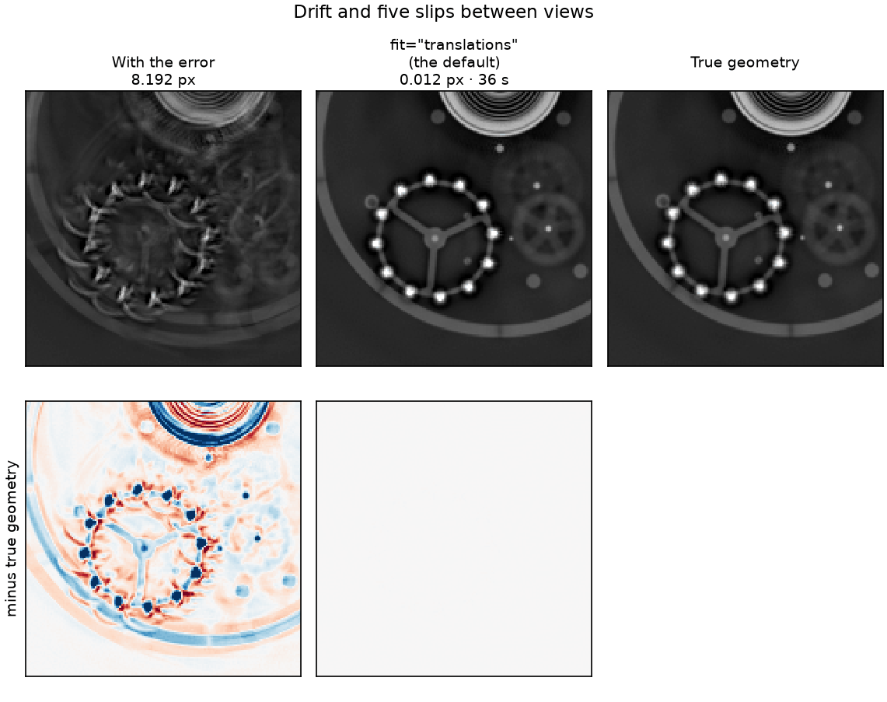
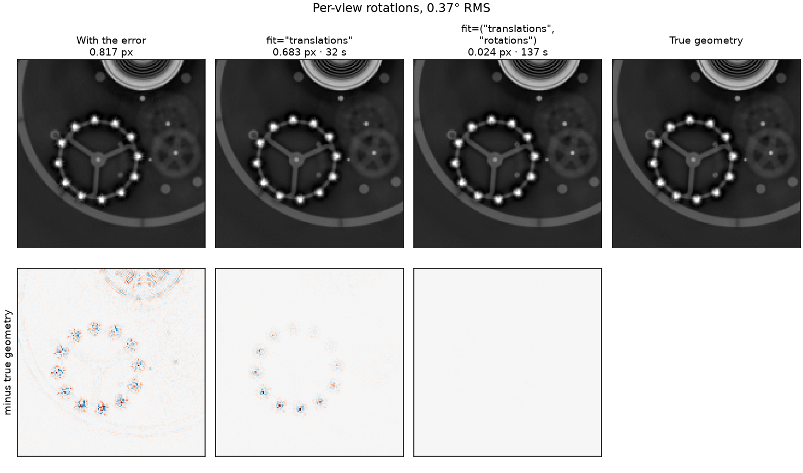

# Align a scan

`tj.align` estimates geometry errors and sample movement while it reconstructs. You choose
which errors it estimates with `fit=`. Start with the cheapest model that matches the error you
suspect, look at the result, and add parameters only while artefacts remain: a parameter the data
do not need costs accuracy, and a missing one leaves an error the fit cannot represent.

Before you align, correct the projections to line integrals and check the declared geometry
against the instrument, as the [real scan guide](real-laminography.md) describes. Pass
`RejectViews()` to that correction when frames may be broken or a crystal may diffract: the fit
otherwise moves those views to explain them. On a real laminography scan with one broken frame,
`RejectViews` removed that frame and the four others where the fitted corrections jumped. Check
what it rejected in `scan.corrections`: on scans whose flux hops or alternates, as some lab sources
and modulated beams do, it can reject good views as well. Reconstruct once without alignment so
that you have an image to compare with.

## Choose what to fit

| What you see | Likely error | Fit |
| --- | --- | --- |
| Point-like features drawn as rings or arcs, the same in every slice | The rotation centre | `fit="center"` |
| Doubled or smeared edges that vary from feature to feature | Drift or sudden slips of the sample between views | `fit="translations"` (the default) |
| Sharp slices at the detector's centre row, with haloes and doubled edges that grow towards the top and bottom of the volume | The rotation axis or the detector rolled about the beam | `fit=("translations", "roll")` |
| In laminography, doubling that remains after translations, worst far from the rotation axis | The laminography tilt | `fit=("translations", "tilt")` |
| Blur that remains after translations and the setup angles | The rotation axis wobbling between views | `fit=("translations", "rotations")` |

```python
import tomojax as tj

scan = tj.load("corrected.nxs")
result = tj.align(scan)                                  # translations
result = tj.align(scan, fit="center")                    # the rotation center only
result = tj.align(scan, fit=("translations", "roll"))    # add the axis roll
tj.save("aligned.nxs", result)
recon = tj.reconstruct(result.scan, "cgls")              # result.scan carries the corrections
```

After a vertical correction of n pixels, the outermost n slices at the top and bottom of a
reconstruction on the default grid are not fully covered by data: some corrected views look above
or below the measured rows there.

The command line uses the same names:

```bash
tomojax align corrected.nxs -o aligned.nxs --fit translations roll
```

`fit` is one name or a tuple of distinct names; the order does not matter. Parameters you leave
out stay at their input values. Every combination uses the same joint solve of the image and the
selected parameters, for parallel, laminography and cone data.

| Name | Fitted parameters | Units and frame |
| --- | --- | --- |
| `center` | One detector-u centre, plus detector-v for cone data | Physical detector-centre lengths, in the same units as `Detector.center` |
| `tilt` | One axis or laminography tilt correction shared by every view | Degrees; positive tilt leans the rotation axis towards the beam |
| `roll` | One detector roll correction shared by every view | Degrees, right-handed about the detector normal: positive turns u towards v, so a point above the centre projects towards +u |
| `translations` | Two translations per view; three for cone data | Physical lab-frame lengths: across the beam and vertically, plus along the beam for cone |
| `rotations` | Two wobble components of the rotation axis per view; each view's angle about the axis is taken as recorded | Sample-frame rotations in degrees, about object x and y |

The figures below show each error on simulated scans, before and after the matching fit: a watch
movement in laminography, and a spark plug in parallel-beam tomography. The lower row of each
figure is the image minus the image made with the true geometry, so any remaining error stands
out. The numbers under each panel are the pose error in detector pixels and the time to fit.

## The rotation centre

A wrong rotation centre turns every small, bright feature into a ring. The rings are the same size
everywhere in the slice, because every view is displaced by the same amount.



`fit="center"` estimates one number for parallel and laminography data and is the fastest fit:
13 s here. Fit the centre first on a new instrument or after any change to the detector or stage.

For cone data, `"center"` also estimates the detector-v centre. The data determine it only weakly:
a vertical detector offset looks almost the same as moving the image vertically, so the fit may
leave the v centre near its starting value and move the image instead. The reconstruction is
still consistent with the data; do not read the fitted v centre as an instrument calibration.

`tj.align(scan, fit="center", method="opposite-views")` estimates the centre from near-opposite
views of an axial parallel scan, without an image: a quick estimate that does not reconstruct, and
estimates neither tilt, roll nor drift. Its result has no `image`.

## Drift and slips

When the sample moves between views, features are doubled or smeared by different amounts,
depending on when each view was taken. The translation fit follows smooth drift and sudden slips
of the sample together.

How far a view may move from its neighbours is read from the scan itself: from how much each
view's own best position scatters from one view to the next. Error that differs from view to
view and is not motion, such as the model error of a real scan, raises that scale, so the fit
does not turn it into motion. A slip much larger than the scale is still followed, a little
short where the scale is large.



The default, `fit="translations"`, removes the drift and slips in this example to 0.008 px in
21 s. It also absorbs a centre error in parallel and laminography scans, so you do not need to fit
the centre separately first. If you request `"center"` and `"translations"` together, the
translations are given zero mean: a common translation and a centre offset describe the same
parallel-ray geometry, and the data cannot tell them apart.

## The setup angles

### Roll

If the rotation axis is rolled about the beam, or the detector is rolled, each detector row sees a
different rotation centre. The row at the detector's centre is right, and the error grows linearly
above and below it. Slices near the middle of the volume are sharp; slices towards the top and
bottom grow haloes and doubled edges. Per-view translations move every row together, so they
cannot correct it.

A vertical section through the rotation axis shows the pattern at once: the error is zero at the
detector's centre row and grows towards the top and bottom of the sample.


Slices at four heights show what the error does to the features themselves:


Adding `"roll"` estimates one angle for the whole scan. In this example it recovers the 0.75° roll
as 0.71°, and every slice then matches the true-geometry image to within 1.3% of its grey range.
It takes 234 s, against 47 s for translations alone. The roll matters most where it is easiest to
miss: away from the centre row it blurs away small defects, such as the bubble in the glass seal.
On a parallel-beam instrument, roll is the setup error to look for first: a fraction of a degree is
enough to blur the top and bottom of a tall sample.

### Tilt

If the rotation axis leans towards or away from the beam, every point rises and falls once per
turn, by the tilt times its depth along the beam. For a compact sample most of that is the whole
sample bobbing up and down, which per-view translations describe exactly, so `fit="translations"`
removes most of a tilt. What remains is a smaller error that grows with distance from the sample's
own centre.


Here the plug is mounted 9 mm off the axis so that its features sweep wide circles; a sample
centred on the axis and symmetric about it is barely affected by a tilt at all. A 3° tilt, larger
than a typical setup error, leaves the section 5.1% from the true-geometry image, and translations
bring it to 1.8%. At 1° the figures are 2.8% and 1.1%. In parallel-beam tomography the roll matters
far more than the tilt.

In laminography a wrong tilt changes the projections much more, and the fit can separate it from
translations: `fit=("translations", "tilt")` recovers a 2° laminography tilt error in the watch
example to 0.017 px in 84 s, against 28 s for translations alone. Small laminography tilt errors
still do little to the image: 0.5° leaves no visible artefact there, and the error has to reach
about 2° before features double. In parallel-beam tomography the data tell a tilt from translations
only through the small remainder, so a tilt fit there converges slowly and can stop well short of
the true angle; rely on translations instead.

`"tilt"` and `"roll"` are shared parameters in the same solve as the image and the per-view
corrections, not an outer search over repeated alignments. They still need structure and angular
coverage that make them observable; an angle the data constrain only weakly is not an instrument
calibration.

## Sample rotation

If the rotation axis wobbles between views, tipping the sample slightly, translations remove most
of the blur but leave a residual at the finest features. Fitting rotations estimates the two
wobble components of the axis for every view. Each view's angle about the axis is taken as
recorded: stage encoders give it, and errors in it are rare. A real laminography scan whose file
records set-point angles rather than encoder readings, checked against a tracked sphere, turned at
constant speed right to its ends. Angle errors are not small when present:
on the simulated watch movement, 0.07° RMS of error in the recorded angles moves its features by
0.13 detector pixels RMS, and no fit here corrects it.



Fit rotations only when the residual is visible. On data without rotation they cost accuracy: on the
drift example at 96 × 96 detector pixels they leave 0.080 px instead of 0.022 px. Their size prior is in angular units, so
changing the voxel size or binning does not make a rotation cheaper; the data must justify each
one. On repetitive structures, such as a TEM grid, per-view rotations can lock onto a wrong
orientation that matches the pattern. Check the fitted angles, and compare the image with the
translation fit.

## Check the result

1. Compare the aligned reconstruction with your unaligned one and with the previous setting's
   result. An extra parameter should remove a visible artefact; if it does not, use the simpler fit.
2. Inspect the estimated values. `result.info["calibration"]` holds each fitted global under the
   name used in `fit=`, and `result.poses` holds the per-view correction table. The returned
   `result.scan` carries both, so use it for reconstruction and saving. Each global's `"value"` is
   the final setting and passes straight to a constructor in another script; its `"change"` is how
   far the fit moved it:

   | Value | Parallel or laminography data | Cone data |
   | --- | --- | --- |
   | `center` | `Detector(..., center=(center, v))` | `Detector(..., center=center)` |
   | `roll` | `ParallelGeometry(..., detector_roll=roll)`, or the same keyword on `LaminographyGeometry` | `ConeBeam(..., detector_roll=roll)` |
   | `tilt` | `LaminographyGeometry(..., tilt=tilt)`: a tilted parallel scan is a laminography scan | `ConeGeometry(..., axis_unit=(0, sin(tilt), cos(tilt)))` |

3. Check that the global values are physically plausible: a tilt correction of several degrees, or
   per-view rotations of more than a fraction of a degree, usually means the model is wrong rather
   than the instrument. A sharper image or a lower residual alone does not establish accurate
   poses.
4. Compare poses only after removing one common rigid motion of the object. Moving the whole
   object and moving every pose back predicts the same data.
5. Read `result.info["report"]`. It states how each level ended ("pose_steps_below_tolerance"
   or "step_budget_reached"), the size of the corrections in detector pixels or degrees, split
   into a smooth part and a view-to-view part, and the range of the per-view offsets. It also
   lists two kinds of view, and `tj.align` warns when either is present:
   - `isolated_views`: a correction that jumps away from both neighbours in the same direction.
     A slip, where the object moves and stays, is not one.
   - `unusual_views`: views whose residual is at least three times their neighbours', such as a
     broken frame or a crystal diffracting. These need not have moved, so look at the frames.
   Look at those views before trusting their corrections, and drop broken frames, or correct
   with `RejectViews()` and align again. The report is
   advisory: a view below its thresholds can still be wrong. `info["report"]["advisories"]` also
   states measured limits that apply to the fit, such as per-view rotations fitted with the
   rotation axis perpendicular to the beam, where they are weakly determined and can end worse
   than translations alone.
6. To test whether the alignment helped, hold out every sixth view, fit the others, and predict
   the held-out views from a reconstruction of the fitted ones, with poses interpolated in view
   order. Compare the prediction error with the fitted and with the nominal poses, after removing
   each view's offset and row ramp, which the fit does not predict. This tests only the smooth
   part of the correction: a single view's error cannot be interpolated into it.

   ```python
   import numpy as np

   index = np.arange(len(scan.angles))
   train, test = index % 6 != 5, index % 6 == 5
   fitted = tj.align(scan.selected(train)).poses
   poses = np.stack([np.interp(index, index[train], fitted[:, j]) for j in range(6)], 1)

   def held_out_error(table):
       candidate = scan.with_poses(table)
       volume = tj.reconstruct(candidate.selected(train), "fbp").volume
       error = np.asarray(tj.project(candidate.selected(test).geometry, volume))
       error = error - np.asarray(scan.projections)[test]
       rows = np.linspace(-1, 1, error.shape[1]).repeat(error.shape[2])
       basis = np.stack([np.ones_like(rows), rows], 1)
       flat = error.reshape(len(error), -1).T
       flat = flat - basis @ np.linalg.lstsq(basis, flat, rcond=None)[0]
       return float(np.sqrt(np.mean(flat**2)))

   print(held_out_error(np.zeros((len(index), 6))), held_out_error(poses))
   ```

`calibration` has one entry for each requested global, `{"value": ..., "change": ...}`. The value
is final: `center` is a scalar for parallel data and a `(u, v)` pair for cone data; `tilt` is the
signed lab inclination `atan2(axis_y, axis_z)` in degrees; `roll` is the detector angle from u
towards v in degrees. For a segmented cone scan whose starting calibrations differ, the final values
are listed in segment order. The change is the fitted increment, in detector pixels for the centre
and degrees for the angles. Per-view tables use `(alpha, beta, phi, x, z, y)`; rotations are in
degrees and translations in physical lengths. `info["report"]` gives the same split:
`"calibration"` for the globals' changes and `"poses"` for the size of the per-view corrections.

The fit works on a bounded grid of at most 16 million voxels and a detector of at most 320 pixels a
side, binned so that each working pixel is no wider than a voxel at the object. Supplying `grid=`
keeps that grid and limits the binning instead. The fitted image extends a little above and below
the grid, so material that moving views bring into the outer rows has somewhere to be; the
returned volume is cropped back to the grid. Each view also has its own offset and ramp down the
detector rows, which the line integrals do not describe: flux changes or phase-retrieval offsets
between views would otherwise look like vertical motion. Each view's departure from the level
the views share is eliminated inside every step, so the poses see only what an offset and ramp
cannot explain, and the data are never modified. The shared level itself stays with the data:
an image can produce it (a faint disc, brightest at its rim, whose every view is one constant),
so removing it too would let the fit invent that disc and drag the views toward their nominal
positions. `info["offsets"]` reports each view's fitted pair relative to the shared level. `result.scan` keeps the scan's grid, so
reconstructing it gives the full-resolution image; `result.image` is the fit's own image, on the
bounded working grid `result.grid`, not a final-resolution reconstruction. The fit compares model
and data through [1, 2, 1] / 4 along the detector's rows and columns, because at the Nyquist
frequency a sampled model cannot be right; nothing then constrains that band, so the fit's image
carries texture at the grid's finest scale that the object does not have.

## Settings

`tj.align` takes the five settings most runs change as keywords, `iterations`,
`image_iterations`, `tolerance`, `interpolation` and `resolution`, and every setting through
`config=tj.AlignConfig(...)`. A keyword replaces the field of the same name.
`result.info["config"]` records the values a call used, with the ones that depend on the scan
resolved. On the command line, `tomojax align` takes the five as `--iterations`,
`--image-iterations`, `--tolerance`, `--interpolation` and `--resolution`, and the rest as keys of a
`--config` TOML file under the same names; `--config-keys` lists them, and `--dry-run` prints the
resolved settings.

```python
config = tj.AlignConfig(levels=(1,), refine_iterations=0)
result = tj.align(scan, fit="translations", iterations=12, config=config)
```

| Setting | Default | What it decides | When to change it |
| --- | --- | --- | --- |
| `iterations` | 8 | Gauss-Newton iterations at the working resolution | Raise it when `info["levels"][-1]["status"]` is `step_budget_reached`; each one costs a linearisation and an image solve |
| `coarse_iterations` | 12 | Iterations at each coarser level | The same trade at the coarse level |
| `levels` | `(2, 1)` | Each level's binning of the working detector, coarsest first | `(1,)` for little motion; a coarser start, such as `(4, 2, 1)`, for large motion |
| `image_iterations` | 16 | Image-solve iterations per Gauss-Newton iteration | Fewer for speed on a translations fit, more for angles: on exact data 8 leaves 0.00044 px after 100 iterations, 16 under 0.0002 px |
| `image_tolerance` | 0.03 | When an image solve may stop before its count | Lower for a tighter solve |
| `tolerance` | 0.01 working pixels | A level stops when two successive pose proposals move the views less than this | 0 runs every level to its iterations; larger stops sooner |
| `min_iterations` | 4 | The fewest iterations before `tolerance` may stop a level | With `tolerance`, against an early stop |
| `resolution` | 320 pixels | The working detector's longest side | Finer for small motion on a large detector; coarser for speed |
| `max_voxels` | 16 000 000 | The working grid's size | Memory against resolution |
| `interpolation` | cubic with an angle on parallel rays, else linear | The projector's in-plane kernel in the fit | Cubic for sharp objects and the best accuracy, at about three times the time (a K11 laminography scan: 287 s linear, 876 s cubic) |
| `refine_iterations` | 5 | The final per-view refinement with the image held | 0 turns it off, for speed or to see the joint fit alone |
| `initial_image_iterations` | 5 | FISTA iterations for the first image | More for a better start on a hard scan |
| `innovation_scale` | 0.02 native pixels | How large a view-to-view step counts as an event | The motion's physical scale |
| `knot_spacing` | 10 views | How stiff the smooth drift is | Drift faster or slower than ten views |
| `rotation_sigma` | 0.5 degrees | The per-view rotations' size prior | A stage's wobble scale |
| `loss_width` | 2.5 noise deviations | Where the robust loss turns from quadratic to linear | Outliers such as zingers or diffraction |
| `loss_contrast_floor` | 0.5 of the contrast | The least loss width, on low-noise data | With `loss_width` |
| `image_tv_weight`, `image_tv_huber` | 0, 1.0 | Total variation on the fit's image | A regularised working image on very noisy data |
| `margin` | 1/16 of the height | How far the fit's image extends past each end of the grid | Material entering the field from above or below |
| `refine_smoothing`, `refine_neighbors` | 8 native pixels, 5 views | The refinement's edge filter and its neighbourhood | Rarely |

`region=` chooses the part of the grid to fit on, as for `tj.reconstruct`: `"auto"` or `"bbox"`
for the box every view sees, `"cube"`, `"cyl"`, or a `RegionEstimate`. Each level's record,
`info["levels"][i]`, gives the `iterations`, `image_iterations` and `initial_image_iterations` it
was given, its `steps` and the `status` it ended with.

## How the figures were made

Both phantoms are meshes simulated with gVXR at 120 keV with 10⁴ photons per pixel and
reconstructed with FBP. The watch is scanned in 35° laminography with 360 of 720 views on
192 × 192 detector pixels of 0.27 mm and a 192³ grid. The spark plug (steel, nickel, copper,
alumina, glass, a carbon resistor and an iridium tip) is scanned in parallel beam with 720 views on
384 × 384 pixels of 0.135 mm and a 384³ grid. The errors were applied to the declared geometry
(centre, tilt) or rendered into the data (drift, slips, rotations, roll). Pose errors are detector
landmark RMS in 0.135 mm pixels after one rigid gauge. Times are for one RTX 4070 Laptop GPU.
Numerical checks of each `fit=`
setting are described in [the benchmark guide](../bench/README.md#alignment-fit-settings).
