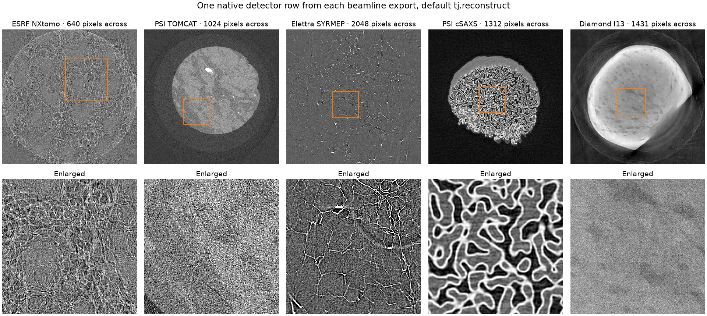

# First slices from beamline exports

Each recipe below loads one detector row from a real beamline export so you can inspect a first slice quickly without allocating a full volume. Except for PSI cSAXS (which stores unwrapped phase), every dataset starts from raw counts.

The pixel sizes and rotation centers below belong to these specific acquisitions; substitute your own scan's calibration when adapting a recipe.



One native detector row from each scan, reconstructed with `tj.reconstruct(scan)`. The example script applies `Rings()` to ESRF and Diamond I13. Elettra extends beyond the detector (local tomography), and cSAXS reconstructs refractive phase rather than attenuation.

```bash
uv run python examples/gallery/beamline_first_slices.py DATA beamline-first-slices.png
```

## ESRF NXtomo export

Download nabu's [bamboo test file](http://www.silx.org/pub/nabu/data/bamboo_reduced_bliss.nx) (HTTP because the server's TLS certificate is invalid), exported from Bliss by `nxtomomill`:

```python
import tomojax as tj

frames = tj.load_frames("bamboo_reduced_bliss.nx")
```

The loader locates the `NXtomo` group regardless of entry name and reads angles, image keys, flats, darks, and unit-labeled pixel pitches. When the file omits the rotation center, loading places it at the detector middle (`detector_center_status="not_recorded"`); supply a calibrated `detector=` or fit it with `tj.align(scan, fit="center")`.

Continue with [Correct, reconstruct, and inspect](#correct-reconstruct-and-inspect) below. For raw Bliss `.h5` or EDF folders instead of NXtomo exports, see [raw ESRF acquisitions](quickstart.md#raw-esrf-acquisitions).

## PSI TOMCAT Data Exchange export

From the [TomoBank catalog](https://tomobank.readthedocs.io/), `tomo_00069.h5` (skin) stores counts, flats, darks, and `/exchange/theta`, but omits the pixel pitch. Supply its accompanying calibration (3.7 µm pixels, rotation axis at column 515.5 on 1024 columns) in millimeters:

```python
import tomojax as tj

pitch = 3.7e-3  # mm (absent from the HDF5 file)
axis_column = 515.5
frames = tj.load_frames(
    "tomo_00069.h5",
    detector=tj.Detector(
        1024, 428, pitch, pitch,
        center=((1023 / 2 - axis_column) * pitch, 0),
    ),
)
```

`Detector.center` takes a physical offset rather than a column index: `((nu - 1) / 2 - axis_column) * pitch` for an axial parallel detector. This recipe reads the Data Exchange conversion rather than TOMCAT's native GigaFRoST format.

## Elettra SYRMEP Data Exchange export

`tomo_00024.h5` (polystyrene foam, from [TomoBank](https://tomobank.readthedocs.io/)) records its 2.04 µm pitch and `/exchange/theta` angles (which TomoJAX uses directly instead of the inconsistent `angular_step` metadata), with rotation axis at column 972 on 2048 columns:

```python
import tomojax as tj

pitch = 2.04e-3  # mm
frames = tj.load_frames(
    "tomo_00024.h5",
    detector=tj.Detector(
        2048, 2048, pitch, pitch,
        center=((2047 / 2 - 972) * pitch, 0),
    ),
)
```

Because the sample extends past the detector edges, the default Fourier inverse continues each detector row past both edges with a cylinder model (`exterior="cylinder"`) to suppress the truncation rim and bowl. Check `result.info["truncation"]` for `outside_fraction` and `interior_shift`, or pass `FourierConfig(exterior="zero")` to disable continuation ([truncated scans](quickstart.md#truncated-and-region-of-interest-scans)).

## PSI cSAXS ptychographic tomography

The nanoporous-glass dataset of Odstrcil et al. (Opt. Express 2019; Zenodo 3539513, `porous_glass_dataset.mat`) is a MATLAB 7.3 file holding unwrapped, aligned phase sinograms rather than raw counts. `tj.load` reads them directly:

```python
import math
import tomojax as tj

scan = tj.load("porous_glass_dataset.mat")  # 720 views of 416 x 1312, parallel
recon = tj.reconstruct(scan)
delta = recon.volume * scan.source.geometry_metadata["wavelength"] / (2 * math.pi)
```

The reconstructed volume is phase per millimeter (`2πδ / λ`); multiplying by `λ / 2π` using the recorded wavelength yields the refractive-index decrement `δ`. The sinograms are pre-centered on the detector middle. Files holding only the unaligned complex `stack_object` are rejected (see [examples/align_ptychography.py](../examples/README.md#prepare-and-align-complex-ptychography-projections) for phase preparation).

## Correct, reconstruct, and inspect

Save one of the `frames = ...` snippets above in `preview.py` and append:

```python
row = frames.counts.shape[1] // 2
scan = frames.cropped(slice(row, row + 1), slice(None)).corrected()
result = tj.reconstruct(scan)
tj.save("preview.nxs", result)
```

Run it and generate slice previews:

```bash
python preview.py
tomojax inspect preview.nxs --preview-dir preview-images
```

Reload the floating-point volume and geometry in Python with:

```python
restored = tj.load_reconstruction("preview.nxs")
print(restored.volume.shape, restored.grid, restored.geometry.detector)
```

Pass `include_scan=True` to `tj.save` if you also want the corrected projections stored in `preview.nxs`. For ring removal, phase retrieval, larger row windows, and explicit solvers, continue with the [quickstart](quickstart.md).

## Half-acquisition with an offset parallel detector

An axial parallel scan can cover a specimen wider than the detector by rotating through 360° with the axis near one detector edge. Keep all views and the original detector coordinates. For example, a 2,560-column detector with the axis 64 pixels from its nearer edge measures 128 columns twice and covers a diameter of 4,992 pixels. Pixel distances here start at the detector edge, half a pixel outside its first pixel center.

```python
import tomojax as tj
from tomojax.corrections import Rings

scan = tj.load("full-turn.nxs")
aligned = tj.align(scan, fit="center").scan
print(aligned.grid.shape)             # (z, y, x)
volume = tj.reconstruct(aligned.corrected(Rings()))
```

The fit matches changes in attenuation across the turn in the strip shared by opposite views. A detector-derived grid expands to the far edge and stays centered on the rotation axis. An explicit reconstruction grid keeps its requested extent. Fourier inversion and FBP weight conjugate rays across the overlap before filtering. Iterative methods use the original measured rays. If the specimen reaches the far edge, the default cylinder continuation estimates the direct methods' missing exterior from that edge.

Use `tomojax inspect full-turn.nxs` or the MCP `inspect` tool to check the orbit. When the file records the axis, inspection also reports the axis-to-edge distance, overlap and complete field diameter in detector pixels. With an unknown axis, inspect the saved aligned scan for those dimensions.

At 0.54 µm pitch, a 4,992 × 4,992 × 2,160 float32 volume occupies 215.3 GB. Fit the center on a representative band before correcting the whole acquisition. Pass the fitted `detector_center` when opening the full frames in the CLI or worker. In Python pass a full-height `detector` with the fitted horizontal center to `load_frames`, then consume `tj.reconstruct_slabs` one slab at a time. The [gallery](gallery.md#parallel-half-acquisition) shows the overlap and reconstructed field.

## Diamond I13 NXtomo acquisition

Diamond I13 scan 159815 (`diamond-i13-mg31912-1/raw/159815.nxs`) links externally to `pco1-159815.hdf`; keep both files in the same directory. TomoJAX discovers its 3001 sample views, 200 flats (before and after), 100 darks, and angles automatically. Bracketing multi-frame flat sets are weighted from a sample of the views by default (`flat_weights="views"`), separating common row gain from local texture; pass `flat_weights="position"` to `.corrected(...)` to blend by position alone, or pass a clean neighboring scan's file as `flats="other_scan.nxs"` when a scan's own flats are shadowed ([flat fields](../src/tomojax/corrections/README.md#flat-fields)). Because pixel pitch is unrecorded, the scan loads in pixel units unless you pass `pixel_size=` or `detector=`.

The example below uses pixel units with this scan's Savu crop (`441:1872`) and axis column (`1159.5` on the 2560-column detector, giving offset `120`):

```python
import tomojax as tj

frames = tj.load_frames(
    "diamond-i13-mg31912-1/raw/159815.nxs",
    detector=tj.Detector(2560, 2160, 1, 1, center=(120, 0)),
)
scan = frames.cropped(slice(1080, 1081), slice(441, 1872)).corrected()
result = tj.reconstruct(scan)
tj.save("i13-preview.nxs", result)
```

```bash
python i13_preview.py
tomojax inspect i13-preview.nxs --preview-dir i13-preview-images
```

Recorded angle signs are kept as stored. For TIFF-only acquisitions without NXtomo metadata, see [preparing TIFF data](real-laminography.md#prepare-tiff-data).

### Loading the same scan from a mixed TIFF folder

If the scan is stored as a single folder of TIFFs (`proj_0.tif`–`proj_3300.tif`: 100 darks, 100 flats, 3001 projections, 100 flats), symlink them into separate folders and supply the angles:

```python
from pathlib import Path
import numpy as np
import tomojax as tj

raw, work = Path("diamond-i13-159815/raw"), Path("i13-split")
groups = {
    "darks": range(0, 100),
    "flats": [*range(100, 200), *range(3201, 3301)],
    "proj": range(200, 3201),
}
for name, indices in groups.items():
    (work / name).mkdir(parents=True, exist_ok=True)
    for i in indices:
        link = work / name / f"proj_{i:04d}.tif"
        if not link.exists():
            link.symlink_to((raw / f"proj_{i}.tif").resolve())

frames = tj.load_frames(
    work / "proj",
    flats=work / "flats",
    darks=work / "darks",
    angles=np.load("savu_angles.npy"),
    detector=tj.Detector(2560, 2160, 1, 1, center=(120, 0)),
)
```

A flat folder carries no frame positions, so its flats are averaged instead of interpolated between the pre- and post-scan sets (on this scan, ~6% beam decay causes up to ±0.03 mean difference in the corrected views).
