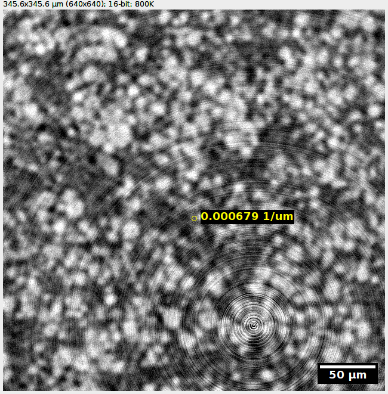

# Export a reconstruction

To open a saved TomoJAX reconstruction in Fiji, write a TIFF stack. The first
command previews the dimensions, file names, value range and disk space. The
second writes the stack. Open `recon.tif` in Fiji and use the slice slider to
move through the volume.

```bash
tomojax export recon.nxs -o recon.tif --dry-run
tomojax export recon.nxs -o recon.tif
```

In Python, pass the destination first. An export writes the selected array
for another application. To reopen the whole result in TomoJAX, use
`tj.save("copy.nxs", recon)`. See [Reopen a saved result](quickstart.md#reopen-a-saved-result).

```python
import tomojax as tj

recon = tj.load_reconstruction("recon.nxs")
receipt = tj.export("detail.ome.tif", recon, crop=(slice(100, 300), None, None))
axes = tj.inspect("detail.ome.tif")["contents"]["volume"]["axes"]
```

In Studio, select the result in **Explore**, choose a format under **Output**,
then choose the destination. Review the file count, size and calibration before
selecting **Queue export**. For a native save, choose **TomoJAX result (.nxs)**.

## Choose a format

Use the file ending for the application that will read the data. Give a folder
name such as `slices/` to write one numbered TIFF per plane.

<!-- formats -->
| Destination | Format | What the reader receives |
| --- | --- | --- |
| `.tif`, `.tiff` | ImageJ TIFF | ImageJ reads voxel size, origin and calibrated intensities in classic TIFF. Bio-Formats reads voxel size in both classic TIFF and BigTIFF. |
| `.ome.tif`, `.ome.tiff` | OME-TIFF | Bio-Formats reads all three voxel dimensions. ImageJ and ITK read the in-plane pixel size. |
| Slice directory | TIFF slices | ImageJ, Bio-Formats and ITK read the in-plane pixel size. |
| `.raw` | Raw | The JSON file beside the pixels gives the axis order, units and intensity scale. |
| `.mhd` | MetaImage | ITK and VTK read the voxel spacing and origin. The header gives lengths without a unit. |
| `.am` | AmiraMesh | Bio-Formats reads voxel size and assumes micrometers when the unit is unknown. The bounding box gives the position of the volume. |
| `.h5`, `.hdf5`, `.nxs` | NeXus NXdata | silx reads the physical coordinates and stored voxel values. For integer images, use the recorded offset and scale to recover intensities. |
| `.zarr`, `.ome.zarr` | OME-Zarr 0.5 | ome-zarr-py reads the axis order, voxel size and origin at each resolution. The export record gives the intensity scale. |
<!-- /formats -->

## Choose the planes and values

A volume crop gives the bounds in **z, y, x** order. The Python example above
takes planes 100 through 299 and keeps every row and column. To reduce that
volume by a factor of two along each axis and write a compressed stack, run

```bash
tomojax export recon.nxs -o detail.tif --crop 100:300,:,: --binning 2 --compress
```

Binning averages complete blocks after cropping and places each new voxel at
the center of its block. A crop one plane thick writes a single section.
With `--axis x`, each slice has z rows and y columns. TIFF viewers display
the first dimension as the stack axis, so a different axis can mirror the
display. MetaImage records the directions in the original coordinate system.

Use the default `float32` for quantitative measurements. To fit intensities
into 16 bits, pass `--dtype uint16`. Add `--range LOW HIGH` to map chosen
physical values to 0 and 65535. Without a range, TomoJAX takes the 0.1 and
99.9 percentiles of the finite values sampled from up to 16 evenly spaced
planes after cropping and binning. Supply a range for constant data. For an
8-bit image use `--dtype uint8`, which maps the upper bound to 255.

The export reports how many voxels fell below and above the range. Inside the
range, multiply the stored integer by the scale in the export record and add
the offset to recover the physical value to within half a step. A nonfinite
voxel stops an integer export. A feature mask keeps its labels and grid. To
export a saved mask, run `tomojax export mask.nxs -o mask.tif`. If selecting
the array explicitly, use `--member mask` or its recorded feature name.

### Read a calibrated TIFF in Fiji

ImageJ reads the voxel size, origin and value calibration from a classic ImageJ
TIFF. TomoJAX writes physical lengths in micrometers. For a scan in pixel units,
the export record gives the spacing. TomoJAX switches to BigTIFF when the
uncompressed pixels reach 4 GiB minus 64 MiB, including when you request
compression. Fiji opens BigTIFF through Bio-Formats, which reads the voxel size,
resets the origin to zero and displays stored integers. Choose float32 to read
physical values through either importer.



In this crop from K11 scan 52567, 640 pixels at 0.54 micrometers per pixel
span 345.6 micrometers. ImageJ reads the marked voxel in the 16-bit TIFF as
an attenuation of 0.000679 µm⁻¹.

## Projections and sinograms

Pass a scan to export its corrected projections. The crop uses view, detector
row and detector column, in that order. Binning averages neighboring detector
pixels and keeps each view. To follow one detector row through successive
views, stack along the detector's vertical axis with `axis="v"`. Each output
plane is then a sinogram, with one row per selected view.

```python
scan = tj.load("aligned.nxs")
tj.export("projections.h5", scan)
tj.export("sinograms.tif", scan, axis="v", crop=((10, 110), None, None))
```

To select projections from a saved alignment or from a reconstruction saved
with its scan, run

```bash
tomojax export aligned.nxs -o sinograms.h5 --member projections --axis v
```

TIFF, raw, MetaImage and NeXus can carry projection stacks. The record
includes the selected angles, detector calibration, poses and acquisition
positions. Choose NeXus when a viewer needs the measured rotation angles
in degrees. A TIFF viewer treats each row of a sinogram as a sample even
when the angular steps differ.

## HDF5 and OME-Zarr

A NeXus export places the array at `/entry/data/data`. A NeXus viewer finds
the array and its coordinates when you open the file. If another program
expects a particular dataset path, give it after the file name. Choose a new
file name to keep existing datasets. Adding `--force` replaces the entire
file, including its other datasets.

```bash
tomojax export recon.nxs -o 'results.h5::/entry/final_result/attenuation' --compress
```

For NeXus, `--compress` uses gzip with shuffle. With integer export, silx
displays the stored values. To convert a stored value using the NeXus fields,
add the signal's offset and then multiply by its scaling factor.

Install `tomojax[zarr]` to export an OME-Zarr 0.5 directory. Open the directory
in an NGFF reader such as ome-zarr-py. The finest level holds the selected
voxels. Each coarser level averages neighboring pairs along each spatial
axis, updates the voxel centers and drops an unpaired voxel at the far edge.
An axis of length one keeps its coordinate. The pyramid ends when all sides
fit in 256 voxels. A mask has one level so its labels stay intact.
Zstandard compression is on by default.

## Keep the output files together

A TIFF stack holds its own export record. A slice folder has a JSON record
named after the folder. Raw, MetaImage and AmiraMesh exports have a record
named after the primary file, such as `detail.mhd.json`. For MetaImage,
keep the header, raw pixels and JSON together when moving the export.

The CLI and worker require `force` to replace an existing output. Use
`--force` on the CLI. Replacing a TomoJAX export directory replaces everything
in it. For other directories, choose a new destination. If an output would
overwrite a file still in use as an input, choose another path. This check
also covers linked files, including a link inside an export directory. It
lasts while a running operation, open handle, unreleased artifact or reachable
Python result depends on the input.

## Continue an interrupted export

For TIFF slice folders, raw files and MetaImage exports, keep the hidden
`.<destination>.partial` directory beside the output. Reconnect the drive if
necessary, then repeat the original request. With the same source file and
options, TomoJAX reuses the completed slabs, integer range and clipping
counts. Only one writer can resume that partial export at a time.

Replacing or editing the input file or changing the crop or encoding starts
a fresh export. In-memory inputs, single-file TIFF stacks, AmiraMesh, NeXus
and OME-Zarr also start from the beginning. A dry run reports whether the
source and format support resuming.
