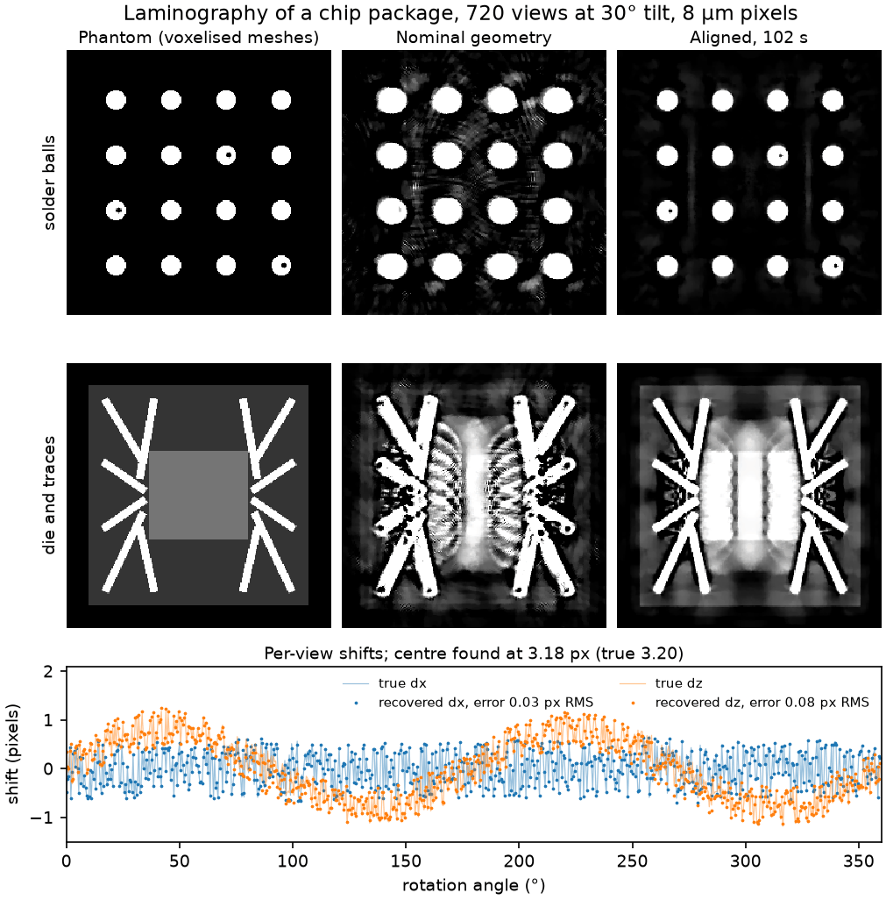
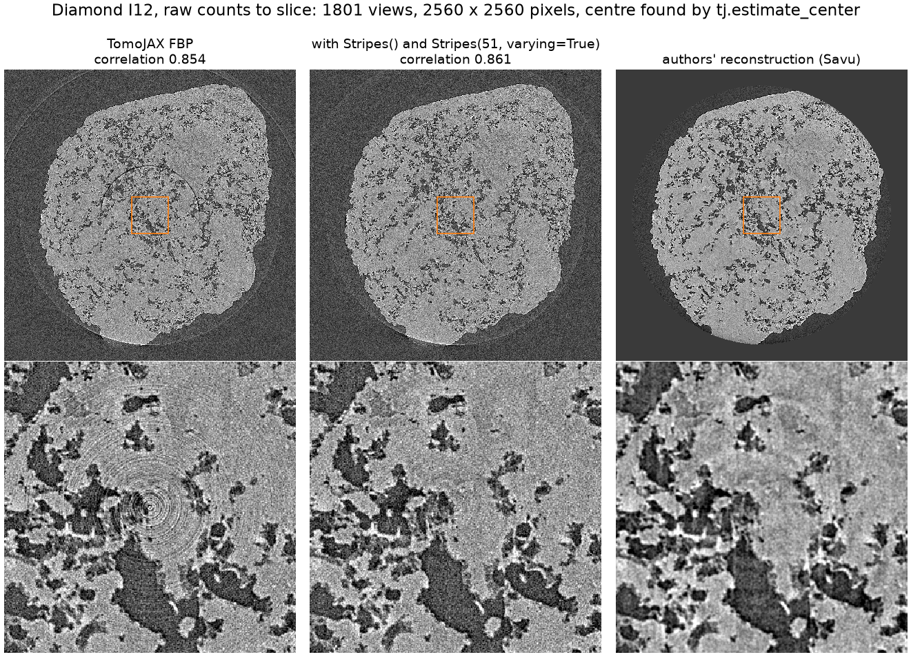
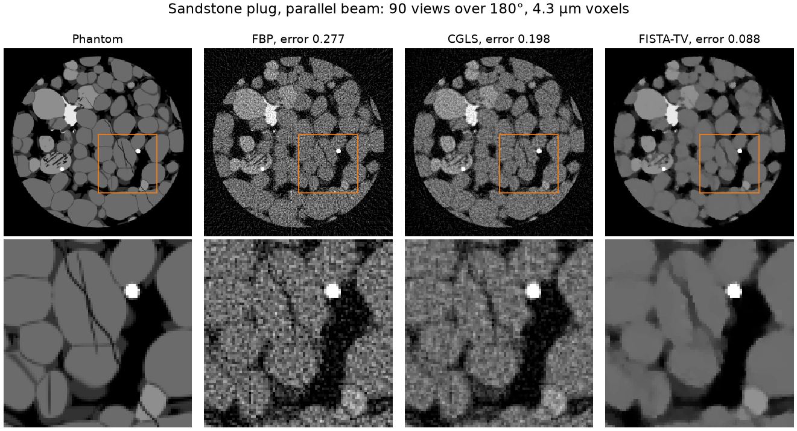
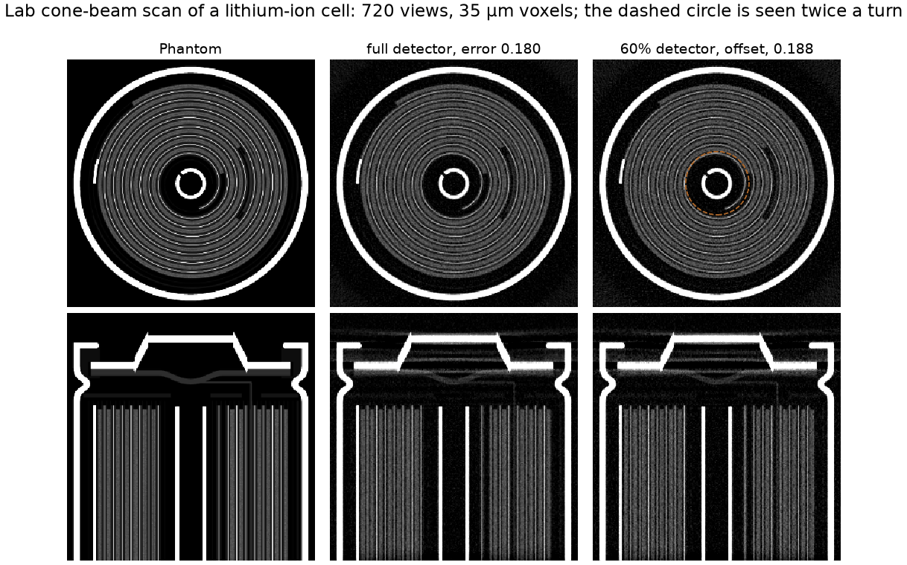
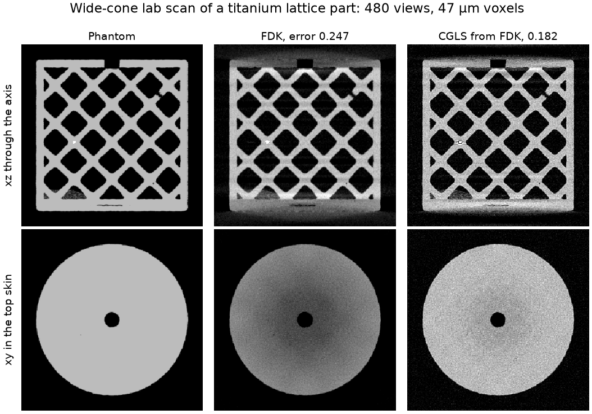

# Gallery

Each figure is made by a script in [examples/gallery](../examples/gallery) on a
laptop GPU (RTX 4070, 8 GB). The synthetic objects are the procedural phantoms
in [bench/phantoms](../bench/phantoms), voxelised 1.5 times finer than the
reconstruction grid, or STL meshes rendered by gVXR, so the data are never
made by the projector that inverts them. Errors are relative L2 against the
phantom inside the object.

## Laminography alignment of a chip package



A DIAD-like scan at 25 keV and 30° tilt, rendered by gVXR from the meshes of a
chip package with phase contrast, detector blur, Poisson noise and flat
fields. The detector is 3.2 pixels off the axis and the sample wobbles and
jitters by about two pixels and 0.1° between views. `tj.align(scan,
mode="cor-then-pose")` finds the centre to 0.02 pixels and the per-view shifts
to 0.03 and 0.08 pixels in under two minutes; the voids in the solder balls
reappear. The shifts are compared after removing a rigid motion of the whole
sample, which no reconstruction can detect, and slices across the sample plane
are left out because laminography blurs them for any method.

```bash
uv run python bench/phantoms/chip_package.py build DATA   # gVXR environment, about 20 minutes
uv run python examples/gallery/chip_laminography.py DATA chip-laminography.png
```

## Ring removal on a real synchrotron scan



The Diamond I12 scan of Vo et al. (Zenodo 3339629), 1801 views on a
2560-pixel detector, from raw counts. `tj.estimate_center` places the axis.
`Stripes()` removes the tight rings round the axis and
`Stripes(51, varying=True)` the large ring from an intensity-dependent column,
leaving the rock's structure as it was. Correlation with the authors' Savu
slice rises from 0.854 to 0.861.

```bash
uv run python examples/gallery/diamond_rings.py full_rows1048-1111.nxs rec_01050.tif diamond-rings.png
```

## Few-view micro-CT of sandstone



A 1 mm sandstone plug (quartz and feldspar grains, clay seams, pyrite,
cracks) in parallel beam with 90 views over 180°. The rock absorbs weakly at
30 keV, so FBP (error 0.277) and 20 CGLS iterations (0.198) are noisy;
FISTA-TV with weight 1e-4 (0.088) keeps the grain contacts and cracks.

```bash
uv run python examples/gallery/rock_few_views.py rock-few-views.png
```

## A cell wider than the detector



A scaled 18650 lithium-ion cell in lab cone beam at eight times magnification.
A detector 60% as wide, offset to see one side of the cell and 1.15 mm past
the axis, reconstructs the whole cross-section: FDK weights the rays measured
twice a turn (the dashed circle), and the error is 0.188 against 0.180 with a
detector covering the cell.

```bash
uv run python examples/gallery/battery_offset_detector.py battery-offset-detector.png
```

## Wide-cone artefacts on a lattice part



An additively manufactured Ti-6Al-4V octet lattice with pores, a lack-of-fusion
flaw and a tungsten inclusion, scanned with a cone of about ten degrees at its
top and bottom. FDK's approximation darkens the centre of the top skin and
smears the plates (error 0.247); 30 CGLS iterations from FDK fit the cone-beam
data and remove it (0.182), at the price of more noise.

```bash
uv run python examples/gallery/lattice_cone.py lattice-cone.png
```
