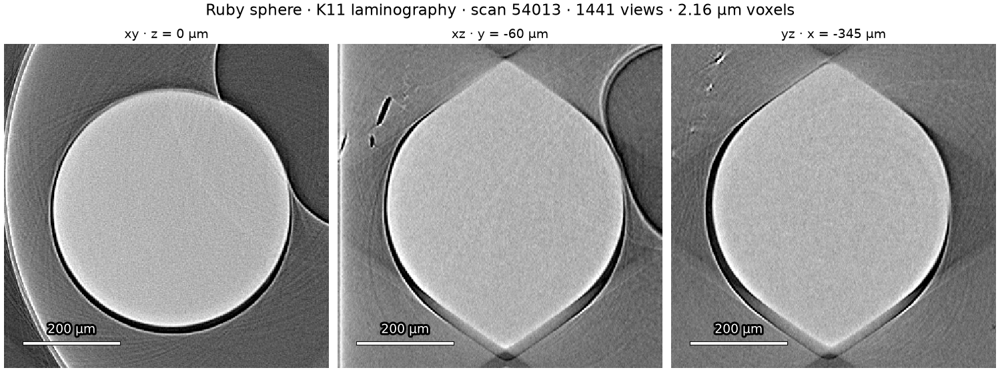
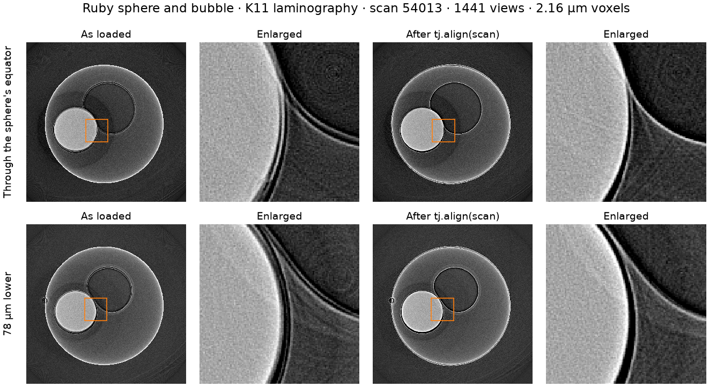
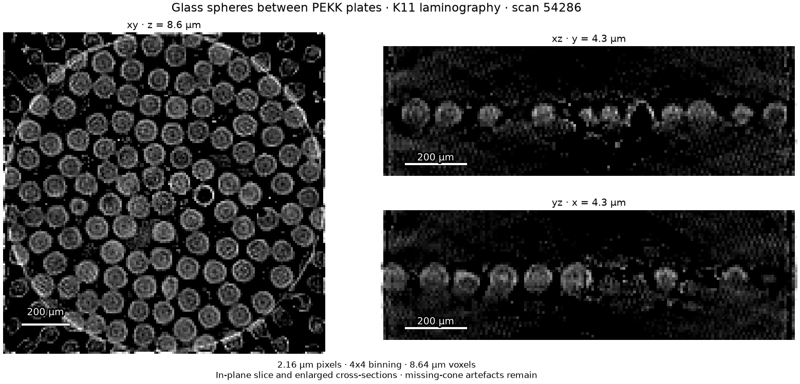
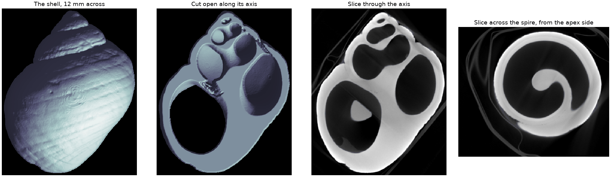
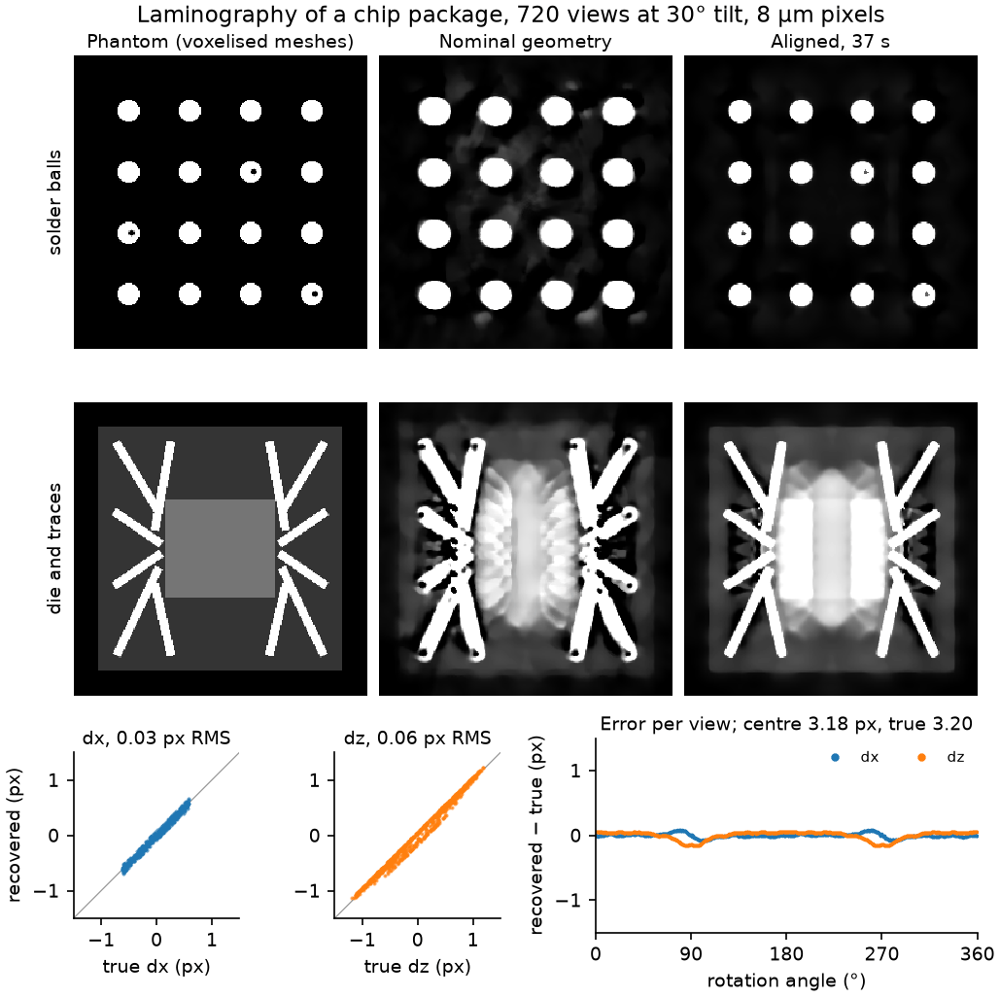
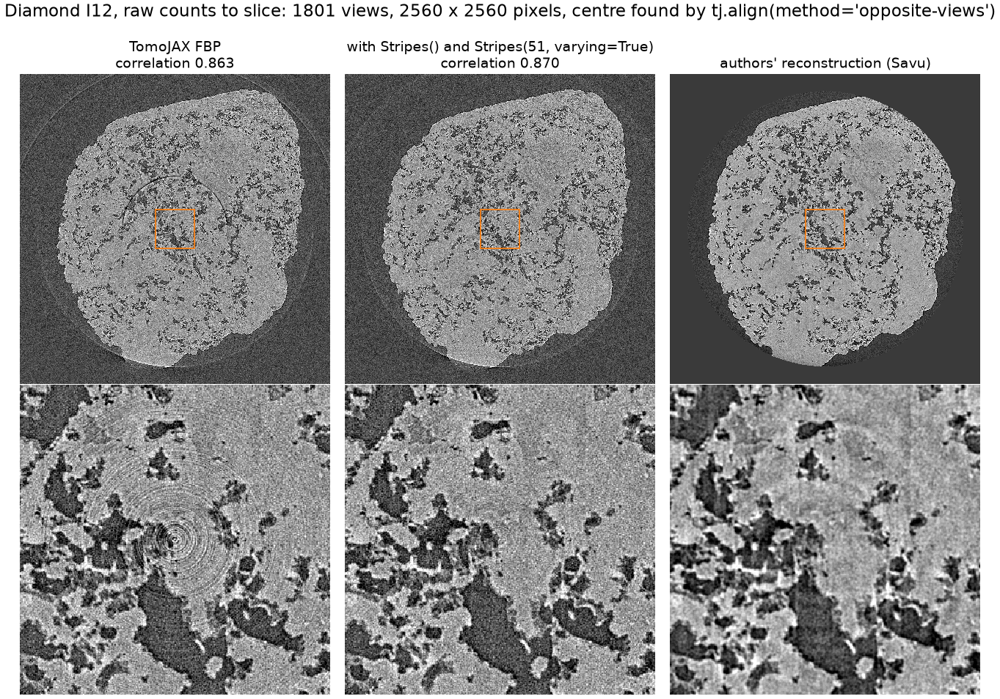
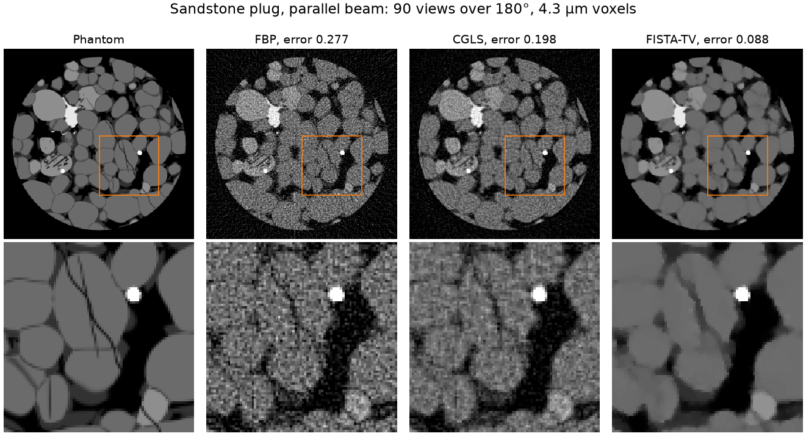
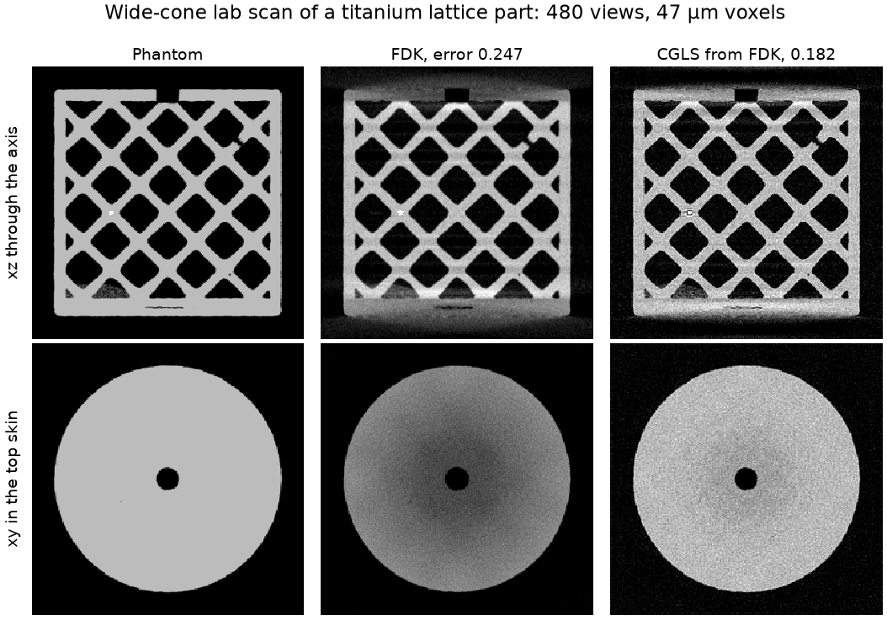

# Gallery

Each figure is generated by a script in [examples/gallery](../examples/gallery) on an RTX 4070 Laptop GPU (8 GB). Synthetic phantoms come from [bench/phantoms](../bench/phantoms), voxelized 1.5× finer than the reconstruction grid or rendered from STL meshes with gVXR so the projections are independent of TomoJAX's projector. Errors are relative L2 inside the object. Install Matplotlib with `uv sync --group examples`.

## Ruby sphere in a real laminography scan



A ruby sphere in Diamond K11 laminography scan 54013, aligned with `tj.align(scan)` and reconstructed by FBP at the detector's 2.16 µm pitch across three orthogonal planes (shared gray scale, 200 µm scale bars). The sphere appears lens-shaped vertically because laminography leaves a cone of frequencies around the rotation axis unmeasured.

```bash
uv run python examples/gallery/k11_ruby_sphere.py k11-54013.nxs k11-ruby-sphere.png
```

## Aligning a real laminography scan



Diamond K11 scan 54013 aligned with `tj.align(scan)` on a 6.48 µm working grid and reconstructed by FBP at 2.16 µm, shown through the sphere's equator and 78 µm lower. Alignment sharpens the doubled sphere and bubble edges into single crisp boundaries.

```bash
uv run python examples/gallery/k11_sphere_alignment.py k11-54013.nxs alignment-k11-sphere.png
```

## Glass spheres between PEKK plates



Glass spheres between PEKK plates in Diamond K11 laminography scan 54286, aligned with `tj.align(scan)` and reconstructed by FBP at 2.16 µm (shared gray scale, 200 µm scale bars), showing the same vertical missing-cone elongation as the ruby sphere.

```bash
uv run python examples/gallery/k11_glass_layer.py k11-54286.nxs k11-glass-layer.png
```

## A snail shell from a lab cone-beam scan



A 12 mm snail shell scanned on a Zeiss Xradia (1601 views of 1024 × 1024 pixels over a full turn), loaded from its `.txrm` file with the recorded center and per-view shifts and reconstructed by FDK on 512³ voxels of 30 µm, without alignment. The cut-open view and the slice through the axis show each earlier whorl inside the last.

```bash
uv run python examples/gallery/zeiss_shell.py S_1_tomo-A.txrm zeiss-shell.png
```

## Laminography alignment of a chip package



A DIAD-like 25 keV, 30° laminography scan rendered in gVXR with phase contrast, detector blur, Poisson noise, and flat fields. The detector is offset 3.2 pixels from the rotation axis, and the sample wobbles and jitters by ~2 pixels and 0.1° per view. `tj.align` recovers the center to 0.02 px and per-view shifts to 0.03 px across the axis and 0.06 px along it in 37 s (after removing one unobservable global rigid shift), restoring the voids inside the solder balls. Display intensity is clipped at 1.2 mm⁻¹, saturating copper and gold (16 and 85 mm⁻¹). Because laminography does not measure slowly varying components along the sample normal, surrounding copper layers bleed into the die slice even with exact poses.

```bash
uv run python bench/phantoms/chip_package.py build DATA   # gVXR environment, ~20 minutes
uv run python examples/gallery/chip_laminography.py DATA chip-laminography.png
```

## Ring removal on a real synchrotron scan



Diamond I12 scan of Vo et al. (Zenodo 3339629, 1801 views on a 2560-pixel detector) from raw counts. `tj.align(method="opposite-views")` locates the rotation axis. The script below removes rings with `Rings()`. The figure above predates that change and shows correlation 0.863 without correction and 0.870 with the removed `Stripes` step against the authors' Savu slice.

```bash
uv run python examples/gallery/diamond_rings.py full_rows1048-1111.nxs Before_correction/rec_01050.tif diamond-rings.png
```

## Few-view micro-CT of sandstone



A 1 mm sandstone plug (quartz and feldspar grains, clay seams, pyrite, cracks) in 90-view, 180° parallel beam at 30 keV. FBP (error 0.277) and 20 CGLS iterations (0.198) stay noisy; FISTA-TV (`tv_weight=1e-4`, error 0.088) preserves grain contacts and cracks.

```bash
uv run python examples/gallery/rock_few_views.py rock-few-views.png
```

## A cell wider than the detector


A scaled 18650 lithium-ion cell, 8.5 mm across, in lab cone beam at 8× magnification. A detector 60% as wide, shifted to reach 1.16 mm past the rotation axis, still sees every point of the cell for more than half the turn, and FDK weights the rays near the axis that it measures twice. The whole cross-section reconstructs at error 0.188, against 0.180 with the full detector.

```bash
uv run python examples/gallery/battery_offset_detector.py battery-offset-detector.png
```

## Wide-cone artifacts on a lattice part



An additively manufactured Ti-6Al-4V octet lattice containing pores, a lack-of-fusion flaw, and a tungsten inclusion, scanned at ~10° cone half-angle. FDK's approximation darkens the top skin and smears horizontal plates (error 0.247); 30 CGLS iterations warm-started from FDK remove the cone artifacts (error 0.182), with slightly higher noise.

```bash
uv run python examples/gallery/lattice_cone.py lattice-cone.png
```
