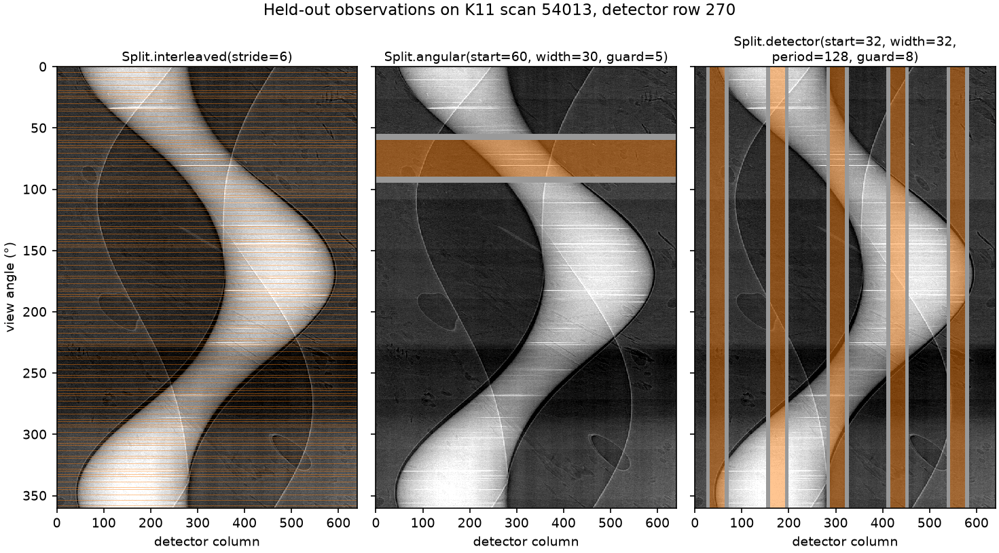

# Held-out evaluation

`tomojax.evaluation.Split` partitions observations into training, held-out test, and optional guard sets before fitting. Pass predictions computed with the same projector and discretization used in the fit; scores compare predictions directly against held-out observations without fitting an intensity scale or offset.

Choose the split that matches what your model shares across observations:

- `Split.interleaved(shape, stride=5, offset=2)` holds out evenly spaced views, for comparing iteration counts or regularization weights. Check several strides, since sparser angular sampling can shift the preferred setting.
- `Split.angular(shape, angles, start=60, width=30, guard=5)` holds out a contiguous angular arc (repeated every 360°), for testing global geometry or smooth motion models across unseen angles.
- `Split.detector(shape, start=32, width=32, period=128, guard=8, offsets=...)` holds out full-height detector-column blocks in every view (with fixed integer pixel `offsets`, either common or per view). Use this for independent per-view poses, where wholly unseen views have no pose evidence.

`shape` is `(views, rows, columns)` and `angles` are in degrees. `split.train` and `split.test` are read-only boolean masks broadcastable to `shape`, with guard observations excluded from both. `split.specification` (JSON) and `split.fingerprint` (SHA-256 of the specification) identify the split for logging alongside dataset IDs, geometry, corrections, and commands.



The three splits on one corrected detector row of Diamond K11 scan 54013 (held-out observations in orange, guards in gray):

```bash
uv run python examples/gallery/held_out_splits.py k11-54013.nxs held-out-splits.png
```

## Prevent leakage

Exclude test and guard observations from every fitted step: reconstruction, pose initialization, motion priors, data-derived weights, and nuisance parameters. Independent flat and dark frames may calibrate both partitions, whereas sample-dependent ring removal or angular smoothing must not mix them. Freeze the split in native detector coordinates before preprocessing, and size guard bands to cover any local preprocessing support or motion range (global Fourier filters mix the whole row regardless of guard width).

`tj.reconstruct` and `tj.align` do not apply `Split` masks automatically:

- For interleaved and angular splits, pass only `scan.selected(split.train_views)` (or the training view indices) into the fit.
- For detector splits, use a solver whose image and pose objectives accept observation weights, and zero the weights on excluded pixels (zeroing the data alone is not exclusion).

Verify isolation by perturbing all excluded observations and confirming the fitted result is unchanged.

## Score matched predictions

```python
from tomojax.evaluation import Split

split = Split.interleaved(observations.shape, stride=5, offset=2)
# Fit using split.train only, then predict with that fit's projector and geometry.
score = split.score(prediction, observations)
print(score.mse, score.relative_l2, score.count)
```

Optional `weights=` specifies nonnegative precision (not square-root precision). Zero-weight entries are ignored; nonfinite values with positive weight raise an error. Empty test batches yield zero totals and `NaN` mean/relative error; zero target energy yields `NaN` relative error.

For large scans, accumulate `Score` objects over view batches with `+` or `sum(...)` before reading ratios:

```python
total = sum(
    split.score(prediction[slice(start, start + 32)], observations[slice(start, start + 32)], views=slice(start, start + 32))
    for start in range(0, observations.shape[0], 32)
)
print(total.mse)
```

Summing `Score` totals preserves exact weighting across uneven batches. Keep a separate untouched test split if you use cross-validation scores to select hyperparameters.

## Stopping-rule limits

Minimizing held-out projection MSE does not reliably select the lowest-error reconstruction. On three real scans with an interleaved every-fifth-view split (`stride=5, offset=2`) and CGLS candidate budgets of `1, 2, 4, 8, 16, 32, 64` iterations (fixed geometry, no intensity rescaling):

| Scan and image metric | MSE-selected iteration / error | Best tested iteration / error | Error ratio |
| --- | ---: | ---: | ---: |
| 2DeteCT 00001 mode 1 (128²), against mode-2 reference | 16 / 0.2247 | 8 / 0.1592 | 1.41× |
| FIPS Walnut 1, 3 orbits, binned 8×8 (64³), against authors' reference | 64 / 0.2825 | 8 / 0.2027 | 1.39× |
| Diamond I13 159815, row 1080, every 8th view (256²), injected Gaussian increment | 16 / 0.5607 | 32 / 0.2599 | 2.16× |

Errors are relative image L2 norms. Shared calibration noise, detector truncation, and forward-model mismatch violate the independent-noise assumption behind view cross-validation, so projection MSE systematically over- or under-iterates relative to image quality.

The same gap appears across other solvers and selection criteria tested on these scans:

- **SIRT on 2DeteCT 00001 (128²):** projection MSE picked 256 updates instead of the best tested 128 for both unconstrained (1.26× higher error) and nonnegative SIRT (1.24×).
- **Ridge regularization on 2DeteCT 00001 (32²):** both projection MSE and an exact discrete image-space risk estimator (`||x||² - 2<x, A_test⁺ y_test>`) picked `λ = 1e-4` instead of `1e-2` (3.27× higher error), even when validated against high-dose mode-2 observations.
- **Fine-grid FDK/FBP validation proxy (`||x||² - 2<x, z_test>`):** matched the best CGLS iteration on four 2DeteCT slices (1.00–1.02× error ratio), but failed to transfer to Diamond I13 (selecting 8 updates with 4.13× the incremental error of 128 updates and 20% worse projection MSE than 50 updates) and showed 3.6–15.9% proxy bias on analytic sharp-disc and truncated-object controls.

For these reasons, TomoJAX provides `Split` and `Score` as evaluation tools and does not use held-out projection scores for automatic stopping or regularization selection. Pair held-out scores with slice inspection or known-truth checks when tuning a workflow.
