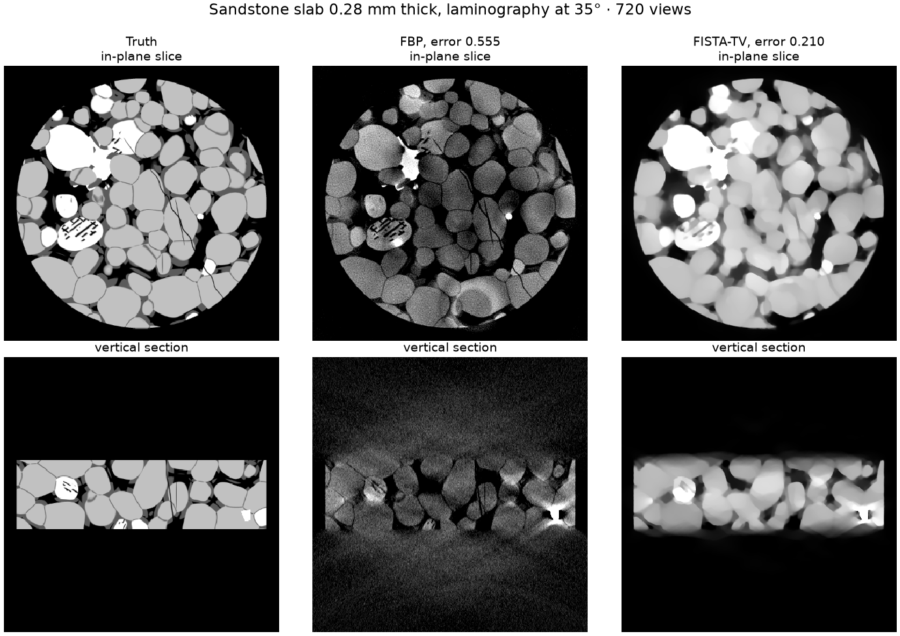

# Known limitations

## Reconstruction and regularization

- **Laminography missing cone:** FBP reconstructs every measured frequency accurately and leaves the unmeasured cone around the rotation axis empty, elongating features along the axis. Iterative solvers (FISTA-TV with nonnegativity) recover part of the missing cone from volume bounds and priors, at the cost of slight smoothing of fine in-plane detail.

  

  A 0.28 mm sandstone slab simulated in 35° laminography (720 views): FBP leaves the missing cone empty (relative error 0.555 inside the slab), while nonnegative FISTA-TV restores the slab faces from bounds and total variation (error 0.210) while slightly smoothing the finest grains:

  ```bash
  uv run python examples/gallery/rock_missing_cone.py rock-missing-cone.png
  ```

- **Phase-contrast fringes under FISTA-TV:** on propagation phase-contrast data, FISTA-TV smooths bright/dark fringe pairs into bands even at high iteration counts, whereas FBP preserves them. Align scans before comparing solvers so motion blur is not mistaken for regularization.
- **Automatic FISTA-TV calibration:** FISTA's automatic `tv_weight` and noise-score stopping assume independent detector errors and roughly uniform coverage across the volume. Coherent detector artifacts such as rings survive and should be corrected beforehand (with `Rings()`). Reaching the 200-update cap (`termination="iteration_limit"`, `early_stop=False`) means the proximal gradient did not reach the noise-score threshold within the budget. The selected weight is a reproducible starting point; pass an explicit `tv_weight` when tuning for a specific specimen, contrast, or resolution target.
- **Automatic CGLS and SIRT stopping:** discrepancy stopping for unpenalized CGLS and full-data SIRT estimates independent detector noise (Haar MAD) and linear-interpolation sampling error from bounded detector patches at isocenter magnification (measurement noise alone for cubic interpolation or explicit detector grids; disabled on 1-pixel detectors). It does not capture motion, scatter, calibration bias, or correlated detector errors. On real scans those unmodeled errors often keep the projection residual above `projection_error_rms` past 50 updates, so the 50-update cap ends the run (`termination="iteration_limit"`, `early_stop=False`) without identifying the scan's noise floor. Unpenalized CGLS and SIRT have no image-space regularizer and fit noise and discretization error if run for hundreds of updates even as the fitted residual keeps falling. Inspect slices, pass an explicit `iterations=` if a scan needs a different budget (with `acceleration=True` if you also want momentum in SIRT), or use `fista` for explicit TV regularization.
- **FDK approximation:** FDK assumes a circular orbit, is exact only in the midplane, and develops cone artifacts at larger cone angles. Use an iterative solver (`cgls`, `fista`, `sirt`) for wide cones or multi-orbit scans.
- **Objects larger than the field of view:** rays that miss the detector are not measured, so the measured rays fix the interior only up to a smooth background. By default (`exterior="cylinder"`), `fourier`, `fbp`, and cone-beam FDK continue each detector row past both edges as a uniform cylinder about the rotation axis fitted to the row's edges. Edges, contrast between neighboring regions, and fine detail inside the field of view stay intact, while the absolute level is only as accurate as that cylinder model. Set `exterior="zero"` in `FBPConfig`, `FourierConfig`, or `FDKConfig` (or in a CLI `--config` TOML file with an explicit `--method`) to assume zero attenuation beyond the detector. In parallel-beam simulations, the interior level stayed within 1% for a body 15% wider than the field of view, within 3% of the body's attenuation for a tube around a contained sample or a wide plate, and within 6% for a body three times the field of view, with the bowl across the field under 4%. Non-cylindrical exteriors behave worse: a square bar whose corners leave the field of view in some views retains a 9% bowl and 27% rim (30% in cone beam). On a rolled cone detector, the continuation uses one axis distance per column for every row. `info["truncation"]["interior_shift"]` gives the estimated change on the rotation axis from the cylinder model. Iterative solvers (`cgls`, `sirt`, `fista`, `spdhg`, `mlem`) fit the grid to the measured rays and do not model material outside it: when material lies outside the grid they keep the bright rim and bowl, and unpenalized CGLS runs to its 50-update cap and fits noise. For truncated scans, use `fourier` or `fbp` (FDK for cone beams), or give an iterative solver a grid that holds the whole object ([detector exterior continuation measurements](measurements.md#detector-exterior-continuation)).
- **Fourier-slice inverse (`fourier`):** supports axial parallel scans only (rejects tilted axes and rotational poses), is non-differentiable, and interpolates across missing angular sectors rather than recovering them; angular interpolation and the native detector-Nyquist cutoff can introduce artifacts on sharp or undersampled data. Setting `filter="ramp"` (or `"hann"` or `"shepp-logan"`) matches FBP's detector response on an unrolled lattice, though differences remain because discrete FBP sums each measured angle directly and aliases frequencies outside the Cartesian frequency grid. On a rolled detector, Fourier resamples measurements onto axial rows before inversion rather than filtering in 2D.
- **No automatic held-out stopping:** held-out projection MSE systematically over- or under-iterates relative to image error on real scans (see [stopping-rule limits](held-out-evaluation.md#stopping-rule-limits)), so iteration counts and regularization weights are not chosen automatically by cross-validation.

## Alignment

See [align a scan](align-a-scan.md#check-the-result) for choosing `fit=` parameters and checking results.

- **Rigid-body assumption:** `tj.align` assumes the whole sample moves rigidly. Deforming or independently moving parts can make an aligned reconstruction worse than the input. When parts move by different amounts the fit follows their average: on Diamond K11-52544 the two compression-platen faces move by 4.12 and 1.21 native px RMS along the axis.
- **Shadows crossing the detector:** attenuation that passes through the beam in some views and is not part of the sample is fitted as sample motion. On Diamond K11-52544 two such crossings moved the fitted horizontal translation by up to 22.4 native px in the views they covered; with the measured shadow removed from the projections the largest horizontal correction was 2.89 px ([full-scale alignment measurements](measurements.md#full-scale-native-detector-alignment)).
- **Unobservable gauges:** a global rigid shift of the object (and, in parallel beam, a constant translation traded against `Detector.center`) leaves projections unchanged. Remove one common rigid transform before comparing pose tables, and treat weakly constrained globals (such as cone detector-v) as gauge-dependent rather than standalone instrument calibrations.
- **Unmodeled view-angle errors:** `"rotations"` fits the two wobble components of the rotation axis and keeps each view's recorded encoder angle fixed. Encoder errors are not corrected (0.07° RMS angle error shifts features by 0.13 px RMS on the watch phantom).
- **Sensitivity limits on parallel half-turns:** slow drift around 0.1 px across a half-turn is weakly constrained (with negligible image effect); `fit=("translations", "tilt")` can overshoot parallel tilt (fitting −0.76° for a true −0.35° on a synthetic sandstone scan); and a 1 px sudden slip is followed ~8% short (0.88 px for a 0.95 px slip, or 0.80 px with `motion="smooth"`).
- **Periodic structures and edge mismatch:** per-view rotations can lock onto wrong orientations on periodic samples such as TEM grids. At sharp, high-attenuation edges, finite-pixel transmission averaging differs from linear ray integration and can mimic small shifts.
- **Outliers and truncation:** broken frames, diffraction flashes, or truncated boundaries outside the grid cannot be explained by rigid motion; robust weighting reduces their pull, and `RejectViews()` should be used for bad frames. Outermost slices on truncated samples remain unreliable with or without alignment.
- **Cone-beam calibration limits:** joint alignment fits detector center, detector roll, and shared axis tilt, not detector pitch/yaw, source distances, or detector warp. Under unrestricted 6-DOF per-view poses, source-radius/orbit-height shifts and uniform camera scaling are exact geometric aliases ([cone-setup aliases](measurements.md#cone-setup-aliases-and-a-conditional-calibration-test)).
- **Direct axial center fit (`fit="center"` on parallel scans):** applies only to unposed, unrolled axial parallel half-turns whose angular spacing resolves the working Fourier slice; other geometries, multi-parameter fits, or calls with joint options or an explicit grid use the joint fit. A detector band with no transmitted sample signal (dark or empty frames) has no axis to measure and can return a large arbitrary offset. Strong artifacts, severely spoiled flat fields, or smooth, nearly stationary objects can shift the estimate by several pixels (up to 3.3 px on smooth Gaussian simulations with detector defects, and 4.7–11.0 px on edge-crop displacement checks of a spoiled-flat beamline scan; see [axial center measurements](measurements.md#axial-rotation-center)). Check doubled slices with a center sweep or pass `method="joint"`.
- **Pair-only center (`method="opposite-views"`):** applies to axial parallel scans only. On low-contrast objects, combined detector defects, or tilted axes, competing correlation peaks can produce large errors (up to 3.9 px p95 on low-contrast gVXR cuboids, 1.0 px at 1° tilt, and >100 px median on low-contrast combined-defect scans), and reported 90% intervals cover only local peak matching, not global mode ambiguity.

## Ring correction

- **Flat sets that do not show the beam:** flat sets around a scan are weighted by what the views show of each ([flat fields](../src/tomojax/corrections/README.md#flat-fields)), which removes a set taken with something in the beam where the other set is clear. Where both sets are covered by something the views do not show, the fine part of the error stays fixed to detector columns (for `Rings()`), and a broad part remains because the views carry no measurement of the beam's level without unattenuated beam; `flat_structure_unmatched` in the `flat_dark` record reports the size. Pass another scan's flats with `flats=` or `--flats` in that case. Sets of one frame each are interpolated by position.
- **Stationary column model:** `Rings()` corrects additive offsets and transmission-dependent responses that stay fixed to detector columns. Artifacts that vary with view angle (such as flux drops or angular swirls) are not rings and are not removed. `Rings()` does not detect or interpolate dead pixels (flat/dark calibration interpolates bracketed unilluminated pixels).
- **Centered circular features and axis residuals:** a rotationally symmetric sample feature centered on the rotation axis produces the same parallel-beam projections as a symmetric detector offset on both half turns and full turns, so projection-only correction cannot separate them. Within ~15 pixels of the rotation axis, residual error can remain on sharp centered features or strong detector drift, and correcting a defect-free scan can introduce small concentric residuals ([ring measurements](measurements.md#ring-correction)).
- **Structure alteration:** because separation from object structure is statistical where rays are not repeated, off-axis features can shift on scans with strong structure or sparse sampling ([structure controls against Algotom](measurements.md#structure-controls-against-algotom)).
- **Differentiation:** full-turn `Rings` uses tiled CUDA kernels in `float32` that do not support automatic differentiation; CPU and `float64` run the JAX path.

## Performance, memory, and derivatives

- **Exact cone-beam transpose speed:** TomoJAX's exact cone-beam transpose is slower than ASTRA's approximate voxel-driven backprojector, especially when the detector is much finer than the voxel grid (bin with `scan.binned(...)` when the detector is ≥2× finer).
- **Memory limits:** SPDHG-TV requires five volumes in VRAM (a 1014³ volume needs ~19.5 GiB and does not fit on an 8 GB GPU; use FISTA-TV, CGLS, or SIRT for host-slab execution). Passing an explicit `grid=` to `tj.align` disables working-grid coarsening and can exceed VRAM.
- **Multi-GPU scope:** `devices=` distributes views across GPUs in a single process (no multi-node support) for `project`, `backproject`, and `reconstruct` (`fbp`/FDK, `cgls`, `fista`) in Python and through `tomojax serve` and `tomojax mcp`; it cannot be combined with host streaming. `fourier`, `sirt`, `mlem`, `spdhg`, `fbp_host`, `tj.align`, and standalone CLI commands use one GPU. Each GPU holds a full copy of the volume (except `fdk_host` and automatic FDK slabs), and iterative speedup is bounded by per-iteration volume collectives over the host interconnect ([use several GPUs](large-scans.md#use-several-gpus)).
- **CUDA derivatives and cubic interpolation:** CUDA Joseph kernels support first-order volume and pose derivatives only (use JAX for higher-order AD), with local derivatives that hold the dominant ray axis and interpolation cell fixed. Cubic interpolation (`interpolation="cubic"`) has negative lobes, can overshoot nonnegative data, and uses a wider 4 × 4 stencil.
- **CUDA requirement:** GPU kernels require `tomojax[cuda12]` and a working NVIDIA driver; without CuPy, cone-beam kernels fall back to the JAX reference (~10× slower).
- **Checkpoint and resume scope:** `checkpoint` is supported on `tj.reconstruct`, `tj.reconstruct_slabs`, and `tj.align`, on `tomojax reconstruct` and `tomojax align` (`--checkpoint DIR`), and on `reconstruct`, `reconstruct_slabs`, and `align` through `tomojax serve` and `tomojax mcp`. Direct expert solver calls (`tomojax.recon.*`) and TomoJAX Studio do not start checkpointed jobs (Studio's protocol model reads `error.checkpoint`, but the desktop app does not submit checkpoints). `SIGTERM` triggers a final save inside a checkpointed loop on the main thread in Python and the CLI, and `tomojax serve` handles `SIGTERM` by canceling every job so checkpointed jobs save; under `tomojax mcp`, the client must stop the server on a scheduler signal so the server can give its worker up to two minutes to save. Kills outside a loop or hard kills (`SIGKILL`) resume from the previous periodic or slab save. JAX solver loops do not record a step count in checkpoint `entries` (host-slab and CUDA loops do), so the `saved` timestamp is the only progress indicator in `inspect`. Resumed runs can differ in the last floating-point bits across GPU models, device counts, JAX/CUDA builds, changed slab partitions, or cone-beam alignment (whose CUDA pose-derivative kernel uses floating-point `atomicAdd`). Resumed runs keep saved arrays larger than 1 MiB memory-mapped while the loop runs, which Linux memory cgroups count toward RSS. See [resume a run after a kill](large-scans.md#resume-a-run-after-a-kill).

## Interfaces and parity

- **No CLI command for raw-frame slab reconstruction:** `reconstruct_slabs` is available in Python (`tj.reconstruct_slabs`), the JSON Lines worker (`tomojax serve`), and the MCP server (`tomojax mcp`), not as a `tomojax` CLI subcommand.
- **Declaring geometry by kind:** `tomojax correct` (`--geometry parallel|lamino|cone`) and worker or MCP `open` (`geometry: {"kind": "parallel"}`) accept a geometry kind name, whereas Python `tj.load` and `tj.load_frames` require a full geometry object (`ParallelGeometry`, `LaminographyGeometry`, or `ConeGeometry`) for `geometry=`.
- **Inspection validity on undeclared geometry:** `inspect` reports `valid: true` (exit 0 on the CLI) for a file that records no rotation axis (`loading["geometry"] == "not_recorded"`), because `valid` reflects dataset integrity checks; reconstruction and alignment refuse the scan until geometry is declared when loading.
- **Worker wire form in MCP checkpoints and `describe`:** the `request` stored in a worker or MCP checkpoint and the parameter schema returned by MCP `describe` on workflow tools use the worker's tagged source objects (`{"type": "path", "path": ...}`), whereas MCP workflow tools take `source` as a path string or handle ID.
- **Canceling a blocking MCP call:** MCP clients that support the MCP tasks extension can cancel a long call directly; clients without task support must read the job ID from `status` and pass it to `control` with `action="cancel"`.

## File formats and external data

- **No helical scans or scatter modeling:** TomoJAX models circular cone orbits and flat detectors, uses single-material beam-hardening curves, and does not model X-ray scatter.
- **Unapplied vendor metadata:** Nikon `OffsetX/Y/Z` reconstruction regions and vendor beam-hardening parameters (Nikon, Zeiss, Bruker) are stored in metadata without being applied automatically.
- **PyHST `.par`:** supports raw single-image axial parallel EDFs only (rejects multi-frame, cone, helical, binning, and distortion modes). Large file-owned grids (such as 2048² × 1200, 20.1 GB in `float32`) survive detector cropping; pass a smaller `grid=` or use `tj.reconstruct_slabs` if memory is tight.
- **External HDF5 links and Zeiss streams:** missing backing files for HDF5 virtual datasets and missing interior Zeiss image streams raise errors rather than zero-filling. Interrupted Zeiss scans load only while stored frames match per-view metadata.
- **Custom benchmark layouts:** raw complex MATLAB ptychography (`stack_object`), FIPS walnut directories, and 2DeteCT folders require explicit preparation scripts (see [examples/README.md](../examples/README.md)).
