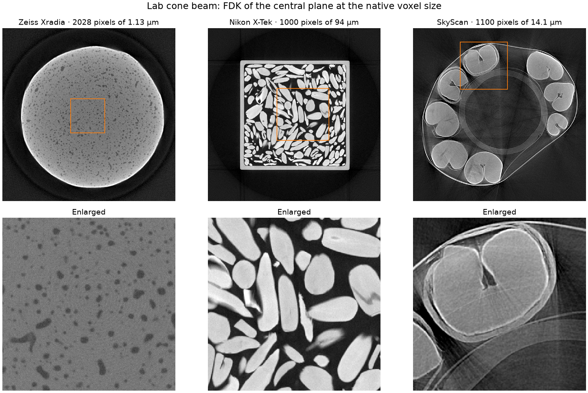

# Lab cone-beam CT

TomoJAX reconstructs and aligns lab cone-beam CT scans (point source, flat detector, turntable) from Nikon `.xtekct`, Zeiss `.txrm`, SkyScan logs, ASTRA geometries, or generic TIFF folders, including multi-orbit acquisitions.

## Import

### Nikon (X-Tek)

A Nikon scan consists of an `.xtekct` parameter file alongside projection TIFFs. `tomojax correct` reads source and detector distances, pixel pitch and offsets, calibrated rotation axis (`ObjectOffsetX`, `ObjectRoll`, `ObjectTilt`, or legacy `CentreOfRotationTop/Bottom`), white level, and nominal angles (`InitialAngle` and `AngularStep`; `.ang` and `_ctdata.txt` sidecars are ignored). Only numbered projection TIFFs matching `<Name>` are loaded, skipping flat fields, thumbnails, and reconstructions. If a folder holds multiple `.xtekct` files, pass the calibrated one (typically `<name>_recon.xtekct`; an acquisition file with `AutomaticCentreOfRotation=1` has no center and loads at the detector middle).

Nikon files do not store dark frames; supply measured darks with `--darks`, or `--darks 0` if counts are already dark-subtracted:

```bash
tomojax correct scan/part.xtekct --darks 0 -o scan.nxs
tomojax inspect scan.nxs
```

TomoJAX reverses Nikon's top-right panel origin and converts angles and offsets into its own frame while keeping lengths in millimeters. Any extra closing frame on a full turn is excluded with a warning. To override angles with a measured schedule, pass `angles=` (or `--angles`) in TomoJAX's object-angle frame.

### Generic TIFF cone scans

For scanners without a dedicated reader, pass measured `ConeGeometry` to `tj.load_frames(..., geometry=..., flats=..., darks=...)`, or declare it on the CLI using one consistent length unit:

```bash
tomojax correct projections/ --flats flats/ --darks darks/ \
  --angles angles.csv --geometry cone \
  --source-to-axis 120.5 --source-to-detector 980.0 \
  --pixel-size 0.2 --detector-center 0.0 0.0 -o scan.nxs
```

`--flats` and `--darks` accept frame directories, another scan's HDF5/NeXus file (taking only its flat or dark frames), or scalar levels (`--flats 60000 --darks 0`). `--pixel-size` accepts one value (square pixels) or `du dv`. For already-corrected line-integral TIFFs, read them with `tomojax.io.api.read_tiff_frames` and construct `tj.Scan(projections, geometry)` in Python.

Optional detector orientation flags (`--axis-offset`, `--detector-roll`, `--detector-pitch`, `--detector-yaw`) apply right-handed rotations about the detector normal (pointing towards the source), u, and v in that order: positive roll turns u towards v, positive pitch tilts the +v edge towards the source, and positive yaw swings the +u edge away from it.

Without a recorded grid, cone scans default to one voxel per detector pixel at the rotation axis (`pixel_size / magnification`). Use `--grid NX NY NZ` on the CLI or `scan.grid.resampled(shape=(64, 64, 64))` in Python to resample the grid while preserving physical extent.

### Artifact corrections

Pass `--rings` or `--zingers` to `tomojax correct` (or `Rings`, `Zingers`, `BeamHardening` to `frames.corrected(...)` in Python). To try settings before correcting the whole scan, add `--dry-run --preview band.png`: it corrects a band of rows, writes their sinograms before and after the steps and the difference, and writes no scan.

```bash
tomojax correct scan/scan.xtekct --darks 0 --rings --dry-run --preview band.png
```

For beam-hardening linearization with an explicit polynomial or X-ray spectrum, see [beam hardening](../src/tomojax/corrections/README.md#beam-hardening); vendor beam-hardening parameters are kept in metadata unapplied.

### Zeiss Xradia preview

Load the **projection acquisition** (`.txrm`), not a reconstructed `.txm` volume or scout image. TomoJAX reads embedded reference images, timestamps, exposure times, angles, distances, and per-view shifts (`alignment/x-shifts`, `y-shifts`), storing those shifts in per-view detector centers so measured pixels are never resampled.

- **Center:** shifts are relative to `AutoRecon/CenterShift`. Without it, loading puts the center at the detector middle (`detector_center_status="not_recorded"`); fit `"center"` with `tj.align` or supply `detector=tj.Detector(nu, nv, pitch, pitch, (u, 0))` (where `pitch` is recorded object-plane pixel size × magnification). Passing a full `geometry=` uses it verbatim and drops embedded shifts with a warning.
- **Orientation:** a volume comes out in the orientation of Xradia's own reconstruction of the same scan, so its slices compare with the vendor's `.txm` directly.
- **References and darks:** pass a separate flat with `--flats reference_Front.xrm` (or `flats=` + `flat_exposure_times=` in seconds for raw arrays). Single-frame timestamped references interpolate linearly by position. Files with `AcquisitionSettings/CameraStaticBackground = 1` need no darks; otherwise supply `--darks` / `darks=`.
- **Detector saturation:** Zeiss records the camera's linear ceiling in `MaxLinearRange` (45 000 counts on typical scans). Long exposures can push air pixels past that ceiling; `tj.load` warns when counts exceed it and records the affected fraction and `linear_limit_line_integral` in the `flat_dark` record. Saturated air reads as artificial absorption (e.g. ~0.33 instead of 0 on CuO_2) and appears as a bright background around the sample.

Saving a scan stores its effective detector, cone arrangements and fitted poses.
On reload, `detector=` sets the first panel and preserves the physical offset to
each other panel. Original Zeiss shifts describe the raw acquisition in its
original view order and pixel units. For nominal geometry, load the `.txrm`
with `apply_poses=False`. To remove rigid poses from a saved scan while keeping
its calibrated detector centers, use `scan.with_poses(None)`.

For a fast 64³ CPU preview (every 8th view, 16 × 16 binning):

```bash
tomojax correct scan.txrm --darks 0 -o corrected.nxs --views ::8 --binning 16
tomojax reconstruct corrected.nxs -o preview.nxs --method cgls --iterations 10 --grid 64 64 64
tomojax inspect preview.nxs --preview-dir previews
```

In Python:

```python
import tomojax as tj

scan = tj.load_frames("scan.txrm").selected(slice(None, None, 8)).corrected(binning=16)
grid = scan.grid.resampled(shape=(64, 64, 64))
recon = tj.reconstruct(scan, "cgls", iterations=10, grid=grid)
tj.save("preview.nxs", recon)
```

Per-view detector shifts produce a `ConeSegments` geometry, for which automatic reconstruction selects matched CGLS rather than single-arrangement FDK.

## Calibrate the detector center and setup angles

A wrong detector center doubles features, while detector roll introduces height-dependent blur. Fit both shared parameters together:

```bash
tomojax align scan.nxs -o calibrated.nxs --fit center roll
```

For cone data, `"center"` fits detector-u and detector-v offsets in the detector frame (distinct from `ConeBeam.axis_offset`), `"roll"` fits detector roll, and adding `"tilt"` fits the rotation-axis tilt. Source distances, pitch, and yaw stay fixed. Compare slices across several heights against an unaligned reconstruction, or sweep the center and choose it by eye (see [check the center by eye](align-a-scan.md#check-the-center-by-eye)).

## Reconstruct

For a single cone-beam arrangement, `--method auto` selects FDK (`--method fbp` selects it explicitly):

```bash
tomojax reconstruct calibrated.nxs -o fdk.nxs
```

FDK handles full turns, offset-detector (half-fan) full turns, and Parker-weighted short scans (≥ 180° + fan angle); for a shorter arc, `--method auto` selects matched CGLS instead. Like any circular-orbit FDK, it is exact in the orbit plane and develops cone artifacts away from it.

For region-of-interest scans where the specimen extends past the detector edges, FDK continues each detector row past both edges after angular weighting (an offset-detector edge covered by opposing views continues as zero) as the projection of a uniform cylinder about the rotation axis, and retains filtered rows as far as the grid projects. That default (`exterior="cylinder"`) removes the bright rim and bowl of a zero exterior: on FIPS Walnut 1 cropped to the middle half of its detector (192 columns), FDK's rim error fell from 548% to 23% of the mean attenuation and its bowl fell from 91% to 14%. Set `FBPConfig(exterior="zero")` in `tj.reconstruct` or `tj.reconstruct_slabs` (`FDKConfig(exterior="zero")` in direct `fdk` calls, or `exterior = "zero"` in `--config` TOML with `--method fbp`) to assume zero outside the detector. Read `recon.info["truncation"]` (`outside_fraction`, `interior_shift`, `edge_ratio`, `radius`, `field_of_view_radius`) to check how much attenuation lies beyond the detector; `tomojax reconstruct` appends the share to its closing line from 1% up. Non-cylindrical exteriors (such as a square bar) still keep partial cupping and rim error, and iterative cone solvers (`cgls`, `fista`, `sirt`, `spdhg`, `mlem`) fit the grid without an exterior model: they are accurate when the grid holds the whole object, and keep the rim and bowl when material extends outside it. See [truncated scans](quickstart.md#truncated-and-region-of-interest-scans).



Orbit-plane FDK slices of three lab scans loaded directly from vendor files at native axis-plane resolution without alignment: Zeiss Xradia CuO_2 tomo-B (3201 views, recorded center and shifts), Nikon X-Tek seeds (1571 views, `_recon.xtekct`), and SkyScan 1172 grains (996 views over 199°, nominal detector middle):

```bash
uv run python examples/gallery/lab_cone_slices.py CuO_2_tomo-B.txrm \
  "47209 testscan korn01_recon.xtekct" jyvat.log lab-cone-slices.png
```

Iterative solvers model the exact cone-beam geometry and per-view poses, using the exact transpose of the forward projector so CGLS stays stable across iterations (ASTRA's approximate backprojector diverges on long cone CGLS runs; see [cone-beam measurements](measurements.md#cone-beam-ct-against-astra-and-tigre)):

```bash
tomojax reconstruct calibrated.nxs -o cgls.nxs --method cgls --iterations 20
tomojax reconstruct calibrated.nxs -o tv.nxs --method fista --iterations 50 --tv-weight 0.002
```

Omitting `--iterations` enables automatic stopping: unpenalized `cgls` and full-data `sirt` stop when the projection residual reaches an estimate of detector noise plus sampling error, capped at 50 updates (full-data `sirt` also enables FISTA momentum when `relaxation <= 1`), and `fista` calibrates TV weight and stops at its proximal-gradient noise estimate up to 200 updates. Unpenalized CGLS and SIRT fit noise and discretization error if run for hundreds of updates even as the fitted residual keeps falling, so stopping early regularizes them. On real cone-beam scans, scatter, motion, and calibration bias often keep the residual above the local estimate at 50 updates (`termination: "iteration_limit"` in `recon.info` or `--manifest`, and printed on the closing line of `tomojax reconstruct`). Pass `--iterations N` for a fixed budget (plain sweeps for `sirt` unless `acceleration = true` is also set in `--config`), or `acceleration = false` in `--config` for plain automatic SIRT.

Pass method-specific settings via `--config` TOML files or `tomojax.recon.*Config` classes ([quickstart](quickstart.md#reconstruct-and-inspect-slices)). When the volume exceeds GPU memory, FDK and iterative cone solvers switch automatically to host z-slabs ([large scans and several GPUs](large-scans.md)).

## Export

```bash
tomojax export fdk.nxs -o fdk_slices/               # 32-bit float TIFF z-slices
tomojax export fdk.nxs -o fdk.raw --dtype uint16    # little-endian z-major raw file
```

A raw export stores little-endian samples in `fdk.raw` and the registered axes and value mapping in `fdk.raw.json`. See [export a reconstruction](export.md) for calibrated TIFF and MetaImage.

## Correct per-view motion

Sample drift, stage wobble, and thermal motion shift the object between views. For cone data, `tomojax align` defaults to three lab-frame translations per view (including along-beam magnification shifts); add `rotations` when wobble remains:

```bash
tomojax align scan.nxs -o aligned.nxs --fit translations rotations
tomojax reconstruct aligned.nxs -o recon.nxs --method cgls
```

Fitted poses compose on top of any input poses; pass `--no-apply-poses` to `reconstruct` to ignore stored poses. See [align a scan](align-a-scan.md) for settings and gauges.

## Speed

On a 256³, 360-view cone scan on an RTX 4070 Laptop GPU (host-to-host), FDK takes 0.10 s (ASTRA 0.29 s, TIGRE 0.54 s) and forward projection 0.14 s (ASTRA 0.17 s); the exact transpose takes 0.12 s versus ASTRA's approximate backprojector at 0.073 s (device-resident times on the same geometry are 0.096 s forward, 0.082 s exact transpose, and 0.049 s FDK). On small cone volumes in a fresh process (384³ spheres and 501³ walnut, medians of three runs), cylinder exterior continuation adds 0.17 to 0.34 s on an RTX PRO 6000 Blackwell and 0.36 to 0.67 s on a Tesla V100S (cropped-walnut FDK fell from 2.17 to 1.75 s on V100S). See [cone-beam measurements](measurements.md#cone-beam-ct-against-astra-and-tigre) and [truncated-scan measurements](measurements.md#automatic-corrections) for 1024³ FDK, real-scan iterative convergence, and continuation accuracy.

## Python workflow

```python
import tomojax as tj

scan = tj.load_frames("scan/part.xtekct", darks=0).corrected()
calibrated = tj.align(scan, fit=("center", "roll")).scan
recon = tj.reconstruct(calibrated, "cgls")
tj.save("part-recon.nxs", recon)
```

For volumes larger than host RAM, pass a writable memmap via `out=` or stream raw frames with `tj.reconstruct_slabs` ([large scans and several GPUs](large-scans.md)).

## Coming from ASTRA

`tj.Scan.from_astra` converts ASTRA `(rows, views, columns)` projections with `cone` or `cone_vec` projection geometry and a 3-D volume geometry directly into a TomoJAX `Scan`:

```python
import astra
import tomojax as tj

proj_geom = astra.create_proj_geom("cone_vec", rows, cols, vectors)
vol_geom = astra.create_vol_geom(501, 501, 501)
scan = tj.Scan.from_astra(data, proj_geom, vol_geom)
volume = tj.reconstruct(scan).volume            # (z, y, x), matching ASTRA
data, proj_geom, vol_geom = scan.to_astra()     # round-trip back to ASTRA
```

ASTRA rotates the source and detector around a fixed object, whereas TomoJAX fixes the beam and rotates the object; `from_astra` fits a circular orbit (reversing angles automatically) and places axis tilts or per-view perturbations into `scan.poses`. Runs of views with different source/detector arrangements become segments of a `ConeSegments` scan (vectors whose source/detector arrangement changes arbitrarily every view are rejected). Converted projections match ASTRA to 0.03% across tilted, offset, and jittered geometries.

## Try one FIPS walnut orbit on a CPU

Download and unpack a `WalnutN` directory from the [FIPS walnut collection](../examples/README.md#bring-a-real-multi-orbit-scan-into-register). `examples/import_walnut.py` handles portrait orientation, reversed view order, flat/dark correction, and ASTRA vector geometry without needing ASTRA installed, defaulting to every 20th view of orbit 2, 12 × 12 binning, and a 64³ grid over the 50.1 mm cube:

```bash
python examples/import_walnut.py ~/data/walnuts/Walnut1 -o orbit.nxs
tomojax reconstruct orbit.nxs -o fdk.nxs --method fbp
tomojax reconstruct orbit.nxs -o cgls.nxs --method cgls --iterations 20
tomojax inspect cgls.nxs --preview-dir walnut-previews
```

In Python after the import:

```python
import tomojax as tj

scan = tj.load("orbit.nxs")
fdk = tj.reconstruct(scan, "fbp")
cgls = tj.reconstruct(scan, "cgls", iterations=20)
tj.save("walnut-cgls.nxs", cgls)
```

Pass `--orbit 1` or `--orbit 3` for the other orbits, or reduce `--every` and `--binning` and raise `--size` for higher resolution. Open all three slice planes to inspect cone artifacts away from the midplane. For all three orbits together, use the multi-orbit workflow below.

## Multi-orbit scans

Scans whose source/detector arrangement changes between orbits or stacked sections use `ConeSegments` (created by `tj.Scan.from_astra` or `tj.Scan.combine([a, b, c])`). Iterative solvers reconstruct all segments jointly; `warm_start=True` averages each segment's FDK volume when every segment covers an arc FDK supports. FDK alone refuses multi-arrangement scans.

Because recorded orbit heights often drift slightly, run `tj.align(scan)` to register all segments jointly (only relative orbit heights are observable, so the combined object can shift slightly in absolute z). [examples/align_walnut_orbits.py](../examples/align_walnut_orbits.py) runs the full three-orbit FIPS walnut workflow at 2 × 2 binning in ~6 minutes on an 8 GB GPU, recovering orbit heights within 0.04 mm of the authors' calibration ([walnut alignment measurements](measurements.md#known-pose-twins-and-real-scans)).

## Limitations

TomoJAX models circular orbits (not helical scans) and flat detectors, uses single-material beam-hardening curves, and does not model X-ray scatter. See [known limitations](known-limitations.md) for full details.
