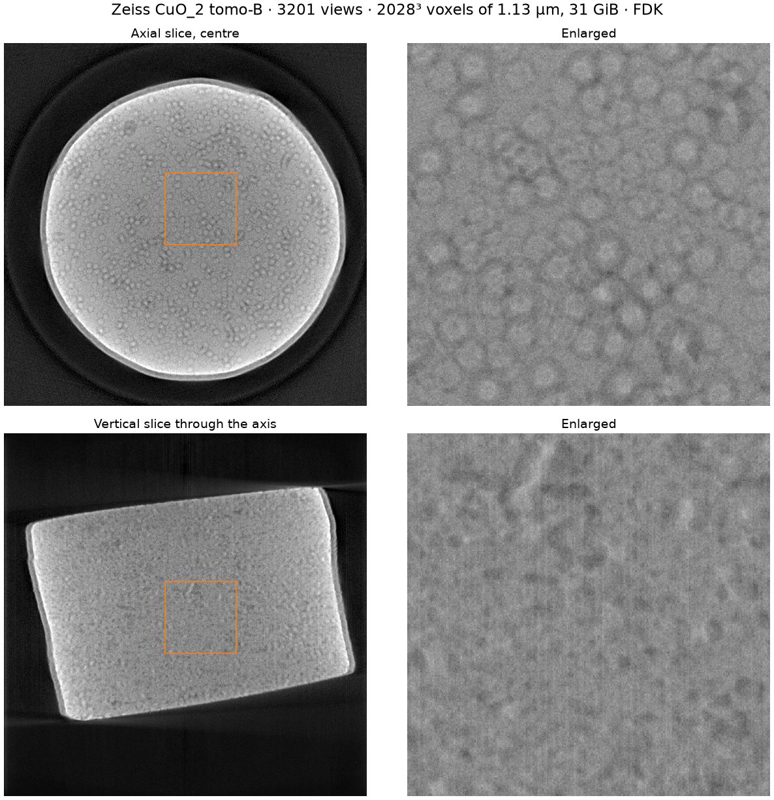

# Large scans and several GPUs

TomoJAX automatically streams projections from host memory and reconstructs volumes in slabs when a scan exceeds GPU memory, and spills large host arrays to disk when they exceed half of available RAM. Streaming applies to projections held as NumPy arrays or memmaps (what `tj.load` returns); JAX arrays already on the GPU stay resident.

## GPU allocator

Importing `tomojax` sets `XLA_PYTHON_CLIENT_PREALLOCATE=false` unless you have set it yourself, so JAX allocates GPU memory on demand instead of reserving 75% up front. This leaves room for cuSolver, CuPy, and CUDA kernel workspaces. The JAX pool still caps at 75% of VRAM and retains freed blocks for reuse. Explicit `XLA_PYTHON_CLIENT_PREALLOCATE`, `XLA_CLIENT_MEM_FRACTION` (or `XLA_PYTHON_CLIENT_MEM_FRACTION`), and `XLA_PYTHON_CLIENT_ALLOCATOR` settings take precedence. Import `tomojax` or set these variables before the first JAX operation.

## What has to fit in host memory

When a large host array would exceed half of available host RAM, TomoJAX backs it with an unlinked temporary file in `TMPDIR` and returns a NumPy memmap:

| Array | Spills to a temporary file when |
| --- | --- |
| Corrected projection stack from `tj.load` or `Frames.corrected` | Stack exceeds half of available RAM |
| Host-slab volume (FBP, FDK, Fourier, MLEM, SIRT) | Volume exceeds half of available RAM |
| Multi-volume solver state (host-slab CGLS, FISTA-TV, accelerated SIRT) | Combined output and work volumes exceed half of available RAM |

`tj.load` logs the spill location; `tj.reconstruct` logs it and records the directory in `info["temporary_file"]`. Because the temporary file is unlinked, it disappears once the array is garbage-collected. Save it with `tj.save`, or pass your own writable memmap as `out=` so the volume is written straight to a named file (an explicit `out=` array is never moved, and solver work files are placed beside it when `out=` is a memmap).

A full-size synchrotron scan easily hits this limit (Diamond I13 159815 is 73 GB corrected). If `TMPDIR` lacks enough free space, TomoJAX raises `MemoryError` listing the required size and free space. On Linux systems where `/tmp` is `tmpfs` (RAM-backed), point `TMPDIR` to a fast local disk before loading, or reduce size with `binning=` or `Frames.selected(...)`.

## What has to fit on the GPU

| Method | Projections | Volume |
| --- | --- | --- |
| FBP (parallel and laminography) | Streamed in view batches from host memory | Switches to host slabs above 40% of free VRAM with an unrolled detector |
| Fourier (axial parallel only) | Read from host arrays or memmaps by row slab | Always built in host slabs |
| FDK (cone beam) | Read from host memory by detector-row band when volume is in host slabs | Switches to host z-slabs above 40% of free VRAM |
| CGLS | Streamed when resident data and solver state exceed free VRAM | Switches to host slabs automatically for cone beam and CUDA linear Joseph parallel/laminography |
| FISTA-TV | Streamed under the same rule; host-volume sweeps keep a detector-row ring | CUDA Joseph switches unmasked ordinary TV to host slabs when resident state does not fit |
| SPDHG-TV | Streamed under the same rule, with its sinogram dual and weights in host memory | Five volumes on the GPU (iterate, data backprojection, three TV duals) plus one view block and small workspace |

Set `stream = true` or `false` in the method's configuration (`--config` TOML or Python `*Config`) to override automatic streaming. Streaming requires the standard batched operators (canonical detector grid; linear/cubic Joseph rather than exact ray integration).

What the large-volume paths hold in memory:

- **Streamed CGLS** solves the equivalent normal equations and periodically recomputes the exact gradient to prevent drift. Host-slab CGLS keeps four host volumes (iterate, normal residual, search direction, normal image) and requires the full projection stack on the GPU for parallel/laminography; cone-beam slab sweeps stream the projections through a detector-row ring instead.
- **Host-slab FISTA-TV** solves the same global objective and finite-iteration TV proximal as resident FISTA-TV (not independent slices), keeping three host volumes (iterate, extrapolate, gradient). Its exact TV halo adds `tv_prox_iterations` planes per side on the GPU, so very high `tv_prox_iterations` can still exhaust VRAM. Huber-TV, support masks, and multi-GPU FISTA-TV require a device-resident volume.
- **Private z-contiguous layout:** resident CUDA solvers convert the volume once at entry and exit, requiring one temporary volume copy. `tj.project`, `tj.backproject`, and `tj.Projector` make that copy if it fits in free VRAM and read `(z, y, x)` in place otherwise (with identical results). Axial parallel projection streams 32 planes at a time and needs no copy.

See [memory measurements](measurements.md#memory) for peak VRAM across solvers on an 8 GB GPU.

## Plan and watch a long run

`--dry-run` resolves a run without starting it. It prints the method and why it was chosen, the grid, and the estimated memory against the memory available:

```bash
tomojax reconstruct scan.nxs --method cgls --dry-run
```

A run prints the same plan in one line as it starts. If it then runs out of memory, the error says what the plan needed and which options would shrink it. `--watch-dir DIR` rewrites images of the solve's central planes in DIR at each checkpoint, so an image viewer open on DIR shows a long reconstruction or alignment converging:

```bash
tomojax reconstruct scan.nxs -o recon.nxs --method cgls --watch-dir watch
```

## Reconstruct a volume larger than the GPU

For FBP, FDK, Fourier, cone CGLS/SIRT/MLEM, and CUDA Joseph parallel/laminography CGLS and FISTA-TV, passing a writable C-ordered `float32` memmap as `out=` forces host-slab execution and writes directly to disk without allocating a second full volume:

```python
import numpy as np
import tomojax as tj

scan = tj.load("scan.nxs")
grid = scan.grid
volume = np.lib.format.open_memmap(
    "volume.npy", mode="w+", dtype=np.float32, shape=(grid.nz, grid.ny, grid.nx)
)
recon = tj.reconstruct(scan, "fbp", out=volume)  # FDK for cone, FBP for parallel/lamino
volume.flush()
```

Input projections and `out=` must not overlap (including separate mappings of the same file). Completed slabs are written as they finish, so an interrupted run can leave partial data on disk. `Reconstruction.info["host_slabs"]` is `True` whenever host slabs are used. Host-slab routes are not differentiable.

Geometry-specific slab behavior:

- **Cone-beam FDK:** processes z-slabs, filtering only the detector rows each slab projects onto. Use `fdk_host` with `FDKHostConfig(slices_per_batch=...)` for explicit slab depth (default uses about a third of free VRAM).
- **Axial parallel FBP and Fourier with an unrolled detector:** processes axial z-slabs (at most 16 slices for FBP), reading only matching detector rows. C-ordered `(z, y, x)` keeps xy-planes contiguous on disk.
- **Laminography and posed FBP:** processes x-slabs (sized to about half of free VRAM), streaming and filtering views per slab. Use `fbp_host` with `FBPHostConfig(slices_per_batch=...)` to override slab depth. A 1024³ laminography volume runs in [37 s on an 8 GB laptop GPU](measurements.md#scans-larger-than-the-gpu).

### Stream raw frames directly into slabs

`Frames.corrected()` produces a complete corrected stack in host memory (or `TMPDIR`). `tj.reconstruct_slabs` uses the following storage strategies.

- **Cone-beam FDK:** `tj.reconstruct_slabs(frames, "fbp")` keeps full-scan angular weights while correcting one row band at a time.
- **Unposed axial parallel with an unrolled detector:** supports `"fbp"`, `"fourier"`, `"sirt"`, and `"mlem"` (with optional `config=` and `warm_start=True`). A full Diamond I12 scan (56.6 GB SIRT volume) ran in 24 minutes using [1.4 GB of VRAM](measurements.md#scans-larger-than-the-gpu).
- **Rolled parallel detector.** FBP, SIRT and MLEM require the full corrected projection stack in host memory and a resident volume on the compute device. The raw slab iterator returns the whole volume in one block. Fourier reads bounded bands of rotated detector rows and returns axial slabs.

```python
import numpy as np
import tomojax as tj
from tomojax.corrections import Stripes

frames = tj.load_frames("raw.nxs")
grid = frames.geometry.grid
volume = np.lib.format.open_memmap(
    "volume.npy", mode="w+", dtype=np.float32, shape=(grid.nz, grid.ny, grid.nx)
)
with tj.reconstruct_slabs(
    frames, "fbp", corrections=[Stripes(), Stripes(51, varying=True)]
) as slabs:
    for z_slice, block in slabs:
        volume[z_slice] = block.volume
volume.flush()
```



The full Zeiss CuO_2 tomo-B scan (3201 views of 2028 × 2028 pixels, 52 GB corrected) reconstructed this way into a 31 GiB `2028³` volume at 1.13 µm in 1036 s on an 8 GB RTX 4070 Laptop GPU with 30 GB host RAM:

```bash
uv run python examples/gallery/zeiss_full_volume.py CuO_2_tomo-B.txrm VOLUME.npy OUT.png
```

Only whole-row line-integral corrections (such as `Stripes`) are supported in `reconstruct_slabs`, not `Paganin` or `RejectViews`. Release each `block` as you iterate so its volume and projections do not accumulate in memory.

## Bin detectors finer than the grid

When the detector pixel pitch (divided by magnification in cone beam) is finer than the reconstruction voxel pitch, projectors trace more rays than the grid can resolve. `scan.binned(factor)` averages `factor × factor` pixel blocks, reducing projection cost by `factor²` and adjusting the detector center to match (remainder edge pixels are dropped). Iterative `tj.reconstruct` warns with the suggested factor whenever the detector is at least twice as fine as the grid. On the CLI, pass `--binning` to `tomojax correct`. On the FIPS walnut, 2 × 2 binning made iterative reconstruction [3.5× faster with no loss of accuracy](measurements.md#fips-walnuts-real-lab-cone-beam-ct).

## Use several GPUs

Pass `devices=` in Python to split views across multiple GPUs in one process (`jax.devices()` uses all visible GPUs):

```python
import jax
import tomojax as tj

scan = tj.load("scan.nxs")
recon = tj.reconstruct(scan, "fista", nonnegative=True, devices=jax.devices())
```

Each GPU projects its share of views against a full copy of the volume, and backprojections are summed onto the first GPU. Multiple GPUs therefore speed up computation rather than expanding volume capacity, except in `fdk_host` and automatic FDK slabs where each GPU reconstructs its own z-slabs (`FDKConfig(devices=...)`).

- **Supported operations:** `tj.project`, `tj.backproject`, and `tj.reconstruct` with `"fbp"` (including FDK), `"cgls"`, and `"fista"`. `spdhg`, `fbp_host`, `tj.align`, and all CLI commands run on one GPU (select which with `CUDA_VISIBLE_DEVICES`).
- **Device memory:** multi-GPU runs hold each GPU's view shard in VRAM and cannot be combined with host streaming (`ValueError`).
- **Scope:** GPUs must belong to one process on one machine.

On four H100 GPUs, 20 FISTA-TV iterations on the FIPS walnut ran [3.3× faster than on one](measurements.md#several-gpus).
