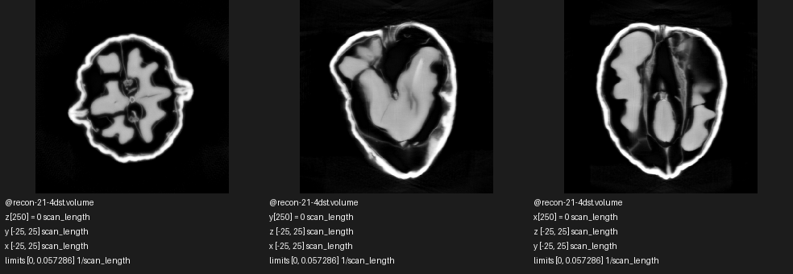

# Use TomoJAX from an AI agent

`tomojax mcp` runs a [Model Context Protocol](https://modelcontextprotocol.io) server over stdio. An agent connected to it can inspect, load, correct, align, reconstruct, simulate and export scans, look at the results as images, and run Python against the data it has loaded. No tool waits for a person, so an agent can work through a scan unattended.



What the agent sees after `reconstruct` on the FIPS walnut (three orbits, FISTA): the central planes, labeled with the result's handle, the plane, its extent and the display limits, beside a short text summary.

## Install and connect

The server needs the `mcp` extra. Install it with the CUDA 12 extra on a GPU machine, and the `spectra` extra if you want `tube_spectrum`:

```bash
uv pip install "tomojax[mcp,cuda12,spectra]"
```

### Claude Code

Add the server, then allow its tools so that calls run without a permission prompt:

```bash
claude mcp add tomojax -- uvx --from "tomojax[mcp,cuda12,spectra]" tomojax mcp
```

```json
{
  "permissions": {
    "allow": ["mcp__tomojax"]
  }
}
```

Put the `permissions` block in `.claude/settings.json` (shared with the project) or `.claude/settings.local.json` (yours only). To share the server with a project instead, commit a `.mcp.json`:

```json
{
  "mcpServers": {
    "tomojax": {
      "command": "uvx",
      "args": ["--from", "tomojax[mcp,cuda12,spectra]", "tomojax", "mcp"]
    }
  }
}
```

A project server needs approval once per checkout. Pre-approve it with `"enabledMcpjsonServers": ["tomojax"]` in `.claude/settings.local.json`.

From a development checkout, run the server from source with `uv run --extra mcp --extra cuda12 tomojax mcp`.

The repository also carries a Claude Code plugin in `plugins/tomojax/`, with this server and the Agent Skill described below.

### Codex and other clients

Any MCP client that starts stdio servers can run the same command. For Codex, add to `~/.codex/config.toml`:

```toml
[mcp_servers.tomojax]
command = "uvx"
args = ["--from", "tomojax[mcp,cuda12,spectra]", "tomojax", "mcp"]
```

### Install the Agent Skill

The TomoJAX Agent Skill teaches an agent how to use TomoJAX well: when to use the server and when its own Python, how to choose a method and check a result without ground truth, how to agree a feature with you by marking it, and how to report a bug. It follows the [Agent Skills](https://agentskills.io) format and ships inside the `tomojax` package. Copy it into the directory your agent reads skills from:

```bash
tomojax skill -o ~/.claude/skills    # Claude Code, every project
tomojax skill -o ~/.codex/skills     # Codex
```

`tomojax skill` with no options prints where the Skill is and the usual locations. Pass `--force` to replace an earlier copy after upgrading TomoJAX.

## Tools

| Tool | What it does |
| --- | --- |
| `status` | Versions, devices, GPU memory, live handles and running jobs |
| `inspect` | Report on a file and what loading it reads, list the datasets and checkpoints in a directory, show an HDF5 tree, or describe a checkpoint |
| `open` | Load a scan, raw frames or a saved result as a handle, with metadata overrides |
| `describe` | Expert settings for an operation or solver, with defaults and units |
| `correct` | Flat/dark correction, zingers, phase retrieval, rings, beam hardening and binning |
| `reconstruct` | Reconstruct with an automatic or named method; returns central planes |
| `reconstruct_slabs` | Reconstruct raw frames slab by slab straight into a file, for volumes too large to hold |
| `align` | Fit the rotation center, setup angles or per-view motion; returns slices for joint fits and a pose plot when per-view motion is fitted |
| `simulate` | Simulate a scan of a phantom, with optional detector artifacts |
| `project`, `backproject` | Apply the forward projector or its exact transpose |
| `edit_scan` | Select views, crop, bin, replace poses or combine scans |
| `preview` | Single slices, center sweeps (with optional `roi` zoom), before/after corrections and region estimates |
| `view` | Planes, projections, sinograms, differences, profiles, statistics, pose tables and pose plots, with marks and feature outlines |
| `feature` | Make a named mask from a box, sphere, cylinder or prism, a region grown from seed points, or a band around another feature |
| `evaluate` | Score candidate settings on held-out views |
| `save`, `export` | Write a dataset or feature mask with its manifest, or TIFF slices and raw volumes |
| `control` | Cancel, pause or resume a job; close a handle; reload tool definitions or restart the worker |
| `python` | Run Python in the worker, with the live handles and `tj` in scope |

Tools that accept `dry_run` report what a call would do without running it: the method and grid a reconstruction would use and its memory estimate, the files an export would create, or the shapes a simulation would produce. Use `describe` before setting expert keys in `config`. A call with a malformed argument returns an error that shows the shape the argument should have, so the agent can correct it on the next try.

## Handles and references

Each result is kept in the server as a handle with an ID such as `@scan-3fa94c1e`. Pass that ID to any tool that takes data. Add a member to choose part of a result, for example `@align-91c0d2aa.scan` for the aligned scan or `@sim-07be55f1.phantom` for a simulation's phantom. A bare handle gives the whole object to `save` and `export`, and its main array (volume, projections, phantom or working image) to an array field.

Workflow `source` fields accept acquisition paths through the normal loader. For array fields, use a handle member, a session array such as `@array-…`, a `.npy` file or an explicit HDF5 dataset such as `scan.h5::/entry/data/data`. Literal arrays use storage order. Relative paths resolve against `CLAUDE_PROJECT_DIR` when set, otherwise the server's working directory. Write `./@name` for a file whose name starts with `@`.

To view or backproject measured line integrals, use `open` and select the scan’s `.projections`. For raw counts, open with `kind=frames` and select `.counts`. Use `inspect` with `preview=true` for a first look, or `preview` with `correction_preview` to compare raw and corrected rows.

`view` and the `volume` field of `project` also accept saved TomoJAX volumes by path (`.nxs`, `.h5` or `.npz`). They use logical `(z, y, x)` order. The worker’s `read` and `statistics` commands use the same references as `view` and can read a region of a saved volume or lazy frames handle in bounded tiles.

Handles last until you close them, the worker restarts, or the server exits. Save results you want to keep. An ID from an earlier session returns an error that lists the live handles.

## Results, images and long jobs

Every result has a short text summary, the same fields as structured content, and labeled PNG panels where an image helps: three central planes after `reconstruct`, working slices (and a pose plot when per-view motion is fitted) after joint `align`, and the requested planes from `view` and `preview`. Panels that are meant to be compared, such as a center sweep, share one display range. Large results are cut to fit the client's limits, and the rest is served as `tomojax://result/...` resources that the result names. Each connection retains up to 64 MiB of paged replies for up to 15 minutes, evicting the oldest first. Repeat the call if a page has expired or been evicted.

Long jobs send progress with the current stage, its metrics and an estimate of the time left. Clients that support the MCP tasks extension receive long calls as tasks they can poll and cancel; other clients wait for the result and can cancel a running job by reading its ID from `status` and calling `control` with `action="cancel"`. A canceled job stops at the next work boundary (an iteration, slab, or alignment step), saving first when it has a `checkpoint`.

The server runs one worker process with one queue, so GPU jobs run one after another. Running out of GPU memory returns an ordinary error with suggestions, and the existing handles stay. If the worker process itself dies, the server reports which handles were lost and starts a new worker.

### What the loader and solver report

`inspect` on a file includes a `loading` section describing what `open` reads without extra arguments: `length_unit` (`"pixel"` when no pixel size is recorded), `center` (`"not_recorded"` when the rotation center defaults to the detector middle until fitted), `geometry` (`"not_recorded"` when no rotation axis or pixel scale is recorded), `frame_records` (the counts of frames, `image_key`, and angles when a scan stopped early and loading trims to their common prefix), or `message` naming a missing argument. The text summary repeats these fields, and every scan, frames, reconstruction, and alignment result carries `detector_center_status`, `geometry_status`, and `frame_records` in its `geometry` field. When `loading.geometry` is `"not_recorded"`, reconstruction and alignment refuse the scan until you `open` it with `geometry`, such as `{"kind": "parallel"}` (or `"lamino"` with `tilt`, or `"cone"` with `source_to_axis` and `source_to_detector`).

Iterative `reconstruct` results carry every scalar diagnostic the solver reports alongside the stopping summary in the text (for example, `"78 updates, stopped at the estimated noise level; automatic TV weight 4.75e-05"` or `"7 updates, stopped at the estimated projection discrepancy"`). Read `termination` (`"projection_discrepancy"` for CGLS/SIRT, `"noise_score"` or `"objective_tolerance"` for FISTA, `"converged"`, `"roundoff_limit"`, `"numerical_breakdown"`, or `"iteration_limit"`), `early_stop`, and `effective_iterations`, plus `resolved_tv_weight` and `noise_score_rms` for FISTA and `measurement_noise_rms` and `projection_error_rms` for CGLS/SIRT. Every `reconstruct` result also carries `truncation` (`edge_ratio`, `outside_fraction`, `interior_shift`, `radius`, and `field_of_view_radius`); when `outside_fraction` rounds to at least 1% (0.5% or above), the text summary appends `"N% of attenuation beyond the detector"`. To turn off default cylinder continuation on `"fbp"` or `"fourier"`, pass `config: {"exterior": "zero"}` alongside the explicit `method` (both `reconstruct` and `reconstruct_slabs` accept it; `reconstruct_slabs` writes the file directly and records `config.exterior` in the saved volume without a top-level `truncation` field in its reply). `align` results carry `calibration` and `diagnostics` (such as `focus_px`, `binning`, `views`, and `pairs` for direct axial center fits).

### Long jobs that must survive a kill

`reconstruct`, `reconstruct_slabs` and `align` take `checkpoint`, a directory (relative paths resolve against `CLAUDE_PROJECT_DIR` when set, otherwise the server's working directory) where the run saves its state at its work boundaries ([resume a run after a kill](large-scans.md#resume-a-run-after-a-kill)). When a run stops before it finishes, because the agent canceled it with `control`, the scheduler sent `SIGTERM`, or the session ended, it saves first and the tool returns a `canceled` error whose `checkpoint` field names the directory and whose `next` says how to resume. Call the same tool again with the same arguments on the same input to continue; the directory is deleted when the run completes. A `reconstruct_slabs` run keeps finished slabs in `checkpoint/volume.npy` until it completes. A kill that allows no save (`SIGKILL`, a lost node) resumes from the last periodic save.

When the server itself is stopped, by `SIGTERM` or by its client closing it, it gives a worker running a checkpointed job up to two minutes to save and exit before it kills the worker. A scheduler may signal only the process it started: on Slurm, `--signal` reached an agent client inside `srun` but not the MCP server the client had started, so the run saved only once the client, on being signaled, stopped its server. Run the client so that it ends its MCP server when it is terminated, as clients do when they exit.

Handles do not outlive the server, so a later session cannot reuse `@scan-…` IDs. Before a long run, `save` the input scan and run from its path; the call can then be repeated exactly. To pick up another session's work, `inspect` the working directory, which lists `checkpoints`, then `inspect` a checkpoint: it reports the run's operation, method and settings, the request that started it (its worker operation with tagged source objects such as `{"type": "path", "path": "..."}` and the provenance of its inputs; pass `source` as the path string when calling the MCP tool), when it was last saved, and whether a running process still holds it (`in_use`).

## Point at a feature

An agent can show you exactly what it means instead of describing it. `view` takes `marks`: points, arrows, boxes, circles, polylines, polygons and text, each with an optional label and color. A position is either array indices of the source, `[z, y, x]` for a volume or `[view, v, u]` for projections, or a pixel in an image an earlier `view` returned, `{"pixel": [x, y], "image": "render-12"}` with the origin at the top left, which the server converts to indices. Either way a mark lands on the same voxel in every plane, ROI and zoom; a circle is a sphere, and each plane shows its cross-section. Index ticks along the image edges, or a pixel grid with `grid`, help the agent aim. The result reports, for each mark, its positions in array indices and, for each plane, whether it was drawn, its pixel in the image, the value under it, and that value's percentile in the plane and place within the display limits. A point or arrow head on flat ground, with no peak, trough or edge within 2 samples, also gets a `warning` and `nearest`: the array indices, distance, value and percentile of the closest structure on that plane, so a miss names where the feature is. A point with `snap` set to `peak`, `trough` or `edge` moves, on each plane, to the brightest or darkest sample or the steepest edge within `within` index units (5 by default), and the report gives where it moved to and how far.

`view` images stay within 1568 pixels on the long edge and 1.15 megapixels, so a model sees them unscaled and its pixel positions match the server's. Give `source` a list to show several candidates side by side on the same planes, with the same marks and outlines, and `limits` to fix the display range.

Once you agree on a structure, the `feature` tool turns it into a named mask held by the server: a box, sphere, cylinder or extruded polygon from the mark, a region grown from a seed point through voxels of similar value, or a band of chosen width around another feature. `view` with `features` outlines up to five features on any volume on the same grid, which is how an agent shows what it will optimize for, and the Skill's `feature_scores.py` scores candidate reconstructions on a feature and its surroundings without ground truth.

## Files

`save`, `export` and `reconstruct_slabs` refuse to replace an existing file unless the call sets `force`, and never overwrite their own inputs. Each output is written beside its destination and moved into place once whole.

The tools carry MCP annotations for clients that decide what to confirm: `status`, `inspect`, `describe`, `view` and `preview` are read-only; `save`, `export`, `reconstruct_slabs`, `control` (which can close handles and restart the worker) and `python` (which runs any code) are marked destructive; the others only add handles. None reaches beyond the local machine.

## Python

`python` runs code in the worker, beside the loaded data, with `tj`, `np` and `handles` in scope. `handles` maps live IDs to their TomoJAX objects, and `ID.member` selects a member as in the typed tools. `register(obj)` publishes a new handle from a `Scan`, `Reconstruction`, array or other result, and `register_feature(mask, like=ID)` a feature on that object's grid. `view(...)` renders planes with the same arguments as the `view` tool, marks and features included, and `show(array, marks=...)` adds an image of a 2D array to the reply. Variables persist between calls until `reset` or a worker restart.

Use it for compound work and for anything the typed tools do not cover: a sweep of reconstruction settings in one call, a custom geometry, a direct solver such as `tomojax.recon.cgls`, `tomojax.forward`, phase unwrapping or your own analysis. The result is the last expression, with arrays of more than 16 values summarized by shape, dtype and range. Errors report the exception and the lines of your code it passed through; set `traceback` for the full trace. Long calls run as tasks and can be canceled at TomoJAX's work boundaries (an iteration, slab, or alignment step). The `tomojax://guide/python` resource has worked examples.

## Guides and prompts

The server publishes the Agent Skill's references as resources, and its workflow guides also as prompts, which Claude Code lists as slash commands: `reconstruct-scan`, `lab-ct-start-to-finish`, `find-the-center` and `check-a-reconstruction`. Read them as `tomojax://guide/{topic}`, alongside `python`, `solvers`, `geometry`, `calibration`, `pointing-and-features`, `tuning-without-truth`, `thin-shell`, `large-scans` and `reporting-bugs`. `tomojax://handle/{id}` gives a handle's summary and provenance, and `tomojax://describe/{operation}` its settings.

## Transport and session lifetime

The server communicates over stdio, running alongside the agent on the same Linux machine as the GPU. Live handles and active tasks persist for the lifetime of the server process; use `save` or `export` for results you want to keep across sessions.
