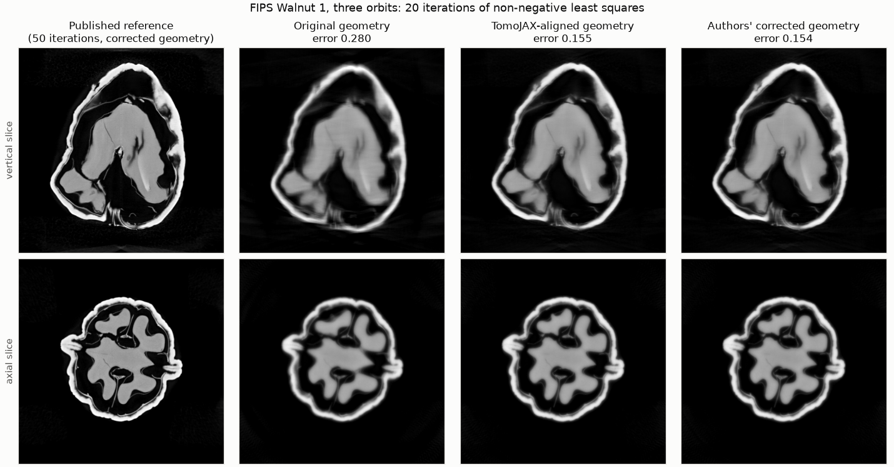

# Measurements

Measured speed, accuracy, scaling, and memory for TomoJAX across parallel-beam, laminography, and cone-beam CT scans. Runnable benchmark scripts are in [bench/](../bench/README.md) and [examples/](../examples/README.md).

## Full-volume speed on a synchrotron scan

Diamond K11 (DIAD) scan `k11-52544` (8,000 views of 2,160 × 2,560 pixels over 180°, 0.54 µm pitch, axis at column 1277.1174) reconstructed to a 2,160 × 2,560 × 2,560 `float32` volume (56.62 GB on disk) on exclusive cluster nodes with 40 CPU cores. Each time is the median of three fresh worker launches from process startup (imports included) through the final output `fsync` on Diamond staging storage, with pre-warmed input files and fresh CUDA, CuPy, JAX, and Numba caches per launch. TomoPy ran on 40 CPU cores of each node type. TomoJAX and httomo read the original HDF5 layout directly; the other seven libraries read a pre-converted 92.90 GB row-chunked copy whose one-time 96.0 s conversion cost is excluded below.

*Full-volume reconstruction times on Diamond `k11-52544` (2,160 × 2,560 × 2,560 voxels) across one and four Tesla V100S 32 GB GPUs and one and eight RTX PRO 6000 Blackwell 96 GB GPUs. Each row shows that method's fastest measured mode, median and three-repeat range from worker launch to final output flush, excluding the one-time 96.0 s input conversion.*

| Library and method | 1 V100S (s) | 4 V100S (s) | 1 Blackwell (s) | 8 Blackwell (s) |
| --- | ---: | ---: | ---: | ---: |
| TomoJAX Fourier (streaming) | 74.5 | 41.3 | 27.9 | 35.9 |
| TomoJAX FBP (streaming) | 367.4 | 101.2 | 59.6 | 29.0 |
| tomocupy (`fourierrec` / `linerec`) | 109.8 `fourierrec` | 66.3 `fourierrec` | 69.7 `fourierrec` | 45.8 `linerec` |
| TomoPy `gridrec` (40 CPU cores) | 430.4 | — | 143.9 | — |
| TIGRE FBP | 558.3 | 172.3 | 180.5 | 48.9 |
| Nabu FBP | 591.8 | 184.8 | 186.8 | 71.5 |
| httomo (`LPRec` / FBP) | 722.5 `LPRec` | 461.7 `LPRec` | 198.5 `LPRec` | 132.5 FBP |
| LEAP FBP | 753.3 | 198.2 | 227.7 | 51.3 |
| ASTRA FBP | 768.6 | 199.6 | 182.0 | 46.2 |
| CIL FBP (TIGRE backend) | 1,240.2 | 320.2 | 360.4 | 80.0 |

TomoJAX had the lowest full-volume median in all four GPU configurations, using 17.3–25.0 GiB host RAM and 3.1–5.2 GiB GPU memory on one card. Two cases where TomoJAX does not win:

- **Fourier beyond one Blackwell card:** adding Blackwell cards slowed streaming Fourier from 27.9 s (range 26.2–39.4 s) on one card to 35.9 s (35.7–39.0 s) on eight, while streaming FBP improved from 59.6 s (59.3–59.7 s) to 29.0 s (27.5–32.6 s).
- **256-row band on eight Blackwell cards (rows 952–1207, 6.71 GB output):** LEAP FBP led at 9.2 s (8.7–10.4 s), ahead of ASTRA FBP (10.9 s), TIGRE FBP (11.8 s), and TomoJAX streaming FBP (11.9 s, range 11.0–12.3 s). Those three libraries read the pre-converted row-chunked copy (96.0 s one-time cost). On one V100S, four V100S, and one Blackwell, TomoJAX led the 256-row band (22.6 s Fourier, 12.0 s Fourier, and 12.0 s FBP).

## Reconstruction accuracy

### Fourier inverse and filtered backprojection

On DIAD `k11-52544` row 1080 (8,000 views, 2,560 columns, interior disc of radius 0.33 of image width), ASTRA, CIL, and TIGRE FBP correlate 0.9999 with TomoJAX FBP after resolving orientation and length units (Nabu 0.9991, LEAP 0.9984, httomo FBP 0.9973). Native TomoJAX Fourier (`filter=None`) correlates 0.9814 with FBP (0.9954 with grid-aligned tomocupy `fourierrec`, 0.9941 with TomoPy `gridrec`) because it preserves higher spatial frequencies and passes more noise. Setting `filter="ramp"` matches FBP's linear-interpolation detector response at the same full-volume speed and VRAM (34.2 vs 34.4 s warm from file on one V100S, 4.05 GiB GPU), raising sample-disc correlation with FBP to 0.9937 and cutting relative L2 difference from 10.99% to 6.31%.

Against independent analytic disk-phantom truth at the same width and view count (2,560 bins, 8,000 views, 50,000 photons per bin; relative L2 inside 0.94 of field radius; 10–90% clean edge width at central and off-axis inclusions):

| Method | Clean / noisy rel. L2 | Central / outer edge (px) |
| --- | ---: | ---: |
| TomoJAX Fourier (`filter=None`) | 0.416% / 17.08% | 1.04 / 1.11 |
| TomoJAX FBP (`filter="ramp"`) | 0.353% / 11.60% | 1.36 / 1.37 |
| TomoJAX Fourier (`filter="ramp"`) | 0.398% / 11.46% | 1.36 / 1.40 |

### Cone-beam CT against ASTRA and TIGRE

On full-scale FIPS Walnut 1 (3 orbits, 1,800 fitted and 1,800 held-out views, 2×2 binned 486 × 384 detector, 501³ grid at 0.1 mm, one RTX PRO 6000 Blackwell), all three CGLS implementations reach their best held-out residual within 0.5% of each other at 40–57 updates (TomoJAX 0.02198 at 40 in 30.3 s; ASTRA 0.02204 at 57 in 34.9 s; TIGRE 0.02209 at 40 in 55.1 s). Running to 1,280 updates causes semi-convergence in all three: TomoJAX's held-out residual rises 15% while its fitted residual keeps falling (1,032 s with periodic residual checks, 0.81 s/iter), ASTRA's fitted residual turns upward after 226 updates (+3.1% by 1,280; held-out +22%) because its backprojector is approximate, and TIGRE stops between 113 and 160 updates after detecting divergence.

On a noise-free 501³ analytic ellipsoid control with the same geometry, TomoJAX CGLS reaches 0.0764 volume error at 226 updates (rising to 0.1072 at 1,280 from subvoxel discretization), whereas ASTRA CGLS quadruples from 0.0813 at 160 to 0.3304 at 1,280. Nonnegative SIRT reaches 0.0122 (TomoJAX) and 0.0124 (ASTRA) at 905 updates, and 0.0205 (TIGRE) at 1,280.

On one RTX 4070 Laptop GPU (8 GB, warm host-to-host):

- **FDK:** Walnut 1 (1 orbit, 1,200 views binned 2×2, 501³) takes 1.02 s vs ASTRA 1.71 s (both error 0.091 against the published reference). At 1024³ (1,024 views), `fdk_host` finishes in 8.0 s warm (11.1 s cold) vs ASTRA 20.3 s and TIGRE 30.7 s.
- **Accelerated nonnegative SIRT:** 12 iterations in TomoJAX beat 24 iterations in ASTRA and TIGRE at equal or lower common-projector residual on Walnut 1 (1 and 3 orbits), Nikon seeds, and Zeiss HDtomo.
- **Where ASTRA wins:** ASTRA's approximate voxel-driven backprojector is faster per iteration than TomoJAX's exact matched transpose (0.073 vs 0.122 s on a 256³ scan; 0.60 vs 0.72–0.81 s/iter for 501³ Walnut 1 CGLS on Blackwell), and ASTRA is faster on Walnut 1 OS-SART and OSEM sweeps. On unbinned Walnut 1, where detector pitch is twice as fine as the voxels, 2×2 binning (`scan.binned(2)`) keeps 20-iteration NNLS accuracy (0.154 vs 0.152) while speeding up TomoJAX 3.5× (86 vs 304 s).

### TV regularization, laminography, and automatic stopping

- **TV against TIGRE:** on a 128³ parallel phantom (180 views, 3% noise, 50 iterations, RTX 4070 Laptop GPU), TomoJAX FISTA-TV reaches 0.075 relative L2 error in 0.32 s warm (0.077 with automatic TV weight), vs TIGRE FISTA at 0.101 in 9.1 s and TIGRE ASD-POCS at 0.146 in 5.6 s.
- **Laminography FBP vs nonnegative FISTA-TV:** on simulated 96³ scans with independent 4× finer truths, automatic nonnegative FISTA-TV cuts measured-band error roughly in half and lowers missing-cone error (rock, −35° tilt, 120 views: 0.165 / 0.316 to 0.0741 / 0.182; watch, −15° tilt, 360 views: 0.163 / 0.396 to 0.0969 / 0.215). On real Diamond K11-54013 (1,441 views, 704 × 704 × 234, RTX 4070 Laptop GPU), FBP takes 5.5 s and 50-iteration FISTA-TV takes 233 s.
- **Automatic discrepancy stopping:** across 72 independent small synthetic scans (16³ and 24³, 0–10% noise), automatic CGLS and SIRT landed within 10% of each method's own best image error in 55 of 72 runs (median error/best ratio 1.000–1.076). On real scans (DIAD `k11-52567`, Walnut 1), unmodeled scatter, motion, and calibration errors exceed the local noise estimate, so unpenalized CGLS and SIRT hit the 50-update cap (`termination="iteration_limit"`).

## Scaling and memory

### Multiple GPUs

Warm iterative scaling using `devices=` on Diamond `k11-52567` (2,000 views, 64 × 2,560 × 2,560 = 419M voxels, 50 iterations, Tesla V100S 32 GB paired across two CPU sockets over PCIe) and binned FIPS Walnut 1 (900 views, 501³, 20 iterations, H100 80 GB over NVLink, measured before shared TV slabs):

| Scan, method, and interconnect | 1 GPU | 2 GPUs (speedup) | 4 GPUs (speedup) | Peak GPU / host (GiB) |
| --- | ---: | ---: | ---: | ---: |
| K11-52567 CGLS (V100S PCIe) | 223.2 s | 122.2 s (1.83×) | 73.7 s (3.03×) | 9.2–17.6 / 9.9 |
| K11-52567 nonnegative FISTA-TV (V100S PCIe) | 249.1 s | 145.2 s (1.72×) | 86.1 s (2.89×) | 13.3–16.6 / 9.9 |
| Walnut 1 nonnegative FISTA-TV (H100 NVLink) | 24.8 s | 13.6 s (1.83×) | 7.4 s (3.34×) | — |

On the PCIe V100S node, a synchronized 1.56 GiB volume all-reduce takes 0.240 s on 2 GPUs (7.00 GB/s) and 0.288 s on 4 GPUs (5.83 GB/s), accounting for 18–20% of 4-GPU wall time. Short solves hit host-preparation overhead: 10 nonnegative FISTA iterations on a 257³ cone phantom (360 views) take 4.71 / 3.45 / 2.57 s on 1 / 2 / 4 V100S cards, with 0.67 s spent in host setup.

### Large volumes, memory, and checkpointing

Volumes larger than VRAM stream in slabs automatically (or via `tj.reconstruct_slabs` from raw frames):

| Scan and workflow | Hardware | Time | Peak GPU / host RAM |
| --- | --- | ---: | ---: |
| DIAD `k11-52544` streaming Fourier (56.6 GB volume) | 1 Blackwell / 1 V100S | 27.9 s / 74.5 s | 5.2 / 17.3 GiB (4.1 / 23.7 GiB V100S) |
| Diamond I12 `reconstruct_slabs` SIRT (1,801 views, 56.6 GB) | RTX 4070 Laptop (8 GB) | 1,436 s solving | 1.41 GB / 3.7 GB (1.13× in-core rate) |
| Zeiss CuO2 `reconstruct_slabs` FDK (3,201 views, 2,028³, 31 GiB) | RTX 4070 Laptop (8 GB) | 1,054 s total | 4.39 GiB / 14.2 GB |
| 1024³ laminography `fbp_host` (1,024 views, 4.3 GB memmap) | RTX 4070 Laptop (8 GB) | 37 s | two x-slabs |

Resident iterative VRAM on the 8 GB RTX 4070 Laptop GPU for 50 iterations on Diamond K11-54013 (1,441 views, 704 × 704 × 234): 2.36 GiB for default SPDHG-TV (98 s), 3.07 GiB SIRT (205 s), 3.77 GiB FISTA-TV (233 s), and 4.57 GiB CGLS (182 s) and MLEM (177 s). SPDHG-TV holds five volumes in VRAM and cannot stream to host slabs.

Checkpointing (`checkpoint=DIR`) on a 64-row DIAD `k11-52567` band (60 CUDA CGLS iterations, one V100S, staging filesystem at 1.0–1.6 GB/s) adds 1.6% wall time (1,164.3 vs 1,146.0 s; one 9.4 s periodic save of 9.57 GiB), adds no GPU memory (25,316 MiB), raises host RSS from 16.95 to 18.69 GiB during saves (30.5–32.3 GiB on resumed segments from memory-mapped arrays), and reproduces uninterrupted outputs bit for bit across `SIGTERM` and `SIGKILL` restarts for CGLS, SIRT, Fourier slabs, FISTA-TV, and `tj.align`.

## Alignment

### Known-pose twins and real scans

Default `tj.align` (`resolution=320`, 16M-voxel cap, one GPU; wall time starts after file decoding or twin generation) on four native-pitch analytic twins (drift, slips, 0.1° angular jitter, 0.002 SD column offsets, 20,000-photon noise; landmark RMS in native pixels after removing one rigid gauge) and three real scans:

| Scan and fit | GPU | Wall time | Accuracy |
| --- | --- | ---: | --- |
| Parallel twin, translations + rotations (3,001 × 2,160 × 2,560) | V100S | 1,488 s | Landmark RMS 3.99 → 0.93 px; image L2 0.0126 |
| Laminography twin, tilt + translations (1,441 × 540 × 640) | Blackwell | 145 s | Landmark RMS 10.28 → 0.48 px; tilt 34.496° vs 34.5° |
| Laminography full twin, tilt + translations (3,001 × 2,160 × 2,560) | Blackwell | 343 s | Landmark RMS 39.50 → 1.89 px (angular jitter unmodeled); tilt 34.493° |
| Cone twin, translations + rotations (3,201 × 2,028 × 2,028) | Blackwell | 139 s | Landmark RMS 3.74 → 0.62 px; image L2 0.0126 |
| K11 `54013` ruby sphere, `fit=("center", "tilt")` (1,441 × 540 × 640) | V100S | 783 s | −35.17° and +2.95 px (within 0.144° and 0.290 px of sphere track) |
| FIPS Walnut 1, 3 native orbits, `fit="translations"` (3,600 × 972 × 768) | Blackwell | 140 s warm | Orbit heights −0.385, −0.753 mm vs authors' −0.397, −0.794 mm; FDK support error 0.263 → 0.108 (authors 0.107) |

Across all 42 FIPS walnuts (every 4th view, binned 2×2), median orbit-height disagreement with the authors' calibration is under a fifth of a voxel.

Alignment limits:

- **One GPU and full host stack:** joint alignment runs on one GPU even when multiple GPUs are visible, and the corrected `float32` stack drives host RSS (164.8 of 173.1 GiB on 8,000-view DIAD `k11-52544`; 1,073 s translations on V100S, 960 s translations + rotations on Blackwell).
- **Crossing shadows and axial rotations:** on DIAD `k11-52544`, a shadow crossing the detector near 80° and 100° pulled fitted horizontal translation to 22.4 native px (2.89 px with the shadow removed), and enabling rotations raised held-out line-integral RMS by ~2%. Across 13 axial parallel watch and rock scans, `fit=("translations", "rotations")` beat translations alone on 7, tied 1, and was up to 27% worse on 5.

### Axial rotation center

Direct `tj.align(scan, fit="center")` on unposed axial parallel half-turns (CPU) had 0.072 px median / 0.407 px worst error across 12 defect-varied 512-column ellipse scans, and 0.317 px median (71/80 within 1 px, worst 2.43 px) across 80 low-contrast combined-defect scans, versus 3.00 px for seeded `method="joint"` and 103.6 px for `method="opposite-views"`. Median error stayed below 0.75 px across 24–2,048 damaged columns. On 22 real DIAD specimen bands (32 rows × 2,560 columns, 4.7 s median on CPU), median disagreement with `method="opposite-views"` was 0.020 px, and ±120 px edge-crop shift error stayed within 0.036 px on three specimen scans.

Smooth, nearly stationary objects with defects reached 3.31 px error. Spoiled-flat or low-contrast holder setup scans missed ±120 px crops by 2.2–11.0 px, and dark bands with no transmitted signal return arbitrary offsets.

## Automatic corrections

### Truncated scans

With default `exterior="cylinder"`, `fourier`, `fbp`, and cone-beam FDK continue each detector row past its edges as a uniform cylinder about the rotation axis. Across four analytic truncated-scan phantoms (1.15× and 3× bodies, a 5-radius plate, and a surrounding tube), continuation cuts interior offset from 4–99% to 0.1–6%, cupping from 18–218% to 0.3–4%, and rim error from 60–1,024% to 0.3–6%, while leaving contained objects unchanged. On DIAD `k11-52567`, air around the sample drops from 0.42e-3 µm⁻¹ (0.95e-3 at the rim) to a flat 0.09e-3 µm⁻¹. On FIPS Walnut 1 cropped to its middle 192 columns, FDK rim error drops from 548% to 23% of mean attenuation and cup from 91% to 14%.

Non-cylindrical exteriors (a square bar whose corners leave the field of view) keep a 9% cup and 27–30% rim, and iterative solvers do not model material outside their grid so they keep the rim and bowl when the object leaves the grid. On full DIAD `k11-52567` from raw frames in RAM, continuation adds no measurable time on one V100S (Fourier 31.6 vs 33.1 s, FBP 324.4 vs 338.4 s) and up to 5% on one Blackwell (Fourier 12.6 vs 12.0 s, FBP 55.8 vs 56.0 s); on small volumes in a fresh process it adds 0.17–0.76 s.

### Bracketing flat fields

With default `flat_weights="views"`, weighting before-and-after flat sets from a sample of views cuts slice RMS error roughly in half on three DIAD scans whose flats were shadowed by the sample stage (measured against neighbor-scan flats with `Rings()` on): `k11-52557` 0.22–0.36 to 0.10–0.20 spread units, `k11-52583` 1.19–1.35 to 0.47–0.60 (center fit −19.98 to −13.67 px vs −13.75 px reference), and `k11-52615` 0.24–0.38 to 0.07–0.16. Thirty-one clean DIAD scans change by at most 0.0002 spread.

Across 1,056 randomized simulated acquisitions with shadows, drift, changing specks, and camera saturation (`Rings()` on), view weighting lowered whole-slice error against position interpolation in 618 cases, tied within 0.01 reference SD in 355, and raised error in 83 (worst increase 0.344 SD, where broad shadows or beam fade cover the detector with little open beam); a 128-case wider-detector check gave 78 wins, 40 ties, and 10 losses. Calibration adds ~2 s on an 8,000-view DIAD scan on one V100S.

### Ring correction

On real synchrotron scans, `Rings()` cuts median fine-ring RMS (5–1,000 px, in slice spread units) from 0.292 to 0.128 across 132 ordinary DIAD half-turn bands, from 0.364 to 0.214 on 21 wide-ring and 40°-start bands, and from 0.263–0.270 to 0.135–0.136 across 24 full-turn Diamond I13 rows (inner 5–100 px drops from 1.19–1.25 to 0.32–0.33). On simulated DIAD-size scans (8,000 × 2,560), 14–23% of fine-ring RMS remains on DIAD-like defects, and total RMS drops on 100-frame finite flats for every tested object.

Against Algotom 1.7 across seven facilities, `Rings()` alters injected off-axis Gaussians less (0.3–28.5% vs 66–1,804%), while retaining more injected gain on several scans and exceeding 5% image alteration on ESRF (28.5%), Elettra (8.0%), and native I13 rows (6.7–17.4%). On a full 8,000-view DIAD Fourier volume on one V100S, `Rings()` adds ~10 s on a half turn (37.3–38.3 vs 28.3 s) and ~20 s on a full turn (50.0 vs 29.3–30.2 s), with ~15 MiB extra VRAM. Angle-varying swirls are not removed, and circular features centered within ~15 px of the rotation axis are ambiguous with symmetric detector offsets.
