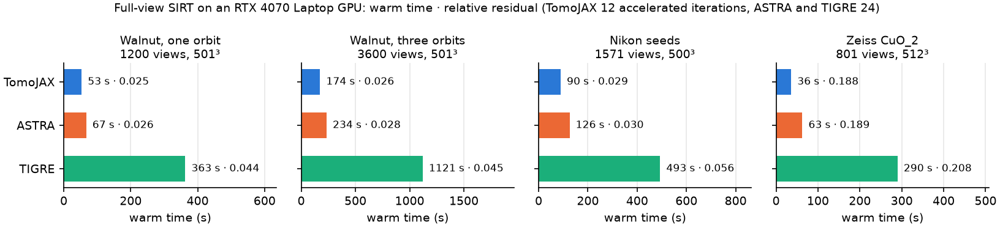

# Measurements

Measured speed, accuracy, and memory results behind the TomoJAX guides, including cases where other libraries win or where a method hits its limits. Each section notes the date, commit, and protocol; runnable scripts live in [bench/](../bench/README.md) and [examples/](../examples/README.md).

## Test environment

Unless noted otherwise, measurements run on Linux with one NVIDIA GeForce RTX 4070 Laptop GPU (Ada, 8 GB), Python 3.12, JAX 0.11.2, ASTRA 2.5.0, TIGRE 3.1.3, TomoPy 1.15.2, and tomocupy 1.1.0. Multi-GPU runs use four H100 80 GB GPUs on a single Modal host.

- **Cold time:** fresh process through the first result, including imports, compilation, and host-device transfers (filesystem cache not cleared).
- **Warm time:** repeated call in the same process.
- **GPU memory:** process peak sampled every 10–20 ms (includes runtime and allocator overhead; brief spikes can fall between samples).

## Headline comparison

Measured 2026-11-21 on commit `58a30e0` on the laptop GPU above. Every library receives identical corrected projections, calibrated geometry, and output grids. Iterative methods are compared at matched reconstruction error except the walnut CGLS row, which uses 10 iterations and reports both errors. Times are warm unless marked cold; ratios above 1 mean TomoJAX is faster.

| Case | TomoJAX | Other tools | Speedup ratio |
| --- | --- | --- | --- |
| [Parallel, real](#parallel-beam-on-a-real-scan-against-astra-tomopy-and-tomocupy): Diamond I12, 1801 views of 64 × 2560 px, in memory | 0.81 s (default Fourier), 3.35 s (FBP) | ASTRA FBP 7.64 s, TomoPy gridrec 2.90 s (CPU) | Default: 9.4× ASTRA, 3.6× TomoPy; FBP: 2.3× ASTRA, 0.87× TomoPy |
| Same scan, raw counts on disk to volume on disk, cold | 11.2 s (default), 10.7 s (FBP) | tomocupy 10.4 s | ~1× (writing 1.6 GiB volume dominates) |
| [Cone FDK, real](#fips-walnuts-real-lab-cone-beam-ct): FIPS walnut 1, 1 orbit, 1200 views binned 2×2, 501³ | 1.02 s | ASTRA 1.71 s | 1.7× (same error, 0.091) |
| [Cone CGLS, real](#fips-walnuts-real-lab-cone-beam-ct): same walnut, 10 iterations from zero | 28.2 s, error 0.184 | ASTRA 26.8 s, error 0.197 | 0.95× (lower error in TomoJAX) |
| [Laminography CGLS](#reconstruction-against-astra) to fixed error, 256³ synthetic (smooth / sharp) | 3.29 / 0.435 s | ASTRA 16.5 / 0.452 s | 5.0× / 1.04× (cold 3.4× / 0.70×) |
| [Parallel CGLS](#reconstruction-against-astra) to fixed error, 256³ synthetic (smooth / sharp) | 0.157 / 0.154 s | ASTRA 0.237 / 0.235 s | 1.5× / 1.5× (cold 0.37× / 0.52×) |
| [Cone FDK](#cone-beam-projection-and-fdk), 256³ synthetic, host to host | 0.103 s | ASTRA 0.288 s, TIGRE 0.543 s | 2.8× ASTRA, 5.3× TIGRE |
| [TV reconstruction](#tv-regularized-reconstruction-against-tigre), 128³ parallel synthetic, 3% noise | 0.32 s, error 0.075 | TIGRE 9.1 s, best error 0.101 | 28× (TIGRE does not reach 0.075) |

**Where other tools win:** ASTRA is faster per CGLS iteration on the walnut (26.8 vs 28.2 s for 10 iterations, though TomoJAX reaches lower error) and faster cold on the sharp laminography and parallel CGLS cells where TomoJAX compiles on first use. TomoPy's CPU gridrec beats TomoJAX's FBP from memory on I12 (2.90 vs 3.35 s), though TomoJAX's default Fourier inverse beats both. On smooth 256³ laminography, plain CGLS from zero misses the error target in 256 iterations where ASTRA passes; TomoJAX's coarse-to-fine CGLS passes and is what the table uses.

## Parallel beam on a real scan against ASTRA, TomoPy and tomocupy

Measured 2026-11-21 on commit `58a30e0` with [`bench/compare_parallel.py`](../bench/compare_parallel.py) on the Diamond I12 sandstone cut of Vo et al. (Zenodo 3339629): 1801 views over 180°, 64 rows × 2560 columns, axis at column 1417.5, reconstructed onto 2560 × 2560 slices.

| From line integrals in host RAM to volume in host RAM | Cold | Warm | Correlation with TomoJAX FBP |
| --- | ---: | ---: | ---: |
| TomoJAX default `tj.reconstruct(scan)` (Fourier-slice inverse) | 2.53 s | 0.81 s | 0.9997 |
| TomoJAX FBP | 4.75 s | 3.35 s | reference |
| ASTRA `FBP_CUDA` (slice by slice) | 8.41 s | 7.64 s | 0.99998 |
| TomoPy gridrec (CPU, 32 threads) | 3.69 s | 2.90 s | 0.988 |

Correlation is computed on the middle slice after a 2-pixel Gaussian blur (unblurred, TomoPy is 0.77 because gridrec retains more high-frequency noise).

End-to-end from raw counts on disk to volume on disk (5 interleaved cold runs with `sync` before each): TomoJAX default 11.2 s median (range 4.3–11.9 s), TomoJAX FBP 10.7 s (6.8–16.6 s), and `tomocupy recon` Fourier 10.4 s (8.8–35.8 s; correlation 0.991). Writing the 1.6 GiB volume dominates all three.

```bash
uv run --no-sync python bench/compare_parallel.py full_rows1048-1111.nxs WORK \
  --axis 1417.5 --baselines-python BASELINES/bin/python
```

## Reconstruction against ASTRA

Measured 2026-11-19 on commit `40330cf` across 27 synthetic cells: Gaussian, sharp (structured), and noisy structured objects in parallel, shifted anisotropic, and 30° laminography geometries on 64³, 128³, and 256³ grids (180 views). Each method runs budgets of 1, 2, 4, …, 256 iterations until full-volume relative L2 error passes the cell's gate (no amplitude rescaling or clipping), and each library contributes its fastest accepted workflow by cold time.

| Speedup (ASTRA / TomoJAX across 26 passing cells) | Cold | Warm |
| --- | ---: | ---: |
| Geometric mean | 1.20× | 2.35× |
| Range | 0.65–3.80× | 0.78–14.5× |

Neither library passed the sharp anisotropic 64³ gate. In most parallel and anisotropic cells TomoJAX's fastest accepted method is the CUDA Fourier inverse (`fourier` with CuPy); in laminography it is Joseph CGLS (plain, FBP-started, or coarse-to-fine). ASTRA is faster on sharp and noisy 256³ laminography (0.65–0.93×) where both reach the gate at the same iteration count.

| Object | Cell | TomoJAX fastest (cold / warm ms) | ASTRA fastest (cold / warm ms) | Cold speedup | Warm speedup |
| --- | --- | --- | --- | ---: | ---: |
| Gaussian | parallel 64 | coarse-to-fine CGLS: 358 / 10.5 | CGLS: 397 / 26.0 | 1.11 | 2.48 |
| Gaussian | anisotropic 64 | Fourier: 364 / 2.0 | CGLS: 396 / 29.5 | 1.09 | 14.48 |
| Gaussian | laminography 64 | coarse-to-fine CGLS: 835 / 269.8 | CGLS: 1740 / 681.2 | 2.08 | 2.52 |
| Gaussian | parallel 128 | Fourier: 349 / 11.4 | fbp2d: 404 / 73.9 | 1.16 | 6.51 |
| Gaussian | anisotropic 128 | Fourier: 379 / 7.2 | fbp3d (CuPy): 434 / 7.9 | 1.15 | 1.10 |
| Gaussian | laminography 128 | coarse-to-fine CGLS: 1810 / 609.6 | FBP-started CGLS: 6885 / 3092.3 | 3.80 | 5.07 |
| Gaussian | parallel 256 | Fourier: 560 / 51.5 | fbp2d: 585 / 215.3 | 1.04 | 4.18 |
| Gaussian | anisotropic 256 | Fourier: 478 / 32.3 | fbp3d (CuPy): 510 / 45.9 | 1.07 | 1.42 |
| Gaussian | laminography 256 | coarse-to-fine CGLS: 10942 / 3532.5 | FBP-started CGLS: 34900 / 16530.2 | 3.19 | 4.68 |
| Sharp | parallel 64 | CGLS: 381 / 18.1 | fbp2d: 368 / 31.5 | 0.97 | 1.74 |
| Sharp | anisotropic 64 | none passed | none passed | — | — |
| Sharp | laminography 64 | coarse-to-fine CGLS: 369 / 10.0 | CGLS: 413 / 29.1 | 1.12 | 2.91 |
| Sharp | parallel 128 | Fourier: 465 / 11.9 | fbp2d: 420 / 73.7 | 0.90 | 6.19 |
| Sharp | anisotropic 128 | Fourier: 327 / 7.8 | fbp3d (CuPy): 437 / 7.6 | 1.34 | 0.98 |
| Sharp | laminography 128 | coarse-to-fine CGLS: 521 / 51.8 | FBP-started CGLS: 614 / 83.9 | 1.18 | 1.62 |
| Sharp | parallel 256 | Fourier: 498 / 58.5 | fbp3d (CuPy): 581 / 91.8 | 1.17 | 1.57 |
| Sharp | anisotropic 256 | Fourier: 456 / 31.2 | fbp3d (CuPy): 485 / 44.5 | 1.06 | 1.42 |
| Sharp | laminography 256 | FBP-started CGLS: 2295 / 484.8 | FBP-started CGLS: 1501 / 450.2 | 0.65 | 0.93 |
| Noisy | parallel 64 | CGLS: 367 / 17.8 | fbp2d: 360 / 34.9 | 0.98 | 1.95 |
| Noisy | anisotropic 64 | Fourier: 319 / 1.9 | FBP-started CGLS: 426 / 7.8 | 1.34 | 4.03 |
| Noisy | laminography 64 | CGLS: 372 / 16.3 | CGLS: 404 / 27.8 | 1.09 | 1.71 |
| Noisy | parallel 128 | Fourier: 421 / 11.9 | fbp2d: 434 / 72.4 | 1.03 | 6.10 |
| Noisy | anisotropic 128 | Fourier: 342 / 7.7 | fbp3d (CuPy): 450 / 7.7 | 1.32 | 1.00 |
| Noisy | laminography 128 | CGLS: 482 / 61.6 | CGLS: 537 / 82.8 | 1.11 | 1.34 |
| Noisy | parallel 256 | Fourier: 534 / 54.0 | fbp2d: 575 / 214.0 | 1.08 | 3.96 |
| Noisy | anisotropic 256 | Fourier: 457 / 31.9 | fbp3d (CuPy): 491 / 44.0 | 1.08 | 1.38 |
| Noisy | laminography 256 | CGLS: 1792 / 613.6 | CGLS: 1507 / 479.8 | 0.84 | 0.78 |

```bash
for suite in gaussian-v1 structured-v1 structured-noisy-v1; do
  uv run --no-sync python bench/compare_reconstructions.py --suite $suite \
    --sizes 64 128 256 --views 180 --repeats 3 \
    --methods tomojax_fourier_cupy tomojax_fbp_cuda tomojax_cgls_cuda \
      tomojax_fbp_joseph_cgls_cuda tomojax_multires_cgls_cuda \
      astra_fbp2d astra_fbp3d_cupy astra_cgls astra_fbp_cgls \
    --output OUTPUT/$suite.json
done
```

Rerunning the 256³ CGLS-only subset on 2026-11-21 (`58a30e0`):

| Object | Cell | TomoJAX (cold / warm ms) | ASTRA (cold / warm ms) | Cold speedup | Warm speedup |
| --- | --- | --- | --- | ---: | ---: |
| Gaussian | parallel 256 | FBP-started CGLS: 2275 / 157 | FBP-started CGLS: 850 / 237 | 0.37 | 1.51 |
| Gaussian | laminography 256 | coarse-to-fine CGLS: 10385 / 3287 | FBP-started CGLS: 34839 / 16519 | 3.35 | 5.03 |
| Sharp | parallel 256 | FBP-started CGLS: 1355 / 154 | FBP-started CGLS: 704 / 235 | 0.52 | 1.53 |
| Sharp | laminography 256 | FBP-started CGLS: 2165 / 435 | FBP-started CGLS: 1522 / 452 | 0.70 | 1.04 |

## Laminography: the default FBP against FISTA

Measured 2026-11-15 (`03a44438`) on two simulated laminography scans with independent fine-mesh truths (4× finer truth projected at 10⁴ photons per fine pixel and binned 4×4 onto 96³ grids): a sandstone rock (120 views, −35° tilt) and a watch movement (360 views, −15° tilt). Relative L2 error is split in Fourier space into the measured band and the unmeasured missing cone:

| Method | Rock (measured / missing cone) | Watch (measured / missing cone) |
| --- | ---: | ---: |
| FBP (default) | 0.165 / 0.316 | 0.163 / 0.396 |
| `fista`, 50 iterations (`tv_weight=5e-5`, `03a44438`) | 0.0835 / 0.212 | 0.0918 / 0.215 |
| `fista`, 100 iterations (`tv_weight=5e-5`, `03a44438`) | 0.0788 / 0.185 | 0.0790 / 0.208 |
| `fista`, 1000 iterations (`tv_weight=5e-5`, `03a44438`) | 0.0792 / 0.186 | 0.0788 / 0.208 |
| `fista`, automatic (`04e69508`, 2026-11-26) | 0.0741 / 0.182 | 0.0969 / 0.215 |

Nonnegative FISTA-TV cuts measured-band error roughly in half and fills part of the missing cone. With automatic calibration (`04e69508`), rock selected `resolved_tv_weight=3.75e-5` and stopped at 198 updates (full NRMSE 0.1966), while watch selected `1.2e-5` and reached the 200-update cap (NRMSE 0.2357). On real Diamond K11 scan 54013 (1441 views, 704 × 704 × 234 grid), FBP takes 5.5 s and 50-iteration FISTA-TV takes 233 s ([iterative solvers on real scans](#iterative-solvers-on-real-scans)).

### Automatic FISTA-TV calibration

Measured 2026-11-26 on commit `04e69508` with default `tv_weight=None` and `tolerance=None` (200-update cap):

- **Independent four-disk sinograms** (4 disks of radii 8, 3.5, 1.5, and 1.5 voxels; 32-subpixel analytic chords vs 32 × 32 voxel reference, 3 slices): across 24 and 96 views and measurement SDs of 0, 0.015, and 0.08, automatic FISTA stopped in 29–78 updates with NRMSE 0.0349 / 0.0436 / 0.1132 (24 views) and 0.0345 / 0.0290 / 0.0663 (96 views). Forcing all 200 updates changed NRMSE by at most 0.0022.
- **2DeteCT slice 00001** (low-dose mode 1 vs published high-dose mode 2 reference downsampled to 128 × 128, nonnegative FISTA, no intensity rescaling): at 180 views, NRMSE was 0.1493 and relative gradient error 0.524 (`resolved_tv_weight=0.00221`, stopped at 92 updates); at 360 views, NRMSE was 0.1318 and gradient error 0.464 (`0.00160`, stopped at 105 updates), with grain-interior high-pass contrast transfer of 0.90 and 0.94 (slight smoothing of small pores).
- **Diamond K11-52567 cathode** (16-row band at 0.54 µm pitch, 500 and 2,000 views): with `Rings()`, automatic FISTA selected `6.08e-6` (500 views) and `3.06e-6` (2,000 views), reaching the 200-update cap in both cases. Without `Rings()`, narrow radial RMS near the axis reached 16.8 (500 views) and 37.1 × 10⁻⁶ µm⁻¹ (2,000 views); `Rings()` cut radial RMS at 2,000 views by 78% (to 8.0 × 10⁻⁶ µm⁻¹) while changing the selected weight by less than 1%.

## TV-regularized reconstruction against TIGRE

Measured 2026-11-21 (`58a30e0`) with [`bench/compare_tv.py`](../bench/compare_tv.py) on a 128³ structured parallel phantom (180 views, 3% noise). Each library runs 50 iterations over its own grid of TV weights and reports its lowest relative L2 error and warm host-to-host time:

| Method | Best relative L2 error | Warm time |
| --- | --- | ---: |
| TomoJAX FISTA-TV | 0.075 (automatic weight: 0.077) | 0.32 s |
| TIGRE FISTA | 0.101 | 9.1 s |
| TIGRE ASD-POCS | 0.146 | 5.6 s |

Higher TIGRE FISTA weights diverge; unregularized CGLS bottoms out at 0.138 (10 iterations).

## PSI ptychographic tomography

Measured 2026-11-19 (`cfc6f7d`) on `porous_glass_dataset.mat` (Odstrcil et al. 2019, Zenodo 3539513: 720 aligned phase projections of 416 × 1312, 6.868 nm pitch). Loading takes 3.6 s and `tj.reconstruct(scan)` (automatic Fourier inverse onto 1312 × 1312 × 416) takes 1.6 s. Converted to `δ` via `λ / 2π`, the middle slice agrees with the authors' `tomogram_delta` to correlation 0.984 and median ratio 0.997.

## Cone-beam projection and FDK

Measured 2026-11-21 (`58a30e0`) with [`bench/compare_cone.py`](../bench/compare_cone.py) (`--size 256 --views 360`): five voxelized ellipsoids on a 256³ grid, 384² detector, 1.5× magnification. Warm host-to-host times (best of 3, transferring 64 MiB volume and 202.5 MiB projections):

| Operation | TomoJAX | ASTRA 2.5 | TIGRE |
| --- | --- | --- | --- |
| Forward projection | 0.137 s (error 0.0060) | 0.168 s (0.0060) | 0.479 s interp (0.0062), 1.24 s Siddon (0.0068) |
| Backprojection | 0.122 s (exact transpose) | 0.073 s (approximate) | 0.094 s ("matched") |
| FDK | 0.103 s (error 0.0581) | 0.288 s (0.0581) | 0.543 s (0.0581) |
| Forward, axis tilted 0.5° | 0.138 s | 0.168 s | — |
| Backprojection, axis tilted 0.5° | 0.106 s (exact transpose) | 0.073 s (approximate) | — |

Device-resident TomoJAX times on the same geometry are 0.096 s forward, 0.082 s exact transpose, and 0.049 s FDK.

With CGLS on the same scan (`dc411a2`, 2026-10-06), TomoJAX's exact transpose runs 10 / 20 / 40 iterations in 3.4 / 6.6 / 13.2 s (volume errors 0.090 / 0.043 / 0.048). ASTRA's `CGLS3D_CUDA` runs in 2.3 / 4.4 / 8.7 s (errors 0.088 / 0.040 / 0.101), diverging after ~20 iterations because its backprojector is approximate (data residual rises from 0.0053 at 30 iterations to 0.027 at 60).

At 1024³ (1024 views of 1024², 4.3 GB each way, `95f0530`, 2026-10-07), `fdk_host` finishes in 8.0 s warm (11.1 s cold) from RAM, compared with 20.3 s for ASTRA `FDK_CUDA` and 30.7 s for TIGRE `fdk`.

### Full-view cone-beam iterative and FDK benchmarks

Benchmarked on full-view real scans (all on the RTX 4070 Laptop GPU, 2 × 2 detector binning unless noted, starting iterative solves from each library's FDK; common-projector residuals use one calibrated ASTRA forward projector across libraries; scripts in [`bench/cone_matrix.py`](../bench/cone_matrix.py)).

#### SIRT (walnut, Nikon seeds, Zeiss HDtomo)

TomoJAX runs 12 iterations of accelerated nonnegative SIRT (`SIRTConfig(lower_bound=0, subsets=1, acceleration=True)`); ASTRA and TIGRE run 24 nonnegative SIRT iterations. Measured 2026-10-19 (walnut/Nikon) and 2026-11-21 (`1c94b346`, Zeiss):

| Scan | Library | Cold / warm (s) | Common-projector residual | Reference error (full / support) or diff to ASTRA |
| --- | --- | ---: | ---: | --- |
| Walnut 1, 1 orbit (1200 views, 501³) | TomoJAX | 58.02 / 53.47 | 0.02474 | 0.1062 / 0.0749 |
| | ASTRA | 70.36 / 67.27 | 0.02600 | 0.1100 / 0.0772 |
| | TIGRE | 364.27 / 363.06 | 0.04417 | 0.1425 / 0.0984 |
| Walnut 1, 3 orbits (3600 views, 501³) | TomoJAX | 179.07 / 174.22 | 0.02622 | 0.0676 / 0.0458 |
| | ASTRA | 237.79 / 234.35 | 0.02756 | 0.0727 / 0.0491 |
| | TIGRE | 1171.20 / 1120.54 | 0.04523 | 0.1137 / 0.0767 |
| Nikon seeds (1571 views, 500³) | TomoJAX | 95.52 / 89.63 | 0.02879 | 0.0140 diff to ASTRA |
| | ASTRA | 135.89 / 125.78 | 0.03006 | — |
| | TIGRE | 504.23 / 493.43 | 0.05611 | 0.1027 diff to ASTRA |
| Zeiss HDtomo (801 views, 512³) | TomoJAX | 33.32 / 26.32 | 0.18374 | 0.0252 diff to ASTRA |
| | ASTRA | 55.51 / 51.85 | 0.18537 | — |
| | TIGRE | 309.66 / 308.06 | 0.20401 | 0.1362 diff to ASTRA |



```bash
uv run python examples/gallery/sirt_times.py sirt-times.png
```

#### CuO FDK (4×4 binning)

Measured 2026-11-21 (`d8758ca5`) on both 3201-view Zeiss CuO scans (`spl1` on 509³, `CuO2` on 507³):

| Scan | Library | Cold / warm (s) | Common-projector residual | Full-volume diff to ASTRA |
| --- | --- | ---: | ---: | ---: |
| CuO-spl1 | TomoJAX | 32.48 / 3.44 | 0.05658 | 0.1257 |
| | ASTRA | 32.13 / 5.33 | 0.10385 | — |
| | TIGRE | 37.75 / 10.38 | 0.10384 | 0.00004 |
| CuO2 | TomoJAX | 30.73 / 3.43 | 0.06334 | 0.1224 |
| | ASTRA | 29.19 / 5.22 | 0.11236 | — |
| | TIGRE | 35.56 / 10.08 | 0.11234 | 0.00004 |

99.7% of the TomoJAX–ASTRA difference on `spl1` sits outside the vendor's reconstructed field of view (relative L2 inside the field is 0.0068), due to virtual padding and full-turn coverage weights. Against the 4×4×4-binned vendor reconstruction (affine-registered inside the field), NRMSE is 0.1094 / 0.1098 / 0.1098 for TomoJAX / ASTRA / TIGRE.

#### Full-view CGLS, OS-SART, and OSEM

Paired interleaved runs (2 fresh processes per library, `bench/cone_matrix.py`). CGLS runs 3 iterations in TomoJAX vs 4 in ASTRA (5 on CuO); OS-SART and OSEM run 1 full sweep from FDK (except Nikon OSEM, which runs 8 outer × 4 subsets in TomoJAX/TIGRE vs 48 in ASTRA from uniform start):

| Scan, method | TomoJAX (iters/subsets, cold / warm s) | ASTRA (iters/subsets, cold / warm s) | Quality metric (TomoJAX vs ASTRA) | Peak GPU MiB (T / A) |
| --- | --- | --- | --- | ---: |
| Walnut 1, 1 orbit, CGLS (`40330cf`) | 3 iters: 19.76 / 11.31 | 4 iters: 18.34 / 13.86 | support err 0.0878 vs 0.0867 | 4309 / 5065 |
| Walnut 1, 3 orbits, CGLS (`3ba80328`) | 3 iters: 79.06 / 59.25 | 4 iters: 74.56 / 60.26 | support err 0.0611 vs 0.0582 | 4404 / 5720 |
| Nikon seeds, CGLS (`22571a59`) | 3 iters: 27.99 / 22.83 | 4 iters: 35.41 / 31.60 | residual 0.0349 vs 0.0299 | 4574 / 4922 |
| Zeiss HDtomo, CGLS (`1c94b346`) | 3 iters: 16.29 / 9.20 | 4 iters: 15.59 / 12.00 | residual 0.1583 vs 0.1496 | 4577 / 5167 |
| CuO-spl1 (bin 4), CGLS (`d8758ca5`) | 3 iters: 65.67 / 34.64 | 5 iters: 94.67 / 72.43 | residual 0.0262 vs 0.0252 | 4577 / 6777 |
| CuO2 (bin 4), CGLS (`d8758ca5`) | 3 iters: 64.16 / 34.23 | 5 iters: 91.26 / 69.18 | residual 0.0413 vs 0.0405 | 4577 / 6695 |
| Walnut 1, 1 orbit, OS-SART (`e2cd2101`) | 12 sub: 16.75 / 9.95 | 16 sub: 12.29 / 8.38 | support err 0.0839 vs 0.0811 | — |
| Walnut 1, 3 orbits, OS-SART (`75435039`) | 17 sub: 36.27 / 26.62 | 16 sub: 31.59 / 22.54 | support err 0.0555 vs 0.0563 | — |
| Nikon seeds, OS-SART (`ed9641e7`) | 13 sub: 18.63 / 13.08 | 12 sub: 16.08 / 12.34 | residual 0.0346 vs 0.0354 | — |
| Zeiss HDtomo, OS-SART (`1c94b346`) | 13 sub: 13.06 / 6.21 | 16 sub: 11.67 / 7.36 | residual 0.1922 vs 0.1897 | — |
| Walnut 1, 1 orbit, OSEM (`e2cd2101`) | 12 sub: 14.41 / 8.50 | 14 sub: 10.32 / 6.52 | support err 0.0720 vs 0.0690 | — |
| Walnut 1, 3 orbits, OSEM (`ed9641e7`) | 13 sub: 42.85 / 27.96 | 14 sub: 30.70 / 21.00 | support err 0.0484 vs 0.0470 | 3358 / 3892 |
| Zeiss HDtomo, OSEM (`1c94b346`) | 1 sub: 11.84 / 4.51 | 2 sub: 9.86 / 5.22 | residual 0.2138 vs 0.2060 | 4547 / — |
| Nikon seeds, OSEM (`44170fc0`) | 8×4 sub: 100.71 / 94.96 | 48×4 sub: 260.40 / 256.31 | residual 0.02665 vs 0.02673 | — |

On the Nikon OSEM case, TIGRE (8×4 subsets) took 210.11 / 196.94 s at residual 0.02685. Across the iterative cone-beam rows where ASTRA is faster, Nsight Systems profiling shows TomoJAX's exact matched transpose accounts for the gap (about 2× ASTRA's approximate voxel-driven backprojection), while TomoJAX uses less VRAM and faster forward projection and FDK.

```bash
export XLA_PYTHON_CLIENT_PREALLOCATE=false
python bench/cone_matrix.py walnut1 "$WALNUT" --library tomojax --method cgls --iterations 3 --repeats 2
python bench/cone_matrix.py walnut3 "$WALNUT" --library tomojax --method ossart --iterations 1 --subsets 17 --repeats 1
python bench/cone_matrix.py cuo "$CUO_SPL1" --library tomojax --method cgls --iterations 3 --repeats 1
```

## FIPS walnuts (real lab cone-beam CT)

[`bench/walnut.py`](../bench/walnut.py) evaluates the 42-walnut FleX-ray dataset of Der Sarkissian et al. (Scientific Data 6, 215, 2019; 3 orbits × 1200 views, published 50-iteration NNLS reference on 501³ at 0.1 mm). On Walnut 1 (`95f0530`–`d1f36f2`, updated `58a30e0` on 2026-11-21):

| Case | TomoJAX | ASTRA |
| --- | --- | --- |
| FDK, 1 orbit (1200 views) | 1.55 s warm (1.7–1.9 s cold); error 0.099 | 2.13 s; error 0.099 |
| FDK, 1 orbit, binned 2×2 (`58a30e0`) | 1.02 s warm; error 0.0912 | 1.71 s; error 0.0911 |
| CGLS from zero, 1 orbit, binned 2×2, 10 iters (`58a30e0`) | 28.2 s warm; error 0.184 | 26.8 s; error 0.197 |
| NNLS, 3 orbits, every 4th view, 20 iters (unbinned) | 304 s; error 0.152 | 217 s; error 0.147 |
| NNLS, 3 orbits, every 4th view, 20 iters (binned 2×2) | 86 s; error 0.154 | 91 s; error 0.152 |

Unbinned, the detector pitch at the axis (0.05 mm) is twice as fine as the 0.1 mm voxels, so TomoJAX's exact ray-driven transpose does 4× unnecessary work. Binning 2 × 2 (`scan.binned(2)`) preserves accuracy while speeding up TomoJAX 3.5× and ASTRA 2.4×.

### Orbit registration

The dataset ships both raw scanner geometry (`scan_geom_original.geom`) and the authors' height-corrected geometry (orbits 2 and 3 shifted by −0.397 and −0.794 mm in object coordinates). Given the uncorrected geometry (every 4th view, binned 2×2), `tj.align` recovers the relative orbit heights directly (`bench/walnut_alignment.py`):

| Height relative to orbit 1 | Orbit 2 | Orbit 3 |
| --- | ---: | ---: |
| TomoJAX `tj.align` | −0.381 mm | −0.755 mm |
| Authors' correction | −0.397 mm | −0.794 mm |

Reconstructing 20 iterations of NNLS (with orbit 1 fixed to compare voxel-for-voxel) drops error against the published reference from 0.280 (uncorrected) to 0.155 (TomoJAX-aligned), matching the authors' corrected geometry (0.154). Across all 42 walnuts, median disagreement with the authors' heights is under a fifth of a voxel ([bench/README.md](../bench/README.md#fips-walnuts-real-lab-cone-beam-ct)).


## Alignment

### Independent vs smooth motion

Measured 2026-11-20 on commit `dd8f2cd` comparing the default `motion="independent"` with `motion="smooth"` on one RTX 4070 Laptop GPU:

| Scan | `motion="smooth"` | `motion="independent"` (default) |
| --- | --- | --- |
| README watch scan (`examples/align_watch.py`), shift RMS across / along | 0.47 / 0.29 px, 35 s | 0.07 / 0.05 px, 36 s |
| Diamond K11 54013 (1441 views, 704 × 704 × 234), ruby-sphere track residual u / v | 0.20 / 0.18 px, 281 s (3.19 GiB) | 0.30 / 0.19 px, 281 s (3.19 GiB) |
| Diamond K11 54286 (1441 views, tilt +35°) | 279 s (3.19 GiB) | 278 s (3.19 GiB) |
| Diamond K11 67208 (4000 views, tilt +30.9°) | 1039 s (4.63 GiB) | 1009 s (4.63 GiB) |
| Synthetic slip rock (120 views, 0.95 px slip), pose RMS / slip recovered | 0.095 px / 0.80 px, 10 s | 0.095 px / 0.88 px, 6 s |
| Half-turn rock, `fit=("translations", "tilt")`, landmarks / fitted tilt (true −0.35°) | 0.148 px / −0.764°, 16 s | 0.148 px / −0.764°, 15 s |
| FIPS walnut, 3 orbits (`examples/align_walnut_orbits.py`), relative heights | 0, −0.385, −0.753 mm, 101 s | 0, −0.385, −0.753 mm, 100 s |
| Zeiss CuO_2 tomo-A (binned 4×4) | 88 s | 75 s (volumes differ 1.0%) |

The smooth motion prior scales linearly in view count (`3aae66e`, FP64): factoring and solving for 1000 / 4000 / 16000 views takes 2.8 / 5.0 / 13.8 ms to factor and 0.71 / 0.84 / 1.9 ms to solve, peaking at 14 / 41 / 163 MiB.

On axial parallel scans, per-view rotations are weakly determined (`a64ea92e`): across 13 axial watch/rock cases, `fit=("translations", "rotations")` beat translations alone on 7, tied on 1, and was up to 27% worse on 5.

### Axial rotation center

Measured 2026-11-26 (`5d1a909f`; seeded `method="joint"` and least-negative FBP baselines from `4d1bc781`) comparing default `tj.align(scan, fit="center")` (direct full-sinogram and opposing-ray measurement on CPU) against `method="opposite-views"`, `method="joint"` (initialized from the measured center on axial parallel scans), and a least-negative FBP sweep. Errors are absolute deviations from the true physical center in native detector pixels.

#### Synthetic scans with known offsets

- **Twelve 512-column ellipse scans** (181 views over a half-turn, 8 rows, offsets from −147.25 to +150.00 px, spanning clean projections, fixed rings with 12 damaged columns, view-dependent streaks, drifting flat shadows, and low-contrast combinations with Poisson noise): default `fit="center"` had median / max error **0.072 / 0.407 px**, compared with **0.25 / 268.61 px** for `method="opposite-views"`, **0.50 / 8.22 px** for `method="joint"`, and **18.25 / 258.50 px** for the least-negative sweep (over −152 to +152 px in 4 px coarse / 0.25 px fine steps).
- **Eighty low-contrast combined-defect ellipse scans** (512 columns, 18% attenuation contrast, Poisson noise, rings, streaks, and flat drift, offsets uniform in −150 to +150 px):

| Method (80 combined-defect scans) | Median error (px) | 90th percentile (px) | Worst error (px) | Within 1 px | Within 2 px |
| --- | ---: | ---: | ---: | ---: | ---: |
| Default `fit="center"` | 0.317 | 1.096 | 2.434 | 71/80 | 78/80 |
| `method="joint"` (seeded) | 3.00 | 8.42 | 16.32 | 18/80 | 32/80 |
| `method="opposite-views"` | 103.64 | 235.49 | 290.51 | 2/80 | 2/80 |
| Least-negative FBP sweep | 116.04 | 221.45 | 294.66 | 0/80 | 0/80 |

- **Twenty-four hollow-tube and triangular-grain scans** (12 random objects on 641 or 769 columns, alternating angular order, offsets of 50–150 px magnitude, tested with photon noise alone and with added rings, spoiled flats, and short beam shadows):

| Method (triangular grains) | Photon noise only, median / worst (px) | Combined defects, median / worst (px) |
| --- | ---: | ---: |
| Default `fit="center"` | 0.174 / 0.409 | 0.291 / 0.529 |
| `method="joint"` (seeded) | 0.05 / 0.12 | 2.00 / 6.49 |
| `method="opposite-views"` | 0.04 / 0.25 | 119.05 / 401.50 |
| Least-negative FBP sweep | 72.09 / 206.49 | 81.20 / 297.80 |

- **Detector widths from 24 to 2,048 columns** (12 analytic ellipses, 4 rows, 96 views over an endpoint-exclusive half-turn, +12% width offset, 0.8 px blur, 3 draws per width; noise adds 1% Gaussian SD; damaged adds fixed stripes, bad columns, and a drifting flat shadow):

| Columns | Noise only, median error (px) | Damaged, median error (px) |
| ---: | ---: | ---: |
| 24 | 0.018 | 0.061 |
| 32 | 0.026 | 0.089 |
| 64 | 0.004 | 0.063 |
| 128 | 0.010 | 0.049 |
| 512 | 0.048 | 0.185 |
| 2,048 | 0.225 | 0.751 |

- **Smooth Gaussian absorbers with defects** (4 smooth Gaussians, uneven reverse-order angles, 0.7 pitch, random offsets up to 24% of width, fixed column errors, and a moving baseline; 12 draws per width): median / worst error was **0.140 / 0.804 px** (25 cols, 88 views), **0.162 / 0.313 px** (33 / 95), **0.183 / 1.669 px** (61 / 103), **0.345 / 2.093 px** (129 / 157), and **0.727 / 3.314 px** (511 / 181). Smooth, nearly stationary objects are harder to separate from detector errors on a half-turn.

#### Real synchrotron scans (Diamond K11 DIAD)

Evaluated on 32-row native bands (rows 1064–1095, 2,560 columns, 0.54 µm pitch, flat/dark corrected) across visit `mg40414-1` on one V100S host:

- **22 specimen scans:** median absolute difference from `method="opposite-views"` was **0.020 px** and from the least-negative FBP sweep **0.969 px** (with a median **4.7 s** per native 32-row band excluding I/O at `4d1bc781`). On `k11-52544` and `k11-52557`, facility processing (`cor_broadcast_p3_vo_centering.h5`) recorded 0 and −25 px in TomoJAX units; `fit="center"` returned +2.37 and −25.19 px at `4d1bc781` (changing by at most 0.108 px across all 22 specimens at `5d1a909f`).
- **Known ±120 px edge-crop displacements** (cropping 240 columns from either detector edge and comparing the fitted change against ±120 px): shift error stayed within **0.036 px** on three specimen scans (`k11-52544`, `k11-52548`, `k11-52561`). On the low-contrast holder setup scan `k11-52529`, the two crops missed ±120 px by **+2.21 and +2.17 px**; on the spoiled-flat setup scan `k11-52583`, they missed by **+4.67 and +10.96 px** (though its uncropped −24.37 px agreed with tracked interior grain trajectories and donor-flat registration).
- **Dark and partly dark bands** (`k11-52535`, `k11-52537`, `k11-52539`): where 46/64 to 64/64 sampled views sit at the dark level, no transmitted specimen signal defines an axis (`fit="center"` returned +1253.87 px on partly dark `k11-52535` at `4d1bc781`).

### Projection-only detector center (`method="opposite-views"`)

On real scans with injected ±0.25, ±0.5, and ±1 px shifts (`a04e5ee7`), 95th-percentile center-change errors across 3 detector rows were 0.00085 px (APS 2-BM), 0.00117 px (Diamond I12), 0.00292 px (Elettra 00024), 0.00488 px (Diamond I13), 0.00567 px (ESRF bamboo), 0.00051 px (PSI cSAXS phase), and 0.00285 px (PSI TOMCAT 00082, 64 rows).

On independent analytic Gaussian projections with Poisson noise (100 pairs per category), p95 location errors were 0.0088–0.0152 px (dense, sparse, truncated) and 0.086 px (low contrast), with 91–100% empirical coverage of the local 90% matching intervals. On independent gVXR cuboids (257 × 65 px, 30 000 photons), p95 errors were 0.052–0.173 px for dense, sparse, off-center, phase-fringe, and truncated objects, rising to **3.91 px** at low contrast (competing peaks; only 1 of 5 truths inside its local 90% interval) and **1.00 px** with a 1° axis tilt.

### Cone-setup aliases and a conditional calibration test

Checking recorded cone ray bundles (`ad7f9805`) confirms two exact geometric aliases under unrestricted 6-DOF per-view poses: shifting source and detector rigidly together (such as radius or orbit-height changes) is absorbed by poses to 5.38e−16–1.01e−14 unit-ray RMS across Nikon clay, Zeiss CuO_2, and Walnut 1; scaling source-to-detector distance, pixel pitch, and detector offsets together leaves all rays identical to 5.11e−16–1.01e−14 RMS.

A fixed-pose Walnut 1 focal-scale test (`c46c52e3`) recovered synthetic scale within 3.24e−9 noiselessly, but on real walnut data shifted held-out correspondence MSE to 1.00034× (no improvement), so focal scaling is not fitted automatically.

## Ring correction

### Half-turn and full-turn synchrotron scans

Measured 2026-11-26 (`f324a3fb`) on Diamond K11 (DIAD) scans and matched simulations on one Tesla V100S 32 GB GPU, and on Diamond I13 cuts on the RTX 4070 Laptop GPU. Fine-ring RMS averages each slice over concentric circles about the rotation axis (0.25 px radius bins, up to 16 angular sectors) minus its 15 px radial running mean, divided by that slice's robust spread (1.4826 × MAD inside 1,000 px). On real scans, this includes the sample's own fine radial texture so zero is unreachable.

#### Real scans

DIAD results cover all 51 rotation scans of visit `mg40414-1` (153 bands across detector rows 540, 1080, and 1620; 8,000 views of 2,560 columns over 180°, Fourier reconstruction). I13 results cover 12 detector rows each (rows 700–1437) of two 3,001-view full-turn scans (`159950` and `159965`, 100 flats before and after), evaluated as full turns at their opposed-view registered axes (columns 1159.1 and 1158.6) and as half turns using the first 1,500 views at the published axes (columns 1403.7 and 1404.1).

| Scan or group | Bands / rows | Metric | No ring step | `Rings()` |
| --- | ---: | --- | ---: | ---: |
| DIAD ordinary half turns | 132 | Median fine-ring RMS, 5–1000 px | 0.292 | 0.128 |
| DIAD hard half turns (wide rings, 40° starts) | 21 | Median fine-ring RMS, 5–1000 px | 0.364 | 0.214 |
| DIAD K11-52510, row 1080 | 1 | Fine-ring RMS, 5–1000 px | 0.493 | 0.246 |
| DIAD K11-52514, row 1080 | 1 | Fine-ring RMS, 5–1000 px | 0.346 | 0.211 |
| I13 159950, full turn (registered axis) | 12 | Median fine-ring RMS, 5–1000 / 5–100 px | 0.263 / 1.190 | 0.135 / 0.330 |
| I13 159965, full turn (registered axis) | 12 | Median fine-ring RMS, 5–1000 / 5–100 px | 0.270 / 1.252 | 0.136 / 0.321 |
| I13 159950 / 159965, row 1035 (registered) | 2 | Center contrast (mean < 8 px minus 18–24 px) | 4.84 / 4.24 | −0.036 / −0.026 |
| I13 159950, first 1,500 views (half turn) | 12 | Median fine-ring RMS, 5–1000 / 5–100 px | 0.166 / 0.698 | 0.089 / 0.301 |
| I13 159965, first 1,500 views (half turn) | 12 | Median fine-ring RMS, 5–1000 / 5–100 px | 0.159 / 0.651 | 0.087 / 0.298 |

Across all 24 full-turn I13 rows on registered axes, the largest absolute center contrast after `Rings()` is 0.310. On the DIAD 40°-start scans (`52557`, `52615`), angle-varying swirls are not column-fixed detector errors and remain untouched.

#### Simulated scans with known truth

One detector row at DIAD size (8,000 views × 2,560 columns, axis 10.3 px off center, two noise seeds) projected from two DIAD-derived objects (`52609` composite, `52571` featureless) and an analytic sharp-disk phantom with a particle on the rotation axis. All arms within a run share photon noise, and errors are measured over 5–1000 px against the ideal-detector reconstruction without a ring step. "DIAD-like" adds constant offsets plus a transmission-dependent response; "strong drift" adds the measured drift between K11-52510's flat sets; "finite flats" uses 100-frame flat noise with no other detector defects.

| Object and turn | DIAD-like: fine share / total RMS | Strong drift: fine share / total RMS | Ideal detector total RMS (`Rings()`) | 100-frame flats total RMS (no step / `Rings()`) |
| --- | ---: | ---: | ---: | ---: |
| 52609, half turn | 0.155 / 0.034 | 0.344 / 0.098 | 0.009 | 0.037 / 0.023 |
| 52609, full turn | 0.142 / 0.023 | 0.313 / 0.074 | 0.010 | 0.026 / 0.017 |
| 52571, half turn | 0.158 / 0.080 | 0.339 / 0.280 | 0.020 | 0.129 / 0.071 |
| 52571, full turn | 0.153 / 0.059 | 0.334 / 0.200 | 0.021 | 0.097 / 0.056 |
| Sharp disks, half turn | 0.220 / 0.050 | 0.418 / 0.137 | 0.017 | 0.044 / 0.030 |
| Sharp disks, full turn | 0.231 / 0.039 | 0.368 / 0.098 | 0.021 | 0.032 / 0.030 |

Fine share is the corrected fine-ring RMS divided by the uncorrected fine-ring RMS (0.15 means 15% remains); total RMS includes broad and non-radial changes in units of the ideal slice's robust spread. On every object and turn, `Rings()` lowers total RMS on 100-frame finite flats relative to no correction, and its change on an ideal detector stays below 100-frame flat noise.

Inside 15 px of the rotation axis on the sharp disks with a centered particle, strong full-turn drift leaves 2.013 total RMS (against 2.138 uncorrected), and full-turn finite-flat or weak-offset runs retain higher inner-15 px RMS than uncorrected scans. On an analytic parallel-beam test with a centered circular annulus (0.00312 peak line-integral signal), adding the annulus to the sample or multiplying the flat field by its exponential differs in line integrals by at most 1.67 × 10⁻¹⁶ across both half and full turns, so no projection-only correction can distinguish the two.

#### Cost at full volume size

K11-52567 (8,000 views of 2,160 × 2,560 pixels) held in host RAM and reconstructed with slab Fourier (`tj.reconstruct_slabs(frames, "fourier", corrections=...)`) on one Tesla V100S 32 GB GPU with 10 CPUs (warm runs). The full-turn row relabels the same raw frames to 360° as a speed control on one V100S host.

| Geometry | No ring step (warm) | With `Rings()` (warm) | Device step alone (2,160 rows, scaled from 8 rows) | Peak GPU (no step / `Rings()`) |
| --- | ---: | ---: | ---: | ---: |
| Half turn (180°) | 28.3 s | 37.3–38.3 s | 5.7 s | 4.053 / 4.068 GiB |
| Full turn (360° control) | 29.3–30.2 s | 50.0 s | 17.7 s | — |

Peak host memory on the half-turn volume was 84.70 GiB without a ring step and 84.93 GiB with `Rings()`.

### Structure controls against Algotom

Comparing `tomojax.corrections.Rings` against Algotom 1.7 (`-log(remove_all_stripe(exp(-q)))`, default 3/51/21) on real parallel-beam cuts (`e71f900f`, `271fd6e3`). Injected detector response is `a + b(1 - exp(-q))` (RMS 0.004 and 0.006); off-axis structure probes are independent analytic Gaussian Radon traces (widths 2 and 8 px, peak 0.05, radii 0.35 and 0.7 of detector half-width):

| Scan cut | Injected residual (`Rings` / Algotom) | Off-axis sinogram alteration (`Rings` / Algotom) |
| --- | ---: | ---: |
| I13 159815, row 1080, cols 441:1869, `::8` | 0.280 / 0.403 | 0.111 / 0.350 |
| I12 3339629, row 1080, 2560 cols, `::8` | 0.392 / 0.241 | 0.0085 / 0.300 |
| APS 2-BM `test_data.h5`, row 11, 1536 cols, `::8` | 0.611 / 0.230 | 0.0130 / 2.074 |
| ESRF bamboo, row 270, 640 cols, `::8` | 0.437 / 0.170 | 0.0367 / 0.353 |

Reconstructed image-domain checks across seven facilities (`a3bef73d`, same analytic off-axis Gaussians at radius 0.7 plus injected dense log-gain RMS 0.002):

| Facility | Radial proxy (raw / `Rings` / Algotom) | Max Gaussian image alteration (`Rings` / Algotom) | Injected gain retained (`Rings` / Algotom) |
| --- | ---: | ---: | ---: |
| I12 | 0.0300 / 0.0218 / 0.0090 | 0.0267 / 2.471 | 0.252 / 0.142 |
| APS | 0.0308 / 0.0212 / 0.0077 | 0.0350 / 18.04 | 0.500 / 0.079 |
| ESRF | 0.0718 / 0.0467 / 0.0101 | 0.2846 / 2.397 | 0.182 / 0.101 |
| Elettra | 0.0467 / 0.0349 / 0.0060 | 0.0799 / 2.485 | 0.234 / 0.073 |
| 2DeteCT | 0.0278 / 0.0239 / 0.0061 | 0.0055 / 2.308 | 0.278 / 0.145 |
| PSI 00071 | 0.0231 / 0.0215 / 0.0045 | 0.0034 / 3.859 | 0.413 / 0.061 |
| Walnut 1 orbit 2 | 0.0288 / 0.0286 / 0.0172 | 0.0373 / 0.657 | 0.401 / 0.382 |

`Rings` alters off-axis structure far less than Algotom across every facility, though it still exceeds 5% image alteration on ESRF (28.5%), Elettra (8.0%), and native I13 rows (6.7–17.4% across six rows). On finite-reference raw-count simulations on I13 row 1080 (4 seeds), `Rings` + FBP retained 48–83% of the injected image-error RMS; on synthetic calibration-gap controls, calibration-only NRMSE (0.150–0.280) rose to 0.258–0.320 after `Rings`. Constrained inverse feasibility (`694a9ae7`) ensures every fitted response curve has a monotonic inverse (minimum derivative 0.501, closure error ≤ 3.6e−7).

## Memory

### Scans larger than the GPU

All runs on the 8 GB RTX 4070 Laptop GPU (30 GB host RAM):

| Run | Result | Date, commit |
| --- | --- | --- |
| `fbp_host`, 1024³ laminography (30° tilt, 1024 views of 1024², 4.3 GB memmaps) | 37 s in two x-slabs | 2026-10-05, `8bc0653` |
| FISTA-TV, 512³ laminography, 3072 views (3.2 GB projections), streamed, 10 iters | 4.3 GB peak GPU (at 768 views: 67.6 s streamed vs 65.0 s resident) | 2026-10-05, `6fa1585` |
| CGLS, 512³ laminography, 3072 views, streamed, 10 iters | 154 s, 3.2 GB peak GPU | 2026-10-06, `9d4c4d1` |
| SPDHG-TV, 512³ laminography, 3072 views, streamed, 192 iters | 297 s, 4.3 GB peak GPU (3.2 GB dual in host RAM; bitwise identical to resident) | 2026-10-06, `9d4c4d1` |
| `tj.reconstruct_slabs` SIRT, full Diamond I12: 1801 views of 2160 × 2560 (39.8 GB corrected) -> 56.6 GB volume | 1436 s solving, 1.41 GB peak GPU, 3.7 GB host RAM (1.13× per-voxel time of an 8-row in-core run) | 2026-10-17, `440cc563` |
| OSEM, full-resolution FIPS walnut: 3600 views of 972 × 768 -> 1001³ volume, 4 subsets × 1 iter from FDK | 230.7 / 241.8 s in 128-plane slabs; 5.66 GiB GPU, 15.6 GB host; error 0.124 / 0.094 (full / support) | 2026-10-21, `30f9f1df` |
| `tj.reconstruct_slabs` FDK, full CuO-spl1: 3201 views of 2036² -> 2036³ (33.8 GB), 32-plane slabs | 900.5 s total, 9.86 GB peak host; 256-view residual 0.0571, vendor NRMSE 0.1099 | 2026-11-21, `d8758ca5` |
| `tj.reconstruct_slabs` FDK, full CuO2: 3201 views of 2028² -> 2028³ (31 GiB), 32-plane slabs | 1053.9 s, 4.39 GiB peak GPU, 14.2 GB host | 2026-10-20, `75435039` |
| OS-SART, CuO-spl1 binned 2×2: 3201 views of 1018² -> 1018³ resident, 3 iters × 8 subsets | 441 s solving (+30 s correcting), 7.31 GiB GPU, 13.8 GB host; residual 0.0319 | 2026-10-20, `30f9f1df` |
| SIRT, synthetic 1300³ (8.79 GB host volume), 180 cone views, 3 iters | 62.8 s in 128-plane slabs, 6.02 GiB GPU, 11.5 GB host | 2026-10-20, `5cf50e6b` |
| CGLS, synthetic 1300³ (4 volumes = 35 GB memmapped on USB HDD), 2 iters | 1514 s in 128-plane slabs, 6.32 GiB GPU, 14.6 GB host (113 GB read, 114 GB written) | 2026-10-21, `30f9f1df` |
| OS-SART, native CuO-spl1 from raw frames (2036³ = 33.8 GB memmapped on USB HDD), 1 iter × 4 subsets | 2131 s solving (2295 s total), 6.25 GiB GPU, 9.4 GB anon host (207 GB read, 135 GB written) | 2026-10-20, `5cf50e6b` |

Reproduce the out-of-core cone runs with [`bench/out_of_core.py`](../bench/out_of_core.py):

```bash
python bench/out_of_core.py synthetic --size 1300 --views 180 --method sirt --iterations 3
python bench/out_of_core.py cuo "$CUO_SPL1" --binning 2 --iterations 3 --subsets 8
```

### Iterative solver memory

On 512³ laminography (768 views of 512², 0.8 GB projections) with `XLA_PYTHON_CLIENT_MEM_FRACTION=0.95` (`4bdf52a`), peak GPU memory is 5.6 GB for CGLS, 4.6 GB for FISTA-TV, and 4.9 GB for SPDHG-TV.

Keeping SPDHG-TV's five state volumes in place in z-contiguous layout (`19431f9`, 2026-11-19) runs default `tj.reconstruct(scan, "spdhg")` on full-size K11 54013 (1441 views, 704 × 704 × 234 grid, projections streamed from host) in 98 s at 2.36 GiB peak VRAM (within JAX's default 75% cap on an 8 GB GPU).

### Iterative solvers on real scans

`tj.reconstruct(scan, method)` at 50 iterations (fresh process per call, `92bd2e8`, 2026-11-21) on the 8 GB RTX 4070 Laptop GPU:

| Scan | CGLS (time / peak VRAM) | SIRT (time / peak VRAM) | MLEM (time / peak VRAM) | FISTA-TV (time / peak VRAM) |
| --- | ---: | ---: | ---: | ---: |
| K11 54013, laminography, 1441 views, 704 × 704 × 234 | 182.0 s / 4.57 GiB | 204.8 s / 3.07 GiB | 176.8 s / 4.57 GiB | 233.2 s / 3.77 GiB |
| Zeiss CuO_2 tomo-A, cone, 801 views, bin 4, 507³ | 99.4 s / 4.75 GiB | 97.9 s / 6.28 GiB | 101.5 s / 4.72 GiB | 145.5 s / 4.04 GiB |
| Diamond I12, parallel, 1801 views, 2560 × 2560 × 64 | 1675 s / 3.35 GiB | 207.5 s / 2.57 GiB | 214.6 s / 2.57 GiB | 1984 s / 7.39 GiB |

### Fourier inverse

Measured 2026-10-04 (`776a8c9`) on a parallel Gaussian phantom (720 views, CuPy CUDA backend, median of 7 warm calls):

| Size | Slices per slab | Warm time | Peak GPU memory | Fastest external warm (peak GPU) |
| --- | ---: | ---: | ---: | --- |
| 256³ | 16 | 88.0 ms | 284 MiB | CuPy/ASTRA: 432 ms (814 MiB) |
| 256³ | 8 | 87.2 ms | 220 MiB | CuPy/ASTRA: 431 ms (814 MiB) |
| 512³ | 16 | 518 ms | 678 MiB | CuPy/ASTRA: 3085 ms (1262 MiB) |
| 512³ | 8 | 615 ms | 430 MiB | native ASTRA 2D: 3072 ms (156 MiB) |

Set `FourierConfig(slices_per_batch=8, backend="cupy")` to trade slight throughput for lower VRAM; ASTRA's slice-by-slice 2D FBP uses the least GPU memory.

## Several GPUs

Measured 2026-10-08 (`a3a925b`) on four H100 80 GB GPUs on Modal: 20 nonnegative FISTA iterations on the binned FIPS walnut (3 orbits, every 4th view = 900 views of 486 × 384, 501³ grid) using `devices=`. Warm (second-call) times:

| GPUs | Warm time (s) | Cold time (s) | Speedup | Diff vs 1 GPU (rel. L2) |
| ---: | ---: | ---: | ---: | ---: |
| 1 | 24.8 | 27.4 | 1.00× | — |
| 2 | 13.6 | 15.8 | 1.83× | 2.9e-7 |
| 4 | 7.4 | 9.5 | 3.34× | 2.9e-7 |

Volume-sized solver updates stay constant per GPU and a 0.5 GB volume reduction crosses NVLink once per iteration.

## Large axial synchrotron scans (V100S and Blackwell)

Measured 2026-11-26 on Diamond K11 parallel-beam scans (2160 × 2560 `uint16` detector, 8,000 views over 180°, 93 GB uncompressed one-frame HDF5 chunks on GPFS) on Tesla V100S 32 GB and RTX PRO 6000 Blackwell 96 GB GPUs.

### Raw HDF5 loading and full-volume slab reconstruction

Measured on commit `1db61b18` on K11-52544 (reconstructing a 2160 × 2560 × 2560, 56.6 GB `float32` volume into host memory on one V100S with 40 CPUs):

| Workflow | Time | Peak host RAM | Verification |
| --- | --- | ---: | --- |
| `tj.reconstruct_slabs(frames, "fourier")` (cold process and file) | 83.3 s | 18 GiB | Middle slice identical to reference |
| `tj.reconstruct_slabs(frames, "fourier")` (second run, cached file) | 39.5 s | 24 GiB | Middle slice identical to reference |
| `tj.reconstruct_slabs(frames, "fourier")` (a second scan of the same size, warm process) | 60.5 s | 24 GiB | — |
| `tj.reconstruct_slabs(frames, "fbp")` (file to volume) | 356.7 s | 26 GiB | — |
| `Frames.corrected()` (8,000 views to host stack) | 141.3 s | 168 GiB | — |

### Fourier FBP-matched detector response

Measured 2026-11-26 on commit `a56b53d1` comparing native Fourier (`filter=None`), Fourier with `filter="ramp"`, and TomoJAX FBP (`filter="ramp"`).

On Diamond K11-52544 row 1080 (8,000 views, 2,560 columns, 0.54 µm pitch, no fitted gain, offset, or registration), `filter="ramp"` brings Fourier closer to FBP in both the sample disc (radius 0.66 of the field radius) and the outer annulus (0.66–0.94 of the field radius):

| Region | Native vs FBP (corr / rel. L2) | `filter="ramp"` vs FBP (corr / rel. L2) |
| --- | ---: | ---: |
| Sample disc | 0.98141 / 10.99% | 0.99366 / 6.31% |
| Outer annulus | 0.97059 / 15.67% | 0.98753 / 9.71% |

On an independent analytic disk phantom at the same detector width and view count (2,560 bins, 8,000 views, 50,000 incident counts per bin; relative L2 inside 0.94 of the field radius against pixel-averaged truth; 10–90% clean edge width at central and off-axis inclusions), native Fourier keeps sharper edges at higher noise, while `filter="ramp"` matches FBP's edge width and noisy error:

| Method | Clean / noisy rel. L2 | Central / outer edge (px) |
| --- | ---: | ---: |
| Fourier (`filter=None`) | 0.416% / 17.08% | 1.04 / 1.11 |
| TomoJAX FBP (`filter="ramp"`) | 0.353% / 11.60% | 1.36 / 1.37 |
| Fourier (`filter="ramp"`) | 0.398% / 11.46% | 1.36 / 1.40 |

Full-volume `tj.reconstruct_slabs` on K11-52544 (2,160 × 2,560 × 2,560 voxels, 8,000 views, one V100S 32 GB, 10 CPUs) runs at the same speed and GPU memory with or without `filter="ramp"`, compared with 344.6 s for FBP from resident raw frames:

| Input | Native elapsed | `filter="ramp"` elapsed | Peak GPU | Peak host RSS |
| --- | ---: | ---: | ---: | ---: |
| File (warm repeat) | 34.41 s (38.35 s first) | 34.23–34.25 s | 4.05 GiB | 17.53 / 17.43 GiB |
| Raw frames in RAM | 30.00–30.34 s | 29.93–30.14 s | 4.05 GiB | 85.07 GiB |

### Packed-row axial CUDA FBP

Measured on commit `bc0d2127` on K11-52544 (8,000 views of 2560 columns, warm one-GPU wall time):

| Case | V100S | Blackwell | Equivalence |
| --- | --- | --- | --- |
| 64 corrected rows, `fbp_host` | 8.07 s | 2.02 s | Bit-identical to scalar gather |
| 32 raw rows in RAM, `tj.reconstruct_slabs` (includes correction, 2 repeats) | 5.02–5.21 s | 0.82–0.84 s | Bit-identical to scalar gather |

In `tools/check_numerical_equivalence.py` on Shepp–Logan FBP (5 repeats), packed-row gathers agree at 0/0 median/max ULP (truth NRMSE 0.1105, relative residual 0.01089).

### Single-GPU, host-slab, and multi-GPU axial CGLS and FISTA-TV

Measured on commit `1db61b18` on central rows of K11-52567 (2560 columns, warm runs on one node with four Tesla V100S and 40 CPUs):

| Case | 1 GPU | 2 GPUs | 4 GPUs | Equivalence |
| --- | ---: | ---: | ---: | --- |
| 64 rows × 2,000 views, CGLS, 50 warm iterations | 254 s | 141 s (1.8×) | 90 s (2.8×) | Five-iteration volumes byte-identical to the previous kernels at each device count |
| 64 rows × 2,000 views, nonnegative FISTA-TV, 50 warm iterations | 284 s | 171 s (1.7×) | 115 s (2.5×) | — |

Warm time per additional iteration on one V100S with the separable axial CUDA Joseph pair: 0.58 s for 16 rows × 1,000 views resident CGLS (0.35 s forward, 0.22 s transpose), 4.90 s for 64 rows × 2,000 views resident CGLS, and on explicit host slabs (`out=`) for 16 rows × 1,000 views, 2.11 s for CGLS and 1.80 s for FISTA. In `tools/check_numerical_equivalence.py` (5 repeats), both parallel Shepp–Logan (NRMSE 0.03761, residual 0.0005108) and laminography (NRMSE 0.3328, residual 0.003923) pass at 0/0 median/max ULP.

### Checkpoint and resume

Measured 2026-11-26 and 2026-11-27 on Diamond K11-52567 (8,000 views of 2,160 × 2,560 pixels, center −2.103) on one Tesla V100S 32 GB GPU per job, writing checkpoints to `/dls/staging` at 1.0–1.6 GB/s (merged as `0a268293`–`33849c47`, verified against uninterrupted baselines on `1db61b18` and `ed4fdaef`). Every resumed output was checked plane by plane with `np.array_equal` against its uninterrupted reference.

Overhead with the default schedule on a 64-row band, 60 iterations of CUDA CGLS:

| Metric | Checkpointing off | Checkpointing on |
| --- | ---: | ---: |
| Solve time | 1146.0 s | 1164.3 s (+18.3 s, +1.6%) |
| Periodic saves | — | 1 (at 633 s, taking 9.4 s) |
| Checkpoint size | — | 9.57 GiB (iterate, direction, gradient 1.6 GiB each; residual 4.9 GiB) |
| Peak host memory | 16.95 GiB | 18.69 GiB (saves copy one device array at a time) |
| Peak GPU memory | 25,316 MiB | 25,316 MiB |

Without a checkpoint, the same CGLS run matched `1db61b18` bit for bit (1146.0 s vs 1147.1 s, 16.95 vs 16.97 GiB host, 25,316 MiB GPU). Resumed CUDA CGLS segments reported 30.5–32.3 GiB peak host RSS because restored arrays stay memory-mapped while the loop runs (reclaimable page cache counted by Linux memory cgroups).

Kill-and-resume checks on K11-52567 (every checkpoint directory was removed automatically on completion):

| Run | Stops and segments | Save cost | Equivalence vs uninterrupted baseline |
| --- | --- | --- | --- |
| CUDA CGLS, 64 rows, 60 iters (Python API) | 3 × `SIGTERM`, 4 segments across two nodes | 6.3–10.4 s per `SIGTERM` save (9.57 GiB) | Bit-identical |
| Same, 120 s save interval | 3 × `kill -9` inside the job (no final save), 4 segments | — | Bit-identical (loses at most work since previous save) |
| `tomojax reconstruct --checkpoint`, same band (`--time=00:10:00 --signal=TERM@300 --requeue`) | 4 × time-limit `SIGTERM`, 5 segments across two nodes | Exit 130 per segment | Output `.nxs` volume bit-identical |
| `tj.reconstruct_slabs(frames, "sirt")`, 128 rows into `.npy` memmap (`r+` on resume) | 3 × `SIGTERM`, 4 segments across two nodes (last resumed at plane 112/128) | 31 saves, 0.1–0.4 s each, up to 3.1 GiB; 1736 s total vs 1702 s uninterrupted | Bit-identical |
| `tj.reconstruct_slabs(frames, "fourier", config=FourierConfig(filter="ramp"))`, 1024 rows into `.npy` memmap | 3 × `SIGTERM`, 4 segments (resumed at planes 12, 390, 392) | 2-plane slabs, 0.006 s per save | All 1,024 planes bit-identical to `ed4fdaef` |
| `tj.reconstruct(scan, "fista")`, automatic TV, 64 rows (chunked JAX, 12.9 GB GPU) | 3 × `SIGTERM`, 4 segments | 3.13 GiB saved in 2.3–2.7 s | Volume, 200-entry loss history, `noise_score_rms`, `effective_tv_weight`, and `resolved_tv_weight` bit-identical to `ed4fdaef` |
| Same with `out=` (host-slab FISTA), 32 rows | 3 × `SIGTERM`, 4 segments | 1.56 GiB saved in 0.7–0.85 s | Volume, 200-entry loss history, and calibration fields bit-identical to `ed4fdaef` |
| `tj.align`, 256 rows binned 2, `resolution=640` | 2 × `SIGTERM` in level 1, 3 segments across two nodes | 0.04–0.08 GiB saved in 0.1–0.3 s | 8,000 × 6 poses and working image bit-identical |

Without a checkpoint, `tools/check_numerical_equivalence.py` against `ed4fdaef` (parallel, cone, and laminography; `fbp`, `cgls`, `sirt`, `fista`, and `align`) passes at 0 ULP on CPU and on the RTX 4070 Laptop GPU (3 repeats, 0 spread).

## Iterative stopping and long-run CGLS

### Discrepancy stopping on independent synthetic scans

Measured 2026-11-27 (`8f767d97`) across 72 independently generated small scans (parallel analytic Gaussian line integrals and cone exact ellipsoid chords against subvoxel-averaged truth, neither projected with TomoJAX). Grids were 16³ (12 or 32 views) and 24³ (18 or 48 views) with 0%, 2%, and 10% independent Gaussian noise (12 cases per geometry and solver path). Each solver was scored at every update through 240 against volume truth; error ratios divide the returned relative volume L2 error by the minimum image error reached by the same method on the same scan. Times are second-call CPU medians, including calibration and host transfer.

| Geometry and path | Automatic updates, range (median) | Median error / best | Worst error / best | Fixed 50 / best, median | Time: automatic / fixed 50 / best budget (ms) |
| --- | ---: | ---: | ---: | ---: | ---: |
| Parallel CGLS | 3–6 (5) | 1.000 | 1.084 | 3.387 | 19 / 157 / 15 |
| Parallel plain SIRT | 14–48 (29) | 1.028 | 1.099 | 1.135 | 70 / 144 / 67 |
| Parallel accelerated SIRT | 8–23 (12.5) | 1.064 | 1.245 | 1.243 | 38 / 146 / 44 |
| Cone CGLS | 5–8 (7) | 1.076 | 1.314 | 3.568 | 83 / 581 / 55 |
| Cone plain SIRT | 18–48 (36) | 1.016 | 1.296 | 1.211 | 442 / 596 / 275 |
| Cone accelerated SIRT | 10–16 (14) | 1.060 | 1.324 | 2.436 | 167 / 604 / 130 |

All 72 runs crossed the estimated discrepancy before the 50-update cap, and 55 of 72 landed within 10% of the same method's path minimum. The largest overshoot was the 16³ 32-view cone scan at 2% noise (accelerated SIRT stopped at 16 updates with error 0.1751 vs 0.1323 at 10; CGLS stopped at 8 with error 0.1876 vs 0.1427 at 4). Plain SIRT and accelerated SIRT follow different image-error paths: compared against fixed 50-sweep plain SIRT, automatic accelerated SIRT had higher image error in 8 of 12 parallel cases (median ratio 1.129) and 6 of 12 cone cases (median ratio 1.011), while running in less time.

### Real scans and 501³ cone-beam control

Measured 2026-11-27 (`8f767d97`) on two real scans using interleaved 50/50 held-out view splits and unconstrained iterative solvers: Diamond K11-52567 (16 central detector rows, 1,000 fitted and 1,000 held-out views, Tesla V100S 32 GB) and FIPS Walnut 1 (3 orbits, 1,800 fitted and 1,800 held-out views, 501³ grid, 486 × 384 binned 2×2 detector, NVIDIA RTX PRO 6000 Blackwell 96 GB). Scores are held-out projection relative L2 norms; CGLS was sampled through 80 updates (20, 32, 40, 50, 57, 64, 80) and SIRT through 320.

| Scan and method | Selected update | Held-out score | Lowest sampled score (update) | Excess |
| --- | ---: | ---: | ---: | ---: |
| Diamond K11-52567, CGLS | 50 | 0.072721 | 0.072571 (57) | 0.21% |
| Diamond K11-52567, plain SIRT | 50 | 0.079021 | 0.074714 (320) | 5.76% |
| Diamond K11-52567, accelerated SIRT | 50 | 0.074525 | 0.072418 (320) | 2.91% |
| FIPS Walnut 1, CGLS | 50 | 0.022107 | 0.021977 (40) | 0.59% |
| FIPS Walnut 1, plain SIRT | 50 | 0.059065 | 0.023253 (320) | 154.0% |
| FIPS Walnut 1, accelerated SIRT | 50 | 0.023301 | 0.022172 (80) | 5.09% |

Both real scans exhausted the 50-update cap (`termination="iteration_limit"`) across all three paths because unmodeled real-scan errors exceeded the local estimate:

- **Diamond K11-52567:** estimated discrepancy was 0.009489 RMS (detector noise 0.009440); residuals at 50 updates were 0.072102 (CGLS), 0.075369 (accelerated SIRT), and 0.080351 (plain SIRT). Warm solve times at 50 updates were 31.34 vs 31.23 s (automatic vs fixed CGLS) and 29.21 vs 29.10 s (accelerated vs plain SIRT), under 0.4% overhead.
- **FIPS Walnut 1:** estimated discrepancy was 0.004369 RMS (equal to estimated detector noise); residuals at 50 updates were 0.009345 (CGLS), 0.010262 (accelerated SIRT), and 0.027424 (plain SIRT). Warm solve times were 37.35 vs 37.28 s (automatic vs fixed CGLS) and 37.02 vs 36.95 s (accelerated vs plain SIRT), under 0.4% overhead. Fresh-process first calls without warm-up took 37.94 vs 38.63 s (CGLS) and 37.99 vs 38.00 s (SIRT).
- **Independent noise-free 501³ cone-beam control** (full Walnut 1 geometry, exact ellipsoid chords averaged over 4 subrays per pixel, 4³ subvoxel-averaged truth, Blackwell): estimated detector noise was 0 and discretization error 0.0004655 RMS. Automatic CGLS reached the 50-update cap with relative volume error 0.08567 in 40.60 s (fixed 50 updates: 0.08567 in 39.42 s), compared with 0.07895 at 113 updates (90.59 s) and 0.07638 at 226 updates (181.82 s), 12.2% above the 226-update minimum. Automatic unconstrained accelerated SIRT reached error 0.12288 in 37.09 s at 50 updates.

### Long-run CGLS semi-convergence and periodic checks

Measured 2026-11-26 (`1.0.0rc6`) and 2026-11-27 (`7058c195`) on the full-scale FIPS Walnut 1 split above (1,800 fitted and 1,800 held-out views, 501³ grid, 486 × 384 binned 2×2 detector) and the noise-free 501³ ellipsoid control on one NVIDIA RTX PRO 6000 Blackwell 96 GB GPU, comparing TomoJAX against ASTRA 2.5.0 (`CGLS3D_CUDA`) and TIGRE 3.3.1 (`cgls`) up to 1,280 updates. All reconstructions are scored with TomoJAX's forward projector.

- **Semi-convergence on Walnut 1 (`1.0.0rc6`):** all three CGLS implementations reached their lowest held-out residuals within 0.5% of each other at 40–57 updates (TomoJAX 0.02198 at 40 in 30.3 s, ASTRA 0.02204 at 57 in 34.9 s, TIGRE 0.02209 at 40 in 55.1 s). Running to 1,280 updates raised held-out residual by 15% for TomoJAX (0.02534) even though its fitted residual kept falling (to 0.01835), and by 22% for ASTRA (0.02684), whose fitted residual turned upward after 226 updates (+3.1% by 1,280). TIGRE stopped early between 113 and 160 updates after detecting divergence (held-out 0.02247, 2% above its best).
- **Semi-convergence on the noise-free 501³ control (`1.0.0rc6`):** TomoJAX CGLS volume error reached its lowest value at 226 updates (0.0764) and rose 40% to 0.1072 by 1,280 as the solver fit subvoxel discretization mismatch. ASTRA's volume error quadrupled from 0.0813 at 160 updates to 0.3304 at 1,280.
- **Periodic FP32 residual check (`7058c195`):** keeping accurate periodic checks on their 16-update cadence cut residual recomputations over 1,280 Walnut 1 updates from 1,183 to 77 and lowered wall time from 2,428 s to 1,032 s (2.35× faster) at the same held-out residual (0.02535 vs 0.02534). In a timestamped repeat (1,034.9 s, 77 recomputations), per-update GPU time averaged 0.717 s across updates 2–50 (before periodic checks), 0.808 s across 101–200, 0.807 s across 601–700, and 0.818 s across the final 100 updates (1.3% above the first checked window). On the 501³ control, reaching the 113-update held-out optimum dropped from 187 s to 90.6 s (vs 96.4 s for ASTRA's 160-update optimum).

## Calibrated detector count noise

`tomojax.datasets.DetectorModel` fits photon gain and read noise from repeated flats and darks (`b608d187`, `0199b919`). Calibrating on the first half of flats and evaluating adjacent-frame log differences on the second half (16 rows, 100 exposures):

| Scan cut | Simulated / observed RMS | Adjacent-row correlation error |
| --- | ---: | ---: |
| Diamond I13 159815, rows 1080:1096, cols 441:1869 | 0.960 | −0.0095 |
| Diamond I12 3339629, rows 1048:1064, all cols | 1.002 | −0.0085 |
| ESRF bamboo, rows 262:278, all cols (1 dark; read noise assumed 0) | 1.002 | −0.0395 |

Propagating finite-reference noise through 360-view full-turn FBP across Gaussian difference bands (σ = 1, 2, 4, 8 px) yields pooled simulated/observed RMS ratios of 0.919–1.100 across all three facilities (individual annuli span 0.661–1.300 on ESRF, 0.893–1.080 on I12/I13).

Two real-detector effects are outside the independent-pixel Poisson + read-noise model:

- **Heavy tails on ESRF:** excess kurtosis differs by 0.30–4.81 across signal quintiles (versus ≤ 0.39 on I12 and I13) due to sparse transient artifacts.
- **Spatial correlation on I13 159850:** averaging over 64 to 2048 columns raises observed/predicted RMS ratios from 1.01 to 3.18 (pre-scan flats) and 1.02 to 1.55 (post-scan flats), because correlated flat fluctuations do not average down as `1/sqrt(N)`.

## Images

See [images/README.md](../images/README.md) for how the README figures were generated (all synthetic watch figures use gVXR ray-traced meshes rather than TomoJAX's projector) and provenance notes for historical DIAD laminography images.
