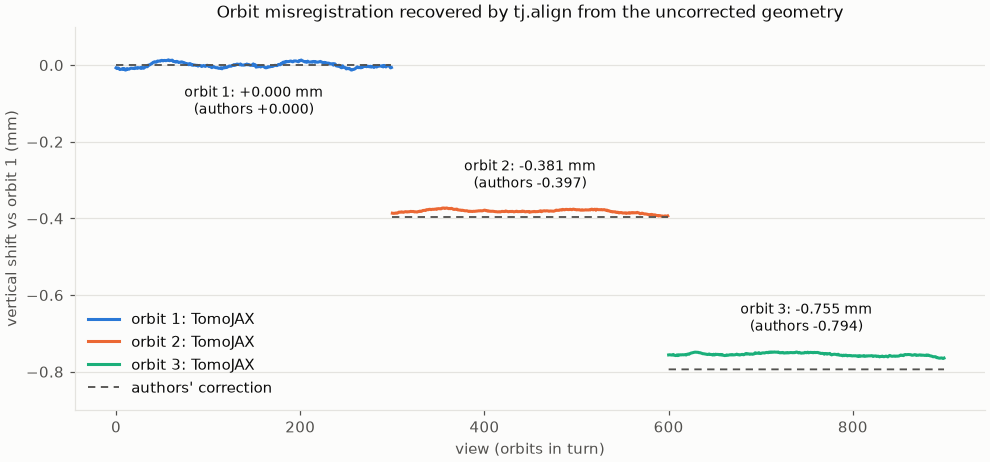

# Measurements

Measured speed, accuracy, and memory results behind the TomoJAX guides, including cases where other libraries win or where a method hits its limits. Each section notes the date, commit, and protocol; runnable scripts live in [bench/](../bench/README.md) and [examples/](../examples/README.md).

## Test environment

Unless noted otherwise, measurements run on Linux with one NVIDIA GeForce RTX 4070 Laptop GPU (Ada, 8 GB), Python 3.12, JAX 0.11.2, ASTRA 2.5.0, TIGRE 3.1.3, TomoPy 1.15.2, and tomocupy 1.1.0. Multi-GPU runs use four H100 80 GB GPUs on a single Modal host.

- **Cold time:** fresh process through the first result, including imports, compilation, and host-device transfers (filesystem cache not cleared).
- **Warm time:** repeated call in the same process.
- **GPU memory:** process peak sampled every 10–20 ms (includes runtime and allocator overhead; brief spikes can fall between samples).

## Headline comparison

Measured 2026-11-21 on commit `58a30e0` on the laptop GPU above. Every library receives identical corrected projections, calibrated geometry, and output grids. Iterative methods are compared at matched reconstruction error except the walnut CGLS row, which uses 10 iterations and reports both errors. Times are warm unless marked cold; ratios above 1 mean TomoJAX is faster.

| Case | TomoJAX | Other tools | Speedup ratio |
| --- | --- | --- | --- |
| [Parallel, real](#parallel-beam-on-a-real-scan-against-astra-tomopy-and-tomocupy): Diamond I12, 1801 views of 64 × 2560 px, in memory | 0.81 s (default Fourier), 3.35 s (FBP) | ASTRA FBP 7.64 s, TomoPy gridrec 2.90 s (CPU) | Default: 9.4× ASTRA, 3.6× TomoPy; FBP: 2.3× ASTRA, 0.87× TomoPy |
| Same scan, raw counts on disk to volume on disk, cold | 11.2 s (default), 10.7 s (FBP) | tomocupy 10.4 s | ~1× (writing 1.6 GiB volume dominates) |
| [Cone FDK, real](#fips-walnuts-real-lab-cone-beam-ct): FIPS walnut 1, 1 orbit, 1200 views binned 2×2, 501³ | 1.02 s | ASTRA 1.71 s | 1.7× (same error, 0.091) |
| [Cone CGLS, real](#fips-walnuts-real-lab-cone-beam-ct): same walnut, 10 iterations from zero | 28.2 s, error 0.184 | ASTRA 26.8 s, error 0.197 | 0.95× (lower error in TomoJAX) |
| [Laminography CGLS](#reconstruction-against-astra) to fixed error, 256³ synthetic (smooth / sharp) | 3.29 / 0.435 s | ASTRA 16.5 / 0.452 s | 5.0× / 1.04× (cold 3.4× / 0.70×) |
| [Parallel CGLS](#reconstruction-against-astra) to fixed error, 256³ synthetic (smooth / sharp) | 0.157 / 0.154 s | ASTRA 0.237 / 0.235 s | 1.5× / 1.5× (cold 0.37× / 0.52×) |
| [Cone FDK](#cone-beam-projection-and-fdk), 256³ synthetic, host to host | 0.103 s | ASTRA 0.288 s, TIGRE 0.543 s | 2.8× ASTRA, 5.3× TIGRE |
| [TV reconstruction](#tv-regularized-reconstruction-against-tigre), 128³ parallel synthetic, 3% noise | 0.32 s, error 0.075 | TIGRE 9.1 s, best error 0.101 | 28× (TIGRE does not reach 0.075) |

**Where other tools win:** ASTRA is faster per CGLS iteration on the walnut (26.8 vs 28.2 s for 10 iterations, though TomoJAX reaches lower error) and faster cold on the sharp laminography and parallel CGLS cells where TomoJAX compiles on first use. TomoPy's CPU gridrec beats TomoJAX's FBP from memory on I12 (2.90 vs 3.35 s), though TomoJAX's default Fourier inverse beats both. On smooth 256³ laminography, plain CGLS from zero misses the error target in 256 iterations where ASTRA passes; TomoJAX's coarse-to-fine CGLS passes and is what the table uses.

## Parallel beam on a real scan against ASTRA, TomoPy and tomocupy

Measured 2026-11-21 on commit `58a30e0` with [`bench/compare_parallel.py`](../bench/compare_parallel.py) on the Diamond I12 sandstone cut of Vo et al. (Zenodo 3339629): 1801 views over 180°, 64 rows × 2560 columns, axis at column 1417.5, reconstructed onto 2560 × 2560 slices.

| From line integrals in host RAM to volume in host RAM | Cold | Warm | Correlation with TomoJAX FBP |
| --- | ---: | ---: | ---: |
| TomoJAX default `tj.reconstruct(scan)` (Fourier-slice inverse) | 2.53 s | 0.81 s | 0.9997 |
| TomoJAX FBP | 4.75 s | 3.35 s | reference |
| ASTRA `FBP_CUDA` (slice by slice) | 8.41 s | 7.64 s | 0.99998 |
| TomoPy gridrec (CPU, 32 threads) | 3.69 s | 2.90 s | 0.988 |

Correlation is computed on the middle slice after a 2-pixel Gaussian blur (unblurred, TomoPy is 0.77 because gridrec retains more high-frequency noise).

End-to-end from raw counts on disk to volume on disk (5 interleaved cold runs with `sync` before each): TomoJAX default 11.2 s median (range 4.3–11.9 s), TomoJAX FBP 10.7 s (6.8–16.6 s), and `tomocupy recon` Fourier 10.4 s (8.8–35.8 s; correlation 0.991). Writing the 1.6 GiB volume dominates all three.

```bash
uv run --no-sync python bench/compare_parallel.py full_rows1048-1111.nxs WORK \
  --axis 1417.5 --baselines-python BASELINES/bin/python
```

## Reconstruction against ASTRA

Measured 2026-11-19 on commit `40330cf` across 27 synthetic cells: Gaussian, sharp (structured), and noisy structured objects in parallel, shifted anisotropic, and 30° laminography geometries on 64³, 128³, and 256³ grids (180 views). Each method runs budgets of 1, 2, 4, …, 256 iterations until full-volume relative L2 error passes the cell's gate (no amplitude rescaling or clipping), and each library contributes its fastest accepted workflow by cold time.

| Speedup (ASTRA / TomoJAX across 26 passing cells) | Cold | Warm |
| --- | ---: | ---: |
| Geometric mean | 1.20× | 2.35× |
| Range | 0.65–3.80× | 0.78–14.5× |

Neither library passed the sharp anisotropic 64³ gate. In most parallel and anisotropic cells TomoJAX's fastest accepted method is the CUDA Fourier inverse (`fourier` with CuPy); in laminography it is Joseph CGLS (plain, FBP-started, or coarse-to-fine). ASTRA is faster on sharp and noisy 256³ laminography (0.65–0.93×) where both reach the gate at the same iteration count.

| Object | Cell | TomoJAX fastest (cold / warm ms) | ASTRA fastest (cold / warm ms) | Cold speedup | Warm speedup |
| --- | --- | --- | --- | ---: | ---: |
| Gaussian | parallel 64 | coarse-to-fine CGLS: 358 / 10.5 | CGLS: 397 / 26.0 | 1.11 | 2.48 |
| Gaussian | anisotropic 64 | Fourier: 364 / 2.0 | CGLS: 396 / 29.5 | 1.09 | 14.48 |
| Gaussian | laminography 64 | coarse-to-fine CGLS: 835 / 269.8 | CGLS: 1740 / 681.2 | 2.08 | 2.52 |
| Gaussian | parallel 128 | Fourier: 349 / 11.4 | fbp2d: 404 / 73.9 | 1.16 | 6.51 |
| Gaussian | anisotropic 128 | Fourier: 379 / 7.2 | fbp3d (CuPy): 434 / 7.9 | 1.15 | 1.10 |
| Gaussian | laminography 128 | coarse-to-fine CGLS: 1810 / 609.6 | FBP-started CGLS: 6885 / 3092.3 | 3.80 | 5.07 |
| Gaussian | parallel 256 | Fourier: 560 / 51.5 | fbp2d: 585 / 215.3 | 1.04 | 4.18 |
| Gaussian | anisotropic 256 | Fourier: 478 / 32.3 | fbp3d (CuPy): 510 / 45.9 | 1.07 | 1.42 |
| Gaussian | laminography 256 | coarse-to-fine CGLS: 10942 / 3532.5 | FBP-started CGLS: 34900 / 16530.2 | 3.19 | 4.68 |
| Sharp | parallel 64 | CGLS: 381 / 18.1 | fbp2d: 368 / 31.5 | 0.97 | 1.74 |
| Sharp | anisotropic 64 | none passed | none passed | — | — |
| Sharp | laminography 64 | coarse-to-fine CGLS: 369 / 10.0 | CGLS: 413 / 29.1 | 1.12 | 2.91 |
| Sharp | parallel 128 | Fourier: 465 / 11.9 | fbp2d: 420 / 73.7 | 0.90 | 6.19 |
| Sharp | anisotropic 128 | Fourier: 327 / 7.8 | fbp3d (CuPy): 437 / 7.6 | 1.34 | 0.98 |
| Sharp | laminography 128 | coarse-to-fine CGLS: 521 / 51.8 | FBP-started CGLS: 614 / 83.9 | 1.18 | 1.62 |
| Sharp | parallel 256 | Fourier: 498 / 58.5 | fbp3d (CuPy): 581 / 91.8 | 1.17 | 1.57 |
| Sharp | anisotropic 256 | Fourier: 456 / 31.2 | fbp3d (CuPy): 485 / 44.5 | 1.06 | 1.42 |
| Sharp | laminography 256 | FBP-started CGLS: 2295 / 484.8 | FBP-started CGLS: 1501 / 450.2 | 0.65 | 0.93 |
| Noisy | parallel 64 | CGLS: 367 / 17.8 | fbp2d: 360 / 34.9 | 0.98 | 1.95 |
| Noisy | anisotropic 64 | Fourier: 319 / 1.9 | FBP-started CGLS: 426 / 7.8 | 1.34 | 4.03 |
| Noisy | laminography 64 | CGLS: 372 / 16.3 | CGLS: 404 / 27.8 | 1.09 | 1.71 |
| Noisy | parallel 128 | Fourier: 421 / 11.9 | fbp2d: 434 / 72.4 | 1.03 | 6.10 |
| Noisy | anisotropic 128 | Fourier: 342 / 7.7 | fbp3d (CuPy): 450 / 7.7 | 1.32 | 1.00 |
| Noisy | laminography 128 | CGLS: 482 / 61.6 | CGLS: 537 / 82.8 | 1.11 | 1.34 |
| Noisy | parallel 256 | Fourier: 534 / 54.0 | fbp2d: 575 / 214.0 | 1.08 | 3.96 |
| Noisy | anisotropic 256 | Fourier: 457 / 31.9 | fbp3d (CuPy): 491 / 44.0 | 1.08 | 1.38 |
| Noisy | laminography 256 | CGLS: 1792 / 613.6 | CGLS: 1507 / 479.8 | 0.84 | 0.78 |

```bash
for suite in gaussian-v1 structured-v1 structured-noisy-v1; do
  uv run --no-sync python bench/compare_reconstructions.py --suite $suite \
    --sizes 64 128 256 --views 180 --repeats 3 \
    --methods tomojax_fourier_cupy tomojax_fbp_cuda tomojax_cgls_cuda \
      tomojax_fbp_joseph_cgls_cuda tomojax_multires_cgls_cuda \
      astra_fbp2d astra_fbp3d_cupy astra_cgls astra_fbp_cgls \
    --output OUTPUT/$suite.json
done
```

Rerunning the 256³ CGLS-only subset on 2026-11-21 (`58a30e0`):

| Object | Cell | TomoJAX (cold / warm ms) | ASTRA (cold / warm ms) | Cold speedup | Warm speedup |
| --- | --- | --- | --- | ---: | ---: |
| Gaussian | parallel 256 | FBP-started CGLS: 2275 / 157 | FBP-started CGLS: 850 / 237 | 0.37 | 1.51 |
| Gaussian | laminography 256 | coarse-to-fine CGLS: 10385 / 3287 | FBP-started CGLS: 34839 / 16519 | 3.35 | 5.03 |
| Sharp | parallel 256 | FBP-started CGLS: 1355 / 154 | FBP-started CGLS: 704 / 235 | 0.52 | 1.53 |
| Sharp | laminography 256 | FBP-started CGLS: 2165 / 435 | FBP-started CGLS: 1522 / 452 | 0.70 | 1.04 |

## Laminography: the default FBP against FISTA

Measured 2026-11-15 (`03a44438`) on two simulated laminography scans with independent fine-mesh truths (4× finer truth projected at 10⁴ photons per fine pixel and binned 4×4 onto 96³ grids): a sandstone rock (120 views, −35° tilt) and a watch movement (360 views, −15° tilt). Relative L2 error is split in Fourier space into the measured band and the unmeasured missing cone:

| Method | Rock (measured / missing cone) | Watch (measured / missing cone) |
| --- | ---: | ---: |
| FBP (default) | 0.165 / 0.316 | 0.163 / 0.396 |
| `fista`, 50 iterations (default) | 0.0835 / 0.212 | 0.0918 / 0.215 |
| `fista`, 100 iterations | 0.0788 / 0.185 | 0.0790 / 0.208 |
| `fista`, 1000 iterations | 0.0792 / 0.186 | 0.0788 / 0.208 |

Nonnegative FISTA-TV with its automatic TV weight halves measured-band error and fills part of the missing cone; 50 iterations stops 5–16% short of convergence on these scans, while 100 iterations reaches the converged floor. On real Diamond K11 scan 54013 (1441 views, 704 × 704 × 234 grid), FBP takes 5.5 s and 50-iteration FISTA-TV takes 233 s ([iterative solvers on real scans](#iterative-solvers-on-real-scans)).

## TV-regularized reconstruction against TIGRE

Measured 2026-11-21 (`58a30e0`) with [`bench/compare_tv.py`](../bench/compare_tv.py) on a 128³ structured parallel phantom (180 views, 3% noise). Each library runs 50 iterations over its own grid of TV weights and reports its lowest relative L2 error and warm host-to-host time:

| Method | Best relative L2 error | Warm time |
| --- | --- | ---: |
| TomoJAX FISTA-TV | 0.075 (automatic weight: 0.077) | 0.32 s |
| TIGRE FISTA | 0.101 | 9.1 s |
| TIGRE ASD-POCS | 0.146 | 5.6 s |

Higher TIGRE FISTA weights diverge; unregularized CGLS bottoms out at 0.138 (10 iterations).

## PSI ptychographic tomography

Measured 2026-11-19 (`cfc6f7d`) on `porous_glass_dataset.mat` (Odstrcil et al. 2019, Zenodo 3539513: 720 aligned phase projections of 416 × 1312, 6.868 nm pitch). Loading takes 3.6 s and `tj.reconstruct(scan)` (automatic Fourier inverse onto 1312 × 1312 × 416) takes 1.6 s. Converted to `δ` via `λ / 2π`, the middle slice agrees with the authors' `tomogram_delta` to correlation 0.984 and median ratio 0.997.

## Cone-beam projection and FDK

Measured 2026-11-21 (`58a30e0`) with [`bench/compare_cone.py`](../bench/compare_cone.py) (`--size 256 --views 360`): five voxelized ellipsoids on a 256³ grid, 384² detector, 1.5× magnification. Warm host-to-host times (best of 3, transferring 64 MiB volume and 202.5 MiB projections):

| Operation | TomoJAX | ASTRA 2.5 | TIGRE |
| --- | --- | --- | --- |
| Forward projection | 0.137 s (error 0.0060) | 0.168 s (0.0060) | 0.479 s interp (0.0062), 1.24 s Siddon (0.0068) |
| Backprojection | 0.122 s (exact transpose) | 0.073 s (approximate) | 0.094 s ("matched") |
| FDK | 0.103 s (error 0.0581) | 0.288 s (0.0581) | 0.543 s (0.0581) |
| Forward, axis tilted 0.5° | 0.138 s | 0.168 s | — |
| Backprojection, axis tilted 0.5° | 0.106 s (exact transpose) | 0.073 s (approximate) | — |

Device-resident TomoJAX times on the same geometry are 0.096 s forward, 0.082 s exact transpose, and 0.049 s FDK.

With CGLS on the same scan (`dc411a2`, 2026-10-06), TomoJAX's exact transpose runs 10 / 20 / 40 iterations in 3.4 / 6.6 / 13.2 s (volume errors 0.090 / 0.043 / 0.048). ASTRA's `CGLS3D_CUDA` runs in 2.3 / 4.4 / 8.7 s (errors 0.088 / 0.040 / 0.101), diverging after ~20 iterations because its backprojector is approximate (data residual rises from 0.0053 at 30 iterations to 0.027 at 60).

At 1024³ (1024 views of 1024², 4.3 GB each way, `95f0530`, 2026-10-07), `fdk_host` finishes in 8.0 s warm (11.1 s cold) from RAM, compared with 20.3 s for ASTRA `FDK_CUDA` and 30.7 s for TIGRE `fdk`.

### Full-view cone-beam iterative and FDK benchmarks

Benchmarked on full-view real scans (all on the RTX 4070 Laptop GPU, 2 × 2 detector binning unless noted, starting iterative solves from each library's FDK; common-projector residuals use one calibrated ASTRA forward projector across libraries; scripts in [`bench/cone_matrix.py`](../bench/cone_matrix.py)).

#### SIRT (walnut, Nikon seeds, Zeiss HDtomo)

TomoJAX runs 12 iterations of accelerated nonnegative SIRT (`SIRTConfig(lower_bound=0, subsets=1, acceleration=True)`); ASTRA and TIGRE run 24 nonnegative SIRT iterations. Measured 2026-10-19 (walnut/Nikon) and 2026-11-21 (`1c94b346`, Zeiss):

| Scan | Library | Cold / warm (s) | Common-projector residual | Reference error (full / support) or diff to ASTRA |
| --- | --- | ---: | ---: | --- |
| Walnut 1, 1 orbit (1200 views, 501³) | TomoJAX | 58.02 / 53.47 | 0.02474 | 0.1062 / 0.0749 |
| | ASTRA | 70.36 / 67.27 | 0.02600 | 0.1100 / 0.0772 |
| | TIGRE | 364.27 / 363.06 | 0.04417 | 0.1425 / 0.0984 |
| Walnut 1, 3 orbits (3600 views, 501³) | TomoJAX | 179.07 / 174.22 | 0.02622 | 0.0676 / 0.0458 |
| | ASTRA | 237.79 / 234.35 | 0.02756 | 0.0727 / 0.0491 |
| | TIGRE | 1171.20 / 1120.54 | 0.04523 | 0.1137 / 0.0767 |
| Nikon seeds (1571 views, 500³) | TomoJAX | 95.52 / 89.63 | 0.02879 | 0.0140 diff to ASTRA |
| | ASTRA | 135.89 / 125.78 | 0.03006 | — |
| | TIGRE | 504.23 / 493.43 | 0.05611 | 0.1027 diff to ASTRA |
| Zeiss HDtomo (801 views, 512³) | TomoJAX | 33.32 / 26.32 | 0.18374 | 0.0252 diff to ASTRA |
| | ASTRA | 55.51 / 51.85 | 0.18537 | — |
| | TIGRE | 309.66 / 308.06 | 0.20401 | 0.1362 diff to ASTRA |


```bash
uv run python examples/gallery/sirt_times.py sirt-times.png
```

#### CuO FDK (4×4 binning)

Measured 2026-11-21 (`d8758ca5`) on both 3201-view Zeiss CuO scans (`spl1` on 509³, `CuO2` on 507³):

| Scan | Library | Cold / warm (s) | Common-projector residual | Full-volume diff to ASTRA |
| --- | --- | ---: | ---: | ---: |
| CuO-spl1 | TomoJAX | 32.48 / 3.44 | 0.05658 | 0.1257 |
| | ASTRA | 32.13 / 5.33 | 0.10385 | — |
| | TIGRE | 37.75 / 10.38 | 0.10384 | 0.00004 |
| CuO2 | TomoJAX | 30.73 / 3.43 | 0.06334 | 0.1224 |
| | ASTRA | 29.19 / 5.22 | 0.11236 | — |
| | TIGRE | 35.56 / 10.08 | 0.11234 | 0.00004 |

99.7% of the TomoJAX–ASTRA difference on `spl1` sits outside the vendor's reconstructed field of view (relative L2 inside the field is 0.0068), due to virtual padding and full-turn coverage weights. Against the 4×4×4-binned vendor reconstruction (affine-registered inside the field), NRMSE is 0.1094 / 0.1098 / 0.1098 for TomoJAX / ASTRA / TIGRE.

#### Full-view CGLS, OS-SART, and OSEM

Paired interleaved runs (2 fresh processes per library, `bench/cone_matrix.py`). CGLS runs 3 iterations in TomoJAX vs 4 in ASTRA (5 on CuO); OS-SART and OSEM run 1 full sweep from FDK (except Nikon OSEM, which runs 8 outer × 4 subsets in TomoJAX/TIGRE vs 48 in ASTRA from uniform start):

| Scan, method | TomoJAX (iters/subsets, cold / warm s) | ASTRA (iters/subsets, cold / warm s) | Quality metric (TomoJAX vs ASTRA) | Peak GPU MiB (T / A) |
| --- | --- | --- | --- | ---: |
| Walnut 1, 1 orbit, CGLS (`40330cf`) | 3 iters: 19.76 / 11.31 | 4 iters: 18.34 / 13.86 | support err 0.0878 vs 0.0867 | 4309 / 5065 |
| Walnut 1, 3 orbits, CGLS (`3ba80328`) | 3 iters: 79.06 / 59.25 | 4 iters: 74.56 / 60.26 | support err 0.0611 vs 0.0582 | 4404 / 5720 |
| Nikon seeds, CGLS (`22571a59`) | 3 iters: 27.99 / 22.83 | 4 iters: 35.41 / 31.60 | residual 0.0349 vs 0.0299 | 4574 / 4922 |
| Zeiss HDtomo, CGLS (`1c94b346`) | 3 iters: 16.29 / 9.20 | 4 iters: 15.59 / 12.00 | residual 0.1583 vs 0.1496 | 4577 / 5167 |
| CuO-spl1 (bin 4), CGLS (`d8758ca5`) | 3 iters: 65.67 / 34.64 | 5 iters: 94.67 / 72.43 | residual 0.0262 vs 0.0252 | 4577 / 6777 |
| CuO2 (bin 4), CGLS (`d8758ca5`) | 3 iters: 64.16 / 34.23 | 5 iters: 91.26 / 69.18 | residual 0.0413 vs 0.0405 | 4577 / 6695 |
| Walnut 1, 1 orbit, OS-SART (`e2cd2101`) | 12 sub: 16.75 / 9.95 | 16 sub: 12.29 / 8.38 | support err 0.0839 vs 0.0811 | — |
| Walnut 1, 3 orbits, OS-SART (`75435039`) | 17 sub: 36.27 / 26.62 | 16 sub: 31.59 / 22.54 | support err 0.0555 vs 0.0563 | — |
| Nikon seeds, OS-SART (`ed9641e7`) | 13 sub: 18.63 / 13.08 | 12 sub: 16.08 / 12.34 | residual 0.0346 vs 0.0354 | — |
| Zeiss HDtomo, OS-SART (`1c94b346`) | 13 sub: 13.06 / 6.21 | 16 sub: 11.67 / 7.36 | residual 0.1922 vs 0.1897 | — |
| Walnut 1, 1 orbit, OSEM (`e2cd2101`) | 12 sub: 14.41 / 8.50 | 14 sub: 10.32 / 6.52 | support err 0.0720 vs 0.0690 | — |
| Walnut 1, 3 orbits, OSEM (`ed9641e7`) | 13 sub: 42.85 / 27.96 | 14 sub: 30.70 / 21.00 | support err 0.0484 vs 0.0470 | 3358 / 3892 |
| Zeiss HDtomo, OSEM (`1c94b346`) | 1 sub: 11.84 / 4.51 | 2 sub: 9.86 / 5.22 | residual 0.2138 vs 0.2060 | 4547 / — |
| Nikon seeds, OSEM (`44170fc0`) | 8×4 sub: 100.71 / 94.96 | 48×4 sub: 260.40 / 256.31 | residual 0.02665 vs 0.02673 | — |

On the Nikon OSEM case, TIGRE (8×4 subsets) took 210.11 / 196.94 s at residual 0.02685. Across the iterative cone-beam rows where ASTRA is faster, Nsight Systems profiling shows TomoJAX's exact matched transpose accounts for the gap (about 2× ASTRA's approximate voxel-driven backprojection), while TomoJAX uses less VRAM and faster forward projection and FDK.

```bash
export XLA_PYTHON_CLIENT_PREALLOCATE=false
python bench/cone_matrix.py walnut1 "$WALNUT" --library tomojax --method cgls --iterations 3 --repeats 2
python bench/cone_matrix.py walnut3 "$WALNUT" --library tomojax --method ossart --iterations 1 --subsets 17 --repeats 1
python bench/cone_matrix.py cuo "$CUO_SPL1" --library tomojax --method cgls --iterations 3 --repeats 1
```

## FIPS walnuts (real lab cone-beam CT)

[`bench/walnut.py`](../bench/walnut.py) evaluates the 42-walnut FleX-ray dataset of Der Sarkissian et al. (Scientific Data 6, 215, 2019; 3 orbits × 1200 views, published 50-iteration NNLS reference on 501³ at 0.1 mm). On Walnut 1 (`95f0530`–`d1f36f2`, updated `58a30e0` on 2026-11-21):

| Case | TomoJAX | ASTRA |
| --- | --- | --- |
| FDK, 1 orbit (1200 views) | 1.55 s warm (1.7–1.9 s cold); error 0.099 | 2.13 s; error 0.099 |
| FDK, 1 orbit, binned 2×2 (`58a30e0`) | 1.02 s warm; error 0.0912 | 1.71 s; error 0.0911 |
| CGLS from zero, 1 orbit, binned 2×2, 10 iters (`58a30e0`) | 28.2 s warm; error 0.184 | 26.8 s; error 0.197 |
| NNLS, 3 orbits, every 4th view, 20 iters (unbinned) | 304 s; error 0.152 | 217 s; error 0.147 |
| NNLS, 3 orbits, every 4th view, 20 iters (binned 2×2) | 86 s; error 0.154 | 91 s; error 0.152 |

Unbinned, the detector pitch at the axis (0.05 mm) is twice as fine as the 0.1 mm voxels, so TomoJAX's exact ray-driven transpose does 4× unnecessary work. Binning 2 × 2 (`scan.binned(2)`) preserves accuracy while speeding up TomoJAX 3.5× and ASTRA 2.4×.

### Orbit registration

The dataset ships both raw scanner geometry (`scan_geom_original.geom`) and the authors' height-corrected geometry (orbits 2 and 3 shifted by −0.397 and −0.794 mm in object coordinates). Given the uncorrected geometry (every 4th view, binned 2×2), `tj.align` recovers the relative orbit heights directly (`bench/walnut_alignment.py`):

| Height relative to orbit 1 | Orbit 2 | Orbit 3 |
| --- | ---: | ---: |
| TomoJAX `tj.align` | −0.381 mm | −0.755 mm |
| Authors' correction | −0.397 mm | −0.794 mm |

Reconstructing 20 iterations of NNLS (with orbit 1 fixed to compare voxel-for-voxel) drops error against the published reference from 0.280 (uncorrected) to 0.155 (TomoJAX-aligned), matching the authors' corrected geometry (0.154). Across all 42 walnuts, median disagreement with the authors' heights is under a fifth of a voxel ([bench/README.md](../bench/README.md#fips-walnuts-real-lab-cone-beam-ct)).




## Alignment

### Independent vs smooth motion

Measured 2026-11-20 on commit `dd8f2cd` comparing the default `motion="independent"` with `motion="smooth"` on one RTX 4070 Laptop GPU:

| Scan | `motion="smooth"` | `motion="independent"` (default) |
| --- | --- | --- |
| README watch scan (`examples/align_watch.py`), shift RMS across / along | 0.47 / 0.29 px, 35 s | 0.07 / 0.05 px, 36 s |
| Diamond K11 54013 (1441 views, 704 × 704 × 234), ruby-sphere track residual u / v | 0.20 / 0.18 px, 281 s (3.19 GiB) | 0.30 / 0.19 px, 281 s (3.19 GiB) |
| Diamond K11 54286 (1441 views, tilt +35°) | 279 s (3.19 GiB) | 278 s (3.19 GiB) |
| Diamond K11 67208 (4000 views, tilt +30.9°) | 1039 s (4.63 GiB) | 1009 s (4.63 GiB) |
| Synthetic slip rock (120 views, 0.95 px slip), pose RMS / slip recovered | 0.095 px / 0.80 px, 10 s | 0.095 px / 0.88 px, 6 s |
| Half-turn rock, `fit=("translations", "tilt")`, landmarks / fitted tilt (true −0.35°) | 0.148 px / −0.764°, 16 s | 0.148 px / −0.764°, 15 s |
| FIPS walnut, 3 orbits (`examples/align_walnut_orbits.py`), relative heights | 0, −0.385, −0.753 mm, 101 s | 0, −0.385, −0.753 mm, 100 s |
| Zeiss CuO_2 tomo-A (binned 4×4) | 88 s | 75 s (volumes differ 1.0%) |

The smooth motion prior scales linearly in view count (`3aae66e`, FP64): factoring and solving for 1000 / 4000 / 16000 views takes 2.8 / 5.0 / 13.8 ms to factor and 0.71 / 0.84 / 1.9 ms to solve, peaking at 14 / 41 / 163 MiB.

On axial parallel scans, per-view rotations are weakly determined (`a64ea92e`): across 13 axial watch/rock cases, `fit=("translations", "rotations")` beat translations alone on 7, tied on 1, and was up to 27% worse on 5.

### Projection-only detector center (`method="opposite-views"`)

On real scans with injected ±0.25, ±0.5, and ±1 px shifts (`a04e5ee7`), 95th-percentile center-change errors across 3 detector rows were 0.00085 px (APS 2-BM), 0.00117 px (Diamond I12), 0.00292 px (Elettra 00024), 0.00488 px (Diamond I13), 0.00567 px (ESRF bamboo), 0.00051 px (PSI cSAXS phase), and 0.00285 px (PSI TOMCAT 00082, 64 rows).

On independent analytic Gaussian projections with Poisson noise (100 pairs per category), p95 location errors were 0.0088–0.0152 px (dense, sparse, truncated) and 0.086 px (low contrast), with 91–100% empirical coverage of the local 90% matching intervals. On independent gVXR cuboids (257 × 65 px, 30 000 photons), p95 errors were 0.052–0.173 px for dense, sparse, off-center, phase-fringe, and truncated objects, rising to **3.91 px** at low contrast (competing peaks; only 1 of 5 truths inside its local 90% interval) and **1.00 px** with a 1° axis tilt.

### Cone-setup aliases and a conditional calibration test

Checking recorded cone ray bundles (`ad7f9805`) confirms two exact geometric aliases under unrestricted 6-DOF per-view poses: shifting source and detector rigidly together (such as radius or orbit-height changes) is absorbed by poses to 5.38e−16–1.01e−14 unit-ray RMS across Nikon clay, Zeiss CuO_2, and Walnut 1; scaling source-to-detector distance, pixel pitch, and detector offsets together leaves all rays identical to 5.11e−16–1.01e−14 RMS.

A fixed-pose Walnut 1 focal-scale test (`c46c52e3`) recovered synthetic scale within 3.24e−9 noiselessly, but on real walnut data shifted held-out correspondence MSE to 1.00034× (no improvement), so focal scaling is not fitted automatically.

## Detector response and structure controls

Comparing `tomojax.corrections.Rings` against Algotom 1.7 (`-log(remove_all_stripe(exp(-q)))`, default 3/51/21) on real parallel-beam cuts (`e71f900f`, `271fd6e3`). Injected detector response is `a + b(1 - exp(-q))` (RMS 0.004 and 0.006); off-axis structure probes are independent analytic Gaussian Radon traces (widths 2 and 8 px, peak 0.05, radii 0.35 and 0.7 of detector half-width):

| Scan cut | Injected residual (`Rings` / Algotom) | Off-axis sinogram alteration (`Rings` / Algotom) |
| --- | ---: | ---: |
| I13 159815, row 1080, cols 441:1869, `::8` | 0.280 / 0.403 | 0.111 / 0.350 |
| I12 3339629, row 1080, 2560 cols, `::8` | 0.392 / 0.241 | 0.0085 / 0.300 |
| APS 2-BM `test_data.h5`, row 11, 1536 cols, `::8` | 0.611 / 0.230 | 0.0130 / 2.074 |
| ESRF bamboo, row 270, 640 cols, `::8` | 0.437 / 0.170 | 0.0367 / 0.353 |

Reconstructed image-domain checks across seven facilities (`a3bef73d`, same analytic off-axis Gaussians at radius 0.7 plus injected dense log-gain RMS 0.002):

| Facility | Radial proxy (raw / `Rings` / Algotom) | Max Gaussian image alteration (`Rings` / Algotom) | Injected gain retained (`Rings` / Algotom) |
| --- | ---: | ---: | ---: |
| I12 | 0.0300 / 0.0218 / 0.0090 | 0.0267 / 2.471 | 0.252 / 0.142 |
| APS | 0.0308 / 0.0212 / 0.0077 | 0.0350 / 18.04 | 0.500 / 0.079 |
| ESRF | 0.0718 / 0.0467 / 0.0101 | 0.2846 / 2.397 | 0.182 / 0.101 |
| Elettra | 0.0467 / 0.0349 / 0.0060 | 0.0799 / 2.485 | 0.234 / 0.073 |
| 2DeteCT | 0.0278 / 0.0239 / 0.0061 | 0.0055 / 2.308 | 0.278 / 0.145 |
| PSI 00071 | 0.0231 / 0.0215 / 0.0045 | 0.0034 / 3.859 | 0.413 / 0.061 |
| Walnut 1 orbit 2 | 0.0288 / 0.0286 / 0.0172 | 0.0373 / 0.657 | 0.401 / 0.382 |

`Rings` alters off-axis structure far less than Algotom across every facility, though it still exceeds 5% image alteration on ESRF (28.5%), Elettra (8.0%), and native I13 rows (6.7–17.4% across six rows). On finite-reference raw-count simulations on I13 row 1080 (4 seeds), `Rings` + FBP retained 48–83% of the injected image-error RMS; on synthetic calibration-gap controls, calibration-only NRMSE (0.150–0.280) rose to 0.258–0.320 after `Rings`. Constrained inverse feasibility (`694a9ae7`) ensures every fitted response curve has a monotonic inverse (minimum derivative 0.501, closure error ≤ 3.6e−7).

## Memory

### Scans larger than the GPU

All runs on the 8 GB RTX 4070 Laptop GPU (30 GB host RAM):

| Run | Result | Date, commit |
| --- | --- | --- |
| `fbp_host`, 1024³ laminography (30° tilt, 1024 views of 1024², 4.3 GB memmaps) | 37 s in two x-slabs | 2026-10-05, `8bc0653` |
| FISTA-TV, 512³ laminography, 3072 views (3.2 GB projections), streamed, 10 iters | 4.3 GB peak GPU (at 768 views: 67.6 s streamed vs 65.0 s resident) | 2026-10-05, `6fa1585` |
| CGLS, 512³ laminography, 3072 views, streamed, 10 iters | 154 s, 3.2 GB peak GPU | 2026-10-06, `9d4c4d1` |
| SPDHG-TV, 512³ laminography, 3072 views, streamed, 192 iters | 297 s, 4.3 GB peak GPU (3.2 GB dual in host RAM; bitwise identical to resident) | 2026-10-06, `9d4c4d1` |
| `tj.reconstruct_slabs` SIRT, full Diamond I12: 1801 views of 2160 × 2560 (39.8 GB corrected) -> 56.6 GB volume | 1436 s solving, 1.41 GB peak GPU, 3.7 GB host RAM (1.13× per-voxel time of an 8-row in-core run) | 2026-10-17, `440cc563` |
| OSEM, full-resolution FIPS walnut: 3600 views of 972 × 768 -> 1001³ volume, 4 subsets × 1 iter from FDK | 230.7 / 241.8 s in 128-plane slabs; 5.66 GiB GPU, 15.6 GB host; error 0.124 / 0.094 (full / support) | 2026-10-21, `30f9f1df` |
| `tj.reconstruct_slabs` FDK, full CuO-spl1: 3201 views of 2036² -> 2036³ (33.8 GB), 32-plane slabs | 900.5 s total, 9.86 GB peak host; 256-view residual 0.0571, vendor NRMSE 0.1099 | 2026-11-21, `d8758ca5` |
| `tj.reconstruct_slabs` FDK, full CuO2: 3201 views of 2028² -> 2028³ (31 GiB), 32-plane slabs | 1053.9 s, 4.39 GiB peak GPU, 14.2 GB host | 2026-10-20, `75435039` |
| OS-SART, CuO-spl1 binned 2×2: 3201 views of 1018² -> 1018³ resident, 3 iters × 8 subsets | 441 s solving (+30 s correcting), 7.31 GiB GPU, 13.8 GB host; residual 0.0319 | 2026-10-20, `30f9f1df` |
| SIRT, synthetic 1300³ (8.79 GB host volume), 180 cone views, 3 iters | 62.8 s in 128-plane slabs, 6.02 GiB GPU, 11.5 GB host | 2026-10-20, `5cf50e6b` |
| CGLS, synthetic 1300³ (4 volumes = 35 GB memmapped on USB HDD), 2 iters | 1514 s in 128-plane slabs, 6.32 GiB GPU, 14.6 GB host (113 GB read, 114 GB written) | 2026-10-21, `30f9f1df` |
| OS-SART, native CuO-spl1 from raw frames (2036³ = 33.8 GB memmapped on USB HDD), 1 iter × 4 subsets | 2131 s solving (2295 s total), 6.25 GiB GPU, 9.4 GB anon host (207 GB read, 135 GB written) | 2026-10-20, `5cf50e6b` |

Reproduce the out-of-core cone runs with [`bench/out_of_core.py`](../bench/out_of_core.py):

```bash
python bench/out_of_core.py synthetic --size 1300 --views 180 --method sirt --iterations 3
python bench/out_of_core.py cuo "$CUO_SPL1" --binning 2 --iterations 3 --subsets 8
```

### Iterative solver memory

On 512³ laminography (768 views of 512², 0.8 GB projections) with `XLA_PYTHON_CLIENT_MEM_FRACTION=0.95` (`4bdf52a`), peak GPU memory is 5.6 GB for CGLS, 4.6 GB for FISTA-TV, and 4.9 GB for SPDHG-TV.

Keeping SPDHG-TV's five state volumes in place in z-contiguous layout (`19431f9`, 2026-11-19) runs default `tj.reconstruct(scan, "spdhg")` on full-size K11 54013 (1441 views, 704 × 704 × 234 grid, projections streamed from host) in 98 s at 2.36 GiB peak VRAM (within JAX's default 75% cap on an 8 GB GPU).

### Iterative solvers on real scans

Default `tj.reconstruct(scan, method)` (50 iterations, fresh process per call, `92bd2e8`, 2026-11-21) on the 8 GB RTX 4070 Laptop GPU:

| Scan | CGLS (time / peak VRAM) | SIRT (time / peak VRAM) | MLEM (time / peak VRAM) | FISTA-TV (time / peak VRAM) |
| --- | ---: | ---: | ---: | ---: |
| K11 54013, laminography, 1441 views, 704 × 704 × 234 | 182.0 s / 4.57 GiB | 204.8 s / 3.07 GiB | 176.8 s / 4.57 GiB | 233.2 s / 3.77 GiB |
| Zeiss CuO_2 tomo-A, cone, 801 views, bin 4, 507³ | 99.4 s / 4.75 GiB | 97.9 s / 6.28 GiB | 101.5 s / 4.72 GiB | 145.5 s / 4.04 GiB |
| Diamond I12, parallel, 1801 views, 2560 × 2560 × 64 | 1675 s / 3.35 GiB | 207.5 s / 2.57 GiB | 214.6 s / 2.57 GiB | 1984 s / 7.39 GiB |

### Fourier inverse

Measured 2026-10-04 (`776a8c9`) on a parallel Gaussian phantom (720 views, CuPy CUDA backend, median of 7 warm calls):

| Size | Slices per slab | Warm time | Peak GPU memory | Fastest external warm (peak GPU) |
| --- | ---: | ---: | ---: | --- |
| 256³ | 16 | 88.0 ms | 284 MiB | CuPy/ASTRA: 432 ms (814 MiB) |
| 256³ | 8 | 87.2 ms | 220 MiB | CuPy/ASTRA: 431 ms (814 MiB) |
| 512³ | 16 | 518 ms | 678 MiB | CuPy/ASTRA: 3085 ms (1262 MiB) |
| 512³ | 8 | 615 ms | 430 MiB | native ASTRA 2D: 3072 ms (156 MiB) |

Set `FourierConfig(slices_per_batch=8, backend="cupy")` to trade slight throughput for lower VRAM; ASTRA's slice-by-slice 2D FBP uses the least GPU memory.

## Several GPUs

Measured 2026-10-08 (`a3a925b`) on four H100 80 GB GPUs on Modal: 20 nonnegative FISTA iterations on the binned FIPS walnut (3 orbits, every 4th view = 900 views of 486 × 384, 501³ grid) using `devices=`. Warm (second-call) times:

| GPUs | Warm time (s) | Cold time (s) | Speedup | Diff vs 1 GPU (rel. L2) |
| ---: | ---: | ---: | ---: | ---: |
| 1 | 24.8 | 27.4 | 1.00× | — |
| 2 | 13.6 | 15.8 | 1.83× | 2.9e-7 |
| 4 | 7.4 | 9.5 | 3.34× | 2.9e-7 |

Volume-sized solver updates stay constant per GPU and a 0.5 GB volume reduction crosses NVLink once per iteration.

## Calibrated detector count noise

`tomojax.datasets.DetectorModel` fits photon gain and read noise from repeated flats and darks (`b608d187`, `0199b919`). Calibrating on the first half of flats and evaluating adjacent-frame log differences on the second half (16 rows, 100 exposures):

| Scan cut | Simulated / observed RMS | Adjacent-row correlation error |
| --- | ---: | ---: |
| Diamond I13 159815, rows 1080:1096, cols 441:1869 | 0.960 | −0.0095 |
| Diamond I12 3339629, rows 1048:1064, all cols | 1.002 | −0.0085 |
| ESRF bamboo, rows 262:278, all cols (1 dark; read noise assumed 0) | 1.002 | −0.0395 |

Propagating finite-reference noise through 360-view full-turn FBP across Gaussian difference bands (σ = 1, 2, 4, 8 px) yields pooled simulated/observed RMS ratios of 0.919–1.100 across all three facilities (individual annuli span 0.661–1.300 on ESRF, 0.893–1.080 on I12/I13).

Two real-detector effects are outside the independent-pixel Poisson + read-noise model:

- **Heavy tails on ESRF:** excess kurtosis differs by 0.30–4.81 across signal quintiles (versus ≤ 0.39 on I12 and I13) due to sparse transient artifacts.
- **Spatial correlation on I13 159850:** averaging over 64 to 2048 columns raises observed/predicted RMS ratios from 1.01 to 3.18 (pre-scan flats) and 1.02 to 1.55 (post-scan flats), because correlated flat fluctuations do not average down as `1/sqrt(N)`.

## Images

See [images/README.md](../images/README.md) for how the README figures were generated (all synthetic watch figures use gVXR ray-traced meshes rather than TomoJAX's projector) and provenance notes for historical DIAD laminography images.
