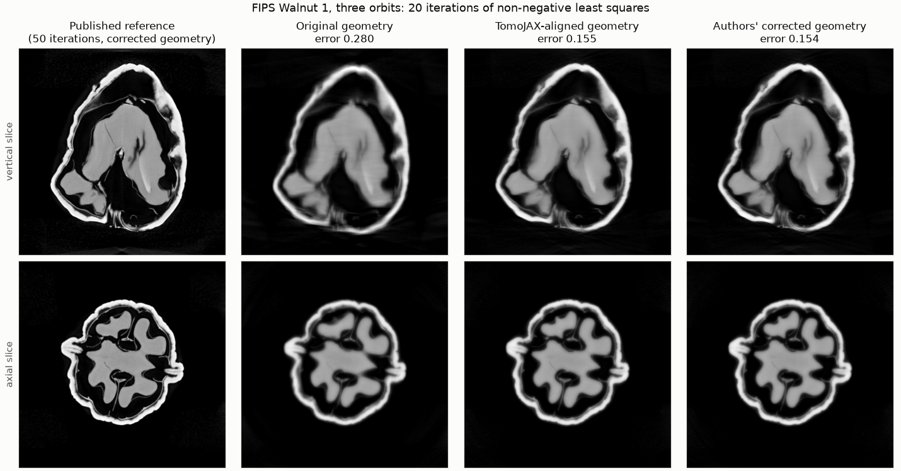
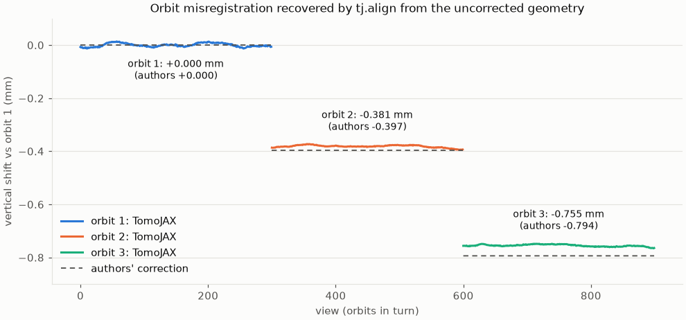

# Measurements

This page holds the measured evidence behind the speed, accuracy and memory
claims in the guides. Each section names the date, the TomoJAX commit the
numbers were measured on and the protocol. The code has changed since some of
those commits, so a later commit can be faster or slower than the figures here.
Failed cases are reported with the rest.

## Test environment

Unless a section says otherwise, measurements use one NVIDIA GeForce RTX 4070
Laptop GPU (Ada, 8 GB) on Linux with Python 3.12, JAX 0.11.2, ASTRA 2.5 and
TIGRE 3.1.3. The Pallas kernels use JAX's deprecated Triton backend, so the
package constrains JAX below 0.12 (`pyproject.toml`); other GPU families have
not been measured. The several-GPU results use four H100 80 GB GPUs in one
machine on Modal. Objects are synthetic except the FIPS walnuts, a real lab
cone-beam scan.

*Cold* time is a fresh process through the first accepted result, including
imports, compilation and transfers. *Warm* time repeats the same call in that
process. GPU memory is the process's peak, sampled every 10 ms; sampling can
miss short peaks, and it includes runtime and allocator overhead.

Commands, adapters and physical conventions are in the
[benchmark guide](../bench/README.md). Raw records are kept out of the
repository; each result names the command, commit and date to rerun it.

## Reconstruction against ASTRA

Measured 2026-10-05 on commit `6fa1585`. The matrix has 27 cells: Gaussian,
sharp (structured) and noisy structured objects, each scanned in parallel,
shifted anisotropic and 30° laminography geometry on 64³, 128³ and 256³ grids,
all with 180 views. Each method runs at budgets of 1, 2, 4, … 256 iterations
until its full-volume relative L2 error passes the cell's fixed gate, without
fitted amplitudes or clipping. Each side contributes its fastest accepted
workflow by cold time. Cold time runs through the first accepted budget,
including the failed lower budgets; warm time is the median of three repeats
of that budget. ASTRA was measured in the same session. TIGRE was not rerun,
because it was the fastest external method in no cell of the earlier
matrices.

| Speedup (ASTRA time / TomoJAX time), 26 paired cells | Cold | Warm |
|---|---:|---:|
| Geometric mean | 1.00 | 2.78 |
| Range | 0.44–2.81 | 0.59–20.4 |

The sharp anisotropic 64³ cell has no accepted result on either side. In the
parallel and anisotropic cells TomoJAX's fastest method is the opt-in Fourier
inverse on CUDA (`fourier_reconstruct` with CuPy), not the default FBP. In
laminography it is Joseph CGLS: plain, FBP-started or coarse-to-fine. Small
laminography scans are slower from a fresh process (0.44–0.59). There, JAX's
import and device setup (about 0.4 s) and tracing the solver (about 0.2 s)
outweigh solves of 30–180 ms.

| Object | Cell | TomoJAX fastest accepted, cold / warm ms | ASTRA fastest accepted, cold / warm ms | Cold speedup | Warm speedup |
|---|---|---|---|---:|---:|
| Gaussian | parallel 64 | Fourier: 368 / 3.0 | fbp2d: 334 / 24.6 | 0.91 | 8.18 |
| Gaussian | anisotropic 64 | Fourier: 372 / 1.5 | CGLS: 383 / 30.1 | 1.03 | 20.41 |
| Gaussian | laminography 64 | coarse-to-fine CGLS: 1777 / 239.0 | CGLS: 1728 / 676.4 | 0.97 | 2.83 |
| Gaussian | parallel 128 | Fourier: 417 / 11.2 | fbp2d: 391 / 59.8 | 0.94 | 5.32 |
| Gaussian | anisotropic 128 | Fourier: 394 / 8.1 | fbp3d (CuPy): 454 / 10.4 | 1.15 | 1.29 |
| Gaussian | laminography 128 | coarse-to-fine CGLS: 2942 / 763.5 | CGLS: 7066 / 3200.5 | 2.40 | 4.19 |
| Gaussian | parallel 256 | Fourier: 593 / 74.6 | fbp2d: 697 / 297.5 | 1.17 | 3.99 |
| Gaussian | anisotropic 256 | Fourier: 507 / 39.0 | fbp3d (CuPy): 539 / 77.5 | 1.06 | 1.99 |
| Gaussian | laminography 256 | coarse-to-fine CGLS: 14077 / 5572.4 | CGLS: 39612 / 18048.9 | 2.81 | 3.24 |
| Sharp | parallel 64 | Fourier: 422 / 3.6 | fbp2d: 367 / 28.4 | 0.87 | 7.85 |
| Sharp | anisotropic 64 | none accepted | none accepted | — | — |
| Sharp | laminography 64 | CGLS: 912 / 28.7 | CGLS: 405 / 29.2 | 0.44 | 1.02 |
| Sharp | parallel 128 | Fourier: 513 / 12.0 | fbp2d: 439 / 61.8 | 0.86 | 5.14 |
| Sharp | anisotropic 128 | Fourier: 416 / 8.0 | fbp3d (CuPy): 474 / 10.6 | 1.14 | 1.33 |
| Sharp | laminography 128 | CGLS: 1197 / 178.4 | FBP-started CGLS: 711 / 105.8 | 0.59 | 0.59 |
| Sharp | parallel 256 | Fourier: 614 / 69.5 | fbp2d: 678 / 308.0 | 1.10 | 4.43 |
| Sharp | anisotropic 256 | Fourier: 533 / 39.6 | fbp3d (CuPy): 555 / 76.5 | 1.04 | 1.93 |
| Sharp | laminography 256 | FBP-started CGLS: 2108 / 647.4 | CGLS: 3225 / 982.5 | 1.53 | 1.52 |
| Noisy | parallel 64 | Fourier: 404 / 3.3 | fbp2d: 394 / 26.2 | 0.98 | 7.99 |
| Noisy | anisotropic 64 | Fourier: 391 / 1.6 | FBP-started CGLS: 448 / 8.5 | 1.15 | 5.29 |
| Noisy | laminography 64 | CGLS: 861 / 29.2 | CGLS: 407 / 29.3 | 0.47 | 1.00 |
| Noisy | parallel 128 | Fourier: 504 / 11.4 | fbp2d: 396 / 62.2 | 0.79 | 5.46 |
| Noisy | anisotropic 128 | Fourier: 406 / 8.1 | fbp3d (CuPy): 450 / 10.0 | 1.11 | 1.24 |
| Noisy | laminography 128 | CGLS: 1043 / 104.2 | CGLS: 588 / 98.6 | 0.56 | 0.95 |
| Noisy | parallel 256 | Fourier: 593 / 70.4 | fbp2d: 678 / 298.7 | 1.14 | 4.24 |
| Noisy | anisotropic 256 | Fourier: 545 / 41.7 | fbp3d (CuPy): 532 / 77.9 | 0.98 | 1.87 |
| Noisy | laminography 256 | FBP-started CGLS: 2099 / 645.0 | CGLS: 2277 / 736.3 | 1.08 | 1.14 |

## TV-regularised reconstruction against TIGRE

Measured 2026-10-05 on commit `7dbf427` with
[`bench/compare_tv.py`](../bench/compare_tv.py). A 128³ structured parallel
phantom is scanned with 180 views and 3% noise. Each library runs 50
iterations over its own grid of regularisation weights, and the best relative
L2 error is reported with its warm time. TIGRE's times include its host
transfers.

| Method | Best relative L2 error | Warm time |
|---|---:|---:|
| TomoJAX FISTA-TV | 0.076 | 1.13 s |
| TIGRE FISTA | 0.101 | 9.7 s |
| TIGRE ASD-POCS | 0.146 | 5.7 s |

Larger TIGRE FISTA weights diverge. Unregularised CGLS reaches 0.138 at best
(10 iterations). This is one phantom at one noise level, not a general ranking.

## Cone-beam projection and FDK

Measured 2026-10-07 on commit `5ea7c22` with
[`bench/compare_cone.py`](../bench/compare_cone.py): five voxelised ellipsoids
(256³, 2×2×2 sub-samples) on a circular 360-view scan with a 384² detector at
1.5× magnification. Forward projections are compared with exact analytic line
integrals and FDK volumes with the phantom. Times are the best of three warm
calls; ASTRA and TIGRE take host arrays.

| Operation | TomoJAX | ASTRA 2.5 | TIGRE |
|---|---:|---:|---:|
| Forward projection | 0.093 s (error 0.0060) | 0.170 s (0.0060) | 0.477 s interpolated (0.0062), 1.24 s Siddon (0.0068) |
| Backprojection | 0.178 s, exact transpose | 0.075 s, approximate transpose | 0.103 s, "matched" |
| FDK | 0.048 s (error 0.0581) | 0.293 s (0.0581) | 0.513 s (0.0581) |
| Forward, axis tilted 0.5° | 0.092 s | 0.171 s | |
| Backprojection, axis tilted 0.5° | 0.232 s, exact transpose | 0.075 s, approximate transpose | |

TomoJAX's backprojection is the exact transpose of its forward projector,
which the iterative solvers and gradients rely on. ASTRA's voxel-driven
backprojector is cheaper but only approximately its transpose, so a CGLS
iteration (one of each) costs about 0.27 s in TomoJAX against ASTRA's 0.25 s.
The transpose has a faster path for views whose detector columns are parallel
to the rotation axis. A tilted axis, a rolled or pitched detector, or the
per-view poses of alignment rule that path out, and an iteration then costs
about 0.32 s at this size. ASTRA's times do not depend on the geometry.

On the same scan (2026-10-06, commit `dc411a2`, before the forward projector
was made faster), CGLS with the matched transpose took 3.4, 6.6 and 13.2 s for
10, 20 and 40 iterations, with volume errors of 0.090, 0.043 and 0.048.
ASTRA's `CGLS3D_CUDA` took 2.3, 4.4 and 8.7 s with errors of 0.088, 0.040 and
0.101. It diverges after about 20 iterations: its own data residual rises
from 0.0053 at 30 iterations to 0.0062 at 40 and 0.027 at 60, which CGLS with a
matched transpose cannot do.

On the binned FIPS walnut (2026-10-10, commit `944b2e0`; 900 views, 501³
voxels, errors against the authors' published reconstruction) neither CGLS
diverges within 50 iterations. TomoJAX's reaches its best error, 0.040, at 25
iterations in 77 s. ASTRA's is at 0.074 after 25 and 0.047 after 50 (about
90 s).

`fdk_host` reconstructed a 1024³ scan (1024 views of 1024² pixels, 4.3 GB each
way) in z-slabs in 8.0 s with the projections and volume in RAM, 11.1 s on the
first call (2026-10-07, commit `95f0530`). ASTRA's `FDK_CUDA` took 20.3 s and
TIGRE's `fdk` 30.7 s from arrays in RAM.

## FIPS walnuts (real lab cone-beam CT)

`bench/walnut.py` reconstructs the walnut collection of Der Sarkissian et al.
(Scientific Data 6, 215, 2019; CC BY 4.0). Each walnut has three source orbits
of 1200 projections on a FleX-ray scanner, per-view geometry vectors, and a
reference reconstruction: 50 iterations of non-negative least squares on all
three orbits, 501³ voxels of 0.1 mm. Walnut 1 was measured on 2026-10-07
(commits `95f0530` to `d1f36f2`):

| | TomoJAX | ASTRA |
| --- | --- | --- |
| Geometry from the vectors | source 66.0014 mm, detector 199.0062 mm (the scanner's log: 66.0014, 199.0062) | |
| FDK, one orbit (1200 views) | 1.7–1.9 s on the first call, compilation included; 1.55 s after; within 0.05% of ASTRA's volume and 0.6% of the authors' published FDK | 2.13 s |
| FDK error against the reference, in the walnut | 0.099 | 0.099 |
| FDK, detector binned 2 × 2 | 1.23 s on the first call, 1.05 s after; error 0.091 | 1.43 s; 0.091 |
| Non-negative least squares, three orbits, every 4th view, 20 iterations | 304 s; error 0.152 | 217 s (the reference's own solver); 0.147 |
| The same, detector binned 2 × 2 | 86 s; error 0.154 | 91 s; 0.152 |

Times start with the projections in host memory and end with the volume
there. JAX's GPU start-up (about 2 s, once per process) is not included. FDK
filters each row by a matrix product on the GPU and backprojects through the
texture unit from half floats, scaled per batch to their peak; like ASTRA's,
its interpolation weights are rounded to 1/256. The volumes agree with ASTRA's
to 0.05% (FDK) and 1.3% (least squares).

Unbinned, TomoJAX's least squares is slower. The detector samples twice as
finely as the 0.1 mm voxels (a pixel spans 0.05 mm at the axis), so the
matched transpose, which follows every ray through every plane, does four
times the work the volume needs; ASTRA's backprojector samples the detector
once per voxel. Binning 2 × 2 (`scan.binned(2)`) costs nothing in accuracy here
and makes TomoJAX's reconstruction 3.5 times faster and ASTRA's 2.4 times. The
FleX-ray's rotation axis also leans 0.5° across the detector, so every view
takes the transpose's general path, about 1.3 times slower than its path for
an upright axis.

### Orbit registration

The collection provides two geometries per walnut. `scan_geom_original.geom`
is as the scanner recorded it. In `scan_geom_corrected.geom` the authors
raised the source and detector of orbits 2 and 3 by 0.397 and 0.794 mm to bring
them into register with orbit 1. Seen from the object, which is how TomoJAX's
poses describe it, that is a vertical correction (`dz`) of −0.397 and
−0.794 mm. Measured 2026-10-07 on commit `0684880`, `bench/walnut_alignment.py`
gives `tj.align` the original record (three orbits, every 4th view, binned
2 × 2), which finds the correction itself in 4.4 minutes:

| | Orbit 2 | Orbit 3 |
| --- | --- | --- |
| Height relative to orbit 1, TomoJAX | −0.381 mm | −0.755 mm |
| The authors' correction | −0.397 mm | −0.794 mm |

Only the orbits' relative heights are observable. `tj.align` reports the
least-motion estimate, here 0.38 mm above the authors', who keep orbit 1 where
its record puts it. To compare volumes voxel by voxel the bench therefore holds
orbit 1 fixed, as they do. Then 20 iterations of non-negative least squares
reach the reference to an error of 0.155 with TomoJAX's geometry, against
0.154 with the authors' and 0.280 with the original record:

`tomojax.alignment.api.orbit_heights`, which compares the orbits' data without
reconstructing, finds +0.37 and +0.74 mm in 23 s on the same walnut
(2026-10-10, commit `944b2e0`). Pose alignment there finds +0.38 and +0.76 in
about 250 s, and held-out views favour about +0.39 and +0.76.

Across all 42 walnuts (2026-10-08), the median disagreement with the authors'
heights is under a fifth of a voxel; the
[benchmark guide](../bench/README.md#fips-walnuts-real-lab-cone-beam-ct) has
the table.

## Alignment

Unless stated, these are fresh `tomojax align` processes on analytic
projections of continuous objects, which are independent of TomoJAX's voxel
model. They were measured with the default settings and detector-frame
translations on 2026-10-06, commit `9d4c4d1`.

### Per-view pose recovery

181 views at 128³, 361 at 256³, 30° laminography and parallel:

| Scan | Motion | Time | Rotation RMSE |
|---|---|---:|---:|
| 128³ parallel / laminography | ±0.25°, ±0.5 px | 50 / 43 s | 0.0085 / 0.0026° |
| 128³ parallel / laminography / anisotropic | ±0.5°, ±8 px | 33 / 46 / 34 s | 0.0090 / 0.0029 / 0.022° |
| 256³ laminography, full resolution | ±0.25°, ±0.5 px | 202 s | 0.0030° |
| 256³ laminography, stopped at half resolution (`--levels 4 2`) | ±0.25°, ±0.5 px | 55 s | 0.0052° |
| 64³ parallel / laminography | ±0.5°, ±15 px (23% of the detector) | 19 / 27 s | 0.031 / 0.013° |

At 128³ the translations are recovered to 0.002 pixels, and the 256³ run fits
in 8 GB of GPU memory. At 64³ the 0.01–0.03° results are the discretisation
floor for that size. At 32³ the floor is 0.1–0.5°, even when the solve starts
from the true poses (2026-10-05, commit `f155b94`). The 64³ anisotropic scan
with ±15 px shifts is not captured (5.0° rotation error) in either translation
frame. An earlier record of 0.0076° and 0.016° for the ±8 px parallel and
anisotropic scans could not be reproduced: that commit now gives 0.0087° and
0.022°.

The global shift search is what captures large shifts (2026-10-05, commit
`84b941b`). With ±0.5° tilts and ±15 px shifts at 64³, rotations end 7.7–12.6°
wrong without it and 0.012–0.034° with it, in parallel and laminography scans.

After the half-resolution alignment of the 256³ laminography scan, the full
data were reconstructed with the recovered poses (2026-10-05, commit
`a7416a7`). Unregularised CGLS reaches 0.27 relative error. Positivity-
constrained FISTA reaches 0.12 after 100 iterations and 0.091 after 300
(109 s), against 0.059 for the volume of the full-resolution alignment.

### Detector centre

| Mode and scan | Result |
|---|---|
| `cor`, +3.7 px offset, 128³ parallel / laminography (2026-10-05, `74923c1`) | 3.693 / 3.677 px in 41 / 84 s; with ±0.5°/±8 px motion as well, 2.2 / 3.3 px |
| `cor-then-pose`, +3.7 px offset with ±0.5°/±8 px motion, 128³ parallel / laminography | rotations to 0.005 / 0.006°, volume error 0.0007 against a true-geometry reconstruction; reports −3.573 px, where the identifiable value is −3.569 px (the random shifts have a mean of 0.131 px) |
| `cor-then-pose`, gVXR chip phantom (DIAD-like 25 keV laminography with phase contrast, blur and noise; 3.2 px offset, about 2 px shifts, 0.1° tilts) | 3.18 px (identifiable 3.178 px), rotations to 0.073°, shifts to 0.087 px RMS, in 127 s |

The earlier sequence, a centre-of-rotation search followed by a pose polish,
left rotation errors of 0.23–0.26° on the analytic scans. With object-frame
translations on the chip phantom's 720 views, `dx` reached 70 px RMS around
90° and 270°, and the per-view u error rose to 0.37 px, against 0.06 px with
detector-frame translations.

### Where the volume sits

Without the least-motion gauge (2026-10-06, commit `123dffe`), a 64³ cone-beam
alignment left a common 1-voxel shift along the axis, and a half-turn parallel
scan with a detector offset a 3-voxel shift. The relative volume errors were
0.26 and 0.55; with the gauge they fall to 0.0037 and 0.019. The README's 96³
laminography example falls from 0.099, with only a rigid shift removed, to
0.047.

### Cone-beam scans

`--mode cor` on 128³ and 256³ blob scans (360 views, 1% to 5% noise) with axis
offsets of 3.7 to 11.2 voxels and detector rolls up to 1.2° recovers the offset
to 0.08 voxels and the roll to 0.04°, in about 4 s at 256³. At 64³ the roll is
good to about 0.15° (2026-10-06, commit `0547ee7`).

On a 64³ cone scan (120 views, magnification 1.5) with ±0.3° and ±1.5 px of
random motion in all six parameters, pose alignment recovers the poses exactly
when the data come from its own projector (2026-10-06, commit `3c35507`). From
exact line integrals of smooth Gaussian blobs it recovers translations to
0.004–0.07 px and rotations to 0.16° RMS (0.13° at 128³), against 0.10°
(0.08°) for the same objects in a parallel beam. `phi`, about the rotation
axis, is the weakest parameter in both.

### Free-voxel pilot

The six-cell pilot (2026-10-04 to 10-06) uses independent random-voxel 32³
objects, 61 irregular views, parallel, shifted anisotropic and 30° tilted
geometry, each clean and noisy, with ±0.25°/±0.5 px motion. Its gates are
0.01° for rotations together with fixed image and shift gates. Its
projections integrate the voxel basis exactly. With the default Joseph
integrator, a different discretisation from the data, every cell misses the
0.01° gate at 0.10–0.26°, while volume errors stay at 0.009–0.085. With
`ray_integrator = "exact"`, the model the data were made with, five of six
cells pass in 8–20 s. That partly reflects an inverse crime. The noisy
anisotropic cell misses at about 0.016°; a local noise analysis predicts about
0.017° from the measurement noise alone. The exact integrator is 10–30 times
slower than Joseph sampling (2026-10-05, commit `f155b94`).

## Memory

### Scans larger than the GPU

All on the 8 GB laptop GPU:

| Run | Result | Date, commit |
|---|---|---|
| `fbp_host`, 1024³ laminography (30° tilt, 1024 views of 1024²), memmap in and out, 4.3 GB each | 37 s, in two x-slabs; laminography FBP ran out of memory at 768³ before | 2026-10-05, `8bc0653` |
| FISTA-TV, 512³ laminography, 3072 views (3.2 GB of projections), streamed, 10 iterations | 4.3 GB peak GPU memory | 2026-10-05, `6fa1585` |
| FISTA-TV, the same with 768 views, where both fit | 67.6 s streamed, 65.0 s with the projections on the GPU | 2026-10-05, `6fa1585` |
| CGLS, 3072 views, streamed, 10 iterations | 154 s, 3.2 GB peak; converges to the same solution | 2026-10-06, `9d4c4d1` |
| SPDHG-TV, 3072 views, streamed, 192 iterations (one view block each) | 297 s, 4.3 GB peak, with its 3.2 GB dual in host memory; bitwise identical to the device-resident solver | 2026-10-06, `9d4c4d1` |

### Iterative solver memory

512³ laminography, 768 views of 512² pixels (0.8 GB of projections), with
`XLA_PYTHON_CLIENT_MEM_FRACTION=0.95` (2026-10-05, commit `4bdf52a`):

| Solver | Peak GPU memory before the change | After |
|---|---|---|
| CGLS | out of memory | 5.6 GB |
| FISTA-TV | 7.2 GB | 4.6 GB |
| SPDHG-TV | out of memory | 4.9 GB |

CGLS keeps about five volumes and three sinograms, FISTA-TV seven volumes, and
SPDHG-TV eight volumes plus its dual sinogram. JAX's default allocator limit is
75% of device memory, under which this CGLS case does not fit; the CLI raises
the limit to 90%.

### Fourier inverse

Measured 2026-10-04 on commit `776a8c9`, before later changes made the Fourier
inverse faster; the memory has not been remeasured since. Parallel Gaussian
phantom, 720 views, CUDA backend; warm time is the median of seven solves. At
512³ the default 16-slice slabs peak at 678 MiB. Allowing the CuPy queues to
be reused across calls brought that peak down from 3892 MiB.

| Case | Slices per slab | Warm time | Peak GPU memory | Fastest external warm, its peak |
|---|---:|---:|---:|---|
| 256³ | 16 | 88.0 ms | 284 MiB | CuPy/ASTRA: 432 ms, 814 MiB |
| 256³ | 8 | 87.2 ms | 220 MiB | CuPy/ASTRA: 431 ms, 814 MiB |
| 512³ | 16 | 518 ms | 678 MiB | CuPy/ASTRA: 3085 ms, 1262 MiB |
| 512³ | 8 | 615 ms | 430 MiB | native ASTRA 2D: 3072 ms, 156 MiB |

`FourierConfig(slices_per_batch=8, backend="cupy")` selects eight slices.
ASTRA's slice-wise native 2D FBP uses the least memory.

## Several GPUs

Measured 2026-10-08 on commit `a3a925b`, on four H100 80 GB GPUs in one Modal
machine. The run is 20 non-negative FISTA iterations on the binned FIPS walnut
(three orbits, every fourth view: 900 views of 486 × 384 pixels, 501³ voxels),
with views shared among the GPUs by `devices=`. Each time is the second call:

| GPUs | Time (s) | Speedup | Volume vs one GPU (relative L2) |
|---:|---:|---:|---:|
| 1 | 24.8 | 1.00 | — |
| 2 | 13.6 | 1.83 | 2.9e-7 |
| 4 | 7.4 | 3.34 | 2.9e-7 |

First calls, which compile, took 27.4, 15.8 and 9.5 s. The difference from one
GPU is the order of the cross-device sum. Each GPU still runs the solver's
volume-sized updates, which do not shrink with more GPUs, and the 0.5 GB volume
sum crosses NVLink once per iteration. ASTRA and TIGRE were not run on this
machine, so these numbers are not a comparison with them.

## Images

The README's [synthetic figure](../images/README.md#reproducible-synthetic-reconstruction)
uses the same model to simulate and reconstruct: it shows the API, not
accuracy. The [historical DIAD laminography images](../images/README.md#historical-real-data-illustrations)
show qualitative use on real data; their raw scan and configuration are not
bundled, so they cannot be reproduced.
