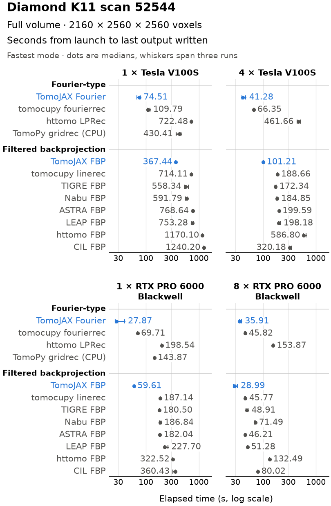

# Measurements

Speed, accuracy, scaling, and memory of TomoJAX on parallel-beam, laminography, and cone-beam CT scans. Benchmark scripts are in [bench/](../bench/README.md) and [examples/](../examples/README.md).

## Full-volume speed on a synchrotron scan

Diamond K11 (DIAD) scan `k11-52544` (8,000 views of 2,160 × 2,560 pixels, 0.54 µm pitch) was reconstructed to a 56.6 GB single-precision volume on exclusive 40-core nodes with Tesla V100S 32 GB or RTX PRO 6000 Blackwell 96 GB GPUs. Each time is the median of three fresh launches from startup until the volume is flushed to disk, with pre-warmed files and fresh caches; TomoJAX and httomo read the original HDF5 layout, while the other libraries read a row-chunked copy whose 96.0 s conversion is excluded.

*Full-volume times on Diamond `k11-52544` across four GPU setups, median and three-repeat range from launch to final flush, excluding input conversion.*

| Library and method | 1 V100S (s) | 4 V100S (s) | 1 Blackwell (s) | 8 Blackwell (s) |
| --- | ---: | ---: | ---: | ---: |
| TomoJAX Fourier (streaming) | 74.51 | 41.28 | 27.87 | 35.91 |
| TomoJAX FBP (streaming) | 367.4 | 101.2 | 59.61 | 28.99 |
| tomocupy (`fourierrec` / `linerec`) | 109.8 `fourierrec` | 66.35 `fourierrec` | 69.71 `fourierrec` | 45.77 `linerec` |
| TomoPy `gridrec` (40 CPU cores) | 430.4 | — | 143.9 | — |
| TIGRE FBP | 558.3 | 172.3 | 180.5 | 48.91 |
| Nabu FBP | 591.8 | 184.8 | 186.8 | 71.49 |
| httomo (`LPRec` / FBP) | 722.5 `LPRec` | 461.7 `LPRec` | 198.5 `LPRec` | 132.5 FBP |
| LEAP FBP | 753.3 | 198.2 | 227.7 | 51.28 |
| ASTRA FBP | 768.6 | 199.6 | 182.0 | 46.21 |
| CIL FBP (TIGRE backend) | 1240 | 320.2 | 360.4 | 80.02 |

TomoJAX had the lowest full-volume median in every GPU setup. On one card, streaming runs used under 25 GiB host RAM and under 5.2 GiB VRAM.

Where TomoJAX does not win:

- **Fourier beyond one Blackwell card:** adding cards slowed streaming Fourier from 27.87 s on one card to 35.91 s on eight. Streaming FBP sped up from 59.61 s to 28.99 s instead.
- **256-row band on eight Blackwell cards:** LEAP FBP finished in 9.24 s against TomoJAX's 11.95 s, with ASTRA and TIGRE between them. Those three read the row-chunked copy; TomoJAX led the band on the other three setups.

## Reconstruction accuracy

### Fourier inverse and filtered backprojection

Tested on DIAD `k11-52544` row 1080 and an analytic disk phantom of matching width and view count (50,000 photons per bin).

ASTRA, CIL, and TIGRE FBP match TomoJAX FBP to correlation 0.9999 after resolving orientation and units. Native Fourier keeps sharper edges than FBP and passes more noise, giving correlation 0.981 on the real slice. Passing `filter="ramp"` matches FBP's detector response at the same full-volume speed and VRAM, raising correlation to 0.994.

| Method | Clean rel. L2 | Noisy rel. L2 | Central / outer edge (px) |
| --- | ---: | ---: | ---: |
| TomoJAX Fourier (`filter=None`) | 0.42% | 17% | 1.04 / 1.11 |
| TomoJAX FBP (`filter="ramp"`) | 0.35% | 12% | 1.36 / 1.37 |
| TomoJAX Fourier (`filter="ramp"`) | 0.40% | 11% | 1.36 / 1.40 |

### Cone-beam CT against ASTRA and TIGRE

Convergence uses three-orbit FIPS Walnut 1 (2×2 binned, 501³ grid) and a noise-free 501³ ellipsoid phantom on one Blackwell GPU. FDK and SIRT timings are warm, host to host, on an 8 GB RTX 4070 Laptop GPU.

| Library | Walnut CGLS best held-out (time) | Phantom CGLS error (best → 1,280) | Phantom SIRT error |
| --- | ---: | ---: | ---: |
| TomoJAX | 0.0220 at 40 iters (30.3 s) | 0.076 → 0.11 | 0.012 |
| ASTRA | 0.0220 at 57 iters (34.9 s) | 0.081 → 0.33 | 0.012 |
| TIGRE | 0.0221 at 40 iters (55.1 s) | 0.078 (stopped early) | 0.021 |

All three CGLS solvers reach the same best held-out residual within 0.5% and semi-converge past it. Because ASTRA's backprojector is approximate, its fitted residual rises after 226 updates and its phantom error quadruples by 1,280. TIGRE stops early after detecting divergence.

Warm FDK on one walnut orbit takes 1.02 s in TomoJAX versus 1.71 s in ASTRA at matched error (0.091). On a 1024³ scan, FDK from host memory back to host memory takes 8.0 s warm versus 20.3 s in ASTRA and 30.7 s in TIGRE. Twelve iterations of accelerated nonnegative SIRT beat 24 iterations in ASTRA and TIGRE at equal or lower residual across four real scans.

- **Where ASTRA wins:** ASTRA's approximate backprojector is faster per iteration than TomoJAX's exact transpose (0.60 vs 0.72–0.81 s per walnut CGLS update on Blackwell) and faster on walnut OS-SART and OSEM sweeps.
- **Over-resolved detectors:** on unbinned Walnut 1, 2×2 binning (`scan.binned(2)`) preserves NNLS accuracy and speeds up TomoJAX 3.5×.

### TV regularization and laminography

Tested on a noisy 128³ parallel phantom (50 iterations, RTX 4070 Laptop GPU) and simulated laminography scans with independent fine-mesh truths.

TomoJAX FISTA-TV reaches 0.075 relative L2 error in 0.32 s warm. TIGRE FISTA reaches 0.10 in 9.1 s.

In laminography, automatic nonnegative FISTA-TV cuts FBP's measured-band error roughly in half (0.17 to 0.074 on rock). It also lowers missing-cone error from 0.32 to 0.18.

With its default settings SPDHG-TV matches FISTA-TV's held-out error on Diamond K11 scan 52567 (ratio 1.000 on 1,000 views and 0.999 on 7,000). On one RTX PRO 6000 Blackwell it takes 6.39 s against 8.43 s for 1,000 views, and 18.38 s against 62.77 s for all 8,000.

## Scaling and memory

### Multiple GPUs

Warm scaling with `devices=` on Diamond `k11-52567` (64 × 2,560 × 2,560, 50 iterations, PCIe V100S) and binned Walnut 1 (501³, 20 iterations, NVLink H100).

| Scan, method, and interconnect | 1 GPU (s) | 2 GPUs (speedup) | 4 GPUs (speedup) |
| --- | ---: | ---: | ---: |
| K11-52567 CGLS (V100S PCIe) | 223.2 | 122.2 (1.83×) | 73.70 (3.03×) |
| K11-52567 nonnegative FISTA-TV (V100S PCIe) | 249.1 | 145.2 (1.72×) | 86.06 (2.89×) |
| Walnut 1 nonnegative FISTA-TV (H100 NVLink) | 24.8 | 13.6 (1.83×) | 7.4 (3.34×) |

- **PCIe collectives:** volume all-reduces take 0.288 s on four V100S cards (5.83 GB/s), accounting for about 19% of wall time.
- **Short solves:** host setup limits scaling on small jobs, where a 10-iteration cone FISTA solve drops from 4.71 s on one V100S to 2.57 s on four.

### Large volumes, memory, and checkpointing

Volumes larger than GPU memory are reconstructed in slabs and streamed to host memory or disk ([large scans](large-scans.md)).

| Scan and workflow | Hardware | Time | Peak GPU / host RAM |
| --- | --- | ---: | ---: |
| DIAD `k11-52544` streaming Fourier (56.6 GB) | 1 Blackwell / 1 V100S | 27.87 s / 74.51 s | 5.2 / 17.3 GiB (Blackwell) |
| Diamond I12, SIRT in slabs written to disk (56.6 GB) | RTX 4070 Laptop (8 GB) | 1436 s | 1.41 GB / 3.7 GB |
| Zeiss CuO2, FDK in slabs written to disk (31 GiB) | RTX 4070 Laptop (8 GB) | 1054 s | 4.39 GiB / 14.2 GB |
| 1024³ laminography, FBP in two slabs (4.3 GB) | RTX 4070 Laptop (8 GB) | 37 s | — |

Resident iterative solves on Diamond K11-54013 on an 8 GB GPU use 2.4–4.6 GiB VRAM across SPDHG-TV, SIRT, FISTA-TV, CGLS, and MLEM. SPDHG-TV holds five volumes in VRAM and cannot stream to host slabs.

Checkpointing (`checkpoint=DIR`) a 64-row CGLS run on one V100S adds 1.6% wall time and no extra VRAM. Each periodic save writes 9.6 GiB in 9.4 s (1.7 GiB extra host memory), and resumed outputs match uninterrupted runs bit for bit across kills.

## Alignment

### Known-pose twins and real scans

`tj.align` with its default settings on one GPU; times start once the scan is decoded. Native-pitch twins add drift, slips, 0.1° angular jitter, column offsets, and 20,000-photon noise; landmark RMS is in native pixels after removing one rigid gauge.

| Scan and fit | GPU | Time (s) | Accuracy |
| --- | --- | ---: | --- |
| Parallel twin, translations + rotations | V100S | 1488 | 4.0 → 0.93 px RMS |
| Laminography twin, tilt + translations | Blackwell | 145 | 10 → 0.48 px RMS; tilt 34.50° vs 34.5° |
| Cone twin, translations + rotations | Blackwell | 139 | 3.7 → 0.62 px RMS |
| K11 `54013` ruby sphere, `fit=("center", "tilt")` | V100S | 783 | Within 0.14° and 0.29 px of sphere track |
| FIPS Walnut 1, 3 orbits, `fit="translations"` | Blackwell | 140 | Heights −0.385, −0.753 mm vs −0.397, −0.794 mm |

On Walnut 1, alignment lowers FDK support error from 0.26 to 0.11, matching the authors' geometry. Across all 42 FIPS walnuts, median orbit-height disagreement is under a fifth of a voxel.

- **Single GPU and host RAM:** joint alignment uses one GPU even when several are visible. The full single-precision projection stack sets host memory, which reaches 173 GiB on 8,000-view `k11-52544` (1073 s on V100S).
- **Crossing shadows:** attenuation crossing the detector is fitted as motion, pulling horizontal translation on `k11-52544` to 22.4 px versus 2.89 px without the shadow.
- **Axial rotations:** per-view rotations are weakly determined on axial parallel scans, worsening 5 of 13 synthetic scans and raising held-out error by 2% on `k11-52544`.

### Axial rotation center

Direct `tj.align(scan, fit="center")` on unposed axial parallel half-turns (CPU) recovers the axis under severe detector defects. Across 80 low-contrast 512-column scans with rings, streaks, and flat drift, its median error was 0.32 px (worst 2.4 px). Seeded joint fitting had 3.0 px median error, and opposite-views registration had 104 px. On 22 real DIAD specimen bands (4.7 s median), direct centering agreed with opposite-views registration to 0.020 px median.

- **Limits:** smooth, nearly stationary objects with defects reached 3.3 px error, spoiled-flat setup scans missed ±120 px crops by up to 11 px, and dark bands return arbitrary offsets.

## Automatic corrections

| Correction | Measured effect | Cost and limit |
| --- | --- | --- |
| Truncated scans (`exterior="cylinder"`) | Analytic phantoms: offset 4–99% → 0.1–6%, rim 60–1024% → 0.3–6%. Cropped Walnut 1 FDK rim: 548% → 23% | Negligible on V100S, up to 5% on Blackwell. Non-cylindrical exteriors keep partial cupping; iterative solvers omit exterior material |
| Bracketing flat fields (`flat_weights="views"`) | Halves RMS error on stage-shadowed DIAD flats while leaving clean scans unchanged. Beat position interpolation in 618 of 1,056 fault simulations (355 ties, 83 losses) | Adds ~2 s on an 8,000-view DIAD scan. Worst loss (0.34 SD) occurs under broad shadows with little open beam |
| Ring correction (`Rings()`) | Halves median fine-ring RMS on DIAD half-turns (0.29 → 0.13) and I13 full-turns (0.27 → 0.14). Alters off-axis structure far less than Algotom 1.7 | Adds ~10 s (half turn) or ~20 s (full turn) on V100S, 15 MiB VRAM. Swirls remain; features within 15 px of the axis are ambiguous with detector offsets |
