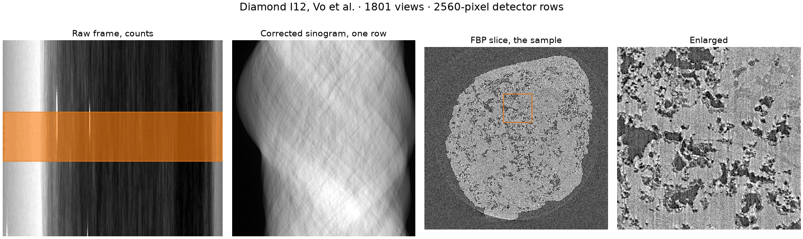
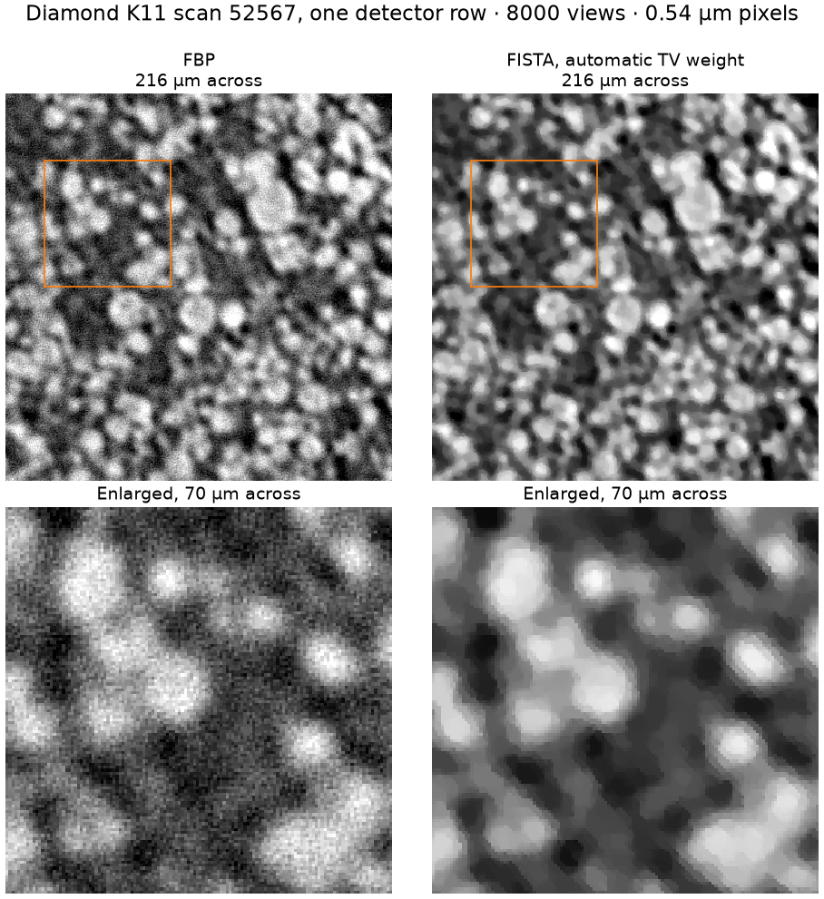

# Reconstruct your first scan

This guide walks through inspecting, correcting, reconstructing, and exporting a real scan with the CLI and Python API. If you do not have scan data yet, try the [synthetic example](../README.md#first-reconstruction).

## Inspect the data and geometry

```bash
tomojax inspect scan.nxs
```

`inspect` prints a `Loading` section (whether the file loads with no further arguments or needs one, full-turn parallel orbit dimensions when applicable, pixel units when no pixel size is recorded, an unrecorded rotation center or rotation axis, and the frame counts a stopped scan was cut to), followed by the projection count and shape, angles, detector and voxel pitches, geometry type, and any recorded corrections. It exits 0 with `Valid: yes`, or lists problems and exits 1. Pass `--json` for machine-readable output (the same structure `tj.inspect(path)` returns, with `loading`). Given a checkpoint directory from `--checkpoint DIR`, `tomojax inspect DIR` reports the saved run, the command or operation that started it, its save time, and whether a live process holds it. It recognizes NXtomo, NeXus scan files (including Diamond/GDA), APS Data Exchange, Nikon `.xtekct`, Zeiss `.txrm`, and ESRF acquisitions and inspects raw frames without applying corrections.

Reconstruction expects line integrals (log attenuation), not raw counts or normalized transmission. TomoJAX applies flat/dark correction and `-log` automatically when the file marks raw frames (NXtomo `image_key`, Data Exchange `data_white`/`data_dark`, Nikon, Zeiss, or ESRF). If flats or darks are absent, supply `flats=` (frames or a single white level) and `darks=` to `tj.load_frames` (pass `darks=0` only when counts are already dark-subtracted).

## Beamline exports

For single-row first-slice recipes covering ESRF NXtomo, PSI TOMCAT, Elettra SYRMEP, PSI cSAXS, and Diamond I13, see [beamline exports](beamline-exports.md).

For a full-turn scan with the rotation axis near a detector edge, see [half-acquisition](beamline-exports.md#half-acquisition-with-an-offset-parallel-detector).

### Raw ESRF acquisitions

- **SPEC EDF folders:** `tj.load("scan_folder", angles=...)` reads uncompressed single-image EDF projections with `.info` or XML metadata. `PixelSize` gives the effective pitch in micrometers; supply `angles=` because the scan range alone does not fix the starting angle.
- **PyHST `.par` files:** pass the parameter file explicitly with `tj.load_frames("scan.par").corrected()`. This reads the indexed EDF sequence, angles, detector pitch, rotation axis, reconstruction region, and dark/flat schedule for raw single-image axial parallel EDFs (directory discovery does not auto-select `.par`; multi-frame, cone, helical, binning, and distortion modes are unsupported).
- **Raw Bliss HDF5:** `tj.load("raw_bliss.h5")` reads basic, half-turn, and full-turn Bliss step sequences, including flats, darks, and recorded angles (select among multiple sequences with `data_path="1.1"`). Effective pixel sizes and distances are kept in millimeters. Helical and multi-volume sequences are unsupported.

Neither SPEC EDF nor raw Bliss records a rotation center; loading places the center at the detector middle (`detector_center_status="not_recorded"`). Estimate it with `tj.align(scan, fit="center")`. Single-row HDF5 sinograms stored as `(view, u)` stay lazy and appear as `(view, 1, u)`.

## Correct raw detector frames

For an HDF5 scan with sample, flat, and dark frames:

```bash
tomojax correct raw.nxs -o corrected.nxs
tomojax inspect corrected.nxs
```

`correct` computes `-log((I - D) / (F - D))`, blending bracketing flat sets with weights measured from a sample of the views while interpolating common row gain by position (`flat_weights="views"`, the default; see [flat fields](../src/tomojax/corrections/README.md#flat-fields)), and records the processing history in `corrected.nxs`. When the views move the flat by more than 1% over more than 1% of the detector, `correct` warns that the views do not follow the flat sets' positions, notes that a shadow covering both flat sets with no open-beam views leaves the incident intensity uncertain, and names both remedies: inspect the reconstruction and either pass a matching scan's file with `--flats other_scan.nxs` to use its clean flat frames, or pass `--flat-weights position` (`flat_weights = "position"` in `--config`) to blend the scan's own sets by position alone. Dataset paths are discovered automatically for NXtomo (including GDA files that record commanded SmarAct rotation angles outside the `NXtomo` group; see [acquisition formats](support-matrix.md#acquisition-formats)), Data Exchange, and NeXus scan files (following the default plot, its `NXdetector` `image_key`, and its plotted angular coordinate). If a scan stopped early and its key or angles have a different length from the frame stack, TomoJAX reads the frames covered by all records from the start and logs a warning with the counts. Add `--zingers`, `--rings`, or `--reject-views` for artifact removal, and `--views` or `--crop` to subset the scan. Skip `correct` if your data are already line integrals.

Use `data_path`, `image_key_path`, and `angles_path` on `tj.load` or `tj.load_frames` (`--data-path`, `--image-key-path`, and `--angles-path` on the CLI, or the matching fields on worker and MCP `open`) to select datasets in a saved HDF5 scan as well as in a raw acquisition, for both eager and lazy loads. A Bliss acquisition accepts `data_path` to select its sequence. TIFF, MATLAB phase, Nikon, SkyScan, Zeiss, and EDF inputs have fixed storage and reject these paths.

For an unlabeled projection stack, supplying `flats` or `darks` identifies the values as detector counts regardless of storage dtype (including `float32` and `float64`); supply both when the file provides neither. A recorded log correction or a PSI phase measurement identifies line integrals and rejects flat/dark calibration (and `--epsilon` or `--flat-weights` on `tomojax correct`). Exposure normalization (`exposure_times` and `flat_exposure_times`) requires flat frames rather than a scalar white level, along with both durations. Overriding a scan's geometry on load keeps its acquisition `view_positions`, including gaps and restarts used by alignment.

When an external file omits metadata:

- **Missing pixel pitch (parallel beam):** loads in pixel units (`length_unit: "pixel"`); override with `pixel_size=`, `detector=`, or `--pixel-size`. Cone-beam files require a physical pixel size.
- **Missing rotation center:** defaults to the detector middle (`detector_center_status="not_recorded"`). Supply `detector=` / `--detector-center U V`, or fit it afterwards with `tj.align(scan, fit="center")`, which measures the axis directly across the full detector on axial parallel scans without fitting a volume (pass `method="opposite-views"` for a pair-only check).
- **Missing rotation axis:** a file that records no rotation axis or pixel scale logs a warning on load (`loading["geometry"] == "not_recorded"` in `inspect`). Reconstruction and alignment refuse it until geometry is declared when loading: pass `geometry=...` to `tj.load`, `--geometry parallel` (or `lamino` / `cone`) to `tomojax correct`, or `geometry: {"kind": "parallel"}` to worker or MCP `open`.
- **Missing angles or laminography tilt:** supply `angles=` or a complete `geometry=`. Explicit `detector=` or `geometry=` overrides are always used as given.

In Python, `tj.load("raw.nxs")` runs the default flat/dark/`-log` correction. For cropping, view selection, or extra steps from `tomojax.corrections`, load frames first:

```python
import tomojax as tj
from tomojax.corrections import RejectViews, Rings

frames = tj.load_frames("raw.nxs")  # also works on TIFFs (with angles=) or Nikon .xtekct
scan = frames.cropped(slice(100, 900), slice(None)).corrected(Rings(), RejectViews())
print(scan)
tj.save("corrected.nxs", scan)
```

HDF5 and TIFF sample, flat, and dark stacks are read lazily during correction, so call `.cropped(...)` or `.selected(...)` before `.corrected(...)` to avoid reading unused pixels (`np.asarray(frames.counts)` materializes the selection). Selection accepts a forward slice, increasing integer indices, or a boolean mask, preserving each view's geometry and its position between flat sets. Call `scan.corrected(...)` to apply line-integral steps (`Rings`, `BeamHardening`, `RejectViews`) to an already-corrected `Scan`.

### Ring removal

Use `Rings()` in Python or `--rings` on the CLI to remove fine and wide detector
rings. The step needs no width or tuning parameters; `frames.corrected`,
`scan.corrected`, `tj.reconstruct_slabs`, and `tomojax correct --rings` bind the
scan geometry automatically.

```bash
tomojax correct raw.nxs -o corrected.nxs --rings
```

```python
from tomojax.corrections import Rings

frames = tj.load_frames("raw.nxs").cropped(slice(100, 116), slice(None))
scan = frames.corrected(Rings())
```

Crop detector rows for a quick preview so every view still contributes to the
fit. `Rings()` models each column's additive offset and transmission-dependent
response: on half-turn scans it estimates wide offsets from persistent jumps
between columns as the sample rotates, and on stationary parallel-beam full
turns it also compares opposed angular arcs.

`Rings()` corrects stationary column errors only. Artifacts that vary with angle
(flux drops or angular swirls) are not detector rings and are not removed, and
this step does not interpolate dead pixels. Flat sets that disagree are weighted
from the views during flat-field correction, leaving `Rings()` a column-fixed
error for any fine unmatched texture (broad shadows present in both flat sets
still require clean flats via `flats=`). A
circular sample feature centered on the rotation axis gives the same
measurements as a symmetric detector offset, so compare corrected and
uncorrected slices near the axis.


One detector row of three real scans, each with its rotation center measured by `tj.align(scan, fit="center")` and reconstructed by the default `tj.reconstruct` without and with `Rings()`. Diamond K11 (DIAD) scan 52567 and setup scan 52510 are half turns of 8000 views on 2560 pixels of 0.54 µm; Diamond I13 scan 159950 is a full turn of 3001 views. Each panel shows 380 pixels around the axis, and the two slices in a row share one gray range.

```bash
uv run python examples/gallery/ring_removal.py k11-52567-row1080.nxs \
  k11-52510-row1080.nxs 159950-row1035.nxs ring-removal.png
```

By default `Rings()` fits on 512 angular bin means, so it adds about 10 s on a
half turn and 20 s on a full turn of an 8,000-view 2160 × 2560 streamed Fourier
volume on one V100S, with ~15 MiB extra GPU memory. See
[ring removal](../src/tomojax/corrections/README.md#ring-removal) and
[ring measurements](measurements.md#automatic-corrections).



Diamond I12 sandstone (Vo et al., Zenodo 3339629; 1801 views of 2560-pixel rows): raw frame with 16 cropped rows marked, middle-row sinogram after ring correction, and FBP slice at axis column 1417.5:

```bash
uv run python examples/gallery/first_slice.py full_rows1048-1111.nxs i12-first-slice.png \
  --rows 24 40 --center -138 --crop 1500 1100 --title "Diamond I12, Vo et al."
```

### Binning and fast previews

Pass `binning=N` to `frames.corrected(...)` (or `--binning N` to `tomojax correct`) to average `N × N` blocks of line integrals on the device; when only row-local steps follow `-log`, uncompressed files are binned slab-by-slab without holding the unbinned stack in host RAM.

A detector-derived grid follows the binned detector automatically, including after saving and reopening a corrected scan. A grid recorded by the file or supplied by the caller keeps its sampling, so pass a matching coarse `grid=` when you want a fast axial parallel preview on a file-owned grid:

```python
import tomojax as tj

scan = tj.load_frames("raw.nxs").selected(slice(None, None, 4)).corrected(binning=8)
scan = tj.align(scan, fit="center").scan
d = scan.detector
grid = tj.Grid(d.nu, d.nu, d.nv, d.du, d.du, d.dv, vol_center=(0, 0, d.center[1]))
tj.save("preview.nxs", tj.reconstruct(scan, grid=grid))
```

On the CLI, `--grid NX NY NZ` resamples the chosen field of view to those voxel counts while preserving physical extent (in Python, `scan.grid.resampled(shape=(NZ, NY, NX))`, matching `grid.shape`).

### Lens distortion and Paganin phase retrieval

For calibrated lens distortion, pass `RadialDistortion(center=(col, row), coefficients=(c0, c1, ...))` from `tomojax.corrections`. It applies a backward radial polynomial on transmission before `-log` (`center` is in zero-based image pixels, not the rotation axis; estimate the rotation center afterwards, and apply before cropping if pixels outside the crop are needed).

For propagation-based phase contrast, `Paganin` filters transmission before `-log`. Supply the material's `delta_beta`, effective propagation `distance` in meters (sample-to-detector distance divided by magnification in cone beam), X-ray `energy_kev`, and sample-plane `pixel_size` in meters:

```python
import tomojax as tj
from tomojax.corrections import Paganin

step = Paganin(delta_beta=100, distance=0.1, energy_kev=25, pixel_size=0.65e-6)
scan = tj.load_frames("raw.nxs").corrected(step)
scan = scan.cropped(slice(100, 900), slice(None))  # crop after Paganin, not before
```

Because Paganin convolves neighboring pixels, crop after phase retrieval (or correct a padded window) rather than cropping raw frames first. Transmission steps run in the order given: put `Zingers` first, then `RadialDistortion`, then `Paganin`. On the CLI, pass `--paganin 100,0.1,25,0.65e-6` or a `--config` TOML file to `tomojax correct` (`tomojax correct --config-keys` lists every key).

### TIFF frames

For TIFF stacks with flat/dark folders and angle sidecars, see [preparing TIFF data](real-laminography.md#prepare-tiff-data).

## Reconstruct and inspect slices

```bash
tomojax reconstruct corrected.nxs -o recon.nxs
tomojax inspect recon.nxs --preview-dir previews
```

The default `--method auto` chooses a solver from the geometry:

- Well-sampled axial `ParallelGeometry`, unposed or carrying per-view rotations about `z` alone -> `fourier` (otherwise `fbp`)
- `LaminographyGeometry`, or `ParallelGeometry` with per-view translations or out-of-plane rotations -> `fbp`
- Single-arrangement `ConeGeometry` -> `fbp` (dispatched to FDK), or `cgls` for an effective source arc shorter than 180° plus the fan angle
- Multi-orbit `ConeSegments` -> `cgls`

Pass `--method` explicitly to fix a solver (`fourier`, `fbp`, `cgls`, `fista`, `spdhg`, `sirt`, `mlem`). Add `--dry-run` to inspect the resolved method, grid, and memory estimate before running, `--watch-dir DIR` to rewrite central-slice PNGs as an iterative solve progresses, or `--checkpoint DIR` to save state on disk so a canceled or killed run resumes when repeated ([resume a run after a kill](large-scans.md#resume-a-run-after-a-kill)). For iterative solvers, `tomojax reconstruct` ends by printing how many updates ran, why the solve stopped, and any automatic TV weight. `recon.nxs` stores the volume, geometry, and record (add `--include-scan` to keep projections too), `tomojax inspect recon.nxs --json` shows the resolved method and settings in the record, and `inspect --preview-dir` writes display-scaled PNGs of the central slices (such as `slice_z_64.png`, plus `projection.png` when present). Use the floating-point volume in `recon.nxs` for quantitative analysis.

### Region and grid options

By default, reconstruction keeps the scan's recorded grid (matching `region=None` in Python). Pass `--region auto` (or `bbox`, `cube`, `cyl`) to crop to the detector field of view; `--region cyl` also zeros voxels outside the cylinder seen by every view after solving. `--grid NX NY NZ` changes voxel counts while preserving the selected physical field of view.

### Fourier-slice inverse

`--method fourier` (or `tj.reconstruct(scan, "fourier")`) runs a fast Fourier-slice inverse in host slabs for axial parallel scans (half turns and full turns), including offset-detector full-turn overlap weighting, rolled detectors (exact axis permutation at 90° multiples, cubic resampling onto horizontal lines otherwise), per-view rotations about `z`, and per-view translations. It uses CuPy on CUDA when available (`tomojax[cuda12]` or `tomojax[fourier-cuda12]`) and NumPy otherwise; force a backend with `FourierConfig(backend="cupy")` or `"numpy"`.

By default (`filter=None`), Fourier uses its native response with a detector-Nyquist disk cutoff: edges stay sharper than in FBP, while high-frequency noise is higher. Pass `filter="ramp"` (`tj.reconstruct(scan, "fourier", filter="ramp")`, `--method fourier --filter ramp`, or `config=FourierConfig(filter="ramp")` in `tj.reconstruct_slabs`) for resolution and noise close to default FBP at Fourier's speed and GPU memory. On a scan with fewer views than detector columns the match is close near the rotation axis and weakens towards the edge of the field of view, as the figure below shows. The same option accepts `"hann"` and `"shepp-logan"` for stronger high-frequency smoothing.


Detector row 1080 of the Diamond I12 scan of Vo et al. (Zenodo 3339629; 1801 views of 2560 pixels), ring-corrected and reconstructed three ways on one grid. In the enlarged region, about 280 pixels from the rotation axis, the RMS difference from FBP is 0.32 of FBP's standard deviation with the default response and 0.15 with `filter="ramp"`. More than about 700 pixels from the axis, both Fourier slices differ from FBP by similar amounts.

```bash
uv run python examples/gallery/fourier_response.py full_rows1048-1111.nxs fourier-response.png
```

### Truncated and region-of-interest scans

When an object extends past the detector edges, detector rows end on nonzero line integrals. Treating unmeasured rays beyond the detector as zero creates a step at both ends of every row, which produces a bright rim and a raised bowl across the reconstructed interior.

All seven reconstruction methods model material beyond the detector by default (`exterior="cylinder"`):

- **Analytic methods (`fourier`, `fbp`, and cone-beam FDK):** continue each detector row past its outer edges before filtering as the projection of a uniform cylinder about the rotation axis fitted to the row's edge values. Rows ending at zero continue as zero, so contained objects reconstruct unchanged.
- **Iterative methods (`cgls`, `sirt`, `fista`, `spdhg`, and `mlem`):** run one coarse 50-iteration fit on the cylinder-continued rows to estimate how much of each measured ray comes from outside the reconstruction grid. CGLS, SIRT, FISTA, and SPDHG subtract that estimate once before the fine solve. MLEM adds its nonnegative estimate to the predicted counts at every update. The scan keeps its original measurements, and an FBP or FDK warm start uses the same `exterior` setting. When the detector edges are zero (a contained scan) or every extended ray intersects the grid, iterative solvers skip the coarse fit and fit the measured rays directly.

Direct solver functions in `tomojax.recon` (`cgls`, `sirt`, `fista`, `spdhg`, `mlem`) fit the arrays they receive without running the exterior estimate; use `tj.reconstruct` or `tj.reconstruct_slabs` for automatic exterior handling.

To compare the default against assuming zero beyond the detector on a small truncated scan:

```python
import tomojax as tj
from tomojax.recon import CGLSConfig

sim = tj.simulate("sphere", size=48, n_views=64)
truncated = sim.scan.cropped(slice(20, 28), slice(16, 32))

with_exterior = tj.reconstruct(truncated, "cgls", region="cyl")
zero_exterior = tj.reconstruct(
    truncated, "cgls", region="cyl", config=CGLSConfig(exterior="zero")
)
print(with_exterior.info["truncation"])
```

The selected setting is saved in `recon.info["config"]` (`info["config"].exterior` in memory and `info["config"]["exterior"]` after reloading).

To turn exterior modeling off, set `exterior="zero"` in the method configuration:

- **Python:** pass the method's config class to `tj.reconstruct` (`FBPConfig`, `FourierConfig`, `CGLSConfig`, `SIRTConfig`, `FISTAConfig`, `SPDHGConfig`, or `MLEMConfig`) or `tj.reconstruct_slabs` (`FBPConfig`, `FourierConfig`, `SIRTConfig`, or `MLEMConfig`). Cone-beam FDK takes `FBPConfig` through the workflow and `FDKConfig` in direct `tomojax.recon.fdk` calls.
- **CLI:** put `exterior = "zero"` in a `--config` TOML file alongside an explicit `--method`:

  ```bash
  printf 'exterior = "zero"\n' > zero-exterior.toml
  tomojax reconstruct corrected.nxs -o recon.nxs --method cgls --config zero-exterior.toml
  ```

- **Worker and MCP:** pass `{"type": "CGLSConfig", "exterior": "zero"}` (using the chosen method's config tag) in the worker, or `{"exterior": "zero"}` alongside an explicit `method` in MCP `reconstruct` or `reconstruct_slabs`.

Turn `exterior="zero"` on when you know the specimen fits inside the detector and nonzero edge readings come from background or scatter you do not want modeled as an outer cylinder, when you want to compare against a zero-padded solver, or when a strongly non-cylindrical exterior makes you prefer the uncorrected fit or a wider grid.

Every reconstruction carries `recon.info["truncation"]`, computed from the measured projections regardless of `exterior` or method (per slab on yielded blocks of `tj.reconstruct_slabs`, and whole-scan in `info=` once the iterator finishes):

| Key | Applies to | Meaning |
| --- | --- | --- |
| `edge_ratio` | All methods | Mean line integral at the detector edges divided by the mean across the rows (zero when sampled edges are air) |
| `outside_fraction` | All methods | Share of the continued scan's attenuation that lies beyond the detector |
| `interior_shift` | All methods | Estimated change on the rotation axis from using the cylinder exterior, in the volume's units |
| `radius` | All methods | Median radius of the rows' fitted cylinders, in the scan's length unit |
| `field_of_view_radius` | All methods | Distance from the rotation axis to the nearer detector edge, or to the far edge on an offset axial parallel full turn (median over sampled horizontal chords on a rolled detector), in the scan's length unit |
| `outside_grid` | Iterative methods | Signed sum of the modeled exterior projection divided by the sum of the measured line integrals (zero when no exterior fit ran) |
| `data_model` | Iterative methods | `"continued_exterior"` when the coarse exterior fit ran, or `"measured"` when the solver fitted the original data |
| `background_treatment` | Iterative methods | `"subtracted"` (CGLS, SIRT, FISTA, SPDHG), `"additive_poisson"` (MLEM), or `"none"` |

When `outside_fraction` rounds to at least 1% (0.5% or above), `tomojax reconstruct` and MCP `reconstruct` / `reconstruct_slabs` append `N% of attenuation beyond the detector` to their summary line. When an iterative exterior fit ran, they also append `modeled exterior subtracted from fit data` (CGLS, SIRT, FISTA, SPDHG) or `modeled exterior added to the Poisson mean` (MLEM).

How to read the reconstruction and its cost:

- **Analytic reconstructions:** edges, contrast between neighboring regions, and fine detail inside the field of view do not depend on the continuation. The absolute attenuation level depends on how closely the exterior matches a uniform cylinder about the rotation axis; compare `interior_shift` with the contrast you measure to judge how much of the level comes from the model. Non-cylindrical exteriors that leave the field of view only in some views (such as a square bar) retain partial cupping and rim error. Voxels outside the inscribed detector field hold the reconstruction of the continued rows; pass `region="cyl"` (`--region cyl`) to zero them.
- **Iterative reconstructions:** the exterior fit removes the bright rim and bowl when the object extends past the detector, while different exteriors can still produce identical measured rays. The absolute level depends on the assumed exterior, and a shorter discrepancy-stopped fit can recover less weak fine detail.
- **Runtime and memory cost:** on full synchrotron volumes (DIAD `k11-52567`, 8,000 views of 2,160 × 2,560 into `2,160 × 2,560²`, medians of three runs), analytic cylinder continuation adds no measurable time on a Tesla V100S 32 GB GPU (Fourier 31.60 s vs 33.10 s; FBP 324.40 s vs 338.40 s) and up to 5% on an RTX PRO 6000 Blackwell 96 GB GPU (Fourier 12.60 s vs 12.00 s; FBP 55.80 s vs 56.00 s), and 0.17 to 0.76 s on smaller volumes in a fresh process. For iterative methods, the coarse exterior fit runs on a downsampled lattice capped at 128 detector columns and rows (binned further if needed to fit free GPU memory) and allocates one private copy of the projections; auxiliary CuPy scratch is freed before the fine solve begins. After preparation, each CGLS, SIRT, FISTA, or SPDHG iteration runs at the same speed as `exterior="zero"`, while MLEM includes the additive estimate in each Poisson update. See [truncated-scan measurements](measurements.md#automatic-corrections) and [known limitations](known-limitations.md#reconstruction-and-regularization).

### Expert settings

Pass solver-specific settings via config classes from `tomojax.recon` (`FBPConfig`, `FourierConfig`, `CGLSConfig`, `FISTAConfig`, `SPDHGConfig`, `SIRTConfig`, `MLEMConfig`) or a `--config` TOML file alongside an explicit `--method` (`tomojax reconstruct --method fista --config-keys` lists one method's keys):

```bash
printf 'regularizer = "huber_tv"\nhuber_delta = 0.01\n' > huber.toml
tomojax reconstruct corrected.nxs -o tv.nxs --method fista --config huber.toml
```

In Python:

```python
from tomojax.recon import FISTAConfig

recon = tj.reconstruct(scan, "fista", config=FISTAConfig(regularizer="huber_tv", huber_delta=0.01))
```

Direct keywords (such as `iterations=100`) override fields of the same name in `config`.

- **Per-view contrast in iterative solvers:** in `CGLSConfig`, `FISTAConfig`, or `SPDHGConfig`, `data_term="per_view_contrast"` profiles out one constant offset per detector view (leaving the absolute background level undetermined).
- **FISTA and SPDHG TV weight and stopping:** With `tv_weight=None` and `tolerance=None` (the defaults), FISTA estimates detector noise and linear interpolation error from the projections, propagates that scale through the backprojector to set the TV weight, and stops once the proximal gradient reaches the estimated noise level or at `iterations=200`. Check `recon.info` (or the saved record, or the closing line of `tomojax reconstruct`) for `resolved_tv_weight` (dimensionless), `effective_tv_weight` (dimensional), `noise_score_rms`, `effective_iterations`, `early_stop`, and `termination` (`"noise_score"`, `"objective_tolerance"`, or `"iteration_limit"`). Pass `tv_weight` explicitly (positive to fix the weight, `0` to disable TV) to bypass calibration and run to `iterations`; pass `FISTAConfig(tolerance=0)` to run an automatic weight for the full budget, or set `iterations` to change the cap. SPDHG uses the same isolated-voxel noise calibration when `tv_weight=None` (reporting `resolved_tv_weight` and `effective_tv_weight`), with its default update count scaling as `ceil(600 × √B)` for `B` view blocks (`views_per_block=16`). Remove rings before running automatic FISTA or SPDHG, because coherent detector errors survive scalar TV calibration.



Detector row 1080 of Diamond K11 (DIAD) scan 52567: 8000 views over a half turn on 2560 pixels of 0.54 µm, corrected with `Rings()` and reconstructed by `tj.reconstruct(scan, "fbp")` and `tj.reconstruct(scan, "fista")`. FISTA chose `resolved_tv_weight` 8.2e-6 and ran to the 200-update cap. All four panels share one gray range.

```bash
uv run python examples/gallery/fista_tv_weight.py k11-52567-row1080.nxs fista-tv-weight.png
```

### Iterative solver defaults and stopping

Unregularized iterative solvers (CGLS and SIRT) fit noise and discretization error if run for hundreds of updates, even as their fitted projection residual keeps falling. Stopping near the error level acts as their regularization. When you omit `iterations=` (`--iterations`), each iterative solver follows one of three stopping rules:

| Solver | Default stopping rule | Work cap / budget | Override for a fixed budget or plain path |
| --- | --- | --- | --- |
| `fista` | Proximal gradient falls below one estimated noise-score SD (`tv_weight=None`, `tolerance=None`) | Up to 200 updates | Pass `tv_weight=...`, `FISTAConfig(tolerance=0)`, or `iterations=N` |
| `cgls` | Projection residual RMS falls below estimated detector noise plus sampling error (when unpenalized and `tolerance=None`) | Up to 50 updates | Pass `iterations=N`, explicit tolerance, or `damping` / `gradient_damping` |
| `sirt` (full data, `subsets=1`) | Same projection-discrepancy stop, with FISTA momentum enabled when `relaxation <= 1` | Up to 50 sweeps | Pass `iterations=N` (plain sweeps; add `SIRTConfig(acceleration=True)` for momentum) or `SIRTConfig(acceleration=False)` for plain automatic SIRT |
| `sirt` (`subsets > 1`), `mlem` | Fixed sweep budget (no momentum) | 50 sweeps | Pass `iterations=N` |
| `spdhg` | Block budget scales with view count | ceil(600 × √B) updates for B blocks | Pass `iterations=N` |

Check `recon.info`, the saved record, or the closing line of `tomojax reconstruct` after an iterative run:

- `termination` names why the solve ended: `"projection_discrepancy"` (CGLS/SIRT) or `"noise_score"` (FISTA) when the solver stopped at the estimated error level, `"objective_tolerance"` (FISTA with an explicit `tolerance`), `"converged"`, `"roundoff_limit"`, or `"numerical_breakdown"` (CGLS), or `"iteration_limit"` when the budget ran out. `early_stop` is `False` when the budget was exhausted.
- `effective_iterations` gives the completed updates or sweeps, `measurement_noise_rms` gives the estimated detector noise SD, and `projection_error_rms` gives the total discrepancy threshold in projection units.
- CGLS reports the final `residual_rms`; SIRT reports `pre_update_residual_rms` (measured at the point projected for the last sweep, including momentum when accelerated) and the resolved `acceleration` flag. On independent axial SIRT slabs, `slab_stopping` lists each slab's range, sweep count, and residual, while top-level `effective_iterations` is the largest sweep count across slabs.

The discrepancy test measures RMS over detector samples. Different spatial frequencies converge at different updates, so reaching this RMS does not imply that every feature has recovered its full contrast.

On real scans, motion, scatter, calibration bias, and correlated detector errors often keep the projection residual above the local noise-and-sampling estimate past 50 updates, so `termination="iteration_limit"` is common. That result means the cap ended the solve without detecting the scan's noise floor. Inspect the slices, pass an explicit `iterations=` if structure is still under-resolved, or switch to `fista` when noise needs explicit TV regularization. To replay an automatic run identically, pass `iterations=recon.info["effective_iterations"]` for CGLS, and pass both `iterations` and `acceleration` from `recon.info` for SIRT.

### Export

```bash
tomojax export recon.nxs -o recon.tif
tomojax export recon.nxs -o detail.mhd --crop 100:300,:,: --binning 2
```

The first command writes one TIFF stack that you can open in Fiji. The second
takes planes 100 through 299 and averages each two-by-two-by-two block of
voxels before writing the MetaImage. Add `--dry-run` to see the output shape,
files and space required. In Python, use `tj.export("recon.tif", recon)`.
See [Export a reconstruction](export.md) to choose a viewer or export projections.

### Checking trial rotation centers by eye

Alongside `tomojax align --fit center`, sweep candidate detector centers on one slice and compare them on a single gray scale:

```bash
tomojax inspect corrected.nxs --preview-dir sweep --centers -20:20:2
tomojax correct corrected.nxs -o centered.nxs --detector-center U V
```

`sweep/center_sweep.png` shows every candidate side by side with the recorded center outlined, and `inspect` prints the `U` value to pass to `--detector-center` for each candidate. In Python, `tomojax.interactive.center_sweep(scan, "z", scan.grid.nz // 2, (-4, -2, 0, 2, 4))` returns the same stack of planes directly without writing intermediate volumes.

### Next steps

- **Volumes larger than GPU or host memory, several GPUs, and checkpoint/resume for cluster jobs:** [large scans and several GPUs](large-scans.md).
- **Export calibrated volumes for ImageJ, Fiji, ITK, VTK, or Amira:** [export a reconstruction](export.md).
- **Laminography and TIFF stacks:** [real parallel and laminography scans](real-laminography.md).
- **Lab cone-beam CT:** [lab cone-beam CT](lab-ct.md).
- **Motion and setup-angle correction:** [align a scan](align-a-scan.md).

## Reopen a saved result

To keep a reconstruction for later work in TomoJAX, save it as a NeXus
file. By default the file holds the volume, its geometry and the processing
record. If you also need the measured projections, include the scan when
you save. The CLI equivalent is `tomojax reconstruct --include-scan`.

```python
import tomojax as tj

scan = tj.load("corrected.nxs")
recon = tj.reconstruct(scan)
tj.save("recon-with-scan.nxs", recon, include_scan=True)

restored = tj.load_reconstruction("recon-with-scan.nxs")
middle = restored.volume[restored.grid.nz // 2]
projections = restored.scan.projections
```

Opening the saved reconstruction maps its volume read-only in z, y, x order.
You can read a plane this way even when the whole volume exceeds available
memory. Run `tomojax inspect recon-with-scan.nxs --json` to see which arrays
are present, their coordinates and how the file was produced.

| What you saved | How to reopen it |
| --- | --- |
| Corrected projections and scan geometry | `tj.load("corrected.nxs")` |
| Reconstructed volume | `tj.load_reconstruction("recon.nxs")` |
| Aligned scan, with the working image when the fit produced one | `tj.load_alignment("aligned.nxs")` |
| Simulated scan and its phantom | `tj.load_simulation("simulation.nxs")` |

A saved scan already contains line integrals. When opening its projections
in another application, skip flat-field correction and the logarithm. For an
older TomoJAX file, see [Saved objects](support-matrix.md#saved-objects).

## Watch a Python operation

Use a watch around loading, correction, reconstruction, or alignment. The
handler runs on the calling thread and must return quickly. The innermost
watch receives the events. Each event is an immutable snapshot. On a
`Started` event, use `name` to identify the operation and `label` for display.
For example, a `level` task can have the label `resolution 1/2`, and a
`reconstruct` task can have the label `cgls`.

```python
import tomojax as tj
import tomojax.progress as progress

stop = progress.Control()

def report(event):
    if isinstance(event, progress.Advanced):
        print(event.task, event.done, event.total, dict(event.metrics))

with progress.watch(report, control=stop):
    scan = tj.load("scan.nxs")
    result = tj.reconstruct(scan, "cgls")
```

Call `stop.pause()` to hold work in memory at the next work boundary (the end of an iteration, slab, or batch) and `stop.resume()` to continue; unlike `checkpoint=`, pausing does not write state to disk or survive a killed process. The task emits `Paused` and `Resumed` on its owner thread.
The ETA on advances uses active elapsed time and excludes the pause.
A `Placed` event names the devices doing the work, in coordinator order.
Call `stop.cancel()` from the handler or another thread to request cancellation.
The operation raises `progress.Canceled` at the next work boundary and closes
its files and workers. When `checkpoint=` is set, a checkpointed loop saves at
its next boundary before raising `progress.Canceled`, whose `checkpoint`
attribute names the directory. A caller-supplied output array can contain completed
slabs. Cancellation requested on the last completed unit preserves the result.
An exception raised by the handler reaches the caller and ends event delivery.

Solver updates count full iterations, including a full sweep for subset methods.
Alignment reports each completed Gauss–Newton step with its diagnostics.
A raw scan can report views read while its correction group reports batches
written. A single-dispatch read or solve can finish with no advances.
For `tj.reconstruct_slabs`, the task spans the `with` block. Each yielded slab
counts once, and leaving the block early closes the task.

`progress.to_json(event)` returns the same dictionary that the CLI writes in
JSON mode. Missing metrics and non-finite numbers become JSON null.
See the [command-line guide](../src/tomojax/cli/README.md#follow-or-cancel-a-command)
and the [record schema](protocol/progress.schema.json).
