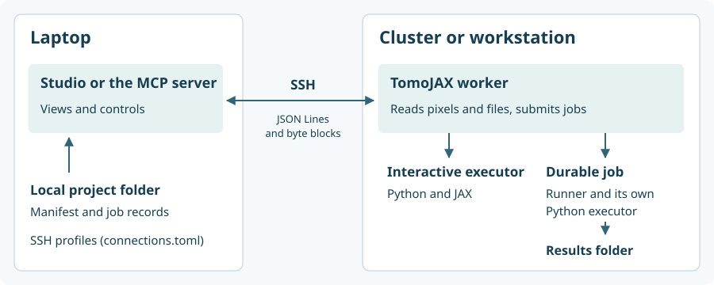

# Reconstruct a scan on another machine

Run Studio on your laptop and keep the scan and reconstruction on the machine that holds your data. A project folder on the laptop remembers the scan paths, settings, views and jobs. You can close Studio during a reconstruction on a workstation or Slurm cluster and reopen the project to see the result.



## Install Studio and connect

The laptop needs Linux on x86-64 or Arm64, a Vulkan driver and SSH. The data host needs the same CPU architecture as the laptop and glibc 2.28 or later. Install TomoJAX and Studio in a Python 3.12, 3.13 or 3.14 environment on the laptop. Studio supplies the worker executable.

```sh
python3 -m venv .venv
. .venv/bin/activate
python -m pip install --pre tomojax tomojax-studio
```

On the laptop, create `~/.config/tomojax/connections.toml`. The example names the connection `cluster`. Replace the SSH destinations, partition and writable results path with yours. Use the SSH destinations in the order you normally reach them. With direct access to the submit host, give just that host.

```toml
[cluster]
ssh = ["login", "submit"]
jobs = "slurm"
session = "srun -p compute -c 4 --mem=16G -t 2:00:00 -u"
sbatch = "-p gpu --gres=gpu:1 -c 4 --mem=16G -t 1:00:00"
results = "/shared/visit/processing"
```

The worker runs on the last SSH host. It uses `session` to start an interactive Python executor and `sbatch` for submitted jobs. The submit host and compute nodes must see the same scan, Python environment and results folder. On a workstation, a connection can be as short as `[workstation]` followed by `ssh = ["lab-gpu"]`. It runs submitted jobs as separate processes.

Log in from the laptop. SSH handles the site’s prompts. A subsequent connection reuses the login. TomoJAX requests eight idle hours for its SSH master unless your SSH configuration sets the lifetime.

```sh
tomojax-worker connect cluster --login
```

If your site already provides TomoJAX, add its absolute interpreter path as `python = "/path/to/env/bin/python"` under `[cluster]`. The default is `python3`. To install the laptop’s version with CUDA 12 support, run the command below. It needs `uv` and package-index access on the **first** SSH host, with a home directory shared by the machines that run Python.

```sh
tomojax-worker connect cluster --install
```

Copy the printed `python =` line into `[cluster]`. On a CPU-only machine, use a Python environment with the matching base `tomojax` package. Check the connection before creating the project.

```sh
tomojax-worker connect cluster --check
tomojax studio
```

The check reports the host, executor version, devices and job launcher. The first connection copies the laptop’s worker to the data host. The Slurm executor can take longer to answer if its allocation is queued.

## Choose the project and results folders

1. On the Studio start screen choose **Create a project**, select **cluster** and choose **Use connection**. Choose a folder on the laptop for the project manifest.
2. Use **Choose first scan…** to browse files on the cluster. For a multi-file acquisition, select its header or master file. Leave **Copy sources into the project** off to read the acquisition where it was collected. You can also import later with **Add scans**.
3. Select a writable **results folder** on the cluster. For a read-only beamtime folder, choose the visit’s processing directory. Studio can suggest the scan’s folder when it is writable, or a previously chosen or configured results location. **Use this folder** creates a project subfolder there. It holds managed inputs, kept previews and job results. Studio checks its project marker when you reconnect.

To try the workflow with simulated data, choose the results folder first and use **Simulation** in **Prepare** to create a phantom scan. For raw detector counts, use **Open & calibrate** in **Prepare** to select flats, darks and geometry before reconstructing.

## Queue and view a reconstruction

Select the calibrated scan, open **Reconstruct**, choose a method and review the grid and settings. For a parallel-beam scan, **FBP** gives a first look at the reconstruction. On Slurm the connection supplies the resource request. Use **Scheduler options** if the job needs different resources. Choose **Queue reconstruction** and open **Jobs**. Once Activity reports the worker’s **Queued** or **Running** state, the remote job can finish with Studio closed.

Open the local project folder again. The connection checks the results folder and retrieves the job’s progress. If Slurm finishes before the results become visible on the submit host, the job stays **Running** until the worker can read its result. Open the completed job and choose **Explore result**. Scroll through axial, coronal and sagittal planes. While scrolling, Studio requests small images. When you stop, it fetches lossless samples for probing and measurements. Zoom in on a feature and pause to fetch finer samples from the visible region. Volume rendering and display window adjustments run on the laptop.

During a network interruption, a cached image is marked **Not live**. Studio reconnects and fetches the selected view again. Use **Log in…** in the status bar if SSH needs a new login. If a job was interrupted or cancelled and has a usable checkpoint, choose **Resume** in Activity. Jobs on the built-in **local** connection run in the session and stop when it closes.

## Copy a file

Open the connection in the status bar and choose **Browse files…**. Select a remote file and choose **Copy to this computer…** to save it on the laptop. **Copy from this computer…** sends one laptop file into the displayed remote folder. Both directions verify the SHA-256 digest, accept files up to 100 MiB and require a new destination. For an exported stack, select an individual slice to take home.

## Use the connection from an MCP client

Set the client’s command to `tomojax` and its arguments to `["mcp", "--connection", "cluster"]`. Start it on the laptop using the same environment as Studio. File paths in tomography operations refer to the cluster. The `python` tool runs in the connected executor and can work with its live scans and volumes. Use `submit` with a saved scan path, keep the job ID, and call `jobs` with that ID after reconnecting. The job tools use the connection’s `results` folder or `~/tomojax` by default. A `download` call takes a remote `path` and a laptop destination `to`. See the [MCP client setup and tool examples](mcp.md).
