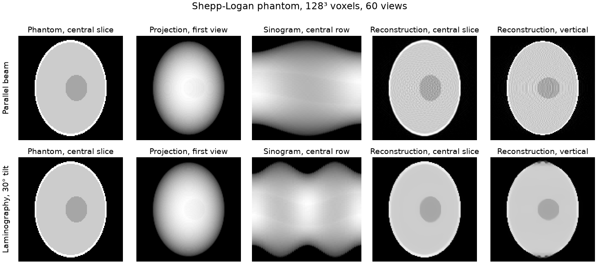

# Simulate and reconstruct tomography data

Simulate synthetic scans to verify an installation or test reconstruction settings before running on real data.

## Generate a parallel scan

```bash
tomojax simulate -o synthetic.nxs --size 32 --n-views 60
tomojax reconstruct synthetic.nxs -o recon.nxs
tomojax inspect recon.nxs --preview-dir previews
```

`--size 32` builds a 32³ Shepp–Logan phantom and a 32×32 detector. `reconstruct` selects the Fourier-slice inverse automatically for this axial parallel scan, and `inspect` writes central projection and slice PNGs to `previews/`.

Run `tomojax simulate --help` for other phantoms, Poisson noise (`--poisson-scale`), and random seeds (`--seed`). Detector artefacts (dead or hot pixels, zingers, stripes) and custom `grid` or `detector` shapes can be configured in a TOML file passed to `--config`; `tomojax simulate --config-keys` lists every key.

## Try tilted geometry

```bash
tomojax simulate -o tilted.nxs --geometry lamino --tilt 30 --size 32 --n-views 60
tomojax reconstruct tilted.nxs -o tilted-recon.nxs \
  --method fista --iterations 50 --tv-weight 0.005 --nonnegative --region off
tomojax inspect tilted-recon.nxs --preview-dir tilted-previews
```

`--tilt` is the angle of the rotation axis away from the perpendicular tomography axis. Because laminography leaves a cone of frequencies around the rotation axis unmeasured, features blur along that axis.



Both workflows above run at `--size 128`, with FISTA's automatic TV weight in place of `0.005` (which was chosen for 32³):

```bash
uv run python examples/gallery/synthetic_scans.py synthetic-scans.png
```

## Use the Python API

From a checkout, run the standalone example:

```bash
python examples/simulate_and_reconstruct.py
```

[examples/simulate_and_reconstruct.py](../examples/simulate_and_reconstruct.py) builds a `Grid`, `Detector`, and `ParallelGeometry`, projects a phantom with `tj.project`, and reconstructs with CGLS:

```python
import numpy as np
import tomojax as tj
from tomojax.datasets import shepp_logan_3d

grid = tj.Grid(32, 32, 32, 1.0, 1.0, 1.0)
geometry = tj.ParallelGeometry(
    grid,
    tj.Detector(32, 32, 1.0, 1.0),
    np.linspace(0, 180, 60, endpoint=False),
)
scan = tj.Scan(tj.project(geometry, shepp_logan_3d(32, 32, 32)), geometry)
volume = tj.reconstruct(scan, "cgls", iterations=24).volume
```

Python keywords mirror the CLI flags: `"cgls"`, `iterations=`, `tv_weight=`, and `nonnegative=` correspond to `--method cgls`, `--iterations`, `--tv-weight`, and `--nonnegative`.

Volumes use `(z, y, x)` order and projections use `(view, v, u)`. All voxel and detector spacings must share one physical length unit; projections integrate attenuation over that unit.

For independent benchmarks against analytic references and real scans, see [measurements](measurements.md). For the watch movement figures in the README, see [examples](../examples/README.md).
