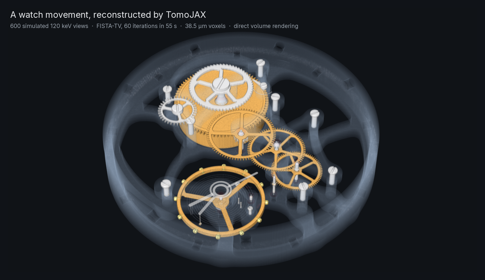
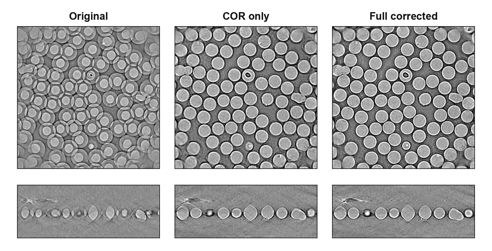

# Image provenance

The README's three figures are reproducible simulations of one object, a 29 mm
mechanical watch movement modelled in Blender
([watch_blender.py](../bench/phantoms/watch_blender.py)) and scanned with gVXR
at 120 keV, so no projection is made by TomoJAX's projector. Each figure has a
JSON record beside it with its settings, errors, run times and versions; the
[examples README](../examples/README.md#reproduce-the-readme-figures) gives
the commands. Other assets are kept as historical illustrations and are not
presented as current validation. Large GIFs are linked here rather than
loaded automatically on the project page.

## Volume rendering of a reconstruction

[watch-render.png](watch-render.png) comes from
[render_watch.py](../examples/render_watch.py): a FISTA-TV reconstruction of
600 noisy views on 38.5 µm voxels, drawn by ray casting through the volume with
a transfer function of the reconstructed attenuation. Colour and opacity are
display choices recorded in [watch-render.json](watch-render.json); the shapes
are the reconstruction's.

## Few-view reconstruction

[reconstruction-example.png](reconstruction-example.png) comes from
[reconstruct_watch.py](../examples/reconstruct_watch.py): 200 views with
10⁴ photons per pixel, a 32-slice slab on 38.5 µm voxels, FBP with a Hann
filter and FISTA-TV. Every panel shares one grey scale, 0 to 0.36 mm⁻¹, so
steel and brass saturate. Errors are relative L2 over the whole slab against
the exact voxel average of the meshes, recorded in
[reconstruction-example.json](reconstruction-example.json).

## Joint alignment of a moving scan

[alignment-example.png](alignment-example.png) comes from
[align_watch.py](../examples/align_watch.py): 400 views on 77 µm voxels with
the axis 5.3 px off centre and per-view wobble and jitter, aligned with
`tj.align(scan, mode="cor-then-pose")`. Both volumes are FISTA-TV
reconstructions with the same settings and every panel shares one grey scale.
The truth, its poses and its centre are compared in the least-motion frame
`tj.align` reports; [alignment-example.json](alignment-example.json) records
the gauge removed and every error.

## Historical real-data illustrations

The existing project description identifies these as DIAD beamline data of
100 µm ruby spheres. The raw acquisition and complete processing configuration
are not bundled. These panels illustrate qualitative reconstruction changes;
they do not establish current pose accuracy, absolute attenuation accuracy, or
runtime. Their original display scaling is retained.

[Per-projection pose-adjustment plot](projection_pose_corrections_3d_zoomed.png)
accompanied this illustration. Treat it as historical context with the same
reproduction limitation.

## Other historical assets

These assets predate the current reproducible example. No complete generation
recipe or measured source snapshot has been established for them in this
cleanup. They remain available without being used to support current metrics.

| Group | Files |
| --- | --- |
| Synthetic alignment panels | [Canonical misalignments](tomojax-canonical-misalignment-grid.png), [before/after alignment](tomojax-alignment-before-after.png), [phantom orthoslices](tomojax-phantom94-orthoslices.png) |
| Static phantom and reconstruction | [Phantom slice](phantom_slice.png), [phantom volume](phantom_volume.png), [reconstruction slice](recon_slice.png), [reconstruction volume](recon_volume.png) |
| Sinograms | [Original](sinogram.png), [misaligned](misaligned_sinogram.png), [noisy](noisy_sinogram.png) |
| Alignment animations | [Misaligned](alignment_process_misaligned.gif), [noisy](alignment_process_noisy.gif) |
| Projection animations | [Projections](projections.gif), [misaligned spin](spin_projections_misaligned.gif), [noisy spin](spin_projections_noisy.gif) |
| Slice animation | [Montage](montage_scroll.gif) |
