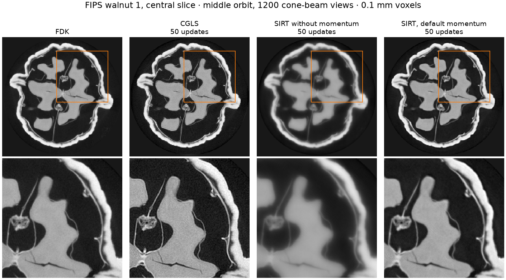

# tomojax.recon

`tomojax.recon` provides the reconstruction routines behind
`tj.reconstruct(scan, method)`:

- `fbp` and `fdk` (cone beams), with `fbp_host` and `fdk_host` for volumes
  kept in host memory
- `fourier`
- `cgls`
- `cgls_multires`
- `fista`
- `spdhg`
- `sirt` (SIRT, OS-SART and SART)
- `mlem`, with ordered subsets in `MLEMConfig`

Each method's settings are a configuration class: `FBPConfig` (FBP and FDK),
`FourierConfig`, `CGLSConfig`, `FISTAConfig`, `SPDHGConfig`, `SIRTConfig` and
`MLEMConfig`. Pass one as
`tj.reconstruct(scan, "fista", config=FISTAConfig(regularizer="huber_tv"))`;
keywords such as `iterations=` replace the fields of the same name. The same
fields are the keys of a `tomojax reconstruct --config` TOML file
(`tomojax reconstruct --method NAME --config-keys` lists them).

Checkpoint and resume (`checkpoint=DIR` on `tj.reconstruct` and
`tj.reconstruct_slabs`, `--checkpoint DIR` on `tomojax reconstruct`, or `checkpoint` on
the worker's and MCP server's `reconstruct` and `reconstruct_slabs`) covers
the iterative solvers (`cgls`, `fista`, `sirt`, `spdhg`, `mlem`) and the host-slab
and raw-slab loops (`fbp`, `fdk`, `fourier`, `sirt`, `mlem`). Calling the lower-level
functions in `tomojax.recon` directly (`cgls`, `cgls_multires`, `fista`, `fbp_host`,
`fdk_host`, `fourier`, and the others) does not expose `checkpoint=`. See
[Resume a run after a kill](../../../docs/large-scans.md#resume-a-run-after-a-kill).

CGLS, FISTA and SPDHG default to `data_term="absolute"`, fitting measured
line integrals to the grid; they do not model material outside it.
`data_term="per_view_contrast"` profiles one constant per complete detector view in the
residual, not just in the input data; the projector and its exact transpose are
unchanged. Absolute background density is then not recoverable. This option is
explicit: no geometry or reconstruction method silently selects it. Profiling
can lose genuine broad density even for a contained object.

FISTA's `tv_weight` is dimensionless. An explicit value's effective weight for
the summed data loss is `alpha * s * W * dV / (L * h)`: `s` is the global
per-view-centered RMS of measured data, `W` the number of detector samples,
`dV` the voxel volume, `h = dV**(1/3)`, and `L` the geometric mean detector
width in the object plane. Differences use `h / voxel_pitch` along each axis.
This is physical TV integrated over the ROI, so changing length units, signal
amplitude, or empty padding does not change this fixed-strength prior. Huber's
`huber_delta` is likewise dimensionless. Both priors are solved in the proximal
step, controlled by `tv_prox_iterations`; the outer step uses only the data
operator's Lipschitz scale. Huber smoothing does not add a large global curvature
penalty to that outer step.

With `tv_weight=None` (the default), FISTA estimates a detector error scale from
Haar-MAD measurement noise and the RMS linear interpolation error implied by
detector curvature, including both the mean error in a detector cell and the
variation within the cell. A centered Gaussian backprojection propagates that
scale into the data gradient to estimate the voxel noise-score SD
(`noise_score_rms`). On multiple GPUs (`devices=`), each device generates its
own noise-probe views from their global indices and sums the partial
backprojections across devices. Comparing the expected largest absolute noise
score over supported voxels with the TV cost of a unit impulse in the flat
interior sets the weight. Coverage variation, detector correlations, and model
bias limit this approximation, and coherent artifacts such as rings should be
removed beforehand. SPDHG uses Haar-MAD calibration with an empirical minimum of
`5e-5`. Both solvers accept an explicit dimensionless weight, including `0` to
disable TV.

On multiple CUDA GPUs, when the resident `float32` volume is at least 64 MiB and
partitioning its longest axis gives each device an interior of at least
`2 * tv_prox_iterations` voxels and a haloed slab smaller than the axis, FISTA
reduces per-device view gradients directly into overlapping slabs
(`psum_scatter`) with a `tv_prox_iterations` halo per side, runs the CUDA TV
proximal on each device's slab using the full grid's step size, and gathers the
disjoint updated interiors (`all_gather`). Both parallel-beam and cone-beam
FISTA use this path. Smaller volumes, non-CUDA devices, or large
`tv_prox_iterations` fall back to all-reducing the gradient and running TV on
each device.

With `tv_weight=None` and `tolerance=None`, FISTA stops when the largest
absolute component of the proximal gradient mapping falls below one estimated
noise-score SD, or after `iterations` updates (default `200`). The mapping uses
the configured finite proximal solve. With an explicit `tv_weight`, or with
`tolerance=0`, FISTA runs to the `iterations` cap; positive `tolerance` with
positive `patience` selects relative objective-change stopping. `info` reports
`resolved_tv_weight`, `effective_tv_weight`, `noise_score_rms`,
`effective_iterations`, `early_stop` (`True` for early stopping, `False`
when the budget was exhausted), and `termination` (`"noise_score"`,
`"objective_tolerance"`, or `"iteration_limit"`). To replay an automatic run, pass
`resolved_tv_weight` and `effective_iterations` from `info`.

With no iteration budget, unpenalized CGLS and full-data SIRT stop when the
projection residual RMS reaches an estimated discrepancy, capped at 50 updates.
Unpenalized least-squares solvers have no image-space regularizer: running them
for hundreds of updates continues to lower the fitted projection residual while
amplifying measurement noise and discretization error, so stopping near the
error level acts as regularization. The discrepancy estimate combines a Haar MAD
for detector noise with the signal power that detector sampling resolves more
finely than the voxel grid. Within the voxel Nyquist band it includes linear
interpolation's variation with subvoxel phase (for cubic interpolation or an
explicit detector grid, only the measurement noise term is used; a one-pixel
detector has no spatial noise statistic and falls back to the 50-update cap).
The calculation uses bounded detector patches (up to 65,536 pixels) and
magnification at isocenter. Motion, scatter, calibration bias, and correlated
detector errors can leave the true projection residual above this local estimate,
so on real scans the 50-update cap often ends the run.

Read `info["termination"]`, `effective_iterations`, `early_stop`,
`projection_error_rms`, and `measurement_noise_rms` together. CGLS reports
`residual_rms`, and SIRT reports `pre_update_residual_rms` at the point it
projected for its last sweep (for accelerated SIRT that point includes momentum,
while the returned volume completes the sweep and respects its bounds and
support). `termination="projection_discrepancy"` records a crossing and
`termination="iteration_limit"` records an exhausted budget; CGLS also reports
its numerical reasons (`converged`, `roundoff_limit`, `numerical_breakdown`).
On independent axial SIRT slabs, each slab estimates its own discrepancy and can
stop at a different sweep; `info["slab_stopping"]` lists each slab's `start`,
`stop`, sweep count, and residual, top-level `effective_iterations` is the
largest sweep count across slabs, `termination` is `iteration_limit` if any slab
hit the cap, and `early_stop` is `True` only when every slab stopped early.

Full-data SIRT uses FISTA momentum by default when `iterations=None` and
`relaxation <= 1`. Pass `SIRTConfig(acceleration=False)` for plain SIRT with the
same discrepancy stop. Passing an explicit `iterations` (or any explicit
`tolerance`, `absolute_tolerance`, `damping`, or `gradient_damping` in CGLS)
disables discrepancy stopping: CGLS uses its numerical tests up to that budget,
and SIRT runs that many plain sweeps unless `acceleration=True` is also set.
Ordered-subset SIRT (`subsets > 1`), MLEM/OSEM, and SPDHG keep fixed budgets and
report `termination="iteration_limit"` and `early_stop=False`: each subset or
block updates a different iterate, MLEM accepts nonnegative measurements in
arbitrary units without count calibration, and SPDHG's sampled block loss does
not evaluate full-data optimality. To replay an automatic run, pass
`iterations=info["effective_iterations"]` for CGLS, both `iterations` and
`acceleration` from `info` for SIRT, and `resolved_tv_weight` and
`effective_iterations` from `info` for FISTA.

### Stopping rules across iterative solvers

| Solver | Default when budget is omitted | Fixed-budget or manual control |
| --- | --- | --- |
| `fista` | Proximal-gradient noise-score stop (`tv_weight=None`, `tolerance=None`), cap 200 updates | Pass explicit `tv_weight`, `tolerance=0`, or `iterations=N` |
| `cgls` | Projection-discrepancy stop (unpenalized, `tolerance=None`), cap 50 updates; numerical checks also apply | Pass `iterations=N`, explicit tolerance, or `damping` / `gradient_damping` |
| `sirt` (`subsets=1`) | Projection-discrepancy stop, cap 50 sweeps; momentum on when `relaxation <= 1` | Pass `iterations=N` (plain sweeps; add `acceleration=True` for momentum) or `SIRTConfig(acceleration=False)` for plain automatic SIRT |
| `sirt` (`subsets > 1`) | Fixed budget of 50 sweeps (no momentum) | Pass `iterations=N` |
| `mlem` | Fixed budget of 50 sweeps | Pass `iterations=N` |
| `spdhg` | Fixed budget of 600 stochastic block updates | Pass `iterations=N` |
| `cgls_multires` | Explicit per-level budgets (`iterations_per_level=(32, 16)`), numerical stopping per level | Pass `iterations_per_level=(...)` and `config=CGLSConfig(tolerance=...)` |



FIPS walnut 1 (Der Sarkissian et al. 2019, Zenodo 2686726): all 1200 views of the middle
cone orbit, the detector binned 2 × 2, on the authors' 501³ grid of 0.1 mm,
with `region="cyl"`. Default CGLS and default SIRT both reached the 50-update
cap on this scan; plain SIRT ran the same 50 updates with
`tj.reconstruct(scan, "sirt", iterations=50)`. All panels share one gray range.

```bash
uv run python examples/gallery/sirt_momentum.py Walnut1 sirt-momentum.png
```

SIRT uses the exact matched projector pair with row and column normalization;
`SIRTConfig()` defaults to `iterations=None, subsets=1, relaxation=1.0, acceleration=None, lower_bound=None, upper_bound=None, support=None`.
Pass `lower_bound=0` for nonnegativity.
More subsets select interleaved OS-SART, with one full sweep per iteration;
one view per subset gives SART. Bounds apply after every subset update, and
voxels outside the support stay zero. Ordered subsets can cycle on inconsistent
data; reduce their number or relaxation for final refinement. Large axial
Joseph scans with detector rows on voxel planes run in exact independent
slabs when needed, returning a host NumPy volume.

CUDA cone CGLS, SIRT/OS-SART and MLEM/OSEM keep device-resident iterates in
private z-contiguous storage. Warm starts and support masks enter as public
`(z, y, x)` arrays; a tiled permutation packs them at the solve boundary and
restores the public output without changing the physical grid or the matched
forward/transpose pair. This also applies to CGLS with streamed projections
and a resident volume. Host-slab solvers and CPU execution use public storage;
the private layout is not a user option or a different reconstruction model.

`fbp`, FDK and `fourier` continue each measured detector row past the detector's
edges before filtering it (`_continuation.py`): each side as the projection of a
uniform cylinder about the rotation axis, `c sqrt(R² - s²)` at distance `s` from
the axis. A detector row has one radius `R`, a least-squares fit of `p²` against
`s²` over the outermost sixteenth of the row at both edges and up to 256 evenly
spaced views; each view's two continuations take their amplitudes from that
view's own edge values. The continuation ends within one detector width, and a
row that reaches its edges at zero continues as zero, so a contained object
reconstructs as before. `fourier` averages the amplitudes over a sixteenth of
the half turn, because its Cartesian resampling takes only two views at each
low frequency. Filtered rows are kept as far as the output grid projects, in
FDK as in parallel `fbp`, so voxels outside the detector's inscribed field of
view hold the reconstruction of the continued scan. `info["truncation"]` records
what the rows' edges say (`edge_ratio`, `outside_fraction`, `interior_shift`,
`radius`, `field_of_view_radius`).

Direct FBP pads, filters and backprojects one view batch at a time. An internal
512 MiB FFT-workspace estimate selects a power-of-two batch for large stacks;
small stacks stay in one batch. This estimate is not a hard process-memory cap:
input projections, output/accumulator volumes, compiler workspaces and runtime
caches remain additional costs. The final partial batch counts each view once.
Given a NumPy array or memmap, `fbp` streams view batches from host memory, so
only the volume and one batch occupy the device. On axial parallel scans with
aligned rows, the CUDA FBP gather packs four contiguous detector rows per
vectorized load with identical output.

`tj.reconstruct` switches `fbp` to `fbp_host`, and FDK to `fdk_host`, when the
volume would take more than 40% of the free device memory on the first device;
`out=` forces it. `fbp_host` keeps the volume in host memory, for scans whose
volume does not fit on the device. Projections already on the device stay
there and are sliced in place. Built-in parallel geometry is processed in axial
slabs that read only the detector rows they need; laminography and other
geometry in x-slabs, each streaming every view batch once (filtering is repeated per slab).
With `slices_per_batch=None`, non-parallel slabs are sized to about half of
the free device memory, so a volume that fits takes one pass:

```python
from tomojax.recon import FBPHostConfig, fbp_host

volume = fbp_host(
    geometry, grid, detector, projections_numpy,
    config=FBPHostConfig(slices_per_batch=16, views_per_batch=32),
    out=output_memmap,  # optional writable FP32 array, shape (grid.nz, grid.ny, grid.nx)
)
```

Each slab uses the same compiled shape, including a final partial slab. Smaller
slabs reduce device storage but increase transfer and dispatch costs. This API
is not differentiable.
Input and output must not overlap, including separate mappings of the same file.
Completed slabs are written immediately, so a later exception can leave partial
output. Callers own memmap flushing. Device workspace and runtime caches remain
additional costs; batch dimensions are not a hard process-memory cap.

`fourier` (`tj.reconstruct(scan, "fourier")`) is an opt-in
Fourier-slice inverse for axial parallel half-turn scans, including
nonuniform encoder angles, rejected views and an inclusive 0 to 180 degree
range; views of one direction share an angular cell and are averaged. It accepts
reordered, reversed and opposing views, offset detectors, anisotropic spacing
and cropped output grids. Per-view translations are honored; rotational pose
corrections and tilted axes are not supported. Projection FFTs use six-point Kaiser–Bessel radial
interpolation, linear interpolation in the measured angle (periodic over a half
turn) and a padded Cartesian inverse FFT. The padding covers both the output grid and the
acquired detector field to avoid wrapping an object outside a cropped ROI back
into it. Rows are continued past the detector's edges first, as for `fbp`.

```python
from tomojax.recon import FourierConfig, fourier

volume = fourier(
    geometry, grid, detector, projections_numpy,
    config=FourierConfig(),  # backend and slab depth selected automatically
    out=output_memmap,  # optional writable FP32 host storage
)
```

With `filter=None` (the default), Fourier cuts off at detector Nyquist. That
native response resolves sharper edges than FBP on clean data while passing
more high-frequency noise. Set `FourierConfig(filter="ramp")` (or pass
`filter="ramp"` to `tj.reconstruct`, or `--method fourier --filter ramp` on the
CLI) to match default FBP's detector response at the same speed and GPU memory.
The filter applies FBP's linear detector-interpolation response
(`sinc²(f) * |s| / f`, where `s` is the folded detector frequency) and folds
radial replicas inside the Cartesian frequency grid. `hann` and `shepp-logan`
add the corresponding FBP windows. On a rolled detector, Fourier resamples onto
axial rows before inversion whereas FBP filters the rolled data in 2D. Fourier
also interpolates linearly in angle and retains only the Cartesian frequency
rectangle, so noisy or sparsely sampled scans still differ from discrete
backprojection.

Install `tomojax[fourier-cuda12]` for the optional CuPy implementation on a host
with a working CUDA 12 runtime/toolkit and NVIDIA driver. The default
`backend="auto"` uses CUDA when it matches the selected JAX device, otherwise
NumPy's portable double-precision FFT reference. CUDA uses single-precision
FFTs and a real inverse FFT to store only half the
Cartesian spectrum. Angular interpolation fractions retain double-precision
coordinates before FP32 accumulation. Both return FP32 host arrays and process fixed axial
slabs, including a padded final batch. The same storage lifetime, nonoverlap and
partial-output rules as `fbp_host` apply. No amplitude fitting or clipping is
performed. Large CUDA jobs overlap bounded host work and transfers on reused
device queues and check each slab for non-finite values on the GPU compute
stream before download. Default CUDA slab depth targets a 256 MiB padded FP32 plane stack (at least one and at most sixteen slices); NumPy defaults to sixteen.
An explicit integer `slices_per_batch` overrides this choice. Additional buffers
and FFT workspaces need more memory, so CUDA exhaustion still halves the depth.
This API is not differentiable and rejects tilted/custom geometry. Large
missing angular sectors are interpolated, not recovered, and the angular
interpolation can introduce artifacts on sharp or undersampled scans; the
[measurements](../../../docs/measurements.md#fourier-inverse) give its memory
and speed, and the [reconstruction comparison](../../../docs/measurements.md#reconstruction-against-astra)
its accuracy-gated results.

`cgls` solves unconstrained least squares with a matched discrete adjoint and
optional scalar damping and quadratic smoothness. It supports JAX and CUDA execution. Iteration
budgets are dynamic, so changing the budget reuses compiled code. Use FISTA or
SPDHG for TV regularization and nonnegativity constraints.

```python
from tomojax.recon import CGLSConfig, cgls

# Omit iterations and tolerance for automatic discrepancy stopping (cap 50):
volume, info = cgls(geometry, grid, detector, projections)
# Pass an explicit budget or tolerance for numerical stopping alone:
volume, info = cgls(
    geometry, grid, detector, projections,
    config=CGLSConfig(iterations=50, tolerance=1e-6, damping=0.0),
)
```

`info` reports the actual backend, effective iterations, normal-residual norm,
and termination reason. Convergence measures stationarity, not scientific image
quality. Before reporting convergence, the solver recomputes `y - A x` and
its normal gradient. It restarts the direction if recursive residual drift
would otherwise indicate premature convergence. `roundoff_limit` indicates
voxelwise update stagnation or a componentwise FP32 cancellation estimate
before the requested normal-residual tolerance was met. The last valid volume
is retained; the solver does not claim convergence in that case. The public
CGLS routine is not a differentiable reconstruction layer.

With both penalties disabled, zero-start CGLS converges toward the minimum
Euclidean-norm least-squares solution. If you supply `init_x`, its component
that produces zero projection signal is retained, up to floating-point error.
Measurements cannot determine those image features. In sparse or tilted scans,
different initial volumes can therefore give different images with equally
small data residuals. This also applies to the initialization passed between
multiresolution levels.

`CGLSConfig(gradient_damping=...)` adds squared physical first differences to
the objective:
`||A x - y||² + damping² ||x||² + gradient_damping² ||D x||²`.
`D` divides adjacent voxel differences by their physical spacing. Only edges
inside the volume contribute; constant volumes have zero smoothness penalty,
including at the boundary. This option defaults to zero and adds no operator
work when disabled. Both weights act on an unnormalized data sum, so changing
the number of views can require choosing new weights. `info` reports both
weights, and multiresolution applies the same settings on each physical grid.
This quadratic prior suppresses variation; it can bias shapes and pose estimates
and does not itself guarantee better recovery.

`cgls_multires` uses coarse CGLS solutions to initialize progressively finer
solves. The final factor must be 1, so the final solve uses every original
measurement. Explicit per-level budgets override `config.iterations`:

```python
from tomojax.recon import cgls_multires

volume, info = cgls_multires(
    geometry, grid, detector, projections,
    factors=(4, 2, 1), iterations_per_level=(40, 20, 20),
    config=CGLSConfig(tolerance=1e-6),
)
```

`info["levels"]` records every level's physical grid, detector, requested and
effective iterations, and termination. `effective_iterations` counts all
levels; `fine_effective_iterations` counts only the final level. Coarsening preserves physical
volume faces and selects actual measured rays at uniform detector strides. It
does not average detector pixels or rescale attenuation. This can accelerate
smooth problems but discards coarse-stage measurements and can alias sharp or
noisy data. The default schedule is not an automatic image-quality criterion.
Each new level shape can require compilation. A numerical breakdown at any
level raises `FloatingPointError`.

CUDA Joseph `fista` uses host slabs automatically when resident state
would exceed device memory; its `out=` argument explicitly selects host output.
The host route supports ordinary TV and box constraints without a support mask.
It uses the same global power estimate, automatic noise-score calibration,
clipped momentum, stopping rule and finite-step TV proximal, not independent
slice solves. Three host volumes move to unlinked temporary files in `TMPDIR`
when their aggregate exceeds half of available host RAM. The output owns its
file until released. Projections and a haloed TV tile still need device space;
the exact halo grows with `tv_prox_iterations`. Host execution is not a
differentiable layer.

Every solver projects with one model: bilinear voxel-center plane integration
(Joseph) for parallel beams and laminography, with CUDA kernels on CUDA, and
its cone-beam counterpart for cone beams. The matched CUDA transpose gathers
into voxels without scattered atomic writes, and JAX provides an independently
differentiated reference transpose. An explicit detector grid must be affine
(a shifted, rolled lattice); its plane coefficients carry it. Poses must be
rigid and homogeneous, with finite grid and detector placement. The matching
public forward API exposes first-order pose differentiation; the solvers return
host diagnostics and are not differentiable layers.

Set `interpolation="cubic"` to use Keys cubic convolution
(a=-1/2) and its matched transpose on either backend. The default is `"linear"`.
Cubic uses a 4-by-4 transverse stencil, including negative weights, and costs
more than bilinear sampling. It matches `project_joseph(interpolation="cubic")`;
select the same interpolation in a reconstruction and its pose objective. It
also applies at every level
of `cgls_multires`, with its value retained in each level's diagnostics.


`normal_residual_is_recomputed` distinguishes directly evaluated diagnostics
from the recursively updated norm at an iteration limit. `residual_recomputations`
counts additional checks beyond initialization. Small global updates trigger
a check, but cannot alone stop a solve: a bright, already-correct region must
not set the precision limit for an independent weak region. The cancellation
estimate is `8 * eps32 * (abs(A).T @ (abs(y) + abs(Ax)) + damping**2 * abs(x))`;
for nonnegative linear weights `abs(A)` is `A`. Cubic uses an explicit
absolute-weight transpose so its negative lobes cannot cancel this bound.
With quadratic smoothness, the estimate also includes
`8 * eps32 * gradient_damping**2 * abs(D.T @ D) @ abs(x)`;
it diagnoses numerical stagnation without relaxing `tolerance` or `absolute_tolerance`. A large residual
gap or an apparent stop restarts the conjugate direction. These checks add operator work near
stopping, while ordinary fixed-budget updates retain the existing operator pair.
Near the FP32 precision floor, checks run every 16 iterations. A direction
restart gets a follow-up check on the next small residual, while an accurate
periodic check resumes the 16-update cadence so long runs keep a steady cost per
update. The componentwise cancellation test and requested convergence tolerance
remain unchanged; a precision-limited result is still reported as
`roundoff_limit`.

Cone-beam CGLS, SIRT and MLEM switch to slab sweeps when the solver's working
set would not fit on the device, or when `out=` is given. Each z slab of the
volume is projected onto, and transposed from, the band of detector rows its
rays can reach, with one set of per-view coefficients, so the slabs sum to the
exact matched projector pair and the results match the device-resident solvers
to FP32 rounding. A sweep projects the slabs in order into a ring of those rows
on the device and transposes each slab as soon as every slab reaching its rows
has been projected; no projection-sized array is stored. CGLS then solves the
normal equations with four host volumes (iterate, normal residual, direction
and its normal image), reading the measurements only for its initial and
recomputed residuals. SIRT, OS-SART and OSEM update one volume a slab at a
time, once per subset: it stays on the device when it fits there beside the
sweep (the result is then a JAX array), and otherwise in host memory. Host
results are C-ordered `(z, y, x)` NumPy volumes, or `out` itself:

```python
import numpy as np
from tomojax.recon import SIRTConfig, sirt

out = np.lib.format.open_memmap(
    "volume.npy", "w+", np.float32, (grid.nz, grid.ny, grid.nx)
)
volume, info = sirt(
    geometry, grid, detector, projections, config=SIRTConfig(subsets=8), out=out
)
```

With a memory-mapped `out`, CGLS keeps its three work volumes in temporary
files in the same directory, and pages of mapped volumes are released after
each slab so they do not stay resident. SIRT from a zero start never reads
what `out` held: its first sweep overwrites it. The ring holds every view of a sweep
over the tallest band of rows a slab reaches; when it cannot fit on the
device even for one-plane slabs, the solve raises `MemoryError` and more SIRT
subsets reduce it. `info` records `slices_per_batch` and the bytes moved to
and from the device.

`mlem` models nonnegative linear Poisson measurements, not raw transmission
counts. `MLEMConfig(subsets=1)` is MLEM; larger values give angle-interleaved
OSEM, with `iterations` counting full passes through the views. OSEM can cycle
near convergence. The boolean `support` mask fixes excluded voxels to zero;
initial zeros are absorbing under multiplicative updates. `warm_start=True`
starts from FBP/FDK clipped to nonnegative values, retaining its zero set.


### Parallel and laminographic CGLS beyond device memory

CUDA linear Joseph solves (single-GPU, multi-GPU, and host-slab CGLS and FISTA)
use the separable axial CUDA Joseph projector pair on axial parallel scans (with
four-row aligned forward loads when voxel planes align with detector rows, and
backprojection threads scheduled along the middle view's dominant plane axis so
contiguous view groups take matching time across devices with identical voxel
sums), and the matched 3-D pair on tilted or nonseparable geometries.

CUDA linear Joseph CGLS streams z slabs automatically when its working volumes
do not fit on the GPU. Slab forward projections are summed before the residual,
and each slab uses the matched transpose; tilted scans are not reconstructed
as independent slices.

If the four host volumes exceed half of available host memory, the result and
work volumes use automatically removed temporary files. Set the standard
`TMPDIR` environment variable to a fast local disk with space for four FP32
volumes. The returned NumPy memmap owns its file until released. Supplying
`out=` preserves that array and puts work files beside it when it is a memmap.
