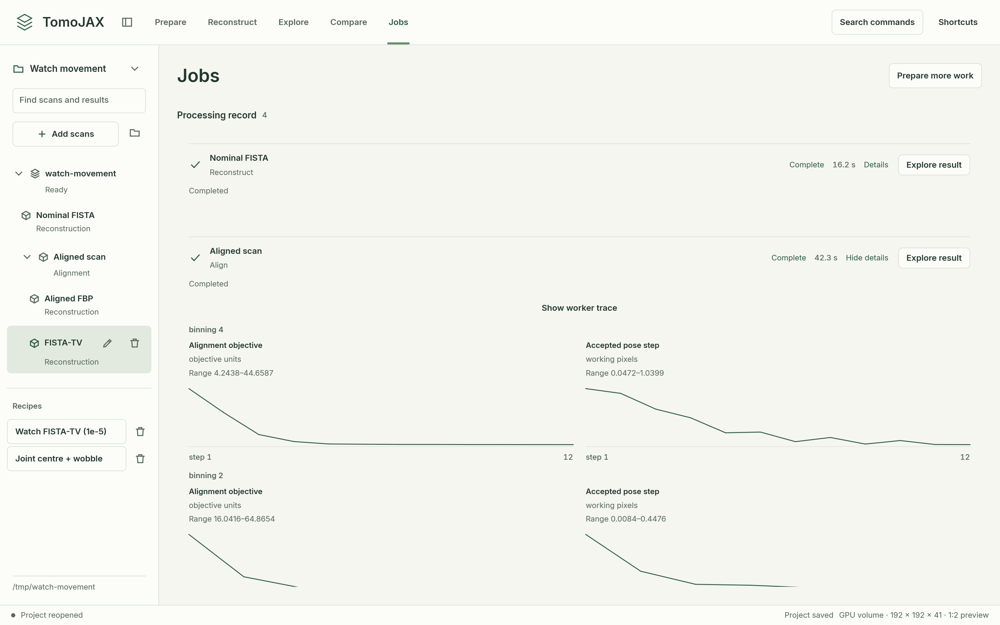

# TomoJAX Studio

TomoJAX Studio is a native desktop workspace for tomography projects. Keep raw acquisitions, derived volumes, saved recipes, and job records in one project folder; run every correction, alignment, and reconstruction through TomoJAX's numerical engine (`tomojax serve`); and inspect linked slices, sinograms, and GPU volume renderings while jobs run.


## Install and run

TomoJAX Studio runs on Linux `x86_64` and `aarch64` (for example an NVIDIA DGX Spark) with a working Vulkan driver.

### Install a prebuilt wheel

Install `tomojax-studio` into the same environment as `tomojax` (use `cuda12` on an NVIDIA GPU, or `cpu` for CPU execution; `--prerelease=allow`, or `--pre` with `pip`, is needed while `1.0.0` is in release candidate):

```sh
uv venv --python 3.12
uv pip install --python .venv/bin/python --prerelease=allow "tomojax[cuda12]" tomojax-studio
.venv/bin/tomojax studio
```

The `tomojax-studio` wheels (`manylinux_2_28_x86_64` and `manylinux_2_28_aarch64`) bundle HDF5 statically, so they require no Rust toolchain or system `libhdf5` package. Prebuilt wheels and standalone tarballs are also attached to each GitHub Release.

### Build from source

To build Studio from a source checkout, install Rust **1.99.1**, a C compiler, and the native build packages (`libhdf5-dev`, `libfontconfig1-dev`, `libxkbcommon-dev`, `pkg-config` on Debian/Ubuntu; or omit `libhdf5-dev` and build with `--features static-hdf5` when `cmake` is available):

```sh
uv sync --locked --extra cuda12 --dev
uv run --no-sync tomojax studio --build
```

The launcher forwards the active Python interpreter to Studio and checks source builds, the active environment's `bin/`, and `PATH`. Subsequent launches reuse the compiled or installed binary:

```sh
tomojax studio                        # open the start screen
tomojax studio /path/to/project       # reopen a saved project
tomojax studio /path/to/scan.nxs      # launch with an acquisition ready to import
tomojax studio --demo                 # create a demo project and simulate a scan in it
```

## Workspaces at a glance

Five top-bar workspaces cover the full tomography loop, while the left sidebar keeps the project tree and saved recipes in view:

| Workspace | Purpose |
| --- | --- |
| **Prepare** | Import acquisitions, calibrate raw frames, run corrections, crop/bin/select views, align geometry, and preview slices or centre sweeps |
| **Reconstruct** | Configure analytical, iterative, or slab reconstructions with live parameter validation and memory plans, then queue jobs |
| **Explore** | Inspect 3D GPU volume renders and linked axial, coronal, sagittal, projection, and sinogram views; take physical distance and ROI measurements; export volumes |
| **Compare** | Compare two reconstructions side by side, with a draggable split curtain, or as a difference map on a shared display window |
| **Jobs** | Follow active progress, live solver checkpoints, per-view pose tables, convergence plots, and the full processing record |

## Start a project and import data

Choose **Create a project**, name its folder, and add acquisitions in **Prepare** using **Add scans**, **Add a scan folder**, or drag-and-drop. Drop multiple files or choose a directory containing several NXtomo files to import a batch.

- **Referenced vs managed copies:** by default, Studio references files in place. Enable **Copy sources into the project** before importing to stage managed copies under `inputs/` while leaving originals untouched. For header-driven formats such as Nikon `.xtekct` or SkyScan `.log`, copying brings along the whole acquisition folder. Reference HDF5 files that use external links, virtual datasets, or external raw storage in place.
- **Supported formats:** NXtomo/HDF5, Data Exchange, ESRF Bliss/EDF/PyHST, Nikon `.xtekct`, Zeiss `.txrm`, SkyScan logs, PSI cSAXS `.mat`, TIFF stacks, and numeric `.npy` arrays. Convert `.npz` archives to NXtomo with `tomojax correct scan.npz -o scan.nxs` before importing.
- **Native preview and full inspection:** standard NXtomo/HDF5 metadata and initial views load directly in Studio's native I/O threads without waiting for the worker. Click **Inspect dataset** to run TomoJAX's full inspection report, including projection statistics across the stack.
- **Calibration:** use **Open & calibrate** when an acquisition needs explicit loader settings (raw-frame kind, flats, darks, angles, pixel pitch, or declared geometry). The form is generated from the worker's parameter schema and reports any missing fields before queuing.

To try Studio without scan files on disk, choose **Try a demo project** on the start screen or launch with `tomojax studio --demo`. Studio creates a new project under its data folder (`~/.local/share/tomojax/Demo projects` on Linux) and simulates a phantom scan with its ground truth; reconstruct it in **Reconstruct**. In any project, **Simulation** in **Prepare** does the same, and **Per-view shift (SD)** adds random per-view motion to try **Alignment** on.

## Prepare, preview, and reconstruct

**Prepare** and **Reconstruct** expose the full public TomoJAX operation set: calibration (`Open & calibrate`), flat/dark and artefact corrections, joint alignment, simulation, view selection, detector cropping and binning, pose tables, multi-orbit scan combination, analytical and iterative reconstruction, slab reconstruction, forward projection, and backprojection.

### Live interactive previews

Four interactive previews update automatically as you adjust settings, without adding jobs to the project history:

- **Slice preview:** reconstructs a single plane at its physical orientation.
- **Centre sweep:** evaluates one offset with the centre slider, or an ordered list of signed detector offsets in pixels in **Centres**, so you can step through candidates and pick the sharpest rotation centre.
- **Correction preview:** switches between **Before correction** and **After correction** sinograms on a row band, keeping native count and corrected line-integral registrations separate.
- **Estimate support:** runs TomoJAX's calibrated laminography region estimator and displays its three orthogonal overlays and physical bounds.

Changing a control supersedes any in-flight preview request while keeping the last image on screen until the new one arrives. Use **Stop** to cancel a preview, **Update preview** to rerun it, or **Keep result** to promote a preview into a durable project asset with its parameters and provenance.

### Validation, plans, recipes, and batch queuing

- **Guided controls and advanced settings:** common correction options (zingers, stripes, rings, Paganin phase retrieval) have dedicated fields; ordered multi-step corrections, solver `*Config` options, and nested settings are available in the advanced fields and JSON editor using the worker schema's field names.
- **Live validation and plans:** edits validate automatically against the worker and highlight exact parameter paths on error (**Review** focuses the failing field). Reconstruction and alignment forms also request the worker's execution plan—showing the resolved method, reasons, grid, device placement, and memory estimate—before you submit.
- **Recipes and batches:** save any configured operation as a named recipe in the sidebar to reuse across scans; applying a recipe populates the form for review before queuing. Select multiple scans in the project tree to queue the same operation across all of them, or choose **Combine scans** to merge selected cone-beam orbits in project order.
- **Immutable job capture:** submitting a job snapshots its parameters and input paths. Continuing to edit forms, apply recipes, or relink assets leaves queued and running work unchanged.

The worker executes one GPU job at a time. You can reorder waiting jobs, browse volumes, or prepare the next batch while a job runs. Interactive previews share the same worker, so when a durable job is running or paused the preview footer links directly to that job's controls.

## Explore, measure, and compare

**Explore** pairs a main viewport (**3D** volume render or **Slice** view) with a linked thumbnail strip showing **Axial**, **Coronal**, **Sagittal**, **Projection**, and **Sinogram** views whenever those arrays are present.


| Interaction | Action |
| --- | --- |
| Drag in **3D** mode | Orbit the volume camera |
| Scroll wheel over a slice | Step through slices |
| Scroll wheel in **3D**, or primary-modifier + wheel on a slice | Zoom |
| Middle-button drag over a slice | Pan |
| Click or drag in **Navigate** mode | Move linked crosshairs across all orthogonal views |
| Double-click or **Fit image** | Reset zoom and pan |
| **Distance**, then drag on a slice | Measure physical distance between sample centres |
| **Region**, then drag a box on a slice | Compute mean, standard deviation, and range of finite samples |

- **Display controls:** adjust the greyscale window (**Apply window** commits typed bounds; **Auto** resets from the image), choose a colour map (**Gray**, **Bone**, **Viridis**, **Magma**), or invert display contrast. Display settings change rendering on the GPU without altering stored float values.
- **3D volume rendering:** tune **Opacity threshold**, **Density**, **Lighting**, and **X / Y / Z extent** clipping planes. Studio loads slices progressively up to 1,024 samples per edge and renders interactive 3D previews at up to 192³ voxels while keeping full-resolution floating-point arrays on disk for measurements and exports.
- **Measurements:** saved distance and ROI measurements stay tied to their asset, slice index, and physical coordinate frame, and reappear whenever you return to that slice.

### Compare results

Open **Compare** and pick a **Left** and **Right** result in the inspector (or select two results in the project tree and choose **Compare selection**). Pick **Axial**, **Coronal**, or **Sagittal**, then switch between three modes:

| Mode | Shows |
| --- | --- |
| **Side by side** | Both results locked to the same slice, zoom, and pan |
| **Split** | Left result on one side of a draggable curtain, right result on the other |
| **Difference** | Left minus right on a greyscale window symmetric around zero |

**Split** and **Difference** compare results on matching grids. Enable **Share display window** to lock both sides to one intensity range, or disable it to scale each side independently.


## Follow jobs and convergence

**Jobs** displays running, queued, and completed work with nested task progress, active-time ETAs, and live checkpoint previews (orthogonal slices for iterative reconstruction and alignment, plus per-view pose tables for alignment). **Activity** in the top bar opens a compact drawer of active jobs from any workspace.

Expand **Details** on any job to inspect its convergence plots (such as alignment objective and accepted pose step across pyramid levels), captured parameters, recorded warnings, and **Show worker trace** for internal worker stages. Pause, resume, and cancel controls act cooperatively at the worker's next checkpoint.



## Project layout, recovery, and export

Each Studio project is a self-contained directory:

```text
project.tomojax.json   # assets, recipes, job records, provenance, and workspace state
inputs/                # managed source copies (when copying is enabled)
derived/               # saved NXtomo reconstructions, alignments, and kept previews
cache/                 # local viewer cache
```

- **Autosave and locking:** workspace state—active asset, slice indices, display window, 3D camera, clipping, comparison pair, measurements, and parameter drafts—saves atomically in the background. An OS file lock ensures only one Studio window writes to a project at a time. The manifest holds up to 32 MiB; if a write fails, the previous manifest stays intact and the status bar reports the error.
- **Managing assets:** rename results inline in the project tree, or remove unused entries from the project (files on disk remain untouched). Assets referenced by a queued or running job stay protected until that job completes or is cancelled.
- **Session recovery:** derived results are committed to `derived/` through the worker before a job is marked complete. If a session closes while a job is running, reopening marks it **Interrupted** so you can inspect any partial destination and retry explicitly.
- **Export:** export derived results from **Explore** as NXtomo (`.nxs`, preserving geometry and included scan), 32-bit float or scaled 16-bit TIFF slice stacks, or NPY bundles with `arrays.json` registration metadata for array-only previews.

## Shortcuts, preferences, and environment variables

Press **Ctrl+K** or click **Search commands** to run any command or open any operation, such as **Alignment**, from the keyboard. Open **Shortcuts** and click **Record** to rebind keys (conflicts and reserved keys are flagged immediately). View undo/redo steps through display and navigation changes without affecting queued or completed jobs.

| Environment variable | Purpose |
| --- | --- |
| `TOMOJAX_STUDIO_PYTHON` | Python interpreter for `tomojax serve` when launching the binary directly (`tomojax studio` sets this automatically) |
| `TOMOJAX_STUDIO_SETTINGS` | Override the preferences file path (recent projects and custom shortcuts) for isolated runs |
| `TOMOJAX_STUDIO_INPUT` | Project directory or acquisition path opened on startup |

## Verification

From the repository root:

```sh
export RUSTUP_TOOLCHAIN=1.99.1
cargo fmt --manifest-path studio/Cargo.toml --check
cargo test --release --locked --manifest-path studio/Cargo.toml
TOMOJAX_TEST_PYTHON="$PWD/.venv/bin/python" cargo test --release --locked --manifest-path studio/Cargo.toml -- --ignored
```

The `--ignored` suite exercises the live Python worker (preview supersession, validation, plans, checkpoints, and durable saves) and checks GPU rendering pixels and opacity against analytic expectations.

Studio also supports headless offscreen rendering through the same scientific compositor:

```sh
TOMOJAX_STUDIO_INPUT=/path/to/project studio/target/release/tomojax-studio \
  --snap /tmp/studio.png --size 1440x900 --scale 2 --at 1.0
```

See [DESIGN.md](DESIGN.md) for the visual system and [ARCHITECTURE.md](ARCHITECTURE.md) for ownership and persistence boundaries.
