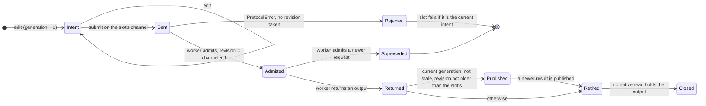
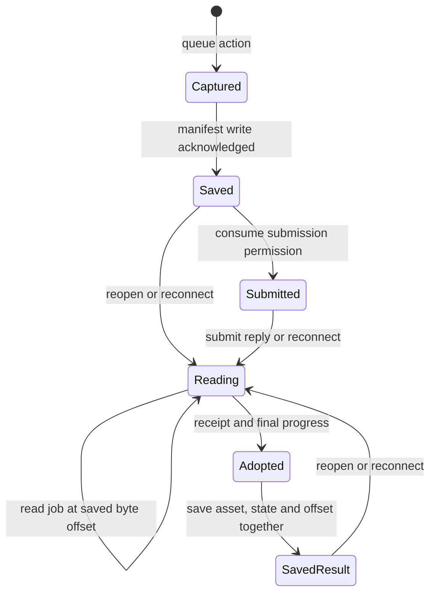
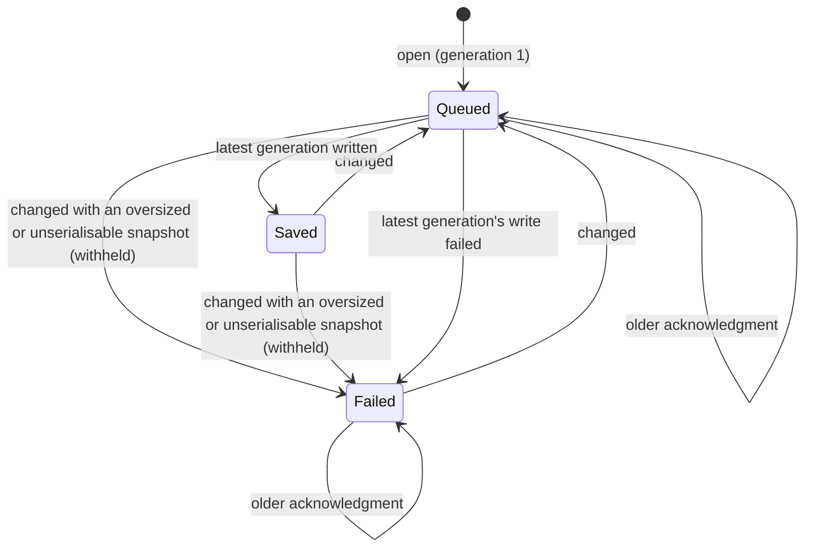

# Studio state charts

Studio talks to `tomojax-worker serve` to submit jobs, receive previews and control work.
The [protocol models](crates/studio-core/tests/protocol_model.rs) explore bounded
interleavings of submissions, replies, disconnects, restarts and saves. Mutation tests
check that the models catch specific failures such as a second submission or a missing asset.

```sh
cargo test --manifest-path studio/Cargo.toml -p studio-core --test protocol_model -- --nocapture
```

`--nocapture` prints how many states each model visited and the shortest
counterexample each bug produces.

## Preview channels

Sources: `engine.rs` (`Requests::observe`), `previews.rs`,
`previews/responses.rs` (`consume`) and the worker's `admit` in
`cli/_session.py`.

A request is stale only after the worker has admitted a newer revision on its
channel. Studio records revisions it has observed, never ones it predicted.
Separately, each slider edit starts a new intent generation, so a result that
was already in the pipe when the user moved the slider is never published.



Bounds: four edits and four submitted requests. The worker can admit or
reject each request. A native reader can hold the published output at any time.

| Property | Guarantee |
| --- | --- |
| stale only after a newer admission | A rejected replacement never makes an admitted request stale |
| published preview matches the latest intent | A terminal already in the pipe before an edit is never shown |
| published revisions never go backwards | The display never returns to an older admission |
| no output closed during a native read | Superseded results retire after their reads finish |
| each output closed once | Retirement is deduplicated |
| every reply correlates with a pending request | Stale terminals still resolve request bookkeeping |
| at rest every request and superseded output is resolved | Nothing is pending and only the published output stays open |
| at rest the latest finished intent is published | No valid result is discarded |

## Job submission and recovery

Studio captures the inputs, settings, projection roles and script when the user queues a job.
The action grants one submission in the current session. Studio waits for the manifest save
before sending the script to the worker. Losing the connection discards this permission.



The worker holds the queue and the job directory. Studio lists jobs on connection and reads
each recorded directory, including completed jobs. A poll supplies the scheduler state,
progress since the saved offset, and the latest preview generation. A new attempt starts a
new task tree. A result asset takes its ID from the job. Re-reading the same receipt keeps
one asset even if Studio stopped during adoption.

An inline job holds the session executor until it finishes, including while paused.
Cancel and Abandon name the job directory. An unknown scheduler state stays visible until
the worker locates the job or the user abandons it. Resuming an interrupted or cancelled
solve reads the current checkpoint, then starts a new job whose solver line uses that path. Studio keeps checking interrupted detached jobs because a receipt can become visible after the scheduler reports the exit. Its original record stays in Activity.

The bounded model interleaves capture, manifest writes, submission, launch, worker
completion, polling, adoption, disconnection and restart. Separate mutations replay a
submission and split a result from its saved offset to check both failure paths.

## Solver preview generations

A job poll names one immutable preview directory. Studio reads its planes, coordinates and
pose table into native buffers and swaps the displayed frame only after the whole read
succeeds. A newer generation supersedes an outstanding read. If the worker has already
removed an older directory, the previous complete frame stays on screen until another is
ready. The runner owns release of the executor's preview files.

## Manifest save generations

Source: `project.rs` (`changed`, the writer thread, `poll`, `flush`).

Each change takes a new generation and hands its snapshot to a coalescing
writer, which acknowledges the generation it wrote. Only an acknowledgment for
the latest generation sets or clears the save error. An older success can still
advance the saved generation.



`flush` waits in `Queued` until the latest generation's acknowledgment
arrives. It returns `Ok` in `Saved` and the error in `Failed`.

Bounds: five generations. Each change may be oversized, each write may fail,
and `poll` or `flush` can run at any point.

| Property | Guarantee |
| --- | --- |
| clean means the latest generation is on disk | An older acknowledgment never clears newer dirty state |
| a known failure of the latest generation stays visible | An older success never clears a newer save error |
| flush succeeds only when the latest generation is on disk | Flush does not report unsaved work as saved |
| flush fails only on the latest generation's error | An older failure does not fail a newer save |
| flush always has an acknowledgment to wait for | Flush cannot hang |
