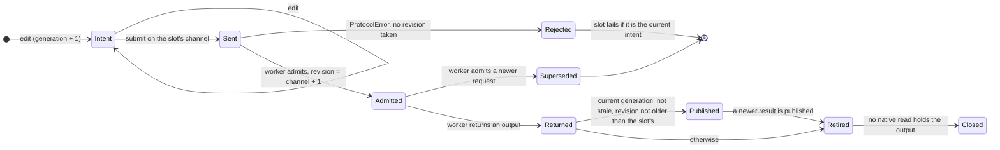
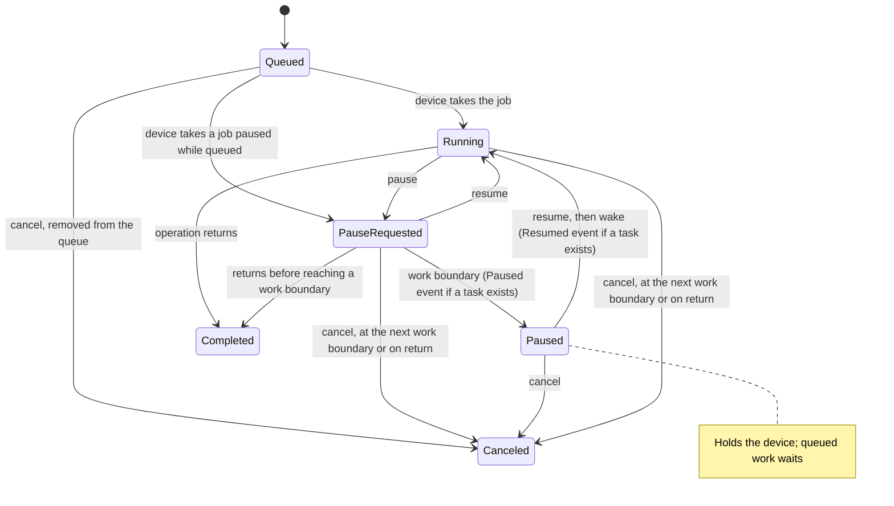
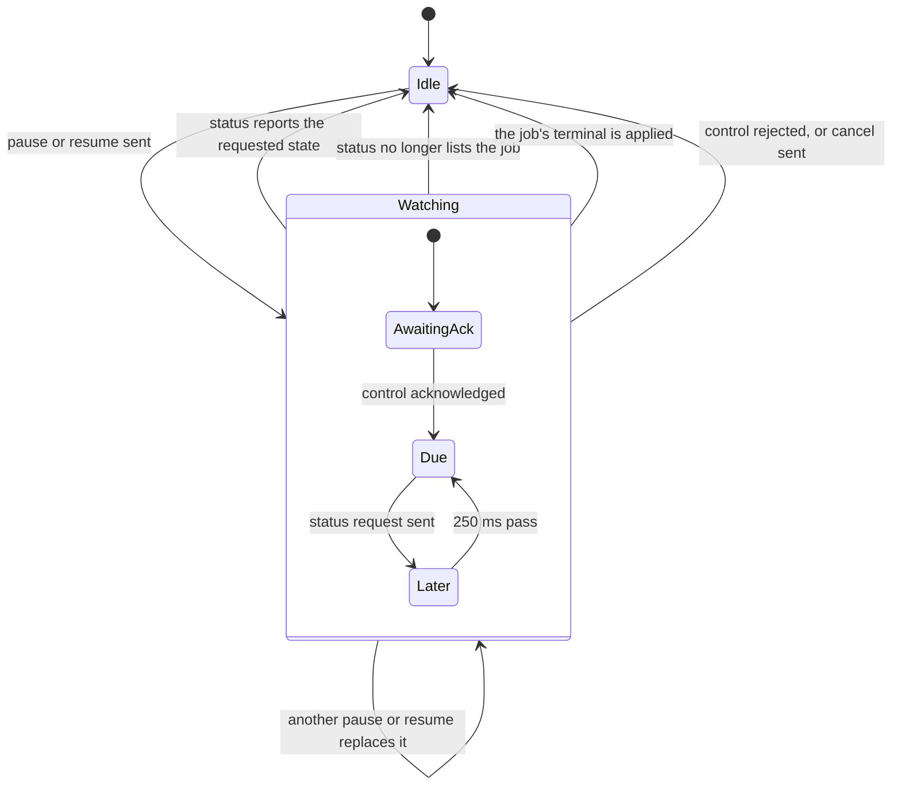
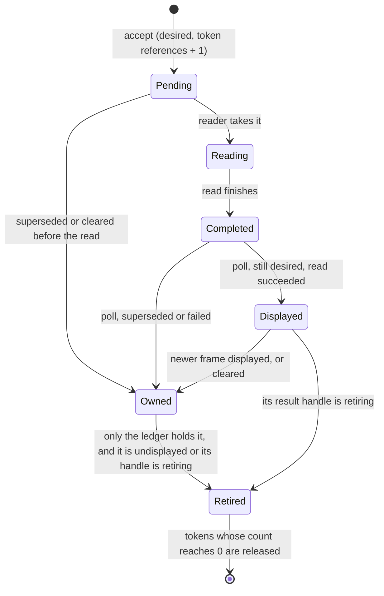
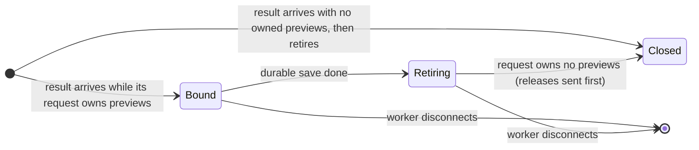
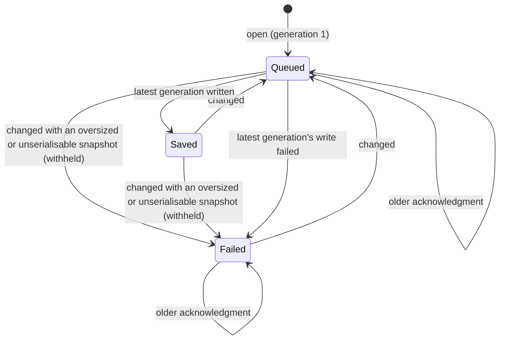

# Studio state charts

These charts show how Studio and `tomojax serve` exchange requests, controls,
artifact leases and saves. Each one matches a model in
[`crates/studio-core/tests/protocol_model.rs`](crates/studio-core/tests/protocol_model.rs). The test explores every
interleaving of Studio, the worker, the pipes between them and Studio's reader
threads, and checks the listed properties in every reachable state. Every
property also has a test that reintroduces a plausible bug and checks that the
model finds it.

```sh
cargo test --manifest-path studio/Cargo.toml -p studio-core --test protocol_model -- --nocapture
```

`--nocapture` prints how many states each model visited and the shortest
counterexample each bug produces.

## Preview channels

Sources: `engine.rs` (`Requests::observe`), `previews.rs`,
`previews/responses.rs` (`consume`) and the worker's `admit` in
`cli/_session.py`.

A request is stale only after the worker has admitted a newer revision on its
channel. Studio records revisions it has observed, never ones it predicted.
Separately, each slider edit starts a new intent generation, so a result that
was already in the pipe when the user moved the slider is never published.



Bounds: four edits and four submitted requests. The worker can admit or
reject each request. A native reader can hold the published output at any time.

| Property | Guarantee |
| --- | --- |
| stale only after a newer admission | A rejected replacement never makes an admitted request stale |
| published preview matches the latest intent | A terminal already in the pipe before an edit is never shown |
| published revisions never go backwards | The display never returns to an older admission |
| no output closed during a native read | Superseded results retire after their reads finish |
| each output closed once | Retirement is deduplicated |
| every reply correlates with a pending request | Stale terminals still resolve request bookkeeping |
| at rest every request and superseded output is resolved | Nothing is pending and only the published output stays open |
| at rest the latest finished intent is published | No valid result is discarded |

## Job control

Sources: `app/controls.rs` (`control_job`, `poll_control`, `control_result`),
`app/jobs.rs` (`schedule`, `progress`) and `progress.Control` on the worker.

The worker's job runs alone on the device. Pausing it keeps the device, so the
next job and any preview wait behind it until it completes or is canceled.



Studio watches a pause or resume until the worker reports the requested state.
A control acknowledgment only confirms that the worker received the request.
The job record changes only on a progress event, a status report or the
terminal.



Bounds: three control clicks, one preview and one queued durable job. A pause
can happen before the first numerical task exists, when the worker emits no
event.

| Property | Guarantee |
| --- | --- |
| paused is shown only on worker evidence | An acknowledgment is not a pause |
| job outcome comes from its terminal | An acknowledgment is not a terminal |
| an unfinished job stays controllable | Resume and cancel still reach a paused job |
| a paused job keeps the device until its terminal | The scheduler does not admit the next job behind a pause |
| no status poll after the terminal | The terminal retires the control watch |
| at rest a finished job has no control watch | Polling stops |

## Preview read leases

Sources: `live.rs`, with the per-frame order of `AppState::poll` (preview
releases first, then handle closes).

A preview's `Arc` is its read lease. The reader inbox, an active read and an
unconsumed completion each hold a copy. A token is released when the last
preview referencing it retires. A result handle closes only after its
request owns no previews, because closing it deletes every artifact the
request published.





A disconnect clears the owners, token references and handles before the
replacement worker starts, because it reuses token names. A read still running
for the old session keeps its private `Arc`. Generations are never reused, so
that read's completion is stale when it arrives.

Bounds: three previews per job (each with a scalar token and a shared
coordinate token), one result handle and one worker restart.

| Property | Guarantee |
| --- | --- |
| no token released under a reader | Supersession and clearing wait for reads |
| no handle closed under a reader | Handle closes wait for reads |
| each token released once | Releases are deduplicated |
| each handle closed once | Handle closes are deduplicated |
| old-session tokens never reach the new worker | The ledger is cleared before token names are reused |
| the frame comes from the live session | An old-session read cannot be displayed |
| at rest an undisplayed ledger is empty | Nothing leaks |

## Manifest save generations

Source: `project.rs` (`changed`, the writer thread, `poll`, `flush`).

Each change takes a new generation and hands its snapshot to a coalescing
writer, which acknowledges the generation it wrote. Only an acknowledgment for
the latest generation sets or clears the save error. An older success can still
advance the saved generation.



`flush` waits in `Queued` until the latest generation's acknowledgment
arrives. It returns `Ok` in `Saved` and the error in `Failed`.

Bounds: five generations. Each change may be oversized, each write may fail,
and `poll` or `flush` can run at any point.

| Property | Guarantee |
| --- | --- |
| clean means the latest generation is on disk | An older acknowledgment never clears newer dirty state |
| a known failure of the latest generation stays visible | An older success never clears a newer save error |
| flush succeeds only when the latest generation is on disk | Flush does not report unsaved work as saved |
| flush fails only on the latest generation's error | An older failure does not fail a newer save |
| flush always has an acknowledgment to wait for | Flush cannot hang |
